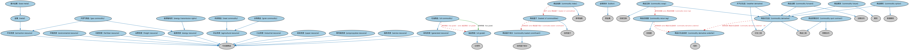

# 大宗商品合约本体（Commodities Contracts Ontology）结构与公理说明

本文档对应 `CommoditiesContracts.rdf` / `CommoditiesContracts.ttl`，说明该本体的类、继承关系、属性和公理约定。结构图见 `CommoditiesContracts-structure.png`（`CommoditiesContracts-structure.svg` 为可缩放版本）。

## 1. 本体概述

定义以大宗商品（能源、金属、农产品等）为标的的衍生品合约。

**在体系中的位置**：衍生品合约模块中按标的资产特化的本体之一。

**上下游关系**：上游继承衍生品基础、期货与远期本体；下游服务商品市场的套保与交易建模。

**与相近概念的差别**：与金融标的衍生品的差别——商品合约常涉及实物交割、仓储与品质规格，这是金融合约没有的问题。

本本体中类与类的核心关系如下（完整细节见各类小节）：

- **农业资源（agricultural resource）** 继承 **可流通商品（NegotiableCommodity）**
- **基本金属（base metal）** 继承 **金属（metal）**
- **商品篮子（basket of commodities）** 继承 **加权篮子（WeightedBasket）**
- **金银条块（bullion）** 继承 **贵金属（PreciousMetal）**
- **商品篮子成分（commodity basket constituent）** 继承 **加权篮子成分（WeightedBasketConstituent）**
- **商品衍生品（commodity derivative）** 继承 **商品工具（CommodityInstrument）**
- **商品衍生品（commodity derivative）** 继承 **衍生工具（DerivativeInstrument）**
- **商品衍生品标的（commodity derivative underlier）** 继承 **标的（Underlier）**
- **商品远期（commodity forward）** 继承 **商品衍生品（commodity derivative）**
- **商品远期（commodity forward）** 继承 **远期合约（Forward）**
- **商品期货（commodity future）** 继承 **商品衍生品（commodity derivative）**
- **商品期货（commodity future）** 继承 **期货（Future）**
- 其余 29 条关系从略。

## 2. 类（Class）

| 类（Class） | 定义（Definition） |
|---|---|
| 农业资源（agricultural resource） | 通过农业过程获得的可转让商品，包括林业、渔业、畜牧、谷物、乳制品、玉米、可可、大豆、糖等。 negotiable commodity that is obtained via some agricultural process, including forestry, fishing, livestock, grain, dairy, corn, cocoa, soybeans, sugar, coffee |
| 基本金属（base metal） | 暴露于空气或湿气中时相对较快失去光泽、氧化或腐蚀、并广泛用于商业和工业的普通金属。 common metal that tarnishes, oxidizes, or corrodes relatively quickly when exposed to air or moisture, that is widely used in commercial and industrial applications, such as construction and manufacturing |
| 商品篮子（basket of commodities） | 成分由一种或多种可转让商品组成的定制篮子。 custom basket whose constituents consist of one or more negotiable commodities |
| 金银条块（bullion） | 经官方认定纯度至少达 99.5% 的实物贵金属。 physical precious metal that is officially recognized as being at least 99.5 percent pure |
| 商品篮子成分（commodity basket constituent） | 定制商品篮子的组成部分，其相对于其他篮子成分的重要性为已知。 component of a custom commodity basket whose relative importance with respect to other basket constituents is known |
| 商品衍生品（commodity derivative） | 主要标的为实物商品、商品价格、相关指数或与实物商品相关之任何其他方面的衍生工具。 derivative instrument whose primary underlying item is a physical commodity, or the price, or related index, or any other aspect related to a physical commodity |
| 商品衍生品标的（commodity derivative underlier） | 商品衍生品的标的，包括但不限于可转让商品本身。 underlier of a commodity derivative, including, but not limited to, the negotiable commodity itself |
| 商品远期（commodity forward） | 买方和卖方约定在未来指定日期交付指定质量和数量货物的远期合约。 forward contract in which a buyer and seller agree upon delivery of a specified quality and quantity of goods at a specified future date |
| 商品期货（commodity future） | 在未来特定日期按特定价格买入或卖出预定数量商品的期货合约。 futures contract to buy or sell a predetermined amount of a commodity at a specific price on a specific date in the future |
| 商品指数（commodity index） | 追踪一篮子商品以衡量其价格和投资回报表现的投资工具。 investment vehicle that tracks a basket of commodities to measure their price and investment return performance |
| 商品期权（commodity option） | 期权买方有权在到期日或之前按固定价格或公式买入或卖出指定商品或商品相关指数的期权。 option where the option buyer has the right to buy or sell specified commodities or commodity related index at a fixed price or formula, on or before a specified date |
| 商品回报腿（commodity return leg） | 商品回报互换中回报基于实物商品、商品价格、价格行为或与商品相关之任何其他方面的一腿。 leg of a commodity return swap in which the return is based on a physical commodity, or the price, or behavior of the price, or any other aspect related to a physical commodity |
| 商品即期合约（commodity spot contract） | 结算时涉及商品资产实物交割的合约。 contract that involves physical delivery of the commodity asset at settlement |
| 商品互换（commodity swap） | 一种商品衍生品：包括但不限于任何主要名义标的为实物商品或商品价格的互换。 commodity derivative that includes, without limitation, any swap for which the primary underlying notional item is a physical commodity, or the price, or behavior of the price, or the level of a commodity index, or other aspect related to a physical commodity |
| 能源资源（energy resource） | 属于能源相关产品或其衍生品的可转让商品，包括电力、可再生能源等。 negotiable commodity that is an energy-related product, or a derivative of an energy-related product, including electricity, renewable energy, or any power/energy delivered through a utility network of provider; diesel fuel, fuel oil, gas oil, gasoline, heating oil, jet fuel, kerosene, natural gas, oil (Brent, Tapis, Dubai, WTI) |
| 能源输电权（energy transmission rights） | 在配电网络中输送电力的权利。 rights to the transmission of power across an electricity distribution network |
| 环境资源（environmental resource） | 包括抵消信用额在内的可转让商品。 negotiable commodity including offset credits |
| 开采资源（extraction resource） | 通过从自然环境中开采获得的矿产资源类可转让商品。 negotiable commodity that is a mineral resource obtained via withdrawal from the natural environment |
| 化肥资源（fertilizer resource） | 包括氨、磷酸二铵（DAP）、钾肥、硫磺、尿素、尿素硝酸铵（UAN）在内的可转让商品。 negotiable commodity that includes ammonia, diammonium phosphate (DAP), potash, sulphur, urea, urea and ammonium nitrate (UAN) |
| 运费资源（freight resource） | 属于运费指数航线的可转让商品。 negotiable commodity that is a freight index route |
| 天然气商品（gas commodity） | 属于天然气的开采资源。 extraction resource that is natural gas |
| 发电资源（generated resource） | 通过某种生产过程获得的可转让商品，包括电力、可再生能源或任何通过公用事业网络输送的电力/能源。 negotiable commodity obtained via some generation process, including electricity, renewable energy, or any power/energy delivered through a utility network or provider |
| 谷物商品（grain commodity） | 属于食用植物（尤其是禾谷类植物）细小坚硬种子的农业资源，如小麦、玉米、黑麦、燕麦、大米和小米。 agricultural resource that is a small, hard seed, of a food plant, especially of a cereal plant, such as wheat, corn, rye, oats, rice, and millet |
| 工业资源（industrial resource） | 通过工业过程（包括建筑和制造）获得的可转让商品。 negotiable commodity that is obtained via some industrial process, including construction and manufacturing |
| 肉类商品（meat commodity） | 源自动物（尤其是哺乳动物）肉体的农业资源，如猪腩肉。 agricultural resource derived from the flesh of an animal (especially a mammal), such as pork bellies |
| 金属（metal） | 新鲜制备、抛光或断裂时呈现光泽外观、且导电导热性能较好的材料。 material that, when freshly prepared, polished, or fractured, shows a lustrous appearance, and conducts electricity and heat relatively well |
| 石油商品（oil commodity） | 从石油提炼的粘稠液体类发电资源，用于燃料、润滑剂及多种产品的制造。 generated resource that is a viscous liquid derived from petroleum, including for use as fuel, or as a lubricant, and the manufacture of many types of paints, plastics, and other materials |
| 油品等级（oil grade） | 衡量石油在使用过程中粘度的指标。 measure of the viscosity of oil during operation |
| 纸类资源（paper resource） | 属于纸制品的可转让商品，包括箱板纸、新闻纸、纸浆、回收纸等。 negotiable commodity that is a paper product, including containerboard, newsprint, pulp, recovered paper |
| 聚丙烯资源（polypropylene resource） | 包括塑料在内的可转让商品。 negotiable commodity including plastics |
| 服务资源（service resource） | 涉及运输、通信和贸易等服务的可转让商品。 negotiable commodity involving services such as transportation, communications, and trade |
| 天气衍生品（weather derivative） | 主要名义标的基于天气相关事物（例如某地平均温度）的衍生工具。 derivative instrument whose primary underlying notional item is based on something related to the weather, for example, the average temperature in Chicago in January |

以下按类逐个展开：每个类给出继承关系、相关属性与公理约定；子类在父类之下降一级编号。

### 2.1 农业资源（agricultural resource）

定义：通过农业过程获得的可转让商品，包括林业、渔业、畜牧、谷物、乳制品、玉米、可可、大豆、糖等。

- 父类：**可流通商品（NegotiableCommodity）**
- 直接子类：**谷物商品（grain commodity）**、**肉类商品（meat commodity）**

#### 2.1.1 谷物商品（grain commodity）

定义：属于食用植物（尤其是禾谷类植物）细小坚硬种子的农业资源，如小麦、玉米、黑麦、燕麦、大米和小米。

- 父类：**农业资源（agricultural resource）**

#### 2.1.2 肉类商品（meat commodity）

定义：源自动物（尤其是哺乳动物）肉体的农业资源，如猪腩肉。

- 父类：**农业资源（agricultural resource）**

### 2.2 商品篮子（basket of commodities）

定义：成分由一种或多种可转让商品组成的定制篮子。

- 父类：**加权篮子（WeightedBasket）**

属性：

| 属性 | 定义 | 说明 |
|---|---|---|
| **具有成员（hasMember）** | — | — |

公理：

- **具有成员（hasMember）**至少有一个取值，类型是**商品篮子成分（commodity basket constituent）**。

### 2.3 金银条块（bullion）

定义：经官方认定纯度至少达 99.5% 的实物贵金属。

- 父类：**贵金属（PreciousMetal）**

### 2.4 商品篮子成分（commodity basket constituent）

定义：定制商品篮子的组成部分，其相对于其他篮子成分的重要性为已知。

- 父类：**加权篮子成分（WeightedBasketConstituent）**

属性：

| 属性 | 定义 | 说明 |
|---|---|---|
| **具有某日商品价值（has commodity value as of date）** | 指明某一商品在指定日期的单位价值。 indicates the per unit value of a given commodity as of some specified date | 值域：货币数量；子属性：具有货币数量 |
| **具有截止日（hasAsOfDate）** | — | — |
| **涉及（involves）** | — | — |
| **具有量值（hasQuantityValue）** | — | — |

公理：

- **具有截止日（hasAsOfDate）**可以有 0 个或多个**显式日期（ExplicitDate）**。
- **具有某日商品价值（has commodity value as of date）**可以有 0 个或多个**货币数量（MonetaryAmount）**。
- **具有量值（hasQuantityValue）**可以有 0 个或多个**标量值（ScalarQuantityValue）**。
- **涉及（involves）**可以有 0 个或多个**商品（Commodity）**。

### 2.5 商品衍生品（commodity derivative）

定义：主要标的为实物商品、商品价格、相关指数或与实物商品相关之任何其他方面的衍生工具。

- 父类：**商品工具（CommodityInstrument）**、**衍生工具（DerivativeInstrument）**
- 直接子类：**商品远期（commodity forward）**、**商品期货（commodity future）**、**商品期权（commodity option）**、**商品互换（commodity swap）**、**天气衍生品（weather derivative）**

属性：

| 属性 | 定义 | 说明 |
|---|---|---|
| **具有标的（hasUnderlier）** | — | — |

公理：

- **具有标的（hasUnderlier）**可以有 0 个或多个**商品衍生品标的（commodity derivative underlier）**。

#### 2.5.1 商品远期（commodity forward）

定义：买方和卖方约定在未来指定日期交付指定质量和数量货物的远期合约。

- 父类：**商品衍生品（commodity derivative）**、**远期合约（Forward）**

#### 2.5.2 商品期货（commodity future）

定义：在未来特定日期按特定价格买入或卖出预定数量商品的期货合约。

- 父类：**商品衍生品（commodity derivative）**、**期货（Future）**

公理：

- 与**金融期货（FinancialFuture）**互斥：同一个体不能同时属于两者。

#### 2.5.3 商品期权（commodity option）

定义：期权买方有权在到期日或之前按固定价格或公式买入或卖出指定商品或商品相关指数的期权。

- 父类：**商品衍生品（commodity derivative）**、**普通期权（VanillaOption）**

#### 2.5.4 商品互换（commodity swap）

定义：一种商品衍生品：包括但不限于任何主要名义标的为实物商品或商品价格的互换。

- 父类：**商品衍生品（commodity derivative）**、**回报互换（ReturnSwap）**

属性：

| 属性 | 定义 | 说明 |
|---|---|---|
| **具有回报腿（hasReturnLeg）** | — | — |

公理：

- **具有回报腿（hasReturnLeg）**至少有一个取值，类型是**商品回报腿（commodity return leg）**。

#### 2.5.5 天气衍生品（weather derivative）

定义：主要名义标的基于天气相关事物（例如某地平均温度）的衍生工具。

- 父类：**商品衍生品（commodity derivative）**、**衍生工具（DerivativeInstrument）**

### 2.6 商品衍生品标的（commodity derivative underlier）

定义：商品衍生品的标的，包括但不限于可转让商品本身。

- 父类：**标的（Underlier）**

属性：

| 属性 | 定义 | 说明 |
|---|---|---|
| **具有某日商品价值（has commodity value as of date）** | 指明某一商品在指定日期的单位价值。 indicates the per unit value of a given commodity as of some specified date | 值域：货币数量；子属性：具有货币数量 |
| **具有截止日（hasAsOfDate）** | — | — |
| **涉及（involves）** | — | — |
| **具有量值（hasQuantityValue）** | — | — |

公理：

- **具有截止日（hasAsOfDate）**可以有 0 个或多个**显式日期（ExplicitDate）**。
- **具有某日商品价值（has commodity value as of date）**可以有 0 个或多个**货币数量（MonetaryAmount）**。
- **具有量值（hasQuantityValue）**可以有 0 个或多个**标量值（ScalarQuantityValue）**。
- **涉及（involves）**可以有 0 个或多个**商品（Commodity）**。

### 2.7 商品指数（commodity index）

定义：追踪一篮子商品以衡量其价格和投资回报表现的投资工具。

- 父类：**参考指数（ReferenceIndex）**

属性：

| 属性 | 定义 | 说明 |
|---|---|---|
| **基于（isBasedOn）** | — | — |

公理：

- **基于（isBasedOn）**至少有一个取值，类型是**商品篮子（basket of commodities）**。

### 2.8 商品回报腿（commodity return leg）

定义：商品回报互换中回报基于实物商品、商品价格、价格行为或与商品相关之任何其他方面的一腿。

- 父类：**回报腿（ReturnLeg）**

属性：

| 属性 | 定义 | 说明 |
|---|---|---|
| **具有标的（hasUnderlier）** | — | — |

公理：

- **具有标的（hasUnderlier）**至少有一个取值，类型是**商品衍生品标的（commodity derivative underlier）**。

### 2.9 商品即期合约（commodity spot contract）

定义：结算时涉及商品资产实物交割的合约。

- 父类：**商品工具（CommodityInstrument）**、**即期合约（SpotContract）**

### 2.10 能源资源（energy resource）

定义：属于能源相关产品或其衍生品的可转让商品，包括电力、可再生能源等。

- 父类：**可流通商品（NegotiableCommodity）**
- 直接子类：**能源输电权（energy transmission rights）**、**天然气商品（gas commodity）**

#### 2.10.1 能源输电权（energy transmission rights）

定义：在配电网络中输送电力的权利。

- 父类：**能源资源（energy resource）**

#### 2.10.2 天然气商品（gas commodity）

定义：属于天然气的开采资源。

- 父类：**能源资源（energy resource）**、**开采资源（extraction resource）**

### 2.11 环境资源（environmental resource）

定义：包括抵消信用额在内的可转让商品。

- 父类：**可流通商品（NegotiableCommodity）**

### 2.12 开采资源（extraction resource）

定义：通过从自然环境中开采获得的矿产资源类可转让商品。

- 父类：**可流通商品（NegotiableCommodity）**
- 直接子类：**天然气商品（gas commodity）**、**金属（metal）**

#### 2.12.2 金属（metal）

定义：新鲜制备、抛光或断裂时呈现光泽外观、且导电导热性能较好的材料。

- 父类：**开采资源（extraction resource）**
- 直接子类：**基本金属（base metal）**

##### 2.12.2.1 基本金属（base metal）

定义：暴露于空气或湿气中时相对较快失去光泽、氧化或腐蚀、并广泛用于商业和工业的普通金属。

- 父类：**金属（metal）**

公理：

- 与**贵金属（PreciousMetal）**互斥：同一个体不能同时属于两者。

### 2.13 化肥资源（fertilizer resource）

定义：包括氨、磷酸二铵（DAP）、钾肥、硫磺、尿素、尿素硝酸铵（UAN）在内的可转让商品。

- 父类：**可流通商品（NegotiableCommodity）**

### 2.14 运费资源（freight resource）

定义：属于运费指数航线的可转让商品。

- 父类：**可流通商品（NegotiableCommodity）**

### 2.15 发电资源（generated resource）

定义：通过某种生产过程获得的可转让商品，包括电力、可再生能源或任何通过公用事业网络输送的电力/能源。

- 父类：**可流通商品（NegotiableCommodity）**
- 直接子类：**石油商品（oil commodity）**

#### 2.15.1 石油商品（oil commodity）

定义：从石油提炼的粘稠液体类发电资源，用于燃料、润滑剂及多种产品的制造。

- 父类：**发电资源（generated resource）**

属性：

| 属性 | 定义 | 说明 |
|---|---|---|
| **具有等级（has grade）** | 石油的等级，例如布伦特原油（Brent Crude）。 The grade of oil e.g. Brent Crude. | 值域：油品等级（oil grade） |

公理：

- **具有等级（has grade）**至少有一个取值，类型是**油品等级（oil grade）**。

### 2.16 工业资源（industrial resource）

定义：通过工业过程（包括建筑和制造）获得的可转让商品。

- 父类：**可流通商品（NegotiableCommodity）**

### 2.17 油品等级（oil grade）

定义：衡量石油在使用过程中粘度的指标。

- 父类：**分类符（Classifier）**

### 2.18 纸类资源（paper resource）

定义：属于纸制品的可转让商品，包括箱板纸、新闻纸、纸浆、回收纸等。

- 父类：**可流通商品（NegotiableCommodity）**

### 2.19 聚丙烯资源（polypropylene resource）

定义：包括塑料在内的可转让商品。

- 父类：**可流通商品（NegotiableCommodity）**

### 2.20 服务资源（service resource）

定义：涉及运输、通信和贸易等服务的可转让商品。

- 父类：**可流通商品（NegotiableCommodity）**

## 3. 依赖（owl:imports，19 个）

本本体通过 `owl:imports` 引入以下本体，各项的中文名称与简介如下：

| 导入本体 | 中文名称 | 简介 |
|---|---|---|
| `DER/DerivativesContracts/DerivativesBasics.rdf` | 衍生品基础本体（Derivatives Basics Ontology） | 定义衍生品合约（derivatives contract）的核心概念：标的资产、行权、到期等，是 DER 域的根基。 |
| `DER/DerivativesContracts/FuturesAndForwards.rdf` | 期货与远期本体（Futures and Forwards Ontology） | 定义期货（futures）与远期（forwards）合约：标准化与非标准化的远期交割安排。 |
| `DER/DerivativesContracts/Options.rdf` | 期权本体（Options Ontology） | 定义期权（option）：买方权利、行权价、到期日、看涨与看跌等核心结构。 |
| `DER/DerivativesContracts/Swaps.rdf` | 互换本体（Swaps Ontology） | 定义互换（swap）合约的通用结构：互换腿（swap leg）、现金流交换与名义本金。 |
| `FBC/DebtAndEquities/Debt.rdf` | 债务本体（Debt Ontology） | 定义债务（debt）与债权债务关系的核心概念：借款人、贷款人、本金与利息义务。 |
| `FBC/FinancialInstruments/FinancialInstruments.rdf` | 金融工具本体（Financial Instruments Ontology） | FIBO 核心本体之一，定义金融工具（financial instrument）的通用概念：可交易、代表某种权利义务的合同工具，是证券、衍生品等具体工具的共同基础。 |
| `FBC/ProductsAndServices/FinancialProductsAndServices.rdf` | 金融产品与服务本体（Financial Products and Services Ontology） | 定义金融产品（financial product）与金融服务（financial service）及其提供、购买关系。 |
| `FND/Accounting/CurrencyAmount.rdf` | 货币金额本体（Currency Amount Ontology） | 定义「金额＋币种」的货币金额（currency amount）表示，是 FIBO 中表达价格、债务金额、付款额等一切带币种数值的基础构件。 |
| `FND/Agreements/Contracts.rdf` | 合同本体（Contracts Ontology） | 在协议之上定义具有法律约束力的合同（contract）：合同当事方、合同条款、义务与权利，是金融工具与交易合同建模的基石。 |
| `FND/DatesAndTimes/FinancialDates.rdf` | 金融日期本体（Financial Dates Ontology） | 定义金融语境下的日期与期间概念：结算日、付息日、到期日、日计数基准等。 |
| `FND/ProductsAndServices/ProductsAndServices.rdf` | 产品与服务本体（Products and Services Ontology） | 定义产品、服务及其提供者与客户的通用关系。 |
| `FND/Relations/Relations.rdf` | 关系本体（Relations Ontology） | FIBO 最底层的基础本体，定义参考（reference）、分类（classify）等通用关系与抽象概念，全库普遍依赖。 |
| `FND/Utilities/AnnotationVocabulary.rdf` | FIBO 标注词汇表（FIBO Annotation Vocabulary） | 定义 FIBO 专用的标注属性（如释义来源、成熟度等级），用于本体自身的元数据标注。 |
| `IND/MarketIndices/BasketIndices.rdf` | 篮子指数本体（Basket Indices Ontology） | 定义以一篮子成分为基础的指数：成分、权重与计算方法。 |
| `https://www.omg.org/spec/Commons/AnnotationVocabulary/` | OMG 通用标注词汇表（OMG Commons Annotation Vocabulary） | OMG 通用本体库（Commons）中的标注词汇表，提供概念映射等标注属性，FIBO 用它标注术语与外部标准的对应关系。 |
| `https://www.omg.org/spec/Commons/Classifiers/` | OMG 通用分类器本体（OMG Commons Classifiers） | OMG 通用本体库（Commons）中的分类器本体，定义分类方案、类别与归类关系的通用概念，FIBO 的分类建模建立在其上。 |
| `https://www.omg.org/spec/Commons/Collections/` | OMG 通用集合本体（OMG Commons Collections） | Commons 库中的集合本体，定义集合、成员等通用概念。 |
| `https://www.omg.org/spec/Commons/DatesAndTimes/` | OMG 通用日期与时间本体（OMG Commons Dates and Times） | Commons 库中的日期时间本体，定义日期、期间、时间点等通用时间概念。 |
| `https://www.omg.org/spec/Commons/QuantitiesAndUnits/` | OMG 通用量与单位本体（OMG Commons Quantities and Units） | Commons 库中的量与单位本体，定义数量、度量单位、量纲的通用概念，支撑金额、比率等数值表达。 |

## 4. 文件

- 官方 RDF/XML：`CommoditiesContracts.rdf`
- 中文 Turtle：`CommoditiesContracts.ttl`
- 结构图：`CommoditiesContracts-structure.png` / `CommoditiesContracts-structure.svg`