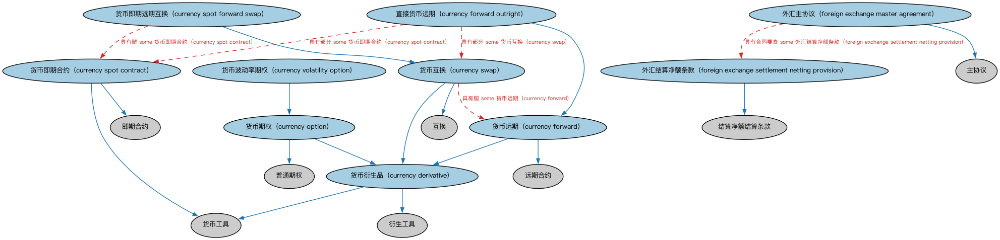

# 外汇合约本体（Currency Contracts Ontology）结构与公理说明

本文档对应 `CurrencyContracts.rdf` / `CurrencyContracts.ttl`，说明该本体的类、继承关系、属性和公理约定。结构图见 `CurrencyContracts-structure.png`（`CurrencyContracts-structure.svg` 为可缩放版本）。

## 1. 本体概述

定义以外汇为标的的衍生品合约：外汇远期、货币互换、外汇期权等。

**在体系中的位置**：衍生品合约模块中按标的资产特化的本体之一。

**上下游关系**：上游继承衍生品基础、期货与远期、互换本体及 IND 外汇本体（提供汇率与货币对概念）；下游服务外汇风险管理建模。

**与相近概念的差别**：与利率衍生品的差别——标的是两种货币的兑换关系而非利率水平；货币互换与利率互换的差别——货币互换通常涉及本金的期初期末交换。

## 2. 类（Class）

| 类（Class） | 定义（Definition） |
|---|---|
| 货币衍生品（currency derivative） | 以约定汇率交付并结算一种货币的给定金额、以换取另一货币给定金额的协议。 |
| 货币远期（currency forward） | 在未来约定日期交付并结算一种货币的给定金额、以换取另一货币给定金额的协议。 |
| 直接货币远期（currency forward outright） | 外汇市场上的远期合约，锁定实体在未来某日必须买入或卖出某一货币的价格。 |
| 货币期权（currency option） | 赋予买方（持有人）在规定期间内按指定汇率买入或卖出货币的权利（而非义务）的期权。 |
| 货币即期合约（currency spot contract） | 即时交割的外汇合约。 |
| 货币即期远期互换（currency spot forward swap） | 双方按约定固定汇率进行两种货币交换的外汇协议：a）在即期结算日交换；b）在远期日反向交换。 |
| 货币互换（currency swap） | 双方将一种货币的给定金额交换为另一种货币、用于即期交割或远期交割的外汇协议。 |
| 货币波动率期权（currency volatility option） | 标的资产基于某一外汇汇率波动率的货币期权。 |
| 外汇主协议（foreign exchange master agreement） | 旨在反映市场最佳实践、为外汇市场参与者提供标准协议的产品专用主协议。 |
| 外汇结算净额条款（foreign exchange settlement netting provision） | 外汇合约特有的结算净额条款。 |

### 2.1 继承关系（Inheritance）

- 货币衍生品（currency derivative） ⊑ 货币工具
- 货币衍生品（currency derivative） ⊑ 衍生工具
- 货币远期（currency forward） ⊑ 货币衍生品（currency derivative）
- 货币远期（currency forward） ⊑ 远期合约
- 直接货币远期（currency forward outright） ⊑ 货币远期（currency forward）
- 货币期权（currency option） ⊑ 货币衍生品（currency derivative）
- 货币期权（currency option） ⊑ 普通期权
- 货币即期合约（currency spot contract） ⊑ 货币工具
- 货币即期合约（currency spot contract） ⊑ 即期合约
- 货币即期远期互换（currency spot forward swap） ⊑ 货币互换（currency swap）
- 货币互换（currency swap） ⊑ 货币衍生品（currency derivative）
- 货币互换（currency swap） ⊑ 互换
- 货币波动率期权（currency volatility option） ⊑ 货币期权（currency option）
- 外汇主协议（foreign exchange master agreement） ⊑ 主协议
- 外汇结算净额条款（foreign exchange settlement netting provision） ⊑ 结算净额结算条款

## 3. 对象属性（Object Property）

| 属性（Property） | 中文（English） | 定义（Definition） | 说明 |
|---|---|---|---|
| fibo-der-drc-cur:hasForwardExchangeRate | 具有远期汇率（has forward exchange rate） | 远期合约中规定的两种货币之间的汇率。 | 定义域（domain）：货币远期（currency forward）；值域（range）：汇率；子属性（subPropertyOf）：具有量值 |
| fibo-der-drc-cur:hasSpotExchangeRate | 具有即期汇率（has spot exchange rate） | 由特定来源在某一日期和时间报出的两种货币之间的汇率，通常用于即期合约。 | 值域（range）：报价汇率；子属性（subPropertyOf）：具有报价汇率 |

## 5. 公理约定（Axioms）

- 货币衍生品（currency derivative）：具有汇率报价来源 some（restriction）
- 货币远期（currency forward）：具有远期汇率（has forward exchange rate） some 汇率
- 直接货币远期（currency forward outright）：具有部分 some 货币即期合约（currency spot contract）
- 直接货币远期（currency forward outright）：具有部分 some 货币互换（currency swap）
- 货币期权（currency option）：具有行权利率 some 汇率
- 货币期权（currency option）：具有标的 some（由…扮演（is played by） 货币即期买入价 ≥0）
- 货币即期合约（currency spot contract）：具有即期汇率（has spot exchange rate） some 报价汇率
- 货币即期远期互换（currency spot forward swap）：具有腿 some 货币即期合约（currency spot contract）
- 货币互换（currency swap）：具有腿 some 货币远期（currency forward）
- 货币波动率期权（currency volatility option）：具有标的 some（由…扮演（is played by） some 货币即期波动率）
- 外汇主协议（foreign exchange master agreement）：具有合同要素 some 外汇结算净额条款（foreign exchange settlement netting provision）

## 6. 依赖（owl:imports，16 个）

本本体通过 `owl:imports` 引入以下本体，各项的中文名称与简介如下：

| 导入本体 | 中文名称 | 简介 |
|---|---|---|
| `BE/FunctionalEntities/Publishers.rdf` | 出版方本体（Publishers Ontology） | 定义出版方及其出版物，用于标识金融信息与文档的发布来源。 |
| `DER/DerivativesContracts/DerivativesBasics.rdf` | 衍生品基础本体（Derivatives Basics Ontology） | 定义衍生品合约（derivatives contract）的核心概念：标的资产、行权、到期等，是 DER 域的根基。 |
| `DER/DerivativesContracts/FuturesAndForwards.rdf` | 期货与远期本体（Futures and Forwards Ontology） | 定义期货（futures）与远期（forwards）合约：标准化与非标准化的远期交割安排。 |
| `DER/DerivativesContracts/Options.rdf` | 期权本体（Options Ontology） | 定义期权（option）：买方权利、行权价、到期日、看涨与看跌等核心结构。 |
| `DER/DerivativesContracts/Swaps.rdf` | 互换本体（Swaps Ontology） | 定义互换（swap）合约的通用结构：互换腿（swap leg）、现金流交换与名义本金。 |
| `FBC/FinancialInstruments/FinancialInstruments.rdf` | 金融工具本体（Financial Instruments Ontology） | FIBO 核心本体之一，定义金融工具（financial instrument）的通用概念：可交易、代表某种权利义务的合同工具，是证券、衍生品等具体工具的共同基础。 |
| `FBC/FunctionalEntities/Markets.rdf` | 市场本体（Markets Ontology） | 定义金融市场（market）：交易所、场外市场及其功能。 |
| `FBC/ProductsAndServices/FinancialProductsAndServices.rdf` | 金融产品与服务本体（Financial Products and Services Ontology） | 定义金融产品（financial product）与金融服务（financial service）及其提供、购买关系。 |
| `FND/Accounting/CurrencyAmount.rdf` | 货币金额本体（Currency Amount Ontology） | 定义「金额＋币种」的货币金额（currency amount）表示，是 FIBO 中表达价格、债务金额、付款额等一切带币种数值的基础构件。 |
| `FND/Agreements/Contracts.rdf` | 合同本体（Contracts Ontology） | 在协议之上定义具有法律约束力的合同（contract）：合同当事方、合同条款、义务与权利，是金融工具与交易合同建模的基石。 |
| `FND/Utilities/AnnotationVocabulary.rdf` | FIBO 标注词汇表（FIBO Annotation Vocabulary） | 定义 FIBO 专用的标注属性（如释义来源、成熟度等级），用于本体自身的元数据标注。 |
| `IND/ForeignExchange/ForeignExchange.rdf` | 外汇本体（Foreign Exchange Ontology） | 定义外汇、汇率（exchange rate）与货币对的概念。 |
| `https://www.omg.org/spec/Commons/AnnotationVocabulary/` | OMG 通用标注词汇表（OMG Commons Annotation Vocabulary） | OMG 通用本体库（Commons）中的标注词汇表，提供概念映射等标注属性，FIBO 用它标注术语与外部标准的对应关系。 |
| `https://www.omg.org/spec/Commons/Collections/` | OMG 通用集合本体（OMG Commons Collections） | Commons 库中的集合本体，定义集合、成员等通用概念。 |
| `https://www.omg.org/spec/Commons/QuantitiesAndUnits/` | OMG 通用量与单位本体（OMG Commons Quantities and Units） | Commons 库中的量与单位本体，定义数量、度量单位、量纲的通用概念，支撑金额、比率等数值表达。 |
| `https://www.omg.org/spec/Commons/RolesAndCompositions/` | OMG 通用角色与构成本体（OMG Commons Roles and Compositions） | Commons 库中的角色本体，定义角色及整体—部分构成关系的通用概念。 |

## 7. 文件

- 官方 RDF/XML：`CurrencyContracts.rdf`
- 中文 Turtle：`CurrencyContracts.ttl`
- 结构图：`CurrencyContracts-structure.png` / `CurrencyContracts-structure.svg`