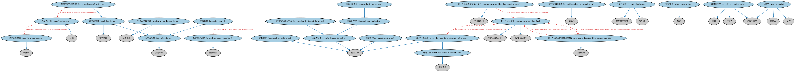

# 衍生品基础本体（Derivatives Basics Ontology）结构与公理说明

本文档对应 `DerivativesBasics.rdf` / `DerivativesBasics.ttl`，说明该本体的类、继承关系、属性和公理约定。结构图见 `DerivativesBasics-structure.png`（`DerivativesBasics-structure.svg` 为可缩放版本）。

## 1. 本体概述

定义衍生品合约（derivatives contract）的核心概念：标的资产（underlying）、行权、到期、交割方式等，是整个 DER 域的概念根基。

**在体系中的位置**：DER（衍生品）域衍生品合约模块的基础本体，期权、期货、互换等所有具体衍生品本体都继承它。

**上下游关系**：上游依赖 FBC 金融工具、FND 合同与日期本体；下游被 DER 域全部本体及 MD 衍生品时序本体引用。

**与相近概念的差别**：衍生品区别于现货工具的关键在于「价值派生自标的资产」——债券、股票是原生工具，衍生品是基于它们的合约；与结构化工具的差别——结构化工具强调多成分组合，衍生品强调价值派生关系。

## 2. 类（Class）

| 类（Class） | 定义（Definition） |
|---|---|
| 现金流表达式（cashflow expression） | 规定作为现金流公式组成部分的现金流计算的表达式。 |
| 现金流公式（cashflow formula） | 用于确定衍生工具现金流的公式。 |
| 现金流条款（cashflow terms） | 列明合约一方承诺支付的现金流结构的条款。 |
| 差价合约（contract for difference） | 现金结算的衍生品：双方同意在合约到期时交换标的当前价值与合约价值之间的差额。 |
| 信用衍生品（credit derivative） | 一种衍生工具：私人持有、可转让的双边合约，在场外（OTC）由债权/债务关系中的双方交易。 |
| 衍生品结算条款（derivative settlement terms） | 规定结算时应交付何物、何时交付、交付给谁以及在何种条件下交付等细节的结算条款。 |
| 衍生品条款（derivative terms） | 衍生品合约特有的合同条款，包括双方之间支付和交付的相关条款。 |
| 衍生品清算组织（derivatives clearing organization） | 使各方能够以清算组织（DCO）的信用替代交易对手信用的清算所。 |
| 经济指标型衍生品（economic rate-based derivative） | 标的为某一经济指标的比率类衍生品。 |
| 远期利率协议（forward rate agreement） | 就未来某一日期的名义本金交换利率承诺的协议。 |
| 利率衍生品（interest rate derivative） | 标的为利率的比率类衍生品。 |
| 介绍经纪商（introducing broker） | 招揽或接受在交易所交易或受其规则约束的衍生品订单的经纪商。 |
| 可观察值（observable value） | 对某一可辨识且可取得证据的事物之值的规范。 |
| 场外衍生工具（over-the-counter derivative instrument） | 未在有组织交易所挂牌的衍生工具。 |
| 场外工具（over-the-counter instrument） | 未在有组织交易所挂牌的金融工具和双边合约。 |
| 参数化现金流条款（parametric cashflow terms） | 按照数学公式定义的一组现金流的条款。 |
| 付款方（paying party） | 负责支付合约所规定交易款项的一方。 |
| 比率类衍生品（rate-based derivative） | 持有人有权（视工具性质可能无义务）进入标的比率类合约的衍生工具。 |
| 收款对手方（receiving counterparty） | 收取合约所规定交易款项的一方。 |
| 标的资产评估（underlying asset valuation） | 对衍生品标的资产进行价值估计的评估活动。 |
| 唯一产品标识符（unique product identifier） | 唯一标识应向交易数据库报告的场外衍生品产品的字符序列。 |
| 唯一产品标识符登记册条目（unique product identifier registry entry） | 唯一产品标识符（UPI）登记册中的条目。 |
| 唯一产品标识符服务提供商（unique product identifier service provider） | 由金融监管机构组成的外部机构指定、负责分配 UPI 并运营 UPI 参考数据库的组织。 |
| 估值条款（valuation terms） | 标的资产估值特有的合同条款。 |

### 2.1 继承关系（Inheritance）

- 现金流表达式（cashflow expression） ⊑ 表达式
- 现金流公式（cashflow formula） ⊑ 公式
- 现金流条款（cashflow terms） ⊑ 衍生品条款（derivative terms）
- 现金流条款（cashflow terms） ⊑ 债务条款
- 差价合约（contract for difference） ⊑ 衍生工具
- 信用衍生品（credit derivative） ⊑ 衍生工具
- 衍生品结算条款（derivative settlement terms） ⊑ 衍生品条款（derivative terms）
- 衍生品结算条款（derivative settlement terms） ⊑ 结算条款
- 衍生品条款（derivative terms） ⊑ 合同承诺
- 衍生品清算组织（derivatives clearing organization） ⊑ 清算所
- 经济指标型衍生品（economic rate-based derivative） ⊑ 比率类衍生品（rate-based derivative）
- 远期利率协议（forward rate agreement） ⊑ 利率衍生品（interest rate derivative）
- 利率衍生品（interest rate derivative） ⊑ 比率类衍生品（rate-based derivative）
- 介绍经纪商（introducing broker） ⊑ 非存款性机构
- 介绍经纪商（introducing broker） ⊑ 经纪商
- 可观察值（observable value） ⊑ 规范
- 场外衍生工具（over-the-counter derivative instrument） ⊑ 场外工具（over-the-counter instrument）
- 场外衍生工具（over-the-counter derivative instrument） ⊑ 衍生工具
- 场外工具（over-the-counter instrument） ⊑ 金融工具
- 参数化现金流条款（parametric cashflow terms） ⊑ 现金流条款（cashflow terms）
- 付款方（paying party） ⊑ 合同当事方
- 付款方（paying party） ⊑ 付款人
- 付款方（paying party） ⊑ 买方
- 比率类衍生品（rate-based derivative） ⊑ 衍生工具
- 收款对手方（receiving counterparty） ⊑ 合同当事方
- 收款对手方（receiving counterparty） ⊑ 收款人
- 收款对手方（receiving counterparty） ⊑ 卖方
- 标的资产评估（underlying asset valuation） ⊑ 价值评估
- 唯一产品标识符（unique product identifier） ⊑ 金融工具标识符
- 唯一产品标识符（unique product identifier） ⊑ 结构化标识符
- 唯一产品标识符登记册条目（unique product identifier registry entry） ⊑ 注册簿条目
- 唯一产品标识符服务提供商（unique product identifier service provider） ⊑ 注册机构
- 估值条款（valuation terms） ⊑ 衍生品条款（derivative terms）

## 3. 对象属性（Object Property）

| 属性（Property） | 中文（English） | 定义（Definition） | 说明 |
|---|---|---|---|
| fibo-der-drc-bsc:hasAccretingNotionalAmount | 具有递增名义本金（has accreting notional amount） | 表明名义本金在合约存续期内递增。 | 值域（range）：货币数量；子属性（subPropertyOf）：具有名义金额 |
| fibo-der-drc-bsc:hasAdditionalCosts | 具有附加成本（has additional costs） | 指明交割时必须支付的成本，如前期费用、经纪佣金等。 | 值域（range）：货币数量；子属性（subPropertyOf）：具有货币数量 |
| fibo-der-drc-bsc:hasAmortizingNotionalAmount | 具有递减名义本金（has amortizing notional amount） | 表明名义本金在合约存续期内递减。 | 值域（range）：货币数量；子属性（subPropertyOf）：具有名义金额 |
| fibo-der-drc-bsc:hasConstantNotionalAmount | 具有固定名义本金（has constant notional amount） | 表明名义本金在合约存续期内保持不变。 | 值域（range）：货币数量；子属性（subPropertyOf）：具有名义金额 |
| fibo-der-drc-bsc:hasCustomNotionalAmount | 具有定制名义本金（has custom notional amount） | 表明名义本金按名义本金阶梯计划表定制。 | 值域（range）：货币数量；子属性（subPropertyOf）：具有名义金额 |
| fibo-der-drc-bsc:hasFirstDeliveryDate | 具有首个交割日（has first delivery date） | 规定为使合约条款得以履行必须交付标的资产（或其部分）的日期区间中的首个日期。 | 定义域（domain）：结算条款；值域（range）：显式日期；子属性（subPropertyOf）：具有显式日期 |
| fibo-der-drc-bsc:hasFirstNoticeDate | 具有首个通知日（has first notice date） | 规定可以发出交割通知的首个日期。 | 定义域（domain）：结算条款；值域（range）：显式日期；子属性（subPropertyOf）：具有显式日期 |
| fibo-der-drc-bsc:hasLastDeliveryDate | 具有最后交割日（has last delivery date） | 规定为使合约条款得以履行必须交付标的资产（或其部分）的日期区间中的最后日期。 | 定义域（domain）：结算条款；值域（range）：显式日期；子属性（subPropertyOf）：具有结束日期 |
| fibo-der-drc-bsc:hasLastNoticeDate | 具有最后通知日（has last notice date） | 规定可以发出交割通知的最后日期。 | 定义域（domain）：结算条款；值域（range）：显式日期；子属性（subPropertyOf）：具有结束日期 |
| fibo-der-drc-bsc:hasSettlementTerms | 具有结算条款（has settlement terms） | 将衍生品与结算过程特有的合同条款关联起来。 | 定义域（domain）：衍生工具；值域（range）：结算条款；子属性（subPropertyOf）：具有合同要素 |
| fibo-der-drc-bsc:hasTickValue | 具有最小变动价位价值（has tick value） | 指明一个最小变动价位（即合约最小价格变动）的现金价值。 | 定义域（domain）：衍生工具；值域（range）：货币数量；子属性（subPropertyOf）：具有货币数量 |
| fibo-der-drc-bsc:hasUnderlyingAssetPrice | 具有标的资产价格（has underlying asset price） | 规定合约所基于之物的价格。 | 值域（range）：货币价格；子属性（subPropertyOf）：具有价格 |
| fibo-der-drc-bsc:hasValuationTerms | 具有估值条款（has valuation terms） | 将衍生品与标的资产估值特有的合同条款关联起来。 | 定义域（domain）：衍生工具；值域（range）：估值条款（valuation terms）；子属性（subPropertyOf）：具有合同要素 |
| fibo-der-drc-bsc:specifiesValueOf | 规定……的价值（specifies value of） | 将衍生品与标的资产估值特有的合同条款关联起来。 | 子属性（subPropertyOf）：适用于 |

## 5. 公理约定（Axioms）

- 现金流公式（cashflow formula）：具有表达式 some 现金流表达式（cashflow expression）
- 衍生品结算条款（derivative settlement terms）：具有附加成本（has additional costs） 货币数量 ≥0
- 衍生品结算条款（derivative settlement terms）：具有标的资产价格（has underlying asset price） 货币价格 ≥0
- 经济指标型衍生品（economic rate-based derivative）：具有标的 some（由…扮演（is played by） some 经济指标）
- 利率衍生品（interest rate derivative）：具有标的 some（由…扮演（is played by） some 参考利率）
- 可观察值（observable value）：价值以……表示 货币 ≥0
- 可观察值（observable value）：规定……的价值（specifies value of） some owl:Thing
- 场外工具（over-the-counter instrument） 与 上市证券 互斥（disjointWith）
- 参数化现金流条款（parametric cashflow terms）：具有公式 some 现金流公式（cashflow formula）
- 比率类衍生品（rate-based derivative）：具有标的 some（由…扮演（is played by） N1e8b124034f84881b476f7a9665aca3f ≥0）
- 标的资产评估（underlying asset valuation）：具有计算代理人 计算代理人 ≥0
- 标的资产评估（underlying asset valuation）：评估 some 标的
- 唯一产品标识符（unique product identifier）：标识 场外衍生工具（over-the-counter derivative instrument） ≥0
- 唯一产品标识符（unique product identifier）：由……注册 some 唯一产品标识符服务提供商（unique product identifier service provider）
- 唯一产品标识符登记册条目（unique product identifier registry entry）：适用于 only 场外衍生工具（over-the-counter derivative instrument）
- 唯一产品标识符登记册条目（unique product identifier registry entry）：restriction
- 唯一产品标识符登记册条目（unique product identifier registry entry）：包含 some 唯一产品标识符（unique product identifier）
- 唯一产品标识符服务提供商（unique product identifier service provider）：登记 唯一产品标识符（unique product identifier） ≥0
- 估值条款（valuation terms）：具有评估日期 some 显式日期
- 估值条款（valuation terms）：涉及 some 标的资产评估（underlying asset valuation）

## 6. 依赖（owl:imports，33 个）

本本体通过 `owl:imports` 引入以下本体，各项的中文名称与简介如下：

| 导入本体 | 中文名称 | 简介 |
|---|---|---|
| `FBC/DebtAndEquities/Debt.rdf` | 债务本体（Debt Ontology） | 定义债务（debt）与债权债务关系的核心概念：借款人、贷款人、本金与利息义务。 |
| `FBC/FinancialInstruments/FinancialInstruments.rdf` | 金融工具本体（Financial Instruments Ontology） | FIBO 核心本体之一，定义金融工具（financial instrument）的通用概念：可交易、代表某种权利义务的合同工具，是证券、衍生品等具体工具的共同基础。 |
| `FBC/FinancialInstruments/InstrumentPricing.rdf` | 工具定价本体（Instrument Pricing Ontology） | 定义金融工具的价格、报价与估值概念。 |
| `FBC/FunctionalEntities/FinancialServicesEntities.rdf` | 金融服务实体本体（Financial Services Entities Ontology） | FBC 域核心本体，定义金融服务机构（银行、券商、保险公司、资管机构等）的功能分类体系。 |
| `FBC/FunctionalEntities/Markets.rdf` | 市场本体（Markets Ontology） | 定义金融市场（market）：交易所、场外市场及其功能。 |
| `FBC/ProductsAndServices/FinancialProductsAndServices.rdf` | 金融产品与服务本体（Financial Products and Services Ontology） | 定义金融产品（financial product）与金融服务（financial service）及其提供、购买关系。 |
| `FND/Accounting/CurrencyAmount.rdf` | 货币金额本体（Currency Amount Ontology） | 定义「金额＋币种」的货币金额（currency amount）表示，是 FIBO 中表达价格、债务金额、付款额等一切带币种数值的基础构件。 |
| `FND/Agreements/Agreements.rdf` | 协议本体（Agreements Ontology） | 定义两个或以上参与方之间协议（agreement）的通用概念：协议的当事方、条款、生效与终止，是合同等一切契约性安排的上位模型。 |
| `FND/Agreements/Contracts.rdf` | 合同本体（Contracts Ontology） | 在协议之上定义具有法律约束力的合同（contract）：合同当事方、合同条款、义务与权利，是金融工具与交易合同建模的基石。 |
| `FND/Arrangements/Assessments.rdf` | 评估本体（Assessments Ontology） | 定义评估活动、评估结果与评估方的通用结构，为信用评级、风险打分等判断性活动提供基础模型。 |
| `FND/Arrangements/Documents.rdf` | 文档本体（Documents Ontology） | 定义文档、文档类型及文档与其所记载内容的关系，为合同文本、募集说明书等法律文书建模。 |
| `FND/ProductsAndServices/PaymentsAndSchedules.rdf` | 付款与计划表本体（Payments and Schedules Ontology） | 定义付款、付款计划表（payment schedule）及其日期与金额结构，是贷款还款、债券付息建模的基础。 |
| `FND/ProductsAndServices/ProductsAndServices.rdf` | 产品与服务本体（Products and Services Ontology） | 定义产品、服务及其提供者与客户的通用关系。 |
| `FND/Relations/Relations.rdf` | 关系本体（Relations Ontology） | FIBO 最底层的基础本体，定义参考（reference）、分类（classify）等通用关系与抽象概念，全库普遍依赖。 |
| `FND/Utilities/Analytics.rdf` | 分析本体（Analytics Ontology） | 定义分析工具、度量与比率的通用概念，支撑指标与模型的表达。 |
| `FND/Utilities/AnnotationVocabulary.rdf` | FIBO 标注词汇表（FIBO Annotation Vocabulary） | 定义 FIBO 专用的标注属性（如释义来源、成熟度等级），用于本体自身的元数据标注。 |
| `IND/EconomicIndicators/EconomicIndicators.rdf` | 经济指标本体（Economic Indicators Ontology） | 定义宏观经济指标（GDP、CPI、失业率等）的通用结构：发布机构、发布频率与数值。 |
| `IND/ForeignExchange/ForeignExchange.rdf` | 外汇本体（Foreign Exchange Ontology） | 定义外汇、汇率（exchange rate）与货币对的概念。 |
| `IND/Indicators/Indicators.rdf` | 指标本体（Indicators Ontology） | 定义「指标」（indicator）的通用概念：对某现象的可度量表示，是经济指标、利率等的上位模型。 |
| `IND/InterestRates/InterestRates.rdf` | 利率本体（Interest Rates Ontology） | 定义利率（interest rate）的结构：基准利率、利差、期限与重置机制。 |
| `SEC/Securities/Baskets.rdf` | 篮子本体（Baskets Ontology） | 定义证券篮子（basket）：作为整体交易或定价的一组证券。 |
| `SEC/Securities/SecuritiesListings.rdf` | 证券上市本体（Securities Listings Ontology） | 定义证券在交易所上市（listing）及其上市状态。 |
| `https://www.omg.org/spec/Commons/AnnotationVocabulary/` | OMG 通用标注词汇表（OMG Commons Annotation Vocabulary） | OMG 通用本体库（Commons）中的标注词汇表，提供概念映射等标注属性，FIBO 用它标注术语与外部标准的对应关系。 |
| `https://www.omg.org/spec/Commons/Collections/` | OMG 通用集合本体（OMG Commons Collections） | Commons 库中的集合本体，定义集合、成员等通用概念。 |
| `https://www.omg.org/spec/Commons/ContextualDesignators/` | OMG 通用语境指称本体（OMG Commons Contextual Designators） | Commons 库中的语境指称本体，定义「在某个语境下指代某物的名称/符号」，是地址、账户号码等语境相关标识的基础。 |
| `https://www.omg.org/spec/Commons/ContextualIdentifiers/` | OMG 通用语境标识符本体（OMG Commons Contextual Identifiers） | Commons 库中的语境标识符本体，定义在特定语境下唯一标识事物的标识符结构，是地址、账户类标识的基础。 |
| `https://www.omg.org/spec/Commons/DatesAndTimes/` | OMG 通用日期与时间本体（OMG Commons Dates and Times） | Commons 库中的日期时间本体，定义日期、期间、时间点等通用时间概念。 |
| `https://www.omg.org/spec/Commons/Documents/` | OMG 通用文档本体（OMG Commons Documents） | Commons 库中的文档本体，定义文档及其组成部分的通用概念。 |
| `https://www.omg.org/spec/Commons/Identifiers/` | OMG 通用标识符本体（OMG Commons Identifiers） | Commons 库中的标识符本体，定义标识符及其编码方案的通用概念。 |
| `https://www.omg.org/spec/Commons/Organizations/` | OMG 通用组织本体（OMG Commons Organizations） | Commons 库中的组织本体，定义组织、组织成员与组织结构的通用概念。 |
| `https://www.omg.org/spec/Commons/QuantitiesAndUnits/` | OMG 通用量与单位本体（OMG Commons Quantities and Units） | Commons 库中的量与单位本体，定义数量、度量单位、量纲的通用概念，支撑金额、比率等数值表达。 |
| `https://www.omg.org/spec/Commons/RegistrationAuthorities/` | OMG 通用登记主管机构本体（OMG Commons Registration Authorities） | Commons 库中的登记主管机构本体，定义负责登记注册的主管机构及其登记行为的通用概念。 |
| `https://www.omg.org/spec/Commons/RolesAndCompositions/` | OMG 通用角色与构成本体（OMG Commons Roles and Compositions） | Commons 库中的角色本体，定义角色及整体—部分构成关系的通用概念。 |

## 7. 文件

- 官方 RDF/XML：`DerivativesBasics.rdf`
- 中文 Turtle：`DerivativesBasics.ttl`
- 结构图：`DerivativesBasics-structure.png` / `DerivativesBasics-structure.svg`