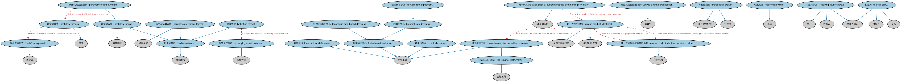

# 衍生品基础本体（Derivatives Basics Ontology）结构与公理说明

本文档对应 `DerivativesBasics.rdf` / `DerivativesBasics.ttl`，说明该本体的类、继承关系、属性和公理约定。结构图见 `DerivativesBasics-structure.png`（`DerivativesBasics-structure.svg` 为可缩放版本）。

## 1. 本体概述

定义衍生品合约（derivatives contract）的核心概念：标的资产（underlying）、行权、到期、交割方式等，是整个 DER 域的概念根基。

**在体系中的位置**：DER（衍生品）域衍生品合约模块的基础本体，期权、期货、互换等所有具体衍生品本体都继承它。

**上下游关系**：上游依赖 FBC 金融工具、FND 合同与日期本体；下游被 DER 域全部本体及 MD 衍生品时序本体引用。

**与相近概念的差别**：衍生品区别于现货工具的关键在于「价值派生自标的资产」——债券、股票是原生工具，衍生品是基于它们的合约；与结构化工具的差别——结构化工具强调多成分组合，衍生品强调价值派生关系。

本本体中类与类的核心关系如下（完整细节见各类小节）：

- **现金流表达式（cashflow expression）** 继承 **表达式（Expression）**
- **现金流公式（cashflow formula）** 继承 **公式（Formula）**
- **现金流条款（cashflow terms）** 继承 **衍生品条款（derivative terms）**
- **现金流条款（cashflow terms）** 继承 **债务条款（DebtTerms）**
- **差价合约（contract for difference）** 继承 **衍生工具（DerivativeInstrument）**
- **信用衍生品（credit derivative）** 继承 **衍生工具（DerivativeInstrument）**
- **衍生品结算条款（derivative settlement terms）** 继承 **衍生品条款（derivative terms）**
- **衍生品结算条款（derivative settlement terms）** 继承 **结算条款（SettlementTerms）**
- **衍生品条款（derivative terms）** 继承 **合同承诺（ContractualCommitment）**
- **衍生品清算组织（derivatives clearing organization）** 继承 **清算所（ClearingHouse）**
- **经济指标型衍生品（economic rate-based derivative）** 继承 **比率类衍生品（rate-based derivative）**
- **远期利率协议（forward rate agreement）** 继承 **利率衍生品（interest rate derivative）**
- 其余 21 条关系从略。

## 2. 类（Class）

| 类（Class） | 定义（Definition） |
|---|---|
| 现金流表达式（cashflow expression） | 规定作为现金流公式组成部分的现金流计算的表达式。 expression that specifies a calculation of a cash flow as a component of a cashflow formula |
| 现金流公式（cashflow formula） | 用于确定衍生工具现金流的公式。 formula for determining cashflows for a derivative instrument |
| 现金流条款（cashflow terms） | 列明合约一方承诺支付的现金流结构的条款。 terms setting out a cashflow structure of payments committed to by one party to a contract |
| 差价合约（contract for difference） | 现金结算的衍生品：双方同意在合约到期时交换标的当前价值与合约价值之间的差额。 cash-settled derivative where the parties agree to exchange on the maturity of the contract the difference between the current value of the underlying asset and the initial value of that asset when the contract is initiated |
| 信用衍生品（credit derivative） | 一种衍生工具：私人持有、可转让的双边合约，在场外（OTC）由债权/债务关系中的双方交易。 derivative instrument that is a privately held, negotiable bilateral contract traded over-the-counter (OTC) between two parties in a creditor/debtor relationship, enabling the creditor to effectively transfer some or all of the risk of a debtor defaulting to a third party |
| 衍生品结算条款（derivative settlement terms） | 规定结算时应交付何物、何时交付、交付给谁以及在何种条件下交付等细节的结算条款。 settlement terms specifying additional details with respect to what is to be delivered when, to whom, under what conditions at the time of settlement |
| 衍生品条款（derivative terms） | 衍生品合约特有的合同条款，包括双方之间支付和交付的相关条款。 contractual terms specific to derivative contracts, including terms related to payments and delivery between parties |
| 衍生品清算组织（derivatives clearing organization） | 使各方能够以清算组织（DCO）的信用替代交易对手信用的清算所。 clearing house that enables parties to substitute the credit of the DCO for the credit of the parties |
| 经济指标型衍生品（economic rate-based derivative） | 标的为某一经济指标的比率类衍生品。 rate-based derivative whose underlier is some economic indicator |
| 远期利率协议（forward rate agreement） | 就未来某一日期的名义本金交换利率承诺的协议。 agreement to exchange an interest rate commitment on a notional amount at a future date |
| 利率衍生品（interest rate derivative） | 标的为利率的比率类衍生品。 rate-based derivative whose underlier is an interest rate |
| 介绍经纪商（introducing broker） | 招揽或接受在交易所交易或受其规则约束的衍生品订单的经纪商。 broker that solicits or accepts orders for derivatives that are traded on or subject to the rules of an exchange |
| 可观察值（observable value） | 对某一可辨识且可取得证据的事物之值的规范。 specification for the value for something discernible and for which evidence can be obtained |
| 场外衍生工具（over-the-counter derivative instrument） | 未在有组织交易所挂牌的衍生工具。 derivative instrument that is not listed on an organized exchange |
| 场外工具（over-the-counter instrument） | 未在有组织交易所挂牌的金融工具和双边合约。 financial instrument and bilateral contract that is not listed on an organized exchange |
| 参数化现金流条款（parametric cashflow terms） | 按照数学公式定义的一组现金流的条款。 terms for a set of cashflows defined according to a mathematical formula |
| 付款方（paying party） | 负责支付合约所规定交易款项的一方。 party responsible for making payments in a transaction specified in a contract |
| 比率类衍生品（rate-based derivative） | 持有人有权（视工具性质可能无义务）进入标的比率类合约的衍生工具。 derivative instrument where the holder has the right but may not have the obligation, depending on the nature of the instrument, to enter into the underlying contract, or pay or receive payment related to the underlying financial rate (or rate contract) on a specified future date based on a specified future rate and term |
| 收款对手方（receiving counterparty） | 收取合约所规定交易款项的一方。 party that receives payments in a transaction specified in a contract |
| 标的资产评估（underlying asset valuation） | 对衍生品标的资产进行价值估计的评估活动。 assessment activity to estimate the value of an underlying asset of a derivative |
| 唯一产品标识符（unique product identifier） | 唯一标识应向交易数据库报告的场外衍生品产品的字符序列。 sequence of characters uniquely identifying an OTC derivative product that is reportable to a trade repository |
| 唯一产品标识符登记册条目（unique product identifier registry entry） | 唯一产品标识符（UPI）登记册中的条目。 entry in a unique product identifier registry |
| 唯一产品标识符服务提供商（unique product identifier service provider） | 由金融监管机构组成的外部机构指定、负责分配 UPI 并运营 UPI 参考数据库的组织。 organization designated by an external body of financial regulators to assign UPIs and operate a UPI reference data library |
| 估值条款（valuation terms） | 标的资产估值特有的合同条款。 contract terms specific to valuation of the underlying asset(s) |

以下按类逐个展开：每个类给出继承关系、相关属性与公理约定；子类在父类之下降一级编号。

### 2.1 现金流表达式（cashflow expression）

定义：规定作为现金流公式组成部分的现金流计算的表达式。

- 父类：**表达式（Expression）**

### 2.2 现金流公式（cashflow formula）

定义：用于确定衍生工具现金流的公式。

- 父类：**公式（Formula）**

属性：

| 属性 | 定义 | 说明 |
|---|---|---|
| **具有表达式（hasExpression）** | — | — |

公理：

- **具有表达式（hasExpression）**至少有一个取值，类型是**现金流表达式（cashflow expression）**。

### 2.3 差价合约（contract for difference）

定义：现金结算的衍生品：双方同意在合约到期时交换标的当前价值与合约价值之间的差额。

- 父类：**衍生工具（DerivativeInstrument）**

### 2.4 信用衍生品（credit derivative）

定义：一种衍生工具：私人持有、可转让的双边合约，在场外（OTC）由债权/债务关系中的双方交易。

- 父类：**衍生工具（DerivativeInstrument）**

### 2.5 衍生品条款（derivative terms）

定义：衍生品合约特有的合同条款，包括双方之间支付和交付的相关条款。

- 父类：**合同承诺（ContractualCommitment）**
- 直接子类：**现金流条款（cashflow terms）**、**衍生品结算条款（derivative settlement terms）**、**估值条款（valuation terms）**

#### 2.5.1 现金流条款（cashflow terms）

定义：列明合约一方承诺支付的现金流结构的条款。

- 父类：**衍生品条款（derivative terms）**、**债务条款（DebtTerms）**
- 直接子类：**参数化现金流条款（parametric cashflow terms）**

##### 2.5.1.1 参数化现金流条款（parametric cashflow terms）

定义：按照数学公式定义的一组现金流的条款。

- 父类：**现金流条款（cashflow terms）**

属性：

| 属性 | 定义 | 说明 |
|---|---|---|
| **具有公式（hasFormula）** | — | — |

公理：

- **具有公式（hasFormula）**至少有一个取值，类型是**现金流公式（cashflow formula）**。

#### 2.5.2 衍生品结算条款（derivative settlement terms）

定义：规定结算时应交付何物、何时交付、交付给谁以及在何种条件下交付等细节的结算条款。

- 父类：**衍生品条款（derivative terms）**、**结算条款（SettlementTerms）**

属性：

| 属性 | 定义 | 说明 |
|---|---|---|
| **具有附加成本（has additional costs）** | 指明交割时必须支付的成本，如前期费用、经纪佣金等。 indicates costs, such as up front costs, brokerage fees and the like, that must be paid on delivery | 值域：货币数量；子属性：具有货币数量 |
| **具有标的资产价格（has underlying asset price）** | 规定合约所基于之物的价格。 specifies a price for something on which the contract is based | 值域：货币价格；子属性：具有价格 |

公理：

- **具有标的资产价格（has underlying asset price）**可以有 0 个或多个**货币价格（MonetaryPrice）**。
- **具有附加成本（has additional costs）**可以有 0 个或多个**货币数量（MonetaryAmount）**。

#### 2.5.3 估值条款（valuation terms）

定义：标的资产估值特有的合同条款。

- 父类：**衍生品条款（derivative terms）**

属性：

| 属性 | 定义 | 说明 |
|---|---|---|
| **具有评估日期（hasDateOfAssessment）** | — | — |
| **涉及（involves）** | — | — |

公理：

- **具有评估日期（hasDateOfAssessment）**至少有一个取值，类型是**显式日期（ExplicitDate）**。
- **涉及（involves）**至少有一个取值，类型是**标的资产评估（underlying asset valuation）**。

### 2.6 衍生品清算组织（derivatives clearing organization）

定义：使各方能够以清算组织（DCO）的信用替代交易对手信用的清算所。

- 父类：**清算所（ClearingHouse）**

### 2.7 介绍经纪商（introducing broker）

定义：招揽或接受在交易所交易或受其规则约束的衍生品订单的经纪商。

- 父类：**非存款性机构（NonDepositoryInstitution）**、**经纪商（Broker）**

### 2.8 可观察值（observable value）

定义：对某一可辨识且可取得证据的事物之值的规范。

- 父类：**规范（Specification）**

属性：

| 属性 | 定义 | 说明 |
|---|---|---|
| **规定……的价值（specifies value of）** | 将衍生品与标的资产估值特有的合同条款关联起来。 relates a derivative to contractual terms specific to valuation of the underlying asset(s) | 子属性：适用于 |
| **价值以……表示（hasValueExpressedIn）** | — | — |

公理：

- **价值以……表示（hasValueExpressedIn）**可以有 0 个或多个**货币（Currency）**。
- **规定……的价值（specifies value of）**至少有一个取值，类型是**owl:Thing（Thing）**。

### 2.9 场外工具（over-the-counter instrument）

定义：未在有组织交易所挂牌的金融工具和双边合约。

- 父类：**金融工具（FinancialInstrument）**
- 直接子类：**场外衍生工具（over-the-counter derivative instrument）**

公理：

- 与**上市证券（ListedSecurity）**互斥：同一个体不能同时属于两者。

#### 2.9.1 场外衍生工具（over-the-counter derivative instrument）

定义：未在有组织交易所挂牌的衍生工具。

- 父类：**场外工具（over-the-counter instrument）**、**衍生工具（DerivativeInstrument）**

### 2.10 付款方（paying party）

定义：负责支付合约所规定交易款项的一方。

- 父类：**合同当事方（ContractParty）**、**付款人（Payer）**、**买方（Buyer）**

### 2.11 比率类衍生品（rate-based derivative）

定义：持有人有权（视工具性质可能无义务）进入标的比率类合约的衍生工具。

- 父类：**衍生工具（DerivativeInstrument）**
- 直接子类：**经济指标型衍生品（economic rate-based derivative）**、**利率衍生品（interest rate derivative）**

属性：

| 属性 | 定义 | 说明 |
|---|---|---|
| **具有标的（hasUnderlier）** | — | — |

公理：

- **具有标的（hasUnderlier）**至少有一个取值，该取值满足：**由…扮演（is played by）**可以有 0 个或多个**N1c764720da4f4b8f8b1dff0f15e8a317**。

#### 2.11.1 经济指标型衍生品（economic rate-based derivative）

定义：标的为某一经济指标的比率类衍生品。

- 父类：**比率类衍生品（rate-based derivative）**

属性：

| 属性 | 定义 | 说明 |
|---|---|---|
| **具有标的（hasUnderlier）** | — | — |

公理：

- **具有标的（hasUnderlier）**至少有一个取值，该取值满足：**由…扮演（is played by）**至少有一个取值，类型是**经济指标（EconomicIndicator）**。

#### 2.11.2 利率衍生品（interest rate derivative）

定义：标的为利率的比率类衍生品。

- 父类：**比率类衍生品（rate-based derivative）**
- 直接子类：**远期利率协议（forward rate agreement）**

属性：

| 属性 | 定义 | 说明 |
|---|---|---|
| **具有标的（hasUnderlier）** | — | — |

公理：

- **具有标的（hasUnderlier）**至少有一个取值，该取值满足：**由…扮演（is played by）**至少有一个取值，类型是**参考利率（ReferenceInterestRate）**。

##### 2.11.2.1 远期利率协议（forward rate agreement）

定义：就未来某一日期的名义本金交换利率承诺的协议。

- 父类：**利率衍生品（interest rate derivative）**

### 2.12 收款对手方（receiving counterparty）

定义：收取合约所规定交易款项的一方。

- 父类：**合同当事方（ContractParty）**、**收款人（Payee）**、**卖方（Seller）**

### 2.13 标的资产评估（underlying asset valuation）

定义：对衍生品标的资产进行价值估计的评估活动。

- 父类：**价值评估（ValueAssessment）**

属性：

| 属性 | 定义 | 说明 |
|---|---|---|
| **具有计算代理人（hasCalculationAgent）** | — | — |
| **评估（evaluates）** | — | — |

公理：

- **具有计算代理人（hasCalculationAgent）**可以有 0 个或多个**计算代理人（CalculationAgent）**。
- **评估（evaluates）**至少有一个取值，类型是**标的（Underlier）**。

### 2.14 唯一产品标识符（unique product identifier）

定义：唯一标识应向交易数据库报告的场外衍生品产品的字符序列。

- 父类：**金融工具标识符（FinancialInstrumentIdentifier）**、**结构化标识符（StructuredIdentifier）**

属性：

| 属性 | 定义 | 说明 |
|---|---|---|
| **标识（identifies）** | — | — |
| **由……注册（isRegisteredBy）** | — | — |

公理：

- **标识（identifies）**可以有 0 个或多个**场外衍生工具（over-the-counter derivative instrument）**。
- **由……注册（isRegisteredBy）**至少有一个取值，类型是**唯一产品标识符服务提供商（unique product identifier service provider）**。

### 2.15 唯一产品标识符登记册条目（unique product identifier registry entry）

定义：唯一产品标识符（UPI）登记册中的条目。

- 父类：**注册簿条目（RegistryEntry）**

属性：

| 属性 | 定义 | 说明 |
|---|---|---|
| **包含（comprises）** | — | — |
| **被包含于（isIncludedIn）** | — | — |
| **适用于（appliesTo）** | — | — |

公理：

- **包含（comprises）**至少有一个取值，类型是**唯一产品标识符（unique product identifier）**。
- **被包含于（isIncludedIn）**的取值固定为 UniqueProductIdentifierReferenceDataLibrary。
- **适用于（appliesTo）**的所有取值只能是**场外衍生工具（over-the-counter derivative instrument）**。

### 2.16 唯一产品标识符服务提供商（unique product identifier service provider）

定义：由金融监管机构组成的外部机构指定、负责分配 UPI 并运营 UPI 参考数据库的组织。

- 父类：**注册机构（RegistrationAuthority）**

属性：

| 属性 | 定义 | 说明 |
|---|---|---|
| **登记（registers）** | — | — |

公理：

- **登记（registers）**可以有 0 个或多个**唯一产品标识符（unique product identifier）**。

## 3. 其他属性

以下属性未绑定到本体的具体类（定义域在外部本体或未声明）：

对象属性（Object Property）：

| 属性 | 定义 | 说明 |
|---|---|---|
| **具有递增名义本金（has accreting notional amount）** | 表明名义本金在合约存续期内递增。 indicates that the notional amount increases through the life of the contract | 值域：货币数量；子属性：具有名义金额 |
| **具有递减名义本金（has amortizing notional amount）** | 表明名义本金在合约存续期内递减。 indicates that the notional amount decreases through the life of the contract | 值域：货币数量；子属性：具有名义金额 |
| **具有固定名义本金（has constant notional amount）** | 表明名义本金在合约存续期内保持不变。 indicates that the notional amount is constant through the life of the contract | 值域：货币数量；子属性：具有名义金额 |
| **具有定制名义本金（has custom notional amount）** | 表明名义本金按名义本金阶梯计划表定制。 indicates that the notional amount is customized per a notional step schedule | 值域：货币数量；子属性：具有名义金额 |
| **具有首个交割日（has first delivery date）** | 规定为使合约条款得以履行必须交付标的资产（或其部分）的日期区间中的首个日期。 specifies the initial date in a range of dates by which the underlying asset (or some portion thereof) must be delivered in order for the terms of the contract to be fulfilled | 值域：显式日期；子属性：具有显式日期 |
| **具有首个通知日（has first notice date）** | 规定可以发出交割通知的首个日期。 specifies the initial date on which a delivery notice can be issued | 值域：显式日期；子属性：具有显式日期 |
| **具有最后交割日（has last delivery date）** | 规定为使合约条款得以履行必须交付标的资产（或其部分）的日期区间中的最后日期。 specifies the final date in a range of dates by which the underlying asset (or some portion thereof) must be delivered in order for the terms of the contract to be fulfilled | 值域：显式日期；子属性：具有结束日期 |
| **具有最后通知日（has last notice date）** | 规定可以发出交割通知的最后日期。 specifies the final date on which a delivery notice can be issued | 值域：显式日期；子属性：具有结束日期 |
| **具有结算条款（has settlement terms）** | 将衍生品与结算过程特有的合同条款关联起来。 relates a derivative to contractual terms specific to the settlement process | 值域：结算条款；子属性：具有合同要素 |
| **具有最小变动价位价值（has tick value）** | 指明一个最小变动价位（即合约最小价格变动）的现金价值。 indicates the cash value of one tick, i.e., the minimum price change of the contract | 值域：货币数量；子属性：具有货币数量 |
| **具有估值条款（has valuation terms）** | 将衍生品与标的资产估值特有的合同条款关联起来。 relates a derivative to contractual terms specific to valuation of the underlying asset(s) | 值域：估值条款（valuation terms）；子属性：具有合同要素 |

## 4. 依赖（owl:imports，33 个）

本本体通过 `owl:imports` 引入以下本体，各项的中文名称与简介如下：

| 导入本体 | 中文名称 | 简介 |
|---|---|---|
| `FBC/DebtAndEquities/Debt.rdf` | 债务本体（Debt Ontology） | 定义债务（debt）与债权债务关系的核心概念：借款人、贷款人、本金与利息义务。 |
| `FBC/FinancialInstruments/FinancialInstruments.rdf` | 金融工具本体（Financial Instruments Ontology） | FIBO 核心本体之一，定义金融工具（financial instrument）的通用概念：可交易、代表某种权利义务的合同工具，是证券、衍生品等具体工具的共同基础。 |
| `FBC/FinancialInstruments/InstrumentPricing.rdf` | 工具定价本体（Instrument Pricing Ontology） | 定义金融工具的价格、报价与估值概念。 |
| `FBC/FunctionalEntities/FinancialServicesEntities.rdf` | 金融服务实体本体（Financial Services Entities Ontology） | FBC 域核心本体，定义金融服务机构（银行、券商、保险公司、资管机构等）的功能分类体系。 |
| `FBC/FunctionalEntities/Markets.rdf` | 市场本体（Markets Ontology） | 定义金融市场（market）：交易所、场外市场及其功能。 |
| `FBC/ProductsAndServices/FinancialProductsAndServices.rdf` | 金融产品与服务本体（Financial Products and Services Ontology） | 定义金融产品（financial product）与金融服务（financial service）及其提供、购买关系。 |
| `FND/Accounting/CurrencyAmount.rdf` | 货币金额本体（Currency Amount Ontology） | 定义「金额＋币种」的货币金额（currency amount）表示，是 FIBO 中表达价格、债务金额、付款额等一切带币种数值的基础构件。 |
| `FND/Agreements/Agreements.rdf` | 协议本体（Agreements Ontology） | 定义两个或以上参与方之间协议（agreement）的通用概念：协议的当事方、条款、生效与终止，是合同等一切契约性安排的上位模型。 |
| `FND/Agreements/Contracts.rdf` | 合同本体（Contracts Ontology） | 在协议之上定义具有法律约束力的合同（contract）：合同当事方、合同条款、义务与权利，是金融工具与交易合同建模的基石。 |
| `FND/Arrangements/Assessments.rdf` | 评估本体（Assessments Ontology） | 定义评估活动、评估结果与评估方的通用结构，为信用评级、风险打分等判断性活动提供基础模型。 |
| `FND/Arrangements/Documents.rdf` | 文档本体（Documents Ontology） | 定义文档、文档类型及文档与其所记载内容的关系，为合同文本、募集说明书等法律文书建模。 |
| `FND/ProductsAndServices/PaymentsAndSchedules.rdf` | 付款与计划表本体（Payments and Schedules Ontology） | 定义付款、付款计划表（payment schedule）及其日期与金额结构，是贷款还款、债券付息建模的基础。 |
| `FND/ProductsAndServices/ProductsAndServices.rdf` | 产品与服务本体（Products and Services Ontology） | 定义产品、服务及其提供者与客户的通用关系。 |
| `FND/Relations/Relations.rdf` | 关系本体（Relations Ontology） | FIBO 最底层的基础本体，定义参考（reference）、分类（classify）等通用关系与抽象概念，全库普遍依赖。 |
| `FND/Utilities/Analytics.rdf` | 分析本体（Analytics Ontology） | 定义分析工具、度量与比率的通用概念，支撑指标与模型的表达。 |
| `FND/Utilities/AnnotationVocabulary.rdf` | FIBO 标注词汇表（FIBO Annotation Vocabulary） | 定义 FIBO 专用的标注属性（如释义来源、成熟度等级），用于本体自身的元数据标注。 |
| `IND/EconomicIndicators/EconomicIndicators.rdf` | 经济指标本体（Economic Indicators Ontology） | 定义宏观经济指标（GDP、CPI、失业率等）的通用结构：发布机构、发布频率与数值。 |
| `IND/ForeignExchange/ForeignExchange.rdf` | 外汇本体（Foreign Exchange Ontology） | 定义外汇、汇率（exchange rate）与货币对的概念。 |
| `IND/Indicators/Indicators.rdf` | 指标本体（Indicators Ontology） | 定义「指标」（indicator）的通用概念：对某现象的可度量表示，是经济指标、利率等的上位模型。 |
| `IND/InterestRates/InterestRates.rdf` | 利率本体（Interest Rates Ontology） | 定义利率（interest rate）的结构：基准利率、利差、期限与重置机制。 |
| `SEC/Securities/Baskets.rdf` | 篮子本体（Baskets Ontology） | 定义证券篮子（basket）：作为整体交易或定价的一组证券。 |
| `SEC/Securities/SecuritiesListings.rdf` | 证券上市本体（Securities Listings Ontology） | 定义证券在交易所上市（listing）及其上市状态。 |
| `https://www.omg.org/spec/Commons/AnnotationVocabulary/` | OMG 通用标注词汇表（OMG Commons Annotation Vocabulary） | OMG 通用本体库（Commons）中的标注词汇表，提供概念映射等标注属性，FIBO 用它标注术语与外部标准的对应关系。 |
| `https://www.omg.org/spec/Commons/Collections/` | OMG 通用集合本体（OMG Commons Collections） | Commons 库中的集合本体，定义集合、成员等通用概念。 |
| `https://www.omg.org/spec/Commons/ContextualDesignators/` | OMG 通用语境指称本体（OMG Commons Contextual Designators） | Commons 库中的语境指称本体，定义「在某个语境下指代某物的名称/符号」，是地址、账户号码等语境相关标识的基础。 |
| `https://www.omg.org/spec/Commons/ContextualIdentifiers/` | OMG 通用语境标识符本体（OMG Commons Contextual Identifiers） | Commons 库中的语境标识符本体，定义在特定语境下唯一标识事物的标识符结构，是地址、账户类标识的基础。 |
| `https://www.omg.org/spec/Commons/DatesAndTimes/` | OMG 通用日期与时间本体（OMG Commons Dates and Times） | Commons 库中的日期时间本体，定义日期、期间、时间点等通用时间概念。 |
| `https://www.omg.org/spec/Commons/Documents/` | OMG 通用文档本体（OMG Commons Documents） | Commons 库中的文档本体，定义文档及其组成部分的通用概念。 |
| `https://www.omg.org/spec/Commons/Identifiers/` | OMG 通用标识符本体（OMG Commons Identifiers） | Commons 库中的标识符本体，定义标识符及其编码方案的通用概念。 |
| `https://www.omg.org/spec/Commons/Organizations/` | OMG 通用组织本体（OMG Commons Organizations） | Commons 库中的组织本体，定义组织、组织成员与组织结构的通用概念。 |
| `https://www.omg.org/spec/Commons/QuantitiesAndUnits/` | OMG 通用量与单位本体（OMG Commons Quantities and Units） | Commons 库中的量与单位本体，定义数量、度量单位、量纲的通用概念，支撑金额、比率等数值表达。 |
| `https://www.omg.org/spec/Commons/RegistrationAuthorities/` | OMG 通用登记主管机构本体（OMG Commons Registration Authorities） | Commons 库中的登记主管机构本体，定义负责登记注册的主管机构及其登记行为的通用概念。 |
| `https://www.omg.org/spec/Commons/RolesAndCompositions/` | OMG 通用角色与构成本体（OMG Commons Roles and Compositions） | Commons 库中的角色本体，定义角色及整体—部分构成关系的通用概念。 |

## 5. 文件

- 官方 RDF/XML：`DerivativesBasics.rdf`
- 中文 Turtle：`DerivativesBasics.ttl`
- 结构图：`DerivativesBasics-structure.png` / `DerivativesBasics-structure.svg`