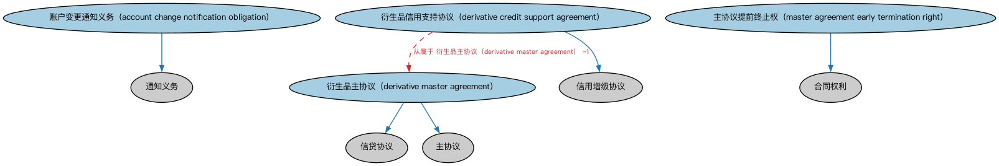

# 衍生品主协议本体（Derivatives Master Agreements Ontology）结构与公理说明

本文档对应 `DerivativesMasterAgreements.rdf` / `DerivativesMasterAgreements.ttl`，说明该本体的类、继承关系、属性和公理约定。结构图见 `DerivativesMasterAgreements-structure.png`（`DerivativesMasterAgreements-structure.svg` 为可缩放版本）。

## 1. 本体概述

定义场外衍生品主协议（master agreement）：以 ISDA 主协议为代表，约定交易双方全部场外交易的通用条款（违约、终止、净额结算、担保）。

**在体系中的位置**：衍生品合约模块中处理「交易关系法律框架」的本体。

**上下游关系**：上游依赖 FND 合同与法律本体；下游被各类场外衍生品（互换、远期）引用——具体的每笔交易确认书都挂在主协议之下。

**与相近概念的差别**：主协议≠交易合约——主协议约定双方所有交易的共同规则，单笔交易的经济条款由交易确认书（confirmation）约定，两者配合构成完整的场外衍生品法律结构。

本本体中类与类的核心关系如下（完整细节见各类小节）：

- **账户变更通知义务（account change notification obligation）** 继承 **通知义务（NotificationObligation）**
- **衍生品信用支持协议（derivative credit support agreement）** 继承 **信用增级协议（CreditEnhancementAgreement）**
- **衍生品主协议（derivative master agreement）** 继承 **信贷协议（CreditAgreement）**
- **衍生品主协议（derivative master agreement）** 继承 **主协议（MasterAgreement）**
- **主协议提前终止权（master agreement early termination right）** 继承 **合同权利（ContractualRight）**

## 2. 类（Class）

| 类（Class） | 定义（Definition） |
|---|---|
| 账户变更通知义务（account change notification obligation） | 就账户详情任何变更通知交易对手的义务。 obligation to notify a counterparty of any changes in account details |
| 衍生品信用支持协议（derivative credit support agreement） | 主协议的附件，规范衍生品交易双方之间抵押品的交换。 addendum to the master agreement that governs the exchange of collateral between parties in derivatives transactions |
| 衍生品主协议（derivative master agreement） | 涵盖合同双方之间拟进行衍生品交易的主协议。 master agreement covering derivatives transactions to be carried out between the parties to this contract |
| 主协议提前终止权（master agreement early termination right） | 主协议一方提前终止协议的合同权利。 contractual right of a party to the master agreement to terminate the agreement early |

以下按类逐个展开：每个类给出继承关系、相关属性与公理约定；子类在父类之下降一级编号。

### 2.1 账户变更通知义务（account change notification obligation）

定义：就账户详情任何变更通知交易对手的义务。

- 父类：**通知义务（NotificationObligation）**

### 2.2 衍生品信用支持协议（derivative credit support agreement）

定义：主协议的附件，规范衍生品交易双方之间抵押品的交换。

- 父类：**信用增级协议（CreditEnhancementAgreement）**

属性：

| 属性 | 定义 | 说明 |
|---|---|---|
| **从属于（isSubordinateTo）** | — | — |

公理：

- **从属于（isSubordinateTo）**恰好有 1 个**衍生品主协议（derivative master agreement）**。

### 2.3 衍生品主协议（derivative master agreement）

定义：涵盖合同双方之间拟进行衍生品交易的主协议。

- 父类：**信贷协议（CreditAgreement）**、**主协议（MasterAgreement）**

### 2.4 主协议提前终止权（master agreement early termination right）

定义：主协议一方提前终止协议的合同权利。

- 父类：**合同权利（ContractualRight）**

## 3. 依赖（owl:imports，5 个）

本本体通过 `owl:imports` 引入以下本体，各项的中文名称与简介如下：

| 导入本体 | 中文名称 | 简介 |
|---|---|---|
| `FBC/DebtAndEquities/Debt.rdf` | 债务本体（Debt Ontology） | 定义债务（debt）与债权债务关系的核心概念：借款人、贷款人、本金与利息义务。 |
| `FND/Agreements/Contracts.rdf` | 合同本体（Contracts Ontology） | 在协议之上定义具有法律约束力的合同（contract）：合同当事方、合同条款、义务与权利，是金融工具与交易合同建模的基石。 |
| `FND/Law/LegalCapacity.rdf` | 法律能力本体（Legal Capacity Ontology） | 定义法律能力、缔约能力、签章权等概念，刻画主体从事法律行为的资格。 |
| `FND/Utilities/AnnotationVocabulary.rdf` | FIBO 标注词汇表（FIBO Annotation Vocabulary） | 定义 FIBO 专用的标注属性（如释义来源、成熟度等级），用于本体自身的元数据标注。 |
| `https://www.omg.org/spec/Commons/AnnotationVocabulary/` | OMG 通用标注词汇表（OMG Commons Annotation Vocabulary） | OMG 通用本体库（Commons）中的标注词汇表，提供概念映射等标注属性，FIBO 用它标注术语与外部标准的对应关系。 |

## 4. 文件

- 官方 RDF/XML：`DerivativesMasterAgreements.rdf`
- 中文 Turtle：`DerivativesMasterAgreements.ttl`
- 结构图：`DerivativesMasterAgreements-structure.png` / `DerivativesMasterAgreements-structure.svg`