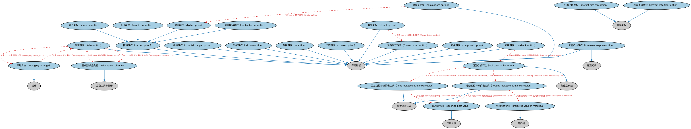

# 奇异期权本体（Exotic Options Ontology）结构与公理说明

本文档对应 `ExoticOptions.rdf` / `ExoticOptions.ttl`，说明该本体的类、继承关系、属性和公理约定。结构图见 `ExoticOptions-structure.png`（`ExoticOptions-structure.svg` 为可缩放版本）。

## 1. 本体概述

定义奇异期权（exotic option）：条款非标准化的期权，如障碍期权、亚式期权、百慕大期权等。

**在体系中的位置**：衍生品合约模块中期权本体的扩展。

**上下游关系**：上游继承期权本体；下游主要服务于场外结构化产品设计。

**与相近概念的差别**：与普通（香草，vanilla）期权的差别——行权条件依赖路径、障碍触发或平均价格等复杂机制，定价与风险特征完全不同。

本本体中类与类的核心关系如下（完整细节见各类小节）：

- **亚式期权（Asian option）** 继承 **奇异期权（ExoticOption）**
- **亚式期权分类器（Asian option classifier）** 继承 **金融工具分类器（FinancialInstrumentClassifier）**
- **平均方法（averaging strategy）** 继承 **战略（Strategy）**
- **障碍期权（barrier option）** 继承 **奇异期权（ExoticOption）**
- **任选期权（chooser option）** 继承 **奇异期权（ExoticOption）**
- **棘轮期权（cliquet option）** 继承 **奇异期权（ExoticOption）**
- **康莫多期权（commodore option）** 继承 **奇异期权（ExoticOption）**
- **复合期权（compound option）** 继承 **奇异期权（ExoticOption）**
- **数字期权（digital option）** 继承 **障碍期权（barrier option）**
- **双重障碍期权（double barrier option）** 继承 **障碍期权（barrier option）**
- **固定回望行权价表达式（fixed lookback strike expression）** 继承 **现金流表达式（CashflowExpression）**
- **浮动回望行权价表达式（floating lookback strike expression）** 继承 **现金流表达式（CashflowExpression）**
- 其余 14 条关系从略。

## 2. 类（Class）

| 类（Class） | 定义（Definition） |
|---|---|
| 亚式期权（Asian option） | 行权条款中支付额由标的平均价格（行权价或结算价）决定的期权。 option whose exercise terms involve a payoff determined by the average underlying price (either the strike price or the settlement price) of the underlying asset over a predetermined period |
| 亚式期权分类器（Asian option classifier） | 按基于利率还是基于价格对亚式期权进行分类的金融工具分类器。 financial instrument classifier that classifies Asian options based on whether they are rate-based or price based |
| 平均方法（averaging strategy） | 用于计算亚式期权平均利率或平均价格的方法。 method used for calculating the average rate or price of an Asian option |
| 障碍期权（barrier option） | 最终行权取决于标的工具价格路径的期权，即其支付取决于标的价格是否触及特定水平。 option whose final exercise depends upon the path taken by the price of an underlying instrument, i.e., whose payoff depends on whether or not the underlying asset has reached or exceeded a predetermined price |
| 任选期权（chooser option） | 允许持有人（买方）选择按固定价格买入（看涨）或卖出（看跌）指定资产之权利的奇异期权。 exotic option that allows its holder (buyer) to exercise the right to buy (call) or sell (put) specified assets at a fixed price whereby the buyer does not have to decide whether the contract will be a put or a call until an agreed future date, prior to expiration |
| 棘轮期权（cliquet option） | 由一系列平值（ATM）期权（看跌或看涨）构成的奇异期权，前一期权到期时后一期权生效。 exotic option that is a series of at-the-money (ATM) options, either puts or calls, where each successive option becomes active when the previous one expires |
| 康莫多期权（commodore option） | 由若干数字障碍期权构成的奇异期权，当标的或标的篮子达到预定水平时支付票息。 exotic option consisting of a number of digital barrier options that pay a coupon if a pre-determined level of the underlying or basket of underlyings is reached |
| 复合期权（compound option） | 标的资产为另一期权的奇异期权。 exotic option for which the underlying asset is another option |
| 数字期权（digital option） | 在期权处于实值且支付条件满足时支付预定金额的奇异期权。 exotic option that has a pre-determined payout if the option is in-the-money and the payoff condition is satisfied |
| 双重障碍期权（double barrier option） | 应用于货币或场外股票的障碍期权，其运作方式类似二元（数字）期权，仅在规定情形下支付。 barrier option applied to currencies or over the counter stocks that works as a binary, or digital option in that it pays out only under defined circumstances, or it is worthless, at expiration |
| 固定回望行权价表达式（fixed lookback strike expression） | 规定计算回望期权固定行权价所需参数的现金流表达式。 cashflow expression specifying the arguments required to calculate the fixed price at which the lookback option is to be exercised |
| 浮动回望行权价表达式（floating lookback strike expression） | 规定计算回望期权可行权最优预计价格所需参数的现金流表达式。 cashflow expression specifying the arguments required to calculate the best projected price at which the lookback option may be exercised |
| 远期生效期权（forward start option） | 就已定到期日、标的资产和其他参数完全确定、在购买时付款、但在未来某时生效的奇异期权。 exotic option that is fully specified with respect to a set expiry date, underlying asset and other parameters, purchased and paid for on initiation, but that becomes active at a set activation date with a strike price determined at the time of activation |
| 利率上限期权（interest rate cap option） | 买方在每个利率超过约定行权价的期间结束时收到付款的利率衍生品。 interest rate derivative in which the buyer receives payments at the end of each period in which the interest rate exceeds the agreed strike price |
| 利率下限期权（interest rate floor option） | 买方在每个利率低于约定行权价的期间结束时收到付款的利率衍生品。 interest rate derivative in which the buyer receives payments at the end of each period in which the interest rate is below the agreed strike price |
| 敲入期权（knock-in option） | 在达到特定价格门槛之前不被触发的障碍期权。 barrier option that is not triggered until a certain price threshold is met |
| 敲出期权（knock-out option） | 内建机制使期权在标的资产达到指定价格水平时作废失效的障碍期权。 barrier option with a built-in mechanism to expire as worthless if a specified price level in the underlying asset is reached |
| 回望期权（lookback option） | 最大限度降低市场进入时点不确定性的奇异期权，持有人在确定行权时可利用历史价格信息。 exotic option that minimizes the uncertainties related to the timing of market entry, providing the holder the advantage of knowing history when determining when to exercise their option |
| 回望行权条款（lookback strike terms） | 基于特定期间（通常截至期权到期）的分析确定标的资产价值的条款。 terms specifying the value of the underlying asset based on analysis during a specific period, typically ending in the maturity of the option, whereby the payoff is determined by comparing the strike price with the value of the selected price |
| 低行权价期权（low exercise price option） | 行权价为一分钱的欧式看涨期权，其表现类似于期货合约。 exotic option that is a European-style call option with an exercise price of one cent that mimics a futures contract |
| 山岭期权（mountain range option） | 基于多种标的证券的奇异期权。 exotic option based on multiple underlying securities |
| 观察最优值（observed best value） | 回望期内某一日期观察到的、从期权视角被视为最优的标的资产价值。 observed value of the underlying asset as of some date during the lookback period that is considered the best value from the perspective of the option holder during the lookback period (depending on whether the option is a call or put) |
| 到期预计价值（projected value at maturity） | 在回望期内某一日期计算得出的标的资产到期预期价值。 expected value of the underlying asset at maturity calculated as of some date during the lookback period |
| 彩虹期权（rainbow option） | 与两种或更多标的资产的表现挂钩的奇异期权。 exotic option linked to the performances of two or more underlying assets |
| 互换期权（swaption） | 赋予持有人在未来某时进入互换交易的权利（而非义务）的场外期权。 over-the-counter option that confers the right but not the obligation, to enter into a swap transaction at some time in the future |

以下按类逐个展开：每个类给出继承关系、相关属性与公理约定；子类在父类之下降一级编号。

### 2.1 亚式期权（Asian option）

定义：行权条款中支付额由标的平均价格（行权价或结算价）决定的期权。

- 父类：**奇异期权（ExoticOption）**

属性：

| 属性 | 定义 | 说明 |
|---|---|---|
| **具有亚式尾部期间（has Asian tail period）** | 标的合约价格平均值计算生效的时间窗口。 window of time during which averaging of the price of the underlying contract is effective | 值域：日期区间；子属性：具有日期区间 |
| **平均值计算所用货币（uses currency in averaging）** | 指明平均值计算所使用的货币。 indicates the currency used in averaging calculation | 值域：货币；子属性：具有货币 |
| **是否使用加权平均（uses weighted average）** | 表明是否使用加权平均来计算平均利率或行权价。 indicates whether a weighted average is being used to calculate the average rate or strike price | 值域：xsd:boolean |
| **具有行权日（hasExerciseDate）** | — | — |
| **由……分类（isClassifiedBy）** | — | — |

公理：

- **具有亚式尾部期间（has Asian tail period）**恰好有 1 个**日期区间（DatePeriod）**。
- **具有行权日（hasExerciseDate）**恰好有 1 个**显式日期（ExplicitDate）**。
- **平均值计算所用货币（uses currency in averaging）**恰好有 1 个**货币（Currency）**。
- **是否使用加权平均（uses weighted average）**存在取值约束。
- **由……分类（isClassifiedBy）**恰好有 1 个**亚式期权分类器（Asian option classifier）**。
- **由……分类（isClassifiedBy）**恰好有 1 个**平均方法（averaging strategy）**。

### 2.2 亚式期权分类器（Asian option classifier）

定义：按基于利率还是基于价格对亚式期权进行分类的金融工具分类器。

- 父类：**金融工具分类器（FinancialInstrumentClassifier）**

属性：

| 属性 | 定义 | 说明 |
|---|---|---|
| **分类（classifies）** | — | — |

公理：

- **分类（classifies）**至少有一个取值，类型是**亚式期权（Asian option）**。

### 2.3 平均方法（averaging strategy）

定义：用于计算亚式期权平均利率或平均价格的方法。

- 父类：**战略（Strategy）**

属性：

| 属性 | 定义 | 说明 |
|---|---|---|
| **分类（classifies）** | — | — |

公理：

- **分类（classifies）**至少有一个取值，类型是**亚式期权（Asian option）**。

### 2.4 障碍期权（barrier option）

定义：最终行权取决于标的工具价格路径的期权，即其支付取决于标的价格是否触及特定水平。

- 父类：**奇异期权（ExoticOption）**
- 直接子类：**数字期权（digital option）**、**双重障碍期权（double barrier option）**、**敲入期权（knock-in option）**、**敲出期权（knock-out option）**

属性：

| 属性 | 定义 | 说明 |
|---|---|---|
| **具有监测频率（has monitoring frequency）** | 检查资产价格是否突破障碍的频率（以天计）。 has frequency with respect to how often, in days, the asset price is checked to see if the barrier has been breached | 值域：xsd:positiveInteger |
| **具有监测期（has monitoring period）** | 对定价进行监测的时间窗口。 window of time during which pricing is monitored | 值域：日期区间；子属性：具有日期区间 |
| **是否高于行权价（is above strike price）** | 表明标的价格高于（或低于）行权价（门槛）时是否触发障碍。 indicates whether the barrier is crossed when the price of the underlier is above (or below, if not) the strike price (threshold) | 值域：xsd:boolean |

公理：

- **具有监测期（has monitoring period）**至少有一个取值，类型是**日期区间（DatePeriod）**。
- **具有监测频率（has monitoring frequency）**至少有一个取值，类型是**xsd:positiveInteger（positiveInteger）**。
- **是否高于行权价（is above strike price）**至少有一个取值，类型是**xsd:boolean（boolean）**。

#### 2.4.1 数字期权（digital option）

定义：在期权处于实值且支付条件满足时支付预定金额的奇异期权。

- 父类：**障碍期权（barrier option）**

#### 2.4.2 双重障碍期权（double barrier option）

定义：应用于货币或场外股票的障碍期权，其运作方式类似二元（数字）期权，仅在规定情形下支付。

- 父类：**障碍期权（barrier option）**

属性：

| 属性 | 定义 | 说明 |
|---|---|---|
| **具有第一障碍价格（has first barrier price）** | 激活或使期权失效的价格（或水平）。 has price (or level) that activates or deactivates the option | 值域：货币价格；子属性：具有价格 |
| **具有第一返还金额（has first rebate amount）** | 指明持有人为期权支付的权利金百分比。 indicates the percentage of the premium paid by the holder for the option | 值域：百分比货币数量；子属性：具有价格 |
| **具有第二障碍价格（has second barrier price）** | 双重障碍期权中第二重障碍激活或失效的价格（或水平）。 has price (or level) that the second barrier activates or deactivates in the case of a double barrier option | 值域：货币价格；子属性：具有价格 |
| **具有第二返还金额（has second rebate amount）** | 指明双重障碍期权中持有人支付的权利金百分比。 indicates the percentage of the premium paid by the holder in the case of a double barrier option | 值域：百分比货币数量；子属性：具有价格 |

公理：

- **具有第一返还金额（has first rebate amount）**可以有 0 个或多个**百分比货币数量（PercentageMonetaryAmount）**。
- **具有第一障碍价格（has first barrier price）**至少有一个取值，类型是**货币价格（MonetaryPrice）**。
- **具有第二返还金额（has second rebate amount）**可以有 0 个或多个**百分比货币数量（PercentageMonetaryAmount）**。
- **具有第二障碍价格（has second barrier price）**至少有一个取值，类型是**货币价格（MonetaryPrice）**。

#### 2.4.3 敲入期权（knock-in option）

定义：在达到特定价格门槛之前不被触发的障碍期权。

- 父类：**障碍期权（barrier option）**

属性：

| 属性 | 定义 | 说明 |
|---|---|---|
| **具有第一障碍价格（has first barrier price）** | 激活或使期权失效的价格（或水平）。 has price (or level) that activates or deactivates the option | 值域：货币价格；子属性：具有价格 |
| **具有第一返还金额（has first rebate amount）** | 指明持有人为期权支付的权利金百分比。 indicates the percentage of the premium paid by the holder for the option | 值域：百分比货币数量；子属性：具有价格 |

公理：

- **具有第一返还金额（has first rebate amount）**可以有 0 个或多个**百分比货币数量（PercentageMonetaryAmount）**。
- **具有第一障碍价格（has first barrier price）**至少有一个取值，类型是**货币价格（MonetaryPrice）**。

#### 2.4.4 敲出期权（knock-out option）

定义：内建机制使期权在标的资产达到指定价格水平时作废失效的障碍期权。

- 父类：**障碍期权（barrier option）**

属性：

| 属性 | 定义 | 说明 |
|---|---|---|
| **具有第一障碍价格（has first barrier price）** | 激活或使期权失效的价格（或水平）。 has price (or level) that activates or deactivates the option | 值域：货币价格；子属性：具有价格 |
| **具有第一返还金额（has first rebate amount）** | 指明持有人为期权支付的权利金百分比。 indicates the percentage of the premium paid by the holder for the option | 值域：百分比货币数量；子属性：具有价格 |

公理：

- **具有第一返还金额（has first rebate amount）**可以有 0 个或多个**百分比货币数量（PercentageMonetaryAmount）**。
- **具有第一障碍价格（has first barrier price）**至少有一个取值，类型是**货币价格（MonetaryPrice）**。

### 2.5 任选期权（chooser option）

定义：允许持有人（买方）选择按固定价格买入（看涨）或卖出（看跌）指定资产之权利的奇异期权。

- 父类：**奇异期权（ExoticOption）**

属性：

| 属性 | 定义 | 说明 |
|---|---|---|
| **具有期权类型选择日（has option type election date）** | 指明任选期权合约持有人选择看涨或看跌的日期。 indicates the date on which the holder of the chooser option contract determines a choice of either a call or a put | 值域：显式日期；子属性：具有显式日期 |
| **包含（comprises）** | — | — |

公理：

- **具有期权类型选择日（has option type election date）**至少有一个取值，类型是**显式日期（ExplicitDate）**。
- **包含（comprises）**至少有一个取值，该取值满足：该属性存在取值约束。

### 2.6 棘轮期权（cliquet option）

定义：由一系列平值（ATM）期权（看跌或看涨）构成的奇异期权，前一期权到期时后一期权生效。

- 父类：**奇异期权（ExoticOption）**

属性：

| 属性 | 定义 | 说明 |
|---|---|---|
| **包含（comprises）** | — | — |

公理：

- **包含（comprises）**至少有一个取值，类型是**远期生效期权（forward start option）**。

### 2.7 康莫多期权（commodore option）

定义：由若干数字障碍期权构成的奇异期权，当标的或标的篮子达到预定水平时支付票息。

- 父类：**奇异期权（ExoticOption）**

属性：

| 属性 | 定义 | 说明 |
|---|---|---|
| **包含（comprises）** | — | — |

公理：

- **包含（comprises）**至少有一个取值，类型是**数字期权（digital option）**。

### 2.8 复合期权（compound option）

定义：标的资产为另一期权的奇异期权。

- 父类：**奇异期权（ExoticOption）**

属性：

| 属性 | 定义 | 说明 |
|---|---|---|
| **包含（comprises）** | — | — |

公理：

- **包含（comprises）**至少有一个取值，类型是**期权（Option）**。

### 2.9 固定回望行权价表达式（fixed lookback strike expression）

定义：规定计算回望期权固定行权价所需参数的现金流表达式。

- 父类：**现金流表达式（CashflowExpression）**

属性：

| 属性 | 定义 | 说明 |
|---|---|---|
| **具有被减数（hasMinuend）** | — | — |
| **具有减数（hasSubtrahend）** | — | — |

公理：

- **具有减数（hasSubtrahend）**至少有一个取值，类型是**观察最优值（observed best value）**。
- **具有被减数（hasMinuend）**至少有一个取值，类型是**行权价（StrikePrice）**。

### 2.10 浮动回望行权价表达式（floating lookback strike expression）

定义：规定计算回望期权可行权最优预计价格所需参数的现金流表达式。

- 父类：**现金流表达式（CashflowExpression）**

属性：

| 属性 | 定义 | 说明 |
|---|---|---|
| **具有被减数（hasMinuend）** | — | — |
| **具有减数（hasSubtrahend）** | — | — |

公理：

- **具有减数（hasSubtrahend）**至少有一个取值，类型是**观察最优值（observed best value）**。
- **具有被减数（hasMinuend）**至少有一个取值，类型是**到期预计价值（projected value at maturity）**。

### 2.11 远期生效期权（forward start option）

定义：就已定到期日、标的资产和其他参数完全确定、在购买时付款、但在未来某时生效的奇异期权。

- 父类：**奇异期权（ExoticOption）**

属性：

| 属性 | 定义 | 说明 |
|---|---|---|
| **包含（comprises）** | — | — |

公理：

- **包含（comprises）**至少有一个取值，该取值满足：该属性存在取值约束。

### 2.12 利率上限期权（interest rate cap option）

定义：买方在每个利率超过约定行权价的期间结束时收到付款的利率衍生品。

- 父类：**利率期权（InterestRateOption）**

公理：

- 与**利率下限期权（interest rate floor option）**互斥：同一个体不能同时属于两者。

### 2.13 利率下限期权（interest rate floor option）

定义：买方在每个利率低于约定行权价的期间结束时收到付款的利率衍生品。

- 父类：**利率期权（InterestRateOption）**

公理：

- 与**利率上限期权（interest rate cap option）**互斥：同一个体不能同时属于两者。

### 2.14 回望期权（lookback option）

定义：最大限度降低市场进入时点不确定性的奇异期权，持有人在确定行权时可利用历史价格信息。

- 父类：**奇异期权（ExoticOption）**

属性：

| 属性 | 定义 | 说明 |
|---|---|---|
| **具有合同要素（hasContractualElement）** | — | — |

公理：

- **具有合同要素（hasContractualElement）**至少有一个取值，类型是**回望行权条款（lookback strike terms）**。

### 2.15 回望行权条款（lookback strike terms）

定义：基于特定期间（通常截至期权到期）的分析确定标的资产价值的条款。

- 父类：**衍生品条款（DerivativeTerms）**

属性：

| 属性 | 定义 | 说明 |
|---|---|---|
| **具有回望期（has lookback period）** | 回望生效的时间窗口。 window of time during which the lookback is effective | 值域：日期区间；子属性：具有日期区间 |
| **具有自变量（hasArgument）** | — | — |
| **具有表达式（hasExpression）** | — | — |

公理：

- **具有回望期（has lookback period）**至少有一个取值，类型是**日期区间（DatePeriod）**。
- **具有自变量（hasArgument）**至少有一个取值，类型是**价格结构（PriceStructure）**。
- **具有表达式（hasExpression）**可以有 0 个或多个**固定回望行权价表达式（fixed lookback strike expression）**。
- **具有表达式（hasExpression）**可以有 0 个或多个**浮动回望行权价表达式（floating lookback strike expression）**。

### 2.16 低行权价期权（low exercise price option）

定义：行权价为一分钱的欧式看涨期权，其表现类似于期货合约。

- 父类：**看涨期权（CallOption）**、**奇异期权（ExoticOption）**

属性：

| 属性 | 定义 | 说明 |
|---|---|---|
| **具有行权方式（hasExerciseStyle）** | — | — |

公理：

- **具有行权方式（hasExerciseStyle）**的取值固定为 EuropeanExerciseConvention。

### 2.17 山岭期权（mountain range option）

定义：基于多种标的证券的奇异期权。

- 父类：**奇异期权（ExoticOption）**

属性：

| 属性 | 定义 | 说明 |
|---|---|---|
| **具有标的（hasUnderlier）** | — | — |

公理：

- **具有标的（hasUnderlier）**至少有一个取值，该取值满足：**由…扮演（is played by）**至少有一个取值，类型是**混合篮子（MixedBasket）**。

### 2.18 观察最优值（observed best value）

定义：回望期内某一日期观察到的、从期权视角被视为最优的标的资产价值。

- 父类：**市场价格（MarketPrice）**

属性：

| 属性 | 定义 | 说明 |
|---|---|---|
| **具有截止日（hasAsOfDate）** | — | — |

公理：

- **具有截止日（hasAsOfDate）**至少有一个取值，类型是**日期（Date）**。

### 2.19 到期预计价值（projected value at maturity）

定义：在回望期内某一日期计算得出的标的资产到期预期价值。

- 父类：**计算价格（CalculatedPrice）**

属性：

| 属性 | 定义 | 说明 |
|---|---|---|
| **具有观测日期时间（hasObservedDateTime）** | — | — |

公理：

- **具有观测日期时间（hasObservedDateTime）**至少有一个取值，类型是**cmns-dt:CombinedDateTime（CombinedDateTime）**。

### 2.20 彩虹期权（rainbow option）

定义：与两种或更多标的资产的表现挂钩的奇异期权。

- 父类：**奇异期权（ExoticOption）**

属性：

| 属性 | 定义 | 说明 |
|---|---|---|
| **具有标的（hasUnderlier）** | — | — |

公理：

- **具有标的（hasUnderlier）**至少有一个取值，该取值满足：**由…扮演（is played by）**至少有一个取值，类型是**混合篮子（MixedBasket）**。

### 2.21 互换期权（swaption）

定义：赋予持有人在未来某时进入互换交易的权利（而非义务）的场外期权。

- 父类：**奇异期权（ExoticOption）**

属性：

| 属性 | 定义 | 说明 |
|---|---|---|
| **具有标的（hasUnderlier）** | — | — |

公理：

- **具有标的（hasUnderlier）**至少有一个取值，该取值满足：**由…扮演（is played by）**至少有一个取值，类型是**互换（Swap）**。

## 3. 依赖（owl:imports，21 个）

本本体通过 `owl:imports` 引入以下本体，各项的中文名称与简介如下：

| 导入本体 | 中文名称 | 简介 |
|---|---|---|
| `DER/DerivativesContracts/DerivativesBasics.rdf` | 衍生品基础本体（Derivatives Basics Ontology） | 定义衍生品合约（derivatives contract）的核心概念：标的资产、行权、到期等，是 DER 域的根基。 |
| `DER/DerivativesContracts/Options.rdf` | 期权本体（Options Ontology） | 定义期权（option）：买方权利、行权价、到期日、看涨与看跌等核心结构。 |
| `DER/DerivativesContracts/Swaps.rdf` | 互换本体（Swaps Ontology） | 定义互换（swap）合约的通用结构：互换腿（swap leg）、现金流交换与名义本金。 |
| `FBC/FinancialInstruments/FinancialInstruments.rdf` | 金融工具本体（Financial Instruments Ontology） | FIBO 核心本体之一，定义金融工具（financial instrument）的通用概念：可交易、代表某种权利义务的合同工具，是证券、衍生品等具体工具的共同基础。 |
| `FBC/FinancialInstruments/InstrumentPricing.rdf` | 工具定价本体（Instrument Pricing Ontology） | 定义金融工具的价格、报价与估值概念。 |
| `FND/Accounting/CurrencyAmount.rdf` | 货币金额本体（Currency Amount Ontology） | 定义「金额＋币种」的货币金额（currency amount）表示，是 FIBO 中表达价格、债务金额、付款额等一切带币种数值的基础构件。 |
| `FND/Agreements/Contracts.rdf` | 合同本体（Contracts Ontology） | 在协议之上定义具有法律约束力的合同（contract）：合同当事方、合同条款、义务与权利，是金融工具与交易合同建模的基石。 |
| `FND/DatesAndTimes/FinancialDates.rdf` | 金融日期本体（Financial Dates Ontology） | 定义金融语境下的日期与期间概念：结算日、付息日、到期日、日计数基准等。 |
| `FND/GoalsAndObjectives/Objectives.rdf` | 目标本体（Objectives Ontology） | 定义目标（objective）及其与组织、计划的关系，用于表达机构的经营目标与投资目标。 |
| `FND/Utilities/Analytics.rdf` | 分析本体（Analytics Ontology） | 定义分析工具、度量与比率的通用概念，支撑指标与模型的表达。 |
| `FND/Utilities/AnnotationVocabulary.rdf` | FIBO 标注词汇表（FIBO Annotation Vocabulary） | 定义 FIBO 专用的标注属性（如释义来源、成熟度等级），用于本体自身的元数据标注。 |
| `IND/Indicators/Indicators.rdf` | 指标本体（Indicators Ontology） | 定义「指标」（indicator）的通用概念：对某现象的可度量表示，是经济指标、利率等的上位模型。 |
| `SEC/Debt/ExerciseConventions.rdf` | 行权惯例本体（Exercise Conventions Ontology） | 定义债务工具中嵌入期权的行权惯例：美式、欧式、百慕大式。 |
| `SEC/Securities/Baskets.rdf` | 篮子本体（Baskets Ontology） | 定义证券篮子（basket）：作为整体交易或定价的一组证券。 |
| `SEC/Securities/SecuritiesClassification.rdf` | 证券分类本体（Securities Classification Ontology） | 定义证券分类方案：按 CFI 代码、按资产类别等对证券归类。 |
| `https://www.omg.org/spec/Commons/AnnotationVocabulary/` | OMG 通用标注词汇表（OMG Commons Annotation Vocabulary） | OMG 通用本体库（Commons）中的标注词汇表，提供概念映射等标注属性，FIBO 用它标注术语与外部标准的对应关系。 |
| `https://www.omg.org/spec/Commons/Classifiers/` | OMG 通用分类器本体（OMG Commons Classifiers） | OMG 通用本体库（Commons）中的分类器本体，定义分类方案、类别与归类关系的通用概念，FIBO 的分类建模建立在其上。 |
| `https://www.omg.org/spec/Commons/Collections/` | OMG 通用集合本体（OMG Commons Collections） | Commons 库中的集合本体，定义集合、成员等通用概念。 |
| `https://www.omg.org/spec/Commons/DatesAndTimes/` | OMG 通用日期与时间本体（OMG Commons Dates and Times） | Commons 库中的日期时间本体，定义日期、期间、时间点等通用时间概念。 |
| `https://www.omg.org/spec/Commons/QuantitiesAndUnits/` | OMG 通用量与单位本体（OMG Commons Quantities and Units） | Commons 库中的量与单位本体，定义数量、度量单位、量纲的通用概念，支撑金额、比率等数值表达。 |
| `https://www.omg.org/spec/Commons/RolesAndCompositions/` | OMG 通用角色与构成本体（OMG Commons Roles and Compositions） | Commons 库中的角色本体，定义角色及整体—部分构成关系的通用概念。 |

## 4. 文件

- 官方 RDF/XML：`ExoticOptions.rdf`
- 中文 Turtle：`ExoticOptions.ttl`
- 结构图：`ExoticOptions-structure.png` / `ExoticOptions-structure.svg`