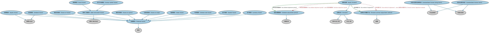

# 期货与远期本体（Futures and Forwards Ontology）结构与公理说明

本文档对应 `FuturesAndForwards.rdf` / `FuturesAndForwards.ttl`，说明该本体的类、继承关系、属性和公理约定。结构图见 `FuturesAndForwards-structure.png`（`FuturesAndForwards-structure.svg` 为可缩放版本）。

## 1. 本体概述

定义期货（futures）与远期（forwards）合约：约定未来某时以约定价格交割标的资产，双方互负义务。

**在体系中的位置**：衍生品合约模块的四大基础结构本体之一。

**上下游关系**：上游继承衍生品基础本体；下游被大宗商品、外汇、利率等按标的特化的合约本体引用，MD 期货时序本体提供其行情数据。

**与相近概念的差别**：期货与远期的核心差别——期货在交易所标准化交易、每日盯市结算，远期是场外定制、到期一次结算；与期权的差别——双方都有交割义务而非单方权利。

## 2. 类（Class）

| 类（Class） | 定义（Definition） |
|---|---|
| 篮子期货（basket future） | 标的资产为一篮子证券和/或指数的期货合约。 |
| 债券期货（bond future） | 标的资产为至少一只债券的期货合约。 |
| 货币期货（currency future） | 标的资产为基于约定汇率在未来某时以一种货币兑换另一种货币之协议的期货合约。 |
| 债务工具期货（debt instrument future） | 标的资产为至少一种债务工具的期货合约。 |
| 股息调整期间（dividend adjustment period） | 用于计算预期股息与该期间实际派发股息之间差额（如有）的日期区间。 |
| 股息期货（dividend future） | 标的资产为至少一笔股票股息的期货合约。 |
| 股票远期（equity forward） | 按约定在未来买卖标的股票、股票指数、股票篮子、股票期货合约或股票期权的远期合约。 |
| 股票期货（equity future） | 标的资产为至少一种权益证券（具体为公开发行交易的股票）的期货合约。 |
| 金融期货（financial future） | 以商品以外的资产为标的的期货合约。 |
| 远期合约（forward） | 双方私下协商、按合约规定价格在未来指定日期买入标的的衍生工具。 |
| 远期合约调整方法（forward contract adjustment method） | 在发生一项或多项异常事件时对合约进行调整的方法。 |
| 期货的期货（future on future） | 标的资产为至少一份（其他）期货合约的期货合约。 |
| 期权的期货（future on option） | 标的资产为至少一份期权合约的期货合约。 |
| 互换的期货（future on swap） | 标的资产为至少一份互换合约的期货合约。 |
| 指数期货（index future） | 标的资产为至少一个参考指数或经济指标的期货合约。 |
| 利率期货（interest rate future） | 以附息工具为标的资产的期货合约。 |
| 货币市场期货（money market future） | 以货币市场工具为标的资产的期货合约。 |
| 标准化期货挂牌条款（standardized futures listing terms） | 由衍生品交易所制定、适用于该交易所任何期货合约挂牌的合同条款。 |
| 标准化期货条款（standardized futures terms） | 由衍生品交易所制定、适用于该交易所交易的任何期货合约的合同条款。 |

### 2.1 继承关系（Inheritance）

- 篮子期货（basket future） ⊑ 金融期货（financial future）
- 债券期货（bond future） ⊑ 债务工具期货（debt instrument future）
- 货币期货（currency future） ⊑ 金融期货（financial future）
- 债务工具期货（debt instrument future） ⊑ 金融期货（financial future）
- 债务工具期货（debt instrument future） ⊑ 债务工具衍生品
- 股息调整期间（dividend adjustment period） ⊑ 日期区间
- 股息期货（dividend future） ⊑ 金融期货（financial future）
- 股息期货（dividend future） ⊑ 股票衍生品
- 股票远期（equity forward） ⊑ 远期合约（forward）
- 股票期货（equity future） ⊑ 金融期货（financial future）
- 股票期货（equity future） ⊑ 股票衍生品
- 金融期货（financial future） ⊑ 期货
- 远期合约（forward） ⊑ 场外衍生工具
- 远期合约（forward） ⊑ 衍生工具
- 远期合约调整方法（forward contract adjustment method） ⊑ 战略
- 期货的期货（future on future） ⊑ 金融期货（financial future）
- 期权的期货（future on option） ⊑ 金融期货（financial future）
- 互换的期货（future on swap） ⊑ 金融期货（financial future）
- 指数期货（index future） ⊑ 金融期货（financial future）
- 利率期货（interest rate future） ⊑ 金融期货（financial future）
- 货币市场期货（money market future） ⊑ 债务工具期货（debt instrument future）
- 标准化期货挂牌条款（standardized futures listing terms） ⊑ 衍生品条款
- 标准化期货挂牌条款（standardized futures listing terms） ⊑ 标准化条款
- 标准化期货条款（standardized futures terms） ⊑ 衍生品条款
- 标准化期货条款（standardized futures terms） ⊑ 标准化条款

## 3. 对象属性（Object Property）

| 属性（Property） | 中文（English） | 定义（Definition） | 说明 |
|---|---|---|---|
| fibo-der-drc-ff:hasDividendAdjustmentPeriod | 具有股息调整期间（has dividend adjustment period） | 指明至少一个用于计算预期股息与实际派发股息之间偏差的日期区间。 | 定义域（domain）：股票远期（equity forward）；值域（range）：股息调整期间（dividend adjustment period）；子属性（subPropertyOf）：具有日期区间 |
| fibo-der-drc-ff:hasMethodOfAdjustment | 具有调整方法（has method of adjustment） | 指明基于合约生命周期内发生的事件处理合约变更的方法。 | 定义域（domain）：股票远期（equity forward）；值域（range）：远期合约调整方法（forward contract adjustment method）；子属性（subPropertyOf）：具有战略 |

## 4. 数据属性（Datatype Property）

| 属性（Property） | 中文（English） | 定义（Definition） |
|---|---|---|
| fibo-der-drc-ff:hasConversionFactor | 具有转换因子（has conversion factor） | 指明使交割债券/票据（1 美元面值）产生固定收益率的价格。转换因子用于计算最终交割价格。 |
| fibo-der-drc-ff:hasMultiple | 具有乘数（has multiple） | 指明用于确定期货合约相对于标的指数价格之关系的乘数。 |

## 5. 公理约定（Axioms）

- 篮子期货（basket future）：具有标的 some（由…扮演（is played by） some 混合篮子）
- 债券期货（bond future）：具有标的 some（由…扮演（is played by） some 债券）
- 债务工具期货（debt instrument future）：具有标的 some（由…扮演（is played by） some 债务工具）
- 股息期货（dividend future）：具有标的 some（由…扮演（is played by） some 上市股份）
- 股票远期（equity forward）：具有股息调整期间（has dividend adjustment period） some 股息调整期间（dividend adjustment period）
- 股票远期（equity forward）：具有调整方法（has method of adjustment） some 远期合约调整方法（forward contract adjustment method）
- 股票远期（equity forward）：具有标的 some（由…扮演（is played by） some（restriction））
- 股票远期（equity forward）：具有合同要素 some 结算条款
- 股票期货（equity future）：具有标的 some（由…扮演（is played by） some 上市股份）
- 期货的期货（future on future）：具有标的 some（由…扮演（is played by） some 期货）
- 期权的期货（future on option）：具有标的 some（由…扮演（is played by） some 期权）
- 互换的期货（future on swap）：具有标的 some（由…扮演（is played by） some 互换）
- 指数期货（index future）：具有标的 some（由…扮演（is played by） some（restriction））
- 利率期货（interest rate future）：具有标的 some（由…扮演（is played by） some（restriction））
- 货币市场期货（money market future）：具有标的 some（由…扮演（is played by） some 货币市场工具）
- 标准化期货挂牌条款（standardized futures listing terms）：具有发布方 some 指定合约市场
- 标准化期货挂牌条款（standardized futures listing terms）：适用于 some 挂牌
- 标准化期货条款（standardized futures terms）：适用于 some 期货
- 标准化期货条款（standardized futures terms）：规定 some 结算条款

## 6. 依赖（owl:imports，27 个）

本本体通过 `owl:imports` 引入以下本体，各项的中文名称与简介如下：

| 导入本体 | 中文名称 | 简介 |
|---|---|---|
| `BE/FunctionalEntities/Publishers.rdf` | 出版方本体（Publishers Ontology） | 定义出版方及其出版物，用于标识金融信息与文档的发布来源。 |
| `DER/DerivativesContracts/DerivativesBasics.rdf` | 衍生品基础本体（Derivatives Basics Ontology） | 定义衍生品合约（derivatives contract）的核心概念：标的资产、行权、到期等，是 DER 域的根基。 |
| `DER/DerivativesContracts/Options.rdf` | 期权本体（Options Ontology） | 定义期权（option）：买方权利、行权价、到期日、看涨与看跌等核心结构。 |
| `DER/DerivativesContracts/Swaps.rdf` | 互换本体（Swaps Ontology） | 定义互换（swap）合约的通用结构：互换腿（swap leg）、现金流交换与名义本金。 |
| `DER/SecurityBasedDerivatives/SecurityBasedDerivatives.rdf` | 证券类衍生品本体（Security-Based Derivatives Ontology） | 定义以单个证券或证券组合为标的的衍生品。 |
| `FBC/FinancialInstruments/FinancialInstruments.rdf` | 金融工具本体（Financial Instruments Ontology） | FIBO 核心本体之一，定义金融工具（financial instrument）的通用概念：可交易、代表某种权利义务的合同工具，是证券、衍生品等具体工具的共同基础。 |
| `FBC/FinancialInstruments/InstrumentPricing.rdf` | 工具定价本体（Instrument Pricing Ontology） | 定义金融工具的价格、报价与估值概念。 |
| `FBC/FunctionalEntities/Markets.rdf` | 市场本体（Markets Ontology） | 定义金融市场（market）：交易所、场外市场及其功能。 |
| `FBC/ProductsAndServices/FinancialProductsAndServices.rdf` | 金融产品与服务本体（Financial Products and Services Ontology） | 定义金融产品（financial product）与金融服务（financial service）及其提供、购买关系。 |
| `FND/Accounting/CurrencyAmount.rdf` | 货币金额本体（Currency Amount Ontology） | 定义「金额＋币种」的货币金额（currency amount）表示，是 FIBO 中表达价格、债务金额、付款额等一切带币种数值的基础构件。 |
| `FND/Agreements/Contracts.rdf` | 合同本体（Contracts Ontology） | 在协议之上定义具有法律约束力的合同（contract）：合同当事方、合同条款、义务与权利，是金融工具与交易合同建模的基石。 |
| `FND/GoalsAndObjectives/Objectives.rdf` | 目标本体（Objectives Ontology） | 定义目标（objective）及其与组织、计划的关系，用于表达机构的经营目标与投资目标。 |
| `FND/Utilities/AnnotationVocabulary.rdf` | FIBO 标注词汇表（FIBO Annotation Vocabulary） | 定义 FIBO 专用的标注属性（如释义来源、成熟度等级），用于本体自身的元数据标注。 |
| `IND/EconomicIndicators/EconomicIndicators.rdf` | 经济指标本体（Economic Indicators Ontology） | 定义宏观经济指标（GDP、CPI、失业率等）的通用结构：发布机构、发布频率与数值。 |
| `IND/MarketIndices/BasketIndices.rdf` | 篮子指数本体（Basket Indices Ontology） | 定义以一篮子成分为基础的指数：成分、权重与计算方法。 |
| `SEC/Debt/Bonds.rdf` | 债券本体（Bonds Ontology） | 定义债券（bond）：期限、票面利率、付息方式与偿还结构。 |
| `SEC/Debt/DebtInstruments.rdf` | 债务工具本体（Debt Instruments Ontology） | 定义债务工具（debt instrument）的通用概念：可交易的债权凭证，是债券、票据等的上位模型。 |
| `SEC/Debt/TradedShortTermDebt.rdf` | 短期交易债务本体（Traded Short-Term Debt Ontology） | 定义货币市场工具等短期可交易债务：商业票据、国库券等。 |
| `SEC/Equities/EquityInstruments.rdf` | 股权工具本体（Equity Instruments Ontology） | 定义股票等股权工具：普通股、优先股及其附带的权利。 |
| `SEC/Securities/Baskets.rdf` | 篮子本体（Baskets Ontology） | 定义证券篮子（basket）：作为整体交易或定价的一组证券。 |
| `SEC/Securities/SecuritiesListings.rdf` | 证券上市本体（Securities Listings Ontology） | 定义证券在交易所上市（listing）及其上市状态。 |
| `https://www.omg.org/spec/Commons/AnnotationVocabulary/` | OMG 通用标注词汇表（OMG Commons Annotation Vocabulary） | OMG 通用本体库（Commons）中的标注词汇表，提供概念映射等标注属性，FIBO 用它标注术语与外部标准的对应关系。 |
| `https://www.omg.org/spec/Commons/ContextualDesignators/` | OMG 通用语境指称本体（OMG Commons Contextual Designators） | Commons 库中的语境指称本体，定义「在某个语境下指代某物的名称/符号」，是地址、账户号码等语境相关标识的基础。 |
| `https://www.omg.org/spec/Commons/DatesAndTimes/` | OMG 通用日期与时间本体（OMG Commons Dates and Times） | Commons 库中的日期时间本体，定义日期、期间、时间点等通用时间概念。 |
| `https://www.omg.org/spec/Commons/Documents/` | OMG 通用文档本体（OMG Commons Documents） | Commons 库中的文档本体，定义文档及其组成部分的通用概念。 |
| `https://www.omg.org/spec/Commons/QuantitiesAndUnits/` | OMG 通用量与单位本体（OMG Commons Quantities and Units） | Commons 库中的量与单位本体，定义数量、度量单位、量纲的通用概念，支撑金额、比率等数值表达。 |
| `https://www.omg.org/spec/Commons/RolesAndCompositions/` | OMG 通用角色与构成本体（OMG Commons Roles and Compositions） | Commons 库中的角色本体，定义角色及整体—部分构成关系的通用概念。 |

## 7. 文件

- 官方 RDF/XML：`FuturesAndForwards.rdf`
- 中文 Turtle：`FuturesAndForwards.ttl`
- 结构图：`FuturesAndForwards-structure.png` / `FuturesAndForwards-structure.svg`