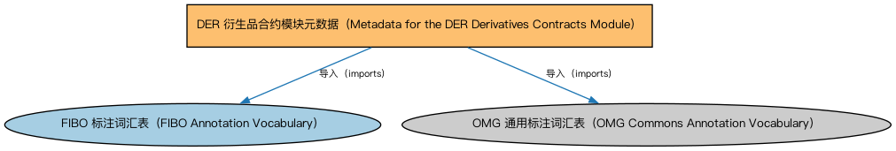

# DER 衍生品合约模块元数据（Metadata for the DER Derivatives Contracts Module）说明

本文档对应 `MetadataDERDerivativesContracts.rdf` / `MetadataDERDerivativesContracts.ttl`。

## 1. 本文件是什么

声明衍生品合约（Derivatives Contracts）模块的构成：衍生品基础、期权、奇异期权、期货与远期、互换、权利与权证、大宗商品合约、外汇合约、结构化工具、主协议及互换个体等本体。

从机制上说，这是一个元数据清单（metadata manifest）文件：它本身不定义任何类或属性，而是通过 `dct:hasPart` 声明一个域或模块由哪些本体构成，并携带版本 IRI、版权、许可与成熟度等发布管理信息。它回答的问题是「这个域/模块包含什么、当前是什么版本」，供发布工具和文档系统按模块组织内容；它的 `owl:imports` 只引入标注词汇表，不是用来加载业务本体的入口（加载入口是 `All*` 与 `About*` 聚合文件）。

## 2. 声明的构成（dct:hasPart，11 个）

| 构成项 | 中文名称 | 简介 |
|---|---|---|
| `DER/DerivativesContracts/CommoditiesContracts.rdf` | 大宗商品合约本体（Commodities Contracts Ontology） | 定义以大宗商品（能源、金属、农产品等）为标的的衍生品合约。 |
| `DER/DerivativesContracts/CurrencyContracts.rdf` | 外汇合约本体（Currency Contracts Ontology） | 定义以外汇为标的的衍生品合约：外汇远期、货币互换等。 |
| `DER/DerivativesContracts/DerivativesBasics.rdf` | 衍生品基础本体（Derivatives Basics Ontology） | 定义衍生品合约（derivatives contract）的核心概念：标的资产、行权、到期等，是 DER 域的根基。 |
| `DER/DerivativesContracts/DerivativesMasterAgreements.rdf` | 衍生品主协议本体（Derivatives Master Agreements Ontology） | 定义 ISDA 主协议等场外衍生品主协议（master agreement）及其条款结构。 |
| `DER/DerivativesContracts/ExoticOptions.rdf` | 奇异期权本体（Exotic Options Ontology） | 定义障碍期权、亚式期权等非标准化（奇异）期权。 |
| `DER/DerivativesContracts/FuturesAndForwards.rdf` | 期货与远期本体（Futures and Forwards Ontology） | 定义期货（futures）与远期（forwards）合约：标准化与非标准化的远期交割安排。 |
| `DER/DerivativesContracts/Options.rdf` | 期权本体（Options Ontology） | 定义期权（option）：买方权利、行权价、到期日、看涨与看跌等核心结构。 |
| `DER/DerivativesContracts/RightsAndWarrants.rdf` | 权利与权证本体（Rights and Warrants Ontology） | 定义认股权证（warrant）、配股权（rights）等赋予持有人购买权利的证券。 |
| `DER/DerivativesContracts/StructuredInstruments.rdf` | 结构化工具本体（Structured Instruments Ontology） | 定义结构化金融工具：由多个成分组合而成、现金流结构定制的工具。 |
| `DER/DerivativesContracts/Swaps.rdf` | 互换本体（Swaps Ontology） | 定义互换（swap）合约的通用结构：互换腿（swap leg）、现金流交换与名义本金。 |
| `DER/DerivativesContracts/SwapsIndividuals.rdf` | 互换个体本体（Swaps Individuals Ontology） | 收录标准化互换合约的参考个体（如标准利率互换的市场约定）。 |

## 3. 标注依赖（owl:imports，2 个）

以下导入仅用于支撑元数据标注本身（如成熟度等级、概念映射），不属于业务内容：

| 导入本体 | 中文名称 | 简介 |
|---|---|---|
| `FND/Utilities/AnnotationVocabulary.rdf` | FIBO 标注词汇表（FIBO Annotation Vocabulary） | 定义 FIBO 专用的标注属性（如释义来源、成熟度等级），用于本体自身的元数据标注。 |
| `https://www.omg.org/spec/Commons/AnnotationVocabulary/` | OMG 通用标注词汇表（OMG Commons Annotation Vocabulary） | OMG 通用本体库（Commons）中的标注词汇表，提供概念映射等标注属性，FIBO 用它标注术语与外部标准的对应关系。 |

## 4. 文件

- 官方 RDF/XML：`MetadataDERDerivativesContracts.rdf`
- 中文 Turtle：`MetadataDERDerivativesContracts.ttl`
- 结构图：`MetadataDERDerivativesContracts-structure.png` / `MetadataDERDerivativesContracts-structure.svg`