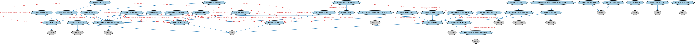

# 期权本体（Options Ontology）结构与公理说明

本文档对应 `Options.rdf` / `Options.ttl`，说明该本体的类、继承关系、属性和公理约定。结构图见 `Options-structure.png`（`Options-structure.svg` 为可缩放版本）。

## 1. 本体概述

定义期权（option）：赋予买方在未来以约定价格买入（看涨）或卖出（看跌）标的资产权利的合约，含行权价、到期日、美式/欧式等核心结构。

**在体系中的位置**：衍生品合约模块的四大基础结构本体之一（期权、期货远期、互换、权证）。

**上下游关系**：上游继承衍生品基础本体；下游被奇异期权、场内期权时序（MD）及各类嵌入期权的工具（可转换债、权证）引用。

**与相近概念的差别**：期权是「权利而非义务」——买方可以不行权，这与期货/远期（双方都有交割义务）是根本差别；与权证的差别——权证由发行人发行、期限更长，期权多在交易所标准化交易。

本本体中类与类的核心关系如下（完整细节见各类小节）：

- **篮子期权（basket option）** 继承 **奇异期权（exotic option）**
- **债券期权（bond option）** 继承 **固定收益期权（fixed income option）**
- **蝶式策略（butterfly）** 继承 **期权交易策略（option trading strategy）**
- **看涨期权（call option）** 继承 **期权（Option）**
- **封顶期权（capped option）** 继承 **普通期权（vanilla option）**
- **领口策略（collar）** 继承 **期权交易策略（option trading strategy）**
- **秃鹰价差（condor spread）** 继承 **期权交易策略（option trading strategy）**
- **备兑看涨期权（covered call）** 继承 **看涨期权（call option）**
- **股票期权（equity option）** 继承 **普通期权（vanilla option）**
- **股票期权（equity option）** 继承 **股票衍生品（EquityDerivative）**
- **奇异期权（exotic option）** 继承 **场外衍生工具（OverTheCounterDerivativeInstrument）**
- **奇异期权（exotic option）** 继承 **期权（Option）**
- 其余 27 条关系从略。

## 2. 类（Class）

| 类（Class） | 定义（Definition） |
|---|---|
| 篮子期权（basket option） | 标的资产为一组（篮子）商品、证券、指数或货币的期权。 |
| 债券期权（bond option） | 赋予买方（持有人）按特定价格买入或卖出（视看涨或看跌而定）债券的权利（而非义务）的期权。 |
| 蝶式策略（butterfly） | 将牛市价差与熊市价差组合、风险固定且盈利封顶的期权策略。 |
| 看涨期权（call option） | 赋予买方（持有人）在指定日期或之前按固定价格或公式买入指定资产的权利（而非义务）的期权。 |
| 封顶期权（capped option） | 设有既定盈利上限或上限价格的期权。 |
| 领口策略（collar） | 买入下档看跌期权并卖出上档看涨期权的期权交易策略，用于防范大额亏损，但也限制了盈利。 |
| 秃鹰价差（condor spread） | 一种非方向性期权策略，同时限制盈利与亏损，旨在从低波动或高波动中获利。 |
| 备兑看涨期权（covered call） | 卖方（投资者）持有等量标的证券的看涨期权。 |
| 股票期权（equity option） | 赋予买方（持有人）买入（通过看涨期权）或卖出（通过看跌期权）标的股票资产的权利（而非义务）的期权。 |
| 奇异期权（exotic option） | 具有非标准支付结构或其他特殊特征的期权。 |
| 外在价值（extrinsic value） | 期权市场价格（即权利金）与其内在价值之间的差额。 |
| 护栏策略（fence） | 利用期权将金融工具的可能回报限定在一定区间内的期权交易策略。 |
| 固定收益期权（fixed income option） | 赋予买方（持有人）买入（通过看涨期权）或卖出（通过看跌期权）标的固定收益资产的权利（而非义务）的期权。 |
| 利率期权（interest rate option） | 赋予买方（持有人）在参考利率的市场利率高于约定水平时收取现金付款的权利（而非义务）的期权。 |
| 内在价值（intrinsic value） | 衡量资产价值的指标，即相对于其当前价格的价值。 |
| 铁蝶式策略（iron butterfly） | 由两个看涨期权、两个看跌期权、三个行权价和同一到期日构成的蝶式策略。 |
| 铁秃鹰策略（iron condor） | 由两个看跌期权（一多一空）、两个看涨期权（一多一空）和四个行权价构成、到期日相同的秃鹰策略。 |
| 长期股票预期证券（long-term equity anticipation security） | 允许持有人买卖股票、到期日长于一年（通常最长三年）的股票期权（LEAPS）。 |
| 价态（moneyness） | 将衍生品的行权价与其标的资产价格相关联的分类器。 |
| 期权持有人（option holder） | 拥有期权的一方。 |
| 期权发行人（option issuer） | 以换取对价为条件授予期权所规定权利的发行人。 |
| 期货期权（option on future） | 赋予持有人在期权到期日或之前按指定价格买入或卖出特定期货合约的权利（而非义务）的期权。 |
| 期权权利金（option premium） | 期权合约的当前市场价格。 |
| 期权权利金公式（option premium formula） | 基于每份期权价格或名义本金百分比计算权利金的表达式。 |
| 期权交易策略（option trading strategy） | 在同一标的资产上涉及不止一种期权类型、行权价或到期日的交易策略。 |
| 保护性领口策略（protective collar） | 由备兑看涨期权和保护性看跌期权构成的领口策略。 |
| 保护性看跌期权（protective put） | 赋予买方（持有人）按等于或接近当前价格的行权价卖出指定资产的权利（而非义务）的看跌期权。 |
| 看跌期权（put option） | 赋予买方（持有人）在指定日期或之前按固定价格或公式卖出指定资产的权利（而非义务）的期权。 |
| 风险逆转策略（risk reversal） | 卖出虚值看跌期权并买入虚值看涨期权、两者到期日相同的期权交易策略。 |
| 标准化期权条款（standardized options terms） | 由证券或期权交易所、或由期权清算机构制定的标准化合同条款。 |
| 跨式策略（straddle） | 同时买入同一标的证券、相同行权价和到期日的看跌期权与看涨期权的中性期权交易策略。 |
| 宽跨式策略（strangle） | 投资者同时持有行权价不同但到期日相同的看涨期权与看跌期权的期权交易策略。 |
| 行权价（strike price） | 合约行权时一手标的资产可以买入或卖出的价格。 |
| 序列期权策略（strip strategy） | 涉及一组带周期性重置日的连续期权的交易策略，各重置区间表现如独立期权。 |
| 普通期权（vanilla option） | 赋予买方（持有人）买入（通过看涨期权）或卖出（通过看跌期权）标的资产的权利（而非义务）的常见期权。 |

以下按类逐个展开：每个类给出继承关系、相关属性与公理约定；子类在父类之下降一级编号。

### 2.1 看涨期权（call option）

定义：赋予买方（持有人）在指定日期或之前按固定价格或公式买入指定资产的权利（而非义务）的期权。

- 父类：**期权（Option）**
- 直接子类：**备兑看涨期权（covered call）**

#### 2.1.1 备兑看涨期权（covered call）

定义：卖方（投资者）持有等量标的证券的看涨期权。

- 父类：**看涨期权（call option）**

### 2.2 奇异期权（exotic option）

定义：具有非标准支付结构或其他特殊特征的期权。

- 父类：**场外衍生工具（OverTheCounterDerivativeInstrument）**、**期权（Option）**
- 直接子类：**篮子期权（basket option）**

#### 2.2.1 篮子期权（basket option）

定义：标的资产为一组（篮子）商品、证券、指数或货币的期权。

- 父类：**奇异期权（exotic option）**

属性：

| 属性 | 定义 | 说明 |
|---|---|---|
| **具有标的（hasUnderlier）** | — | — |
| **具有价格确定方法（hasPriceDeterminationMethod）** | — | — |
| **具有合同期限（hasContractDuration）** | — | — |

公理：

- **具有价格确定方法（hasPriceDeterminationMethod）**至少有一个取值，类型是**价格确定方法（PriceDeterminationMethod）**。
- **具有合同期限（hasContractDuration）**至少有一个取值，类型是**显式时长（ExplicitDuration）**。
- **具有标的（hasUnderlier）**至少有一个取值，该取值满足：**由…扮演（is played by）**至少有一个取值，类型是**混合篮子（MixedBasket）**。

### 2.3 外在价值（extrinsic value）

定义：期权市场价格（即权利金）与其内在价值之间的差额。

- 父类：**货币数量（MonetaryAmount）**

公理：

- 与**内在价值（intrinsic value）**互斥：同一个体不能同时属于两者。

### 2.4 内在价值（intrinsic value）

定义：衡量资产价值的指标，即相对于其当前价格的价值。

- 父类：**货币数量（MonetaryAmount）**

### 2.5 价态（moneyness）

定义：将衍生品的行权价与其标的资产价格相关联的分类器。

- 父类：**分类符（Classifier）**

属性：

| 属性 | 定义 | 说明 |
|---|---|---|
| **分类（classifies）** | — | — |

公理：

- **分类（classifies）**至少有一个取值，类型是**期权（Option）**。

### 2.6 期权持有人（option holder）

定义：拥有期权的一方。

- 父类：**所有者（Owner）**

属性：

| 属性 | 定义 | 说明 |
|---|---|---|
| **持有（holds）** | — | — |

公理：

- **持有（holds）**至少有一个取值，类型是**期权（Option）**。

### 2.7 期权发行人（option issuer）

定义：以换取对价为条件授予期权所规定权利的发行人。

- 父类：**发行人（Issuer）**

属性：

| 属性 | 定义 | 说明 |
|---|---|---|
| **由…扮演（is played by）** | — | — |

公理：

- **由…扮演（is played by）**至少有一个取值，该取值满足：**是…的参与方（is a party to）**至少有一个取值，类型是**期权（Option）**。

### 2.8 期权权利金（option premium）

定义：期权合约的当前市场价格。

- 父类：**市场价格（MarketPrice）**

属性：

| 属性 | 定义 | 说明 |
|---|---|---|
| **具有货币数量（hasMonetaryAmount）** | — | — |
| **具有表达式（hasExpression）** | — | — |
| **具有量值（hasQuantityValue）** | — | — |

公理：

- **具有表达式（hasExpression）**可以有 0 个或多个**期权权利金公式（option premium formula）**。
- **具有货币数量（hasMonetaryAmount）**可以有 0 个或多个**货币数量（MonetaryAmount）**。
- **具有量值（hasQuantityValue）**可以有 0 个或多个**百分比货币数量（PercentageMonetaryAmount）**。

### 2.9 期权权利金公式（option premium formula）

定义：基于每份期权价格或名义本金百分比计算权利金的表达式。

- 父类：**表达式（Expression）**

### 2.10 期权交易策略（option trading strategy）

定义：在同一标的资产上涉及不止一种期权类型、行权价或到期日的交易策略。

- 父类：**交易策略（TradingStrategy）**
- 直接子类：**蝶式策略（butterfly）**、**领口策略（collar）**、**秃鹰价差（condor spread）**、**护栏策略（fence）**、**风险逆转策略（risk reversal）**、**跨式策略（straddle）**、**宽跨式策略（strangle）**、**序列期权策略（strip strategy）**

属性：

| 属性 | 定义 | 说明 |
|---|---|---|
| **包含（comprises）** | — | — |

公理：

- **包含（comprises）**至少有一个取值，类型是**期权（Option）**。

#### 2.10.1 蝶式策略（butterfly）

定义：将牛市价差与熊市价差组合、风险固定且盈利封顶的期权策略。

- 父类：**期权交易策略（option trading strategy）**
- 直接子类：**铁蝶式策略（iron butterfly）**

属性：

| 属性 | 定义 | 说明 |
|---|---|---|
| **具有行权价格（has exercise price）** | 规定持有人承诺买入或卖出标的资产的预定价格。 | 值域：行权价（strike price）；子属性：具有价格 |
| **包含（comprises）** | — | — |

公理：

- **具有行权价格（has exercise price）**恰好有 3 个**行权价（strike price）**。
- **包含（comprises）**恰好有 4 个**期权（Option）**。

##### 2.10.1.1 铁蝶式策略（iron butterfly）

定义：由两个看涨期权、两个看跌期权、三个行权价和同一到期日构成的蝶式策略。

- 父类：**蝶式策略（butterfly）**

属性：

| 属性 | 定义 | 说明 |
|---|---|---|
| **包含（comprises）** | — | — |

公理：

- **包含（comprises）**恰好有 2 个**看涨期权（call option）**。
- **包含（comprises）**恰好有 2 个**看跌期权（put option）**。

#### 2.10.2 领口策略（collar）

定义：买入下档看跌期权并卖出上档看涨期权的期权交易策略，用于防范大额亏损，但也限制了盈利。

- 父类：**期权交易策略（option trading strategy）**
- 直接子类：**保护性领口策略（protective collar）**

属性：

| 属性 | 定义 | 说明 |
|---|---|---|
| **包含（comprises）** | — | — |

公理：

- **包含（comprises）**恰好有 1 个**看涨期权（call option）**。
- **包含（comprises）**恰好有 1 个**看跌期权（put option）**。

##### 2.10.2.1 保护性领口策略（protective collar）

定义：由备兑看涨期权和保护性看跌期权构成的领口策略。

- 父类：**领口策略（collar）**

属性：

| 属性 | 定义 | 说明 |
|---|---|---|
| **包含（comprises）** | — | — |

公理：

- **包含（comprises）**恰好有 1 个**保护性看跌期权（protective put）**。
- **包含（comprises）**恰好有 1 个**备兑看涨期权（covered call）**。

#### 2.10.3 秃鹰价差（condor spread）

定义：一种非方向性期权策略，同时限制盈利与亏损，旨在从低波动或高波动中获利。

- 父类：**期权交易策略（option trading strategy）**
- 直接子类：**铁秃鹰策略（iron condor）**

##### 2.10.3.1 铁秃鹰策略（iron condor）

定义：由两个看跌期权（一多一空）、两个看涨期权（一多一空）和四个行权价构成、到期日相同的秃鹰策略。

- 父类：**秃鹰价差（condor spread）**

属性：

| 属性 | 定义 | 说明 |
|---|---|---|
| **具有行权价格（has exercise price）** | 规定持有人承诺买入或卖出标的资产的预定价格。 | 值域：行权价（strike price）；子属性：具有价格 |
| **包含（comprises）** | — | — |

公理：

- **具有行权价格（has exercise price）**恰好有 4 个**行权价（strike price）**。
- **包含（comprises）**恰好有 2 个**看涨期权（call option）**。
- **包含（comprises）**恰好有 2 个**看跌期权（put option）**。

#### 2.10.4 护栏策略（fence）

定义：利用期权将金融工具的可能回报限定在一定区间内的期权交易策略。

- 父类：**期权交易策略（option trading strategy）**

属性：

| 属性 | 定义 | 说明 |
|---|---|---|
| **包含（comprises）** | — | — |

公理：

- **包含（comprises）**恰好有 1 个**看涨期权（call option）**。
- **包含（comprises）**恰好有 2 个**看跌期权（put option）**。

#### 2.10.5 风险逆转策略（risk reversal）

定义：卖出虚值看跌期权并买入虚值看涨期权、两者到期日相同的期权交易策略。

- 父类：**期权交易策略（option trading strategy）**

属性：

| 属性 | 定义 | 说明 |
|---|---|---|
| **包含（comprises）** | — | — |

公理：

- **包含（comprises）**恰好有 1 个**看涨期权（call option）**。
- **包含（comprises）**恰好有 1 个**看跌期权（put option）**。

#### 2.10.6 跨式策略（straddle）

定义：同时买入同一标的证券、相同行权价和到期日的看跌期权与看涨期权的中性期权交易策略。

- 父类：**期权交易策略（option trading strategy）**

属性：

| 属性 | 定义 | 说明 |
|---|---|---|
| **包含（comprises）** | — | — |

公理：

- **包含（comprises）**恰好有 1 个**看涨期权（call option）**。
- **包含（comprises）**恰好有 1 个**看跌期权（put option）**。

#### 2.10.7 宽跨式策略（strangle）

定义：投资者同时持有行权价不同但到期日相同的看涨期权与看跌期权的期权交易策略。

- 父类：**期权交易策略（option trading strategy）**

属性：

| 属性 | 定义 | 说明 |
|---|---|---|
| **包含（comprises）** | — | — |

公理：

- **包含（comprises）**恰好有 1 个**看涨期权（call option）**。
- **包含（comprises）**恰好有 1 个**看跌期权（put option）**。

#### 2.10.8 序列期权策略（strip strategy）

定义：涉及一组带周期性重置日的连续期权的交易策略，各重置区间表现如独立期权。

- 父类：**期权交易策略（option trading strategy）**

属性：

| 属性 | 定义 | 说明 |
|---|---|---|
| **具有行权日偏移（has exercise date offset）** | 指明重置日与行权日之间的天数。 | 值域：时长；子属性：具有时长 |
| **具有起息日偏移（has interest accrual date offset）** | 指明每个重置日与下一期间利息开始计提之间的天数。 | 值域：时长；子属性：具有时长 |
| **具有结算日偏移（has settlement date offset）** | 指明每个重置日与相应结算日之间的天数。 | 值域：时长；子属性：具有时长 |
| **具有进度表（hasSchedule）** | — | — |
| **包含（comprises）** | — | — |

公理：

- **具有进度表（hasSchedule）**至少有一个取值，类型是**进度表（Schedule）**。
- **包含（comprises）**恰好有 1 个**看涨期权（call option）**。
- **包含（comprises）**恰好有 2 个**看跌期权（put option）**。

### 2.11 看跌期权（put option）

定义：赋予买方（持有人）在指定日期或之前按固定价格或公式卖出指定资产的权利（而非义务）的期权。

- 父类：**期权（Option）**
- 直接子类：**保护性看跌期权（protective put）**

#### 2.11.1 保护性看跌期权（protective put）

定义：赋予买方（持有人）按等于或接近当前价格的行权价卖出指定资产的权利（而非义务）的看跌期权。

- 父类：**看跌期权（put option）**

属性：

| 属性 | 定义 | 说明 |
|---|---|---|
| **具有计算市值（has calculated market value）** | 指明截至某一相对日期计算得出、被视为该时期权市场价值的价格。 | 值域：期权权利金（option premium）；子属性：具有价格 |

公理：

- **具有计算市值（has calculated market value）**至少有一个取值，类型是**期权权利金（option premium）**。

### 2.12 标准化期权条款（standardized options terms）

定义：由证券或期权交易所、或由期权清算机构制定的标准化合同条款。

- 父类：**标准化条款（StandardizedTerms）**

属性：

| 属性 | 定义 | 说明 |
|---|---|---|
| **具有发布方（hasPublisher）** | — | — |
| **具有价格确定方法（hasPriceDeterminationMethod）** | — | — |
| **适用于（appliesTo）** | — | — |

公理：

- **具有价格确定方法（hasPriceDeterminationMethod）**至少有一个取值，类型是**价格确定方法（PriceDeterminationMethod）**。
- **具有发布方（hasPublisher）**至少有一个取值，该取值满足：该属性存在取值约束。
- **适用于（appliesTo）**至少有一个取值，类型是**普通期权（vanilla option）**。

### 2.13 行权价（strike price）

定义：合约行权时一手标的资产可以买入或卖出的价格。

- 父类：**货币价格（MonetaryPrice）**

### 2.14 普通期权（vanilla option）

定义：赋予买方（持有人）买入（通过看涨期权）或卖出（通过看跌期权）标的资产的权利（而非义务）的常见期权。

- 父类：**期权（Option）**
- 直接子类：**封顶期权（capped option）**、**股票期权（equity option）**、**固定收益期权（fixed income option）**、**利率期权（interest rate option）**、**期货期权（option on future）**

属性：

| 属性 | 定义 | 说明 |
|---|---|---|
| **具有价格确定方法（hasPriceDeterminationMethod）** | — | — |
| **具有合同期限（hasContractDuration）** | — | — |

公理：

- **具有价格确定方法（hasPriceDeterminationMethod）**至少有一个取值，类型是**价格确定方法（PriceDeterminationMethod）**。
- **具有合同期限（hasContractDuration）**至少有一个取值，类型是**显式时长（ExplicitDuration）**。

#### 2.14.1 封顶期权（capped option）

定义：设有既定盈利上限或上限价格的期权。

- 父类：**普通期权（vanilla option）**

属性：

| 属性 | 定义 | 说明 |
|---|---|---|
| **具有上限价格（has cap price）** | 合约可行权的价格上限。 | 值域：货币价格；子属性：具有货币数量 |

公理：

- **具有上限价格（has cap price）**至少有一个取值，类型是**货币价格（MonetaryPrice）**。

#### 2.14.2 股票期权（equity option）

定义：赋予买方（持有人）买入（通过看涨期权）或卖出（通过看跌期权）标的股票资产的权利（而非义务）的期权。

- 父类：**普通期权（vanilla option）**、**股票衍生品（EquityDerivative）**
- 直接子类：**长期股票预期证券（long-term equity anticipation security）**

属性：

| 属性 | 定义 | 说明 |
|---|---|---|
| **具有行权方式（has exercise style）** | 指明期权规定的行权惯例。 | 值域：行权惯例；子属性：由……分类 |

公理：

- **具有行权方式（has exercise style）**的取值固定为 AmericanExerciseConvention。

##### 2.14.2.1 长期股票预期证券（long-term equity anticipation security）

定义：允许持有人买卖股票、到期日长于一年（通常最长三年）的股票期权（LEAPS）。

- 父类：**股票期权（equity option）**

属性：

| 属性 | 定义 | 说明 |
|---|---|---|
| **具有合同期限（hasContractDuration）** | — | — |

公理：

- **具有合同期限（hasContractDuration）**至少有一个取值，类型是**时长（Duration）**。

#### 2.14.3 固定收益期权（fixed income option）

定义：赋予买方（持有人）买入（通过看涨期权）或卖出（通过看跌期权）标的固定收益资产的权利（而非义务）的期权。

- 父类：**普通期权（vanilla option）**、**债务工具衍生品（DebtInstrumentDerivative）**
- 直接子类：**债券期权（bond option）**

##### 2.14.3.1 债券期权（bond option）

定义：赋予买方（持有人）按特定价格买入或卖出（视看涨或看跌而定）债券的权利（而非义务）的期权。

- 父类：**固定收益期权（fixed income option）**

属性：

| 属性 | 定义 | 说明 |
|---|---|---|
| **具有标的（hasUnderlier）** | — | — |

公理：

- **具有标的（hasUnderlier）**至少有一个取值，该取值满足：**由…扮演（is played by）**至少有一个取值，类型是**债券（Bond）**。

#### 2.14.4 利率期权（interest rate option）

定义：赋予买方（持有人）在参考利率的市场利率高于约定水平时收取现金付款的权利（而非义务）的期权。

- 父类：**利率衍生品（InterestRateDerivative）**、**普通期权（vanilla option）**

属性：

| 属性 | 定义 | 说明 |
|---|---|---|
| **具有行权利率（has strike rate）** | 合约可行权的利率。 | 值域：比率；子属性：具有量值 |
| **具有标的（hasUnderlier）** | — | — |

公理：

- **具有标的（hasUnderlier）**至少有一个取值，该取值满足：**由…扮演（is played by）**至少有一个取值，类型是**利率基准（InterestRateBenchmark）**。
- **具有行权利率（has strike rate）**至少有一个取值，类型是**利率（InterestRate）**。

#### 2.14.5 期货期权（option on future）

定义：赋予持有人在期权到期日或之前按指定价格买入或卖出特定期货合约的权利（而非义务）的期权。

- 父类：**普通期权（vanilla option）**

属性：

| 属性 | 定义 | 说明 |
|---|---|---|
| **具有标的（hasUnderlier）** | — | — |
| **具有行权条款（hasExerciseTerms）** | — | — |

公理：

- **具有标的（hasUnderlier）**至少有一个取值，该取值满足：**由…扮演（is played by）**至少有一个取值，类型是**期货（Future）**。
- **具有行权条款（hasExerciseTerms）**至少有一个取值，类型是**美式行权条款（AmericanExerciseTerms）**。

## 3. 其他属性

以下属性未绑定到本体的具体类（定义域在外部本体或未声明）：

对象属性（Object Property）：

| 属性 | 定义 | 说明 |
|---|---|---|
| **具有行权计划表（has exercise schedule）** | 将期权与合约中规定的、约束其可行权时间的计划表关联起来。 | 值域：进度表；子属性：具有进度表 |
| **具有期权持有人（has option holder）** | 指明期权的所有者。 | 值域：期权持有人（option holder）；子属性：具有合同当事方 |
| **具有期权签发方（has option writer）** | 指明期权的发行人。 | 值域：期权发行人（option issuer）；子属性：具有合同当事方 |
| **具有行权百分比（has strike percentage amount）** | 指明以标的资产价值百分比表示的行权价格或行权水平。 | 值域：百分比货币数量；子属性：具有价格 |

## 4. 依赖（owl:imports，30 个）

本本体通过 `owl:imports` 引入以下本体，各项的中文名称与简介如下：

| 导入本体 | 中文名称 | 简介 |
|---|---|---|
| `BE/FunctionalEntities/Publishers.rdf` | 出版方本体（Publishers Ontology） | 定义出版方及其出版物，用于标识金融信息与文档的发布来源。 |
| `DER/DerivativesContracts/DerivativesBasics.rdf` | 衍生品基础本体（Derivatives Basics Ontology） | 定义衍生品合约（derivatives contract）的核心概念：标的资产、行权、到期等，是 DER 域的根基。 |
| `DER/SecurityBasedDerivatives/SecurityBasedDerivatives.rdf` | 证券类衍生品本体（Security-Based Derivatives Ontology） | 定义以单个证券或证券组合为标的的衍生品。 |
| `FBC/FinancialInstruments/FinancialInstruments.rdf` | 金融工具本体（Financial Instruments Ontology） | FIBO 核心本体之一，定义金融工具（financial instrument）的通用概念：可交易、代表某种权利义务的合同工具，是证券、衍生品等具体工具的共同基础。 |
| `FBC/FinancialInstruments/InstrumentPricing.rdf` | 工具定价本体（Instrument Pricing Ontology） | 定义金融工具的价格、报价与估值概念。 |
| `FBC/FunctionalEntities/Markets.rdf` | 市场本体（Markets Ontology） | 定义金融市场（market）：交易所、场外市场及其功能。 |
| `FBC/ProductsAndServices/FinancialProductsAndServices.rdf` | 金融产品与服务本体（Financial Products and Services Ontology） | 定义金融产品（financial product）与金融服务（financial service）及其提供、购买关系。 |
| `FND/Accounting/CurrencyAmount.rdf` | 货币金额本体（Currency Amount Ontology） | 定义「金额＋币种」的货币金额（currency amount）表示，是 FIBO 中表达价格、债务金额、付款额等一切带币种数值的基础构件。 |
| `FND/Agreements/Contracts.rdf` | 合同本体（Contracts Ontology） | 在协议之上定义具有法律约束力的合同（contract）：合同当事方、合同条款、义务与权利，是金融工具与交易合同建模的基石。 |
| `FND/Arrangements/Documents.rdf` | 文档本体（Documents Ontology） | 定义文档、文档类型及文档与其所记载内容的关系，为合同文本、募集说明书等法律文书建模。 |
| `FND/DatesAndTimes/FinancialDates.rdf` | 金融日期本体（Financial Dates Ontology） | 定义金融语境下的日期与期间概念：结算日、付息日、到期日、日计数基准等。 |
| `FND/OwnershipAndControl/Ownership.rdf` | 所有权本体（Ownership Ontology） | 定义「拥有」关系：所有者、被拥有资产及所有权份额。 |
| `FND/Relations/Relations.rdf` | 关系本体（Relations Ontology） | FIBO 最底层的基础本体，定义参考（reference）、分类（classify）等通用关系与抽象概念，全库普遍依赖。 |
| `FND/Utilities/Analytics.rdf` | 分析本体（Analytics Ontology） | 定义分析工具、度量与比率的通用概念，支撑指标与模型的表达。 |
| `FND/Utilities/AnnotationVocabulary.rdf` | FIBO 标注词汇表（FIBO Annotation Vocabulary） | 定义 FIBO 专用的标注属性（如释义来源、成熟度等级），用于本体自身的元数据标注。 |
| `IND/InterestRates/InterestRates.rdf` | 利率本体（Interest Rates Ontology） | 定义利率（interest rate）的结构：基准利率、利差、期限与重置机制。 |
| `SEC/Debt/Bonds.rdf` | 债券本体（Bonds Ontology） | 定义债券（bond）：期限、票面利率、付息方式与偿还结构。 |
| `SEC/Debt/ExerciseConventions.rdf` | 行权惯例本体（Exercise Conventions Ontology） | 定义债务工具中嵌入期权的行权惯例：美式、欧式、百慕大式。 |
| `SEC/Equities/EquityInstruments.rdf` | 股权工具本体（Equity Instruments Ontology） | 定义股票等股权工具：普通股、优先股及其附带的权利。 |
| `SEC/Securities/Baskets.rdf` | 篮子本体（Baskets Ontology） | 定义证券篮子（basket）：作为整体交易或定价的一组证券。 |
| `SEC/Securities/SecuritiesListings.rdf` | 证券上市本体（Securities Listings Ontology） | 定义证券在交易所上市（listing）及其上市状态。 |
| `https://www.omg.org/spec/Commons/AnnotationVocabulary/` | OMG 通用标注词汇表（OMG Commons Annotation Vocabulary） | OMG 通用本体库（Commons）中的标注词汇表，提供概念映射等标注属性，FIBO 用它标注术语与外部标准的对应关系。 |
| `https://www.omg.org/spec/Commons/Classifiers/` | OMG 通用分类器本体（OMG Commons Classifiers） | OMG 通用本体库（Commons）中的分类器本体，定义分类方案、类别与归类关系的通用概念，FIBO 的分类建模建立在其上。 |
| `https://www.omg.org/spec/Commons/Collections/` | OMG 通用集合本体（OMG Commons Collections） | Commons 库中的集合本体，定义集合、成员等通用概念。 |
| `https://www.omg.org/spec/Commons/ContextualDesignators/` | OMG 通用语境指称本体（OMG Commons Contextual Designators） | Commons 库中的语境指称本体，定义「在某个语境下指代某物的名称/符号」，是地址、账户号码等语境相关标识的基础。 |
| `https://www.omg.org/spec/Commons/DatesAndTimes/` | OMG 通用日期与时间本体（OMG Commons Dates and Times） | Commons 库中的日期时间本体，定义日期、期间、时间点等通用时间概念。 |
| `https://www.omg.org/spec/Commons/Documents/` | OMG 通用文档本体（OMG Commons Documents） | Commons 库中的文档本体，定义文档及其组成部分的通用概念。 |
| `https://www.omg.org/spec/Commons/PartiesAndSituations/` | OMG 通用参与方与情境本体（OMG Commons Parties and Situations） | Commons 库中的参与方本体，定义独立主体、参与方及其角色扮演的通用概念，是 FIBO 参与方模型的上游。 |
| `https://www.omg.org/spec/Commons/QuantitiesAndUnits/` | OMG 通用量与单位本体（OMG Commons Quantities and Units） | Commons 库中的量与单位本体，定义数量、度量单位、量纲的通用概念，支撑金额、比率等数值表达。 |
| `https://www.omg.org/spec/Commons/RolesAndCompositions/` | OMG 通用角色与构成本体（OMG Commons Roles and Compositions） | Commons 库中的角色本体，定义角色及整体—部分构成关系的通用概念。 |

## 5. 文件

- 官方 RDF/XML：`Options.rdf`
- 中文 Turtle：`Options.ttl`
- 结构图：`Options-structure.png` / `Options-structure.svg`