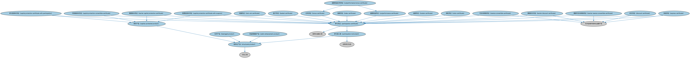

# 结构化工具本体（Structured Instruments Ontology）结构与公理说明

本文档对应 `StructuredInstruments.rdf` / `StructuredInstruments.ttl`，说明该本体的类、继承关系、属性和公理约定。结构图见 `StructuredInstruments-structure.png`（`StructuredInstruments-structure.svg` 为可缩放版本）。

## 1. 本体概述

定义结构化金融工具：由多个成分（如债券＋期权）组合而成、现金流结构定制的工具，如保本票据、可转换债券的混合特征部分。

**在体系中的位置**：衍生品合约模块中处理「组合结构」的本体。

**上下游关系**：上游继承衍生品基础本体并引用 SEC 债务工具；下游服务结构化产品设计、风险分解分析。

**与相近概念的差别**：与普通衍生品的差别——结构化工具是「打包组合」，一个工具内嵌多种成分；与证券化产品（ABS/MBS）的差别——证券化以资产池现金流为基础，结构化工具以衍生策略组合为基础。

## 2. 类（Class）

| 类（Class） | 定义（Definition） |
|---|---|
| 障碍保本凭证（barrier capital protection certificate） | 保本产品：保护额度定义为名义价格的一定百分比（如 100%），到期最低赎回额等于该保护水平，但设有障碍条款。 |
| 障碍折价凭证（barrier discount certificate） | 参与凭证：使投资者能以较低价格获得标的资产，作为回报其收益设有上限，且标的触及障碍时保护失效。 |
| 障碍可反向转换凭证（barrier reverse convertible certificate） | 参与凭证：支付是有条件的——若障碍从未被触及，赎回时支付名义价格加票息；若被触及，则按约定交割标的或现金。 |
| 篮子凭证（basket certificate） | 标的资产为对应认购比率的一篮子证券份额的凭证。 |
| 红利凭证（bonus certificate） | 在障碍未被触及的前提下最低赎回额等于名义价值的凭证，其相对于多资产结构具有更高风险。 |
| 附票息保本凭证（capital protection certificate with coupons） | 保本产品：保护额度定义为名义价格的一定百分比（如 100%），到期最低赎回额等于该保护水平，并在存续期内支付票息。 |
| 参与型保本凭证（capital protection certificate with participation） | 保本产品：保护额度定义为名义金额的一定百分比（如 100%），到期最低赎回额等于该保护水平，并可参与标的上涨。 |
| 可转换保本凭证（capital protection convertible certificate） | 保本产品：保护额度定义为名义价格的一定百分比（如 100%），到期最低赎回额等于该保护水平，并具有可转换特征。 |
| 保本产品（capital-protected product） | 在保护投资者本金的同时参与股票、基金或指数等金融资产表现的结构化产品。 |
| 折价凭证（discount certificate） | 参与凭证：使投资者能以较低价格获得标的资产，作为回报其收益设有上限。 |
| 快线凭证（express certificate） | 参与凭证：支付是有条件的——若标的在观察日高于行权价，则提前赎回并支付约定金额。 |
| 指数凭证（index certificate） | 标的资产为指数的凭证。 |
| 杠杆产品（leveraged product） | 在收益增强型产品之上提供进一步放大收益的结构化产品，通常对上行空间不设限制。 |
| 超额收益红利凭证（outperformance bonus certificate） | 允许对行权价以上的正收益进行超额（不成比例）参与的凭证，其最低赎回额等于名义价值（以障碍未被触及为条件）。 |
| 超额收益凭证（outperformance certificate） | 允许对行权价以上的正收益进行超额（不成比例）参与的凭证，标的价格变动按 1:1 反映。 |
| 参与凭证（participation certificate） | 提供参与资产价格涨跌之可能性的参与型产品，须承担交易对手风险。 |
| 参与型工具（participation instrument） | 提供参与某一资产或一篮子资产表现之可能性的结构化产品。 |
| 可反向转换凭证（reverse convertible certificate） | 参与凭证：支付是有条件的——若标的资产在到期时收于行权价之下，则交割标的资产和/或现金。 |
| 结构化产品（structured product） | 现金流特征取决于一个或多个指数、或内嵌远期或期权、或投资者回报取决于其他要素的证券。 |
| 追踪凭证（tracker certificate） | 按 1:1 反映标的价格变动（经转换比率和相关费用调整）的凭证，其相关风险与直接持有标的相当。 |
| 涡轮凭证（turbo certificate） | 作为杠杆证券的凭证，其价格一对一跟踪标的金融资产价格，可用于做多或做空。 |
| 双赢凭证（twin-win certificate） | 在标的资产价值上涨和下跌时均可能获利的凭证，标的价格下跌也可转化为利润（在一定区间内）。 |
| 收益增强型产品（yield-enhancement product） | 以承担下行风险为代价提供预定收益的结构化产品。 |

### 2.1 继承关系（Inheritance）

- 障碍保本凭证（barrier capital protection certificate） ⊑ 保本产品（capital-protected product）
- 障碍保本凭证（barrier capital protection certificate） ⊑ 参与凭证（participation certificate）
- 障碍折价凭证（barrier discount certificate） ⊑ 参与凭证（participation certificate）
- 障碍折价凭证（barrier discount certificate） ⊑ 无本金保护结构化金融产品
- 障碍可反向转换凭证（barrier reverse convertible certificate） ⊑ 参与凭证（participation certificate）
- 障碍可反向转换凭证（barrier reverse convertible certificate） ⊑ 无本金保护结构化金融产品
- 篮子凭证（basket certificate） ⊑ 参与凭证（participation certificate）
- 红利凭证（bonus certificate） ⊑ 参与凭证（participation certificate）
- 附票息保本凭证（capital protection certificate with coupons） ⊑ 保本产品（capital-protected product）
- 附票息保本凭证（capital protection certificate with coupons） ⊑ 参与凭证（participation certificate）
- 参与型保本凭证（capital protection certificate with participation） ⊑ 保本产品（capital-protected product）
- 参与型保本凭证（capital protection certificate with participation） ⊑ 参与凭证（participation certificate）
- 可转换保本凭证（capital protection convertible certificate） ⊑ 保本产品（capital-protected product）
- 可转换保本凭证（capital protection convertible certificate） ⊑ 参与凭证（participation certificate）
- 保本产品（capital-protected product） ⊑ 结构化产品（structured product）
- 折价凭证（discount certificate） ⊑ 参与凭证（participation certificate）
- 折价凭证（discount certificate） ⊑ 无本金保护结构化金融产品
- 快线凭证（express certificate） ⊑ 参与凭证（participation certificate）
- 快线凭证（express certificate） ⊑ 无本金保护结构化金融产品
- 指数凭证（index certificate） ⊑ 参与凭证（participation certificate）
- 杠杆产品（leveraged product） ⊑ 结构化产品（structured product）
- 超额收益红利凭证（outperformance bonus certificate） ⊑ 红利凭证（bonus certificate）
- 超额收益红利凭证（outperformance bonus certificate） ⊑ 超额收益凭证（outperformance certificate）
- 超额收益凭证（outperformance certificate） ⊑ 参与凭证（participation certificate）
- 参与凭证（participation certificate） ⊑ 参与型工具（participation instrument）
- 参与凭证（participation certificate） ⊑ 结构化金融工具
- 参与型工具（participation instrument） ⊑ 结构化产品（structured product）
- 参与型工具（participation instrument） ⊑ 证券类衍生品
- 可反向转换凭证（reverse convertible certificate） ⊑ 参与凭证（participation certificate）
- 可反向转换凭证（reverse convertible certificate） ⊑ 无本金保护结构化金融产品
- 结构化产品（structured product） ⊑ 衍生工具
- 追踪凭证（tracker certificate） ⊑ 参与凭证（participation certificate）
- 涡轮凭证（turbo certificate） ⊑ 参与凭证（participation certificate）
- 双赢凭证（twin-win certificate） ⊑ 参与凭证（participation certificate）
- 收益增强型产品（yield-enhancement product） ⊑ 结构化产品（structured product）

## 6. 依赖（owl:imports，6 个）

本本体通过 `owl:imports` 引入以下本体，各项的中文名称与简介如下：

| 导入本体 | 中文名称 | 简介 |
|---|---|---|
| `DER/DerivativesContracts/DerivativesBasics.rdf` | 衍生品基础本体（Derivatives Basics Ontology） | 定义衍生品合约（derivatives contract）的核心概念：标的资产、行权、到期等，是 DER 域的根基。 |
| `DER/SecurityBasedDerivatives/SecurityBasedDerivatives.rdf` | 证券类衍生品本体（Security-Based Derivatives Ontology） | 定义以单个证券或证券组合为标的的衍生品。 |
| `FBC/FinancialInstruments/FinancialInstruments.rdf` | 金融工具本体（Financial Instruments Ontology） | FIBO 核心本体之一，定义金融工具（financial instrument）的通用概念：可交易、代表某种权利义务的合同工具，是证券、衍生品等具体工具的共同基础。 |
| `FND/Utilities/AnnotationVocabulary.rdf` | FIBO 标注词汇表（FIBO Annotation Vocabulary） | 定义 FIBO 专用的标注属性（如释义来源、成熟度等级），用于本体自身的元数据标注。 |
| `SEC/Debt/PoolBackedSecurities.rdf` | 池支持证券本体（Pool-backed Securities Ontology） | 定义以资产池为支持的证券的通用结构：资产池、分层（tranche）与过手安排。 |
| `https://www.omg.org/spec/Commons/AnnotationVocabulary/` | OMG 通用标注词汇表（OMG Commons Annotation Vocabulary） | OMG 通用本体库（Commons）中的标注词汇表，提供概念映射等标注属性，FIBO 用它标注术语与外部标准的对应关系。 |

## 7. 文件

- 官方 RDF/XML：`StructuredInstruments.rdf`
- 中文 Turtle：`StructuredInstruments.ttl`
- 结构图：`StructuredInstruments-structure.png` / `StructuredInstruments-structure.svg`