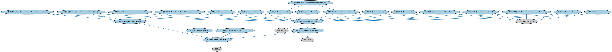

# 结构化工具本体（Structured Instruments Ontology）结构与公理说明

本文档对应 `StructuredInstruments.rdf` / `StructuredInstruments.ttl`，说明该本体的类、继承关系、属性和公理约定。结构图见 `StructuredInstruments-structure.png`（`StructuredInstruments-structure.svg` 为可缩放版本）。

## 1. 本体概述

定义结构化金融工具：由多个成分（如债券＋期权）组合而成、现金流结构定制的工具，如保本票据、可转换债券的混合特征部分。

**在体系中的位置**：衍生品合约模块中处理「组合结构」的本体。

**上下游关系**：上游继承衍生品基础本体并引用 SEC 债务工具；下游服务结构化产品设计、风险分解分析。

**与相近概念的差别**：与普通衍生品的差别——结构化工具是「打包组合」，一个工具内嵌多种成分；与证券化产品（ABS/MBS）的差别——证券化以资产池现金流为基础，结构化工具以衍生策略组合为基础。

本本体中类与类的核心关系如下（完整细节见各类小节）：

- **障碍保本凭证（barrier capital protection certificate）** 继承 **保本产品（capital-protected product）**
- **障碍保本凭证（barrier capital protection certificate）** 继承 **参与凭证（participation certificate）**
- **障碍折价凭证（barrier discount certificate）** 继承 **参与凭证（participation certificate）**
- **障碍折价凭证（barrier discount certificate）** 继承 **无本金保护结构化金融产品（StructuredFinanceWithoutPrincipalProtection）**
- **障碍可反向转换凭证（barrier reverse convertible certificate）** 继承 **参与凭证（participation certificate）**
- **障碍可反向转换凭证（barrier reverse convertible certificate）** 继承 **无本金保护结构化金融产品（StructuredFinanceWithoutPrincipalProtection）**
- **篮子凭证（basket certificate）** 继承 **参与凭证（participation certificate）**
- **红利凭证（bonus certificate）** 继承 **参与凭证（participation certificate）**
- **附票息保本凭证（capital protection certificate with coupons）** 继承 **保本产品（capital-protected product）**
- **附票息保本凭证（capital protection certificate with coupons）** 继承 **参与凭证（participation certificate）**
- **参与型保本凭证（capital protection certificate with participation）** 继承 **保本产品（capital-protected product）**
- **参与型保本凭证（capital protection certificate with participation）** 继承 **参与凭证（participation certificate）**
- 其余 23 条关系从略。

## 2. 类（Class）

| 类（Class） | 定义（Definition） |
|---|---|
| 障碍保本凭证（barrier capital protection certificate） | 保本产品：保护额度定义为名义价格的一定百分比（如 100%），到期最低赎回额等于该保护水平，但设有障碍条款。 capital-protected product whose protection is defined as a percentage of the nominal price (e.g. 100 percent), with minimum redemption at expiry equivalent to the capital protection |
| 障碍折价凭证（barrier discount certificate） | 参与凭证：使投资者能以较低价格获得标的资产，作为回报其收益设有上限，且标的触及障碍时保护失效。 participation certificate that enables the investor to acquire the underlying asset at a lower price in return for a limited payout, and for which the maximum redemption amount (Cap) is paid out if the barrier is never breached |
| 障碍可反向转换凭证（barrier reverse convertible certificate） | 参与凭证：支付是有条件的——若障碍从未被触及，赎回时支付名义价格加票息；若被触及，则按约定交割标的或现金。 participation certificate whose payout is conditional: should the barrier never be breached, the nominal price plus coupon is paid at redemption; if the barrier is breached the product changes into a reverse convertible |
| 篮子凭证（basket certificate） | 标的资产为对应认购比率的一篮子证券份额的凭证。 certificate whose underlying asset represents a fraction of a basket of securities that corresponds to the subscription ratio |
| 红利凭证（bonus certificate） | 在障碍未被触及的前提下最低赎回额等于名义价值的凭证，其相对于多资产结构具有更高风险。 certificate whose minimum redemption is equal to the nominal value provided the barrier has not been breached, with a greater risk in relation to multiple underlying asset(s) (worst-of), allowing for a higher bonus level or lower barrier, and with a reduced risk compared to a direct investment into the underlying asset(s) |
| 附票息保本凭证（capital protection certificate with coupons） | 保本产品：保护额度定义为名义价格的一定百分比（如 100%），到期最低赎回额等于该保护水平，并在存续期内支付票息。 capital-protected product whose protection is defined as a percentage of the nominal price (e.g. 100 percent), with minimum redemption at expiry equivalent to the capital protection |
| 参与型保本凭证（capital protection certificate with participation） | 保本产品：保护额度定义为名义金额的一定百分比（如 100%），到期最低赎回额等于该保护水平，并可参与标的上涨。 capital-protected product whose protection is defined as a percentage of the nominal amount (e.g. 100 percent), with minimum redemption at expiry equivalent to the capital protection |
| 可转换保本凭证（capital protection convertible certificate） | 保本产品：保护额度定义为名义价格的一定百分比（如 100%），到期最低赎回额等于该保护水平，并具有可转换特征。 capital-protected product whose protection is defined as a percentage of the nominal price (e.g. 100 percent), with minimum redemption at expiry equivalent to the capital protection |
| 保本产品（capital-protected product） | 在保护投资者本金的同时参与股票、基金或指数等金融资产表现的结构化产品。 structured product that participates in the performance of a financial asset, such as a stock, fund or index, while protecting the investor's capital |
| 折价凭证（discount certificate） | 参与凭证：使投资者能以较低价格获得标的资产，作为回报其收益设有上限。 participation certificate that enables the investor to acquire the underlying asset at a lower price in return for a limited payout, and for which the underlying asset(s) and/or a cash amount is redeemed should the underlying asset close below the strike on expiry, for which, in return, the potential profit is capped |
| 快线凭证（express certificate） | 参与凭证：支付是有条件的——若标的在观察日高于行权价，则提前赎回并支付约定金额。 participation certificate whose payout is conditional: should the underlying trade above the strike on the observation date, an early redemption consisting of nominal price plus an additional coupon amount is paid |
| 指数凭证（index certificate） | 标的资产为指数的凭证。 certificate whose underlying asset is an index |
| 杠杆产品（leveraged product） | 在收益增强型产品之上提供进一步放大收益的结构化产品，通常对上行空间不设限制。 structured product that provides a further enhanced yield (over and above that of a yield-enhancement product), often without any limit to the upside participation, and frequently with a stop-loss in order to limit potential capital losses |
| 超额收益红利凭证（outperformance bonus certificate） | 允许对行权价以上的正收益进行超额（不成比例）参与的凭证，其最低赎回额等于名义价值（以障碍未被触及为条件）。 certificate that allows disproportionate participation (outperformance) in positive performance above the strike, in which the minimum redemption is equal to the nominal value provided the barrier has not been breached, with greater risk multiple underlying asset(s) (worst-of) allow for a higher bonus level or lower barrier, and reduced risk compared to a direct investment into the underlying asset(s) |
| 超额收益凭证（outperformance certificate） | 允许对行权价以上的正收益进行超额（不成比例）参与的凭证，标的价格变动按 1:1 反映。 certificate that allows disproportionate participation (outperformance) in positive performance above the strike, reflecting underlying price moves 1:1 (adjusted by the conversion ratio and any related fees), and whose risk is comparable to direct investment in the underlying asset(s) |
| 参与凭证（participation certificate） | 提供参与资产价格涨跌之可能性的参与型产品，须承担交易对手风险。 participation product that provides the possibility to participate in the gains or losses in the price of an asset, subject to counterparty risk |
| 参与型工具（participation instrument） | 提供参与某一资产或一篮子资产表现之可能性的结构化产品。 structured product that provides the possibility to participate in the performance of an asset or basket of assets |
| 可反向转换凭证（reverse convertible certificate） | 参与凭证：支付是有条件的——若标的资产在到期时收于行权价之下，则交割标的资产和/或现金。 participation certificate whose payout is conditional: should the underlying asset close below the strike on expiry, the underlying asset(s) and/ or a cash amount is redeemed; should the underlying asset close above the strike at expiry, the nominal amount plus the coupon is paid at redemption |
| 结构化产品（structured product） | 现金流特征取决于一个或多个指数、或内嵌远期或期权、或投资者回报取决于其他要素的证券。 security whose cash flow characteristics depend upon one or more indices or that have embedded forwards or options or securities where an investor's investment return and the issuer's payment obligations are contingent on, or highly sensitive to, changes in the value of underlying assets, indices, interest rates or cash flows |
| 追踪凭证（tracker certificate） | 按 1:1 反映标的价格变动（经转换比率和相关费用调整）的凭证，其相关风险与直接持有标的相当。 certificate that reflects underlying price moves 1:1 (adjusted by conversion ratio and any related fees), in which the associated risk is comparable to direct investment in the underlying asset(s) |
| 涡轮凭证（turbo certificate） | 作为杠杆证券的凭证，其价格一对一跟踪标的金融资产价格，可用于做多或做空。 certificate that acts as a leveraged security, whose price tracks an underlying financial asset's price one for one, and that can be used to go long or short |
| 双赢凭证（twin-win certificate） | 在标的资产价值上涨和下跌时均可能获利的凭证，标的价格下跌也可转化为利润（在一定区间内）。 certificate that makes profits possible with rising and falling underlying asset values, in which a falling underlying asset price converts into profit up to the barrier, and whose minimum redemption is equal to the nominal value provided the barrier has not been breached |
| 收益增强型产品（yield-enhancement product） | 以承担下行风险为代价提供预定收益的结构化产品。 structured product that provides a predefined yield in return for a downside risk |

以下按类逐个展开：每个类给出继承关系、相关属性与公理约定；子类在父类之下降一级编号。

### 2.1 结构化产品（structured product）

定义：现金流特征取决于一个或多个指数、或内嵌远期或期权、或投资者回报取决于其他要素的证券。

- 父类：**衍生工具（DerivativeInstrument）**
- 直接子类：**保本产品（capital-protected product）**、**杠杆产品（leveraged product）**、**参与型工具（participation instrument）**、**收益增强型产品（yield-enhancement product）**

#### 2.1.1 保本产品（capital-protected product）

定义：在保护投资者本金的同时参与股票、基金或指数等金融资产表现的结构化产品。

- 父类：**结构化产品（structured product）**
- 直接子类：**障碍保本凭证（barrier capital protection certificate）**、**附票息保本凭证（capital protection certificate with coupons）**、**参与型保本凭证（capital protection certificate with participation）**、**可转换保本凭证（capital protection convertible certificate）**

##### 2.1.1.1 障碍保本凭证（barrier capital protection certificate）

定义：保本产品：保护额度定义为名义价格的一定百分比（如 100%），到期最低赎回额等于该保护水平，但设有障碍条款。

- 父类：**保本产品（capital-protected product）**、**参与凭证（participation certificate）**

##### 2.1.1.2 附票息保本凭证（capital protection certificate with coupons）

定义：保本产品：保护额度定义为名义价格的一定百分比（如 100%），到期最低赎回额等于该保护水平，并在存续期内支付票息。

- 父类：**保本产品（capital-protected product）**、**参与凭证（participation certificate）**

##### 2.1.1.3 参与型保本凭证（capital protection certificate with participation）

定义：保本产品：保护额度定义为名义金额的一定百分比（如 100%），到期最低赎回额等于该保护水平，并可参与标的上涨。

- 父类：**保本产品（capital-protected product）**、**参与凭证（participation certificate）**

##### 2.1.1.4 可转换保本凭证（capital protection convertible certificate）

定义：保本产品：保护额度定义为名义价格的一定百分比（如 100%），到期最低赎回额等于该保护水平，并具有可转换特征。

- 父类：**保本产品（capital-protected product）**、**参与凭证（participation certificate）**

#### 2.1.2 杠杆产品（leveraged product）

定义：在收益增强型产品之上提供进一步放大收益的结构化产品，通常对上行空间不设限制。

- 父类：**结构化产品（structured product）**

#### 2.1.3 参与型工具（participation instrument）

定义：提供参与某一资产或一篮子资产表现之可能性的结构化产品。

- 父类：**结构化产品（structured product）**、**证券类衍生品（SecurityBasedDerivative）**
- 直接子类：**参与凭证（participation certificate）**

##### 2.1.3.1 参与凭证（participation certificate）

定义：提供参与资产价格涨跌之可能性的参与型产品，须承担交易对手风险。

- 父类：**参与型工具（participation instrument）**、**结构化金融工具（StructuredFinanceInstrument）**
- 直接子类：**障碍保本凭证（barrier capital protection certificate）**、**障碍折价凭证（barrier discount certificate）**、**障碍可反向转换凭证（barrier reverse convertible certificate）**、**篮子凭证（basket certificate）**、**红利凭证（bonus certificate）**、**附票息保本凭证（capital protection certificate with coupons）**、**参与型保本凭证（capital protection certificate with participation）**、**可转换保本凭证（capital protection convertible certificate）**、**折价凭证（discount certificate）**、**快线凭证（express certificate）**、**指数凭证（index certificate）**、**超额收益凭证（outperformance certificate）**、**可反向转换凭证（reverse convertible certificate）**、**追踪凭证（tracker certificate）**、**涡轮凭证（turbo certificate）**、**双赢凭证（twin-win certificate）**

###### 2.1.3.1.2 障碍折价凭证（barrier discount certificate）

定义：参与凭证：使投资者能以较低价格获得标的资产，作为回报其收益设有上限，且标的触及障碍时保护失效。

- 父类：**参与凭证（participation certificate）**、**无本金保护结构化金融产品（StructuredFinanceWithoutPrincipalProtection）**

###### 2.1.3.1.3 障碍可反向转换凭证（barrier reverse convertible certificate）

定义：参与凭证：支付是有条件的——若障碍从未被触及，赎回时支付名义价格加票息；若被触及，则按约定交割标的或现金。

- 父类：**参与凭证（participation certificate）**、**无本金保护结构化金融产品（StructuredFinanceWithoutPrincipalProtection）**

###### 2.1.3.1.4 篮子凭证（basket certificate）

定义：标的资产为对应认购比率的一篮子证券份额的凭证。

- 父类：**参与凭证（participation certificate）**

###### 2.1.3.1.5 红利凭证（bonus certificate）

定义：在障碍未被触及的前提下最低赎回额等于名义价值的凭证，其相对于多资产结构具有更高风险。

- 父类：**参与凭证（participation certificate）**
- 直接子类：**超额收益红利凭证（outperformance bonus certificate）**

###### 2.1.3.1.5.1 超额收益红利凭证（outperformance bonus certificate）

定义：允许对行权价以上的正收益进行超额（不成比例）参与的凭证，其最低赎回额等于名义价值（以障碍未被触及为条件）。

- 父类：**红利凭证（bonus certificate）**、**超额收益凭证（outperformance certificate）**

###### 2.1.3.1.9 折价凭证（discount certificate）

定义：参与凭证：使投资者能以较低价格获得标的资产，作为回报其收益设有上限。

- 父类：**参与凭证（participation certificate）**、**无本金保护结构化金融产品（StructuredFinanceWithoutPrincipalProtection）**

###### 2.1.3.1.10 快线凭证（express certificate）

定义：参与凭证：支付是有条件的——若标的在观察日高于行权价，则提前赎回并支付约定金额。

- 父类：**参与凭证（participation certificate）**、**无本金保护结构化金融产品（StructuredFinanceWithoutPrincipalProtection）**

###### 2.1.3.1.11 指数凭证（index certificate）

定义：标的资产为指数的凭证。

- 父类：**参与凭证（participation certificate）**

###### 2.1.3.1.12 超额收益凭证（outperformance certificate）

定义：允许对行权价以上的正收益进行超额（不成比例）参与的凭证，标的价格变动按 1:1 反映。

- 父类：**参与凭证（participation certificate）**
- 直接子类：**超额收益红利凭证（outperformance bonus certificate）**

###### 2.1.3.1.13 可反向转换凭证（reverse convertible certificate）

定义：参与凭证：支付是有条件的——若标的资产在到期时收于行权价之下，则交割标的资产和/或现金。

- 父类：**参与凭证（participation certificate）**、**无本金保护结构化金融产品（StructuredFinanceWithoutPrincipalProtection）**

###### 2.1.3.1.14 追踪凭证（tracker certificate）

定义：按 1:1 反映标的价格变动（经转换比率和相关费用调整）的凭证，其相关风险与直接持有标的相当。

- 父类：**参与凭证（participation certificate）**

###### 2.1.3.1.15 涡轮凭证（turbo certificate）

定义：作为杠杆证券的凭证，其价格一对一跟踪标的金融资产价格，可用于做多或做空。

- 父类：**参与凭证（participation certificate）**

###### 2.1.3.1.16 双赢凭证（twin-win certificate）

定义：在标的资产价值上涨和下跌时均可能获利的凭证，标的价格下跌也可转化为利润（在一定区间内）。

- 父类：**参与凭证（participation certificate）**

#### 2.1.4 收益增强型产品（yield-enhancement product）

定义：以承担下行风险为代价提供预定收益的结构化产品。

- 父类：**结构化产品（structured product）**

## 3. 依赖（owl:imports，6 个）

本本体通过 `owl:imports` 引入以下本体，各项的中文名称与简介如下：

| 导入本体 | 中文名称 | 简介 |
|---|---|---|
| `DER/DerivativesContracts/DerivativesBasics.rdf` | 衍生品基础本体（Derivatives Basics Ontology） | 定义衍生品合约（derivatives contract）的核心概念：标的资产、行权、到期等，是 DER 域的根基。 |
| `DER/SecurityBasedDerivatives/SecurityBasedDerivatives.rdf` | 证券类衍生品本体（Security-Based Derivatives Ontology） | 定义以单个证券或证券组合为标的的衍生品。 |
| `FBC/FinancialInstruments/FinancialInstruments.rdf` | 金融工具本体（Financial Instruments Ontology） | FIBO 核心本体之一，定义金融工具（financial instrument）的通用概念：可交易、代表某种权利义务的合同工具，是证券、衍生品等具体工具的共同基础。 |
| `FND/Utilities/AnnotationVocabulary.rdf` | FIBO 标注词汇表（FIBO Annotation Vocabulary） | 定义 FIBO 专用的标注属性（如释义来源、成熟度等级），用于本体自身的元数据标注。 |
| `SEC/Debt/PoolBackedSecurities.rdf` | 池支持证券本体（Pool-backed Securities Ontology） | 定义以资产池为支持的证券的通用结构：资产池、分层（tranche）与过手安排。 |
| `https://www.omg.org/spec/Commons/AnnotationVocabulary/` | OMG 通用标注词汇表（OMG Commons Annotation Vocabulary） | OMG 通用本体库（Commons）中的标注词汇表，提供概念映射等标注属性，FIBO 用它标注术语与外部标准的对应关系。 |

## 4. 文件

- 官方 RDF/XML：`StructuredInstruments.rdf`
- 中文 Turtle：`StructuredInstruments.ttl`
- 结构图：`StructuredInstruments-structure.png` / `StructuredInstruments-structure.svg`