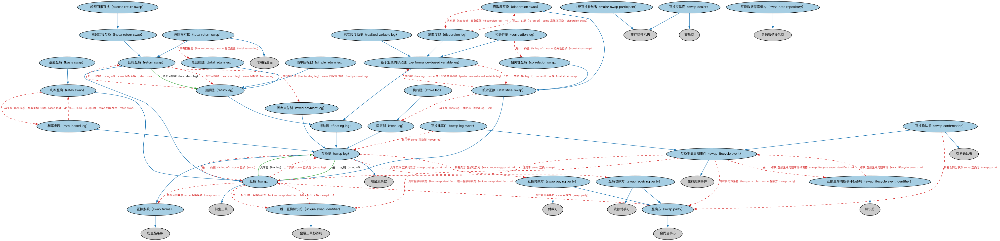

# 互换本体（Swaps Ontology）结构与公理说明

本文档对应 `Swaps.rdf` / `Swaps.ttl`，说明该本体的类、继承关系、属性和公理约定。结构图见 `Swaps-structure.png`（`Swaps-structure.svg` 为可缩放版本）。

## 1. 本体概述

定义互换（swap）合约的通用结构：两个或多个互换腿（swap leg）之间按约定公式交换现金流，含名义本金、支付日程等。

**在体系中的位置**：衍生品合约模块的四大基础结构本体之一，是利率互换、股权互换、信用违约互换的共同基础。

**上下游关系**：上游继承衍生品基础本体；下游被利率互换（DER/RateDerivatives）、股权互换（DER/SecurityBasedDerivatives）、信用违约互换（DER/CreditDerivatives）特化；互换个体本体提供标准市场约定实例。

**与相近概念的差别**：互换是「现金流交换」而非一次性买卖——这是它与期货、期权的本质差别；与债券的差别——债券交换的是本金与利息，互换通常只交换利息差额，名义本金不交割。

本本体中类与类的核心关系如下（完整细节见各类小节）：

- **基差互换（basis swap）** 继承 **利率互换（rates swap）**
- **相关性腿（correlation leg）** 继承 **基于业绩的浮动腿（performance-based variable leg）**
- **相关性互换（correlation swap）** 继承 **统计互换（statistical swap）**
- **离散度腿（dispersion leg）** 继承 **基于业绩的浮动腿（performance-based variable leg）**
- **离散度互换（dispersion swap）** 继承 **统计互换（statistical swap）**
- **超额回报互换（excess return swap）** 继承 **指数回报互换（index return swap）**
- **固定腿（fixed leg）** 继承 **互换腿（swap leg）**
- **固定支付腿（fixed payment leg）** 继承 **互换腿（swap leg）**
- **浮动腿（floating leg）** 继承 **互换腿（swap leg）**
- **指数回报互换（index return swap）** 继承 **回报互换（return swap）**
- **主要互换参与者（major swap participant）** 继承 **非存款性机构（NonDepositoryInstitution）**
- **基于业绩的浮动腿（performance-based variable leg）** 继承 **浮动腿（floating leg）**
- 其余 32 条关系从略。

## 2. 类（Class）

| 类（Class） | 定义（Definition） |
|---|---|
| 基差互换（basis swap） | 支付流参考不同基准的互换。 |
| 相关性腿（correlation leg） | 相关性互换的浮动腿，支付金额基于一组标的产品价格的观察平均相关性。 |
| 相关性互换（correlation swap） | 一种场外统计衍生品，用于对冲一组标的产品价格观察平均相关性相关的风险。 |
| 离散度腿（dispersion leg） | 离散度互换的浮动腿，支付金额基于标的产品价格变动的已实现离散度。 |
| 离散度互换（dispersion swap） | 用于对冲标的资产价格变动幅度的统计衍生品。 |
| 超额回报互换（excess return swap） | 回报互换的一种：指数水平变动等于主要由各成分价格变化产生的回报。 |
| 固定腿（fixed leg） | 付款方有义务在互换期限内按固定年利率或固定金额不定期付款的互换腿。 |
| 固定支付腿（fixed payment leg） | 规定按固定年利率计算的付款计划相关合同条款的互换腿。 |
| 浮动腿（floating leg） | 付款方有义务在互换期限内按某一浮动利率不定期付款的互换腿。 |
| 指数回报互换（index return swap） | 付款基于向互换卖方支付的费用以及基于指数水平变动的浮动参考价格的回报互换。 |
| 主要互换参与者（major swap participant） | 在任何主要互换类别中持有大量头寸的金融服务提供商。 |
| 基于业绩的浮动腿（performance-based variable leg） | 支付取决于标的业绩某种统计度量的互换浮动腿。 |
| 利率类腿（rate-based leg） | 基于浮动利率、浮动通胀率或固定利率的利率类互换腿。 |
| 利率互换（rates swap） | 两个交易对手约定在协议期间的规定日期、基于指定名义本金和利率互相支付现金流的互换。 |
| 已实现浮动腿（realized variable leg） | 付款在到期时一次性净额结算（而非定期支付）的基于业绩的互换腿。 |
| 回报腿（return leg） | 支付标的所产生收益的互换腿。 |
| 回报互换（return swap） | 其中一腿（回报腿）基于某一标的所产生收益的互换。 |
| 简单回报腿（simple return leg） | 严格基于标的资产所产生收益、不含升值、减值、资本利得和任何费用的回报腿。 |
| 统计互换（statistical swap） | 支付取决于标的业绩某种统计度量的互换。 |
| 执行腿（strike leg） | 规定在执行时报出的固定金额（即「执行额」）的互换腿。 |
| 互换（swap） | 交易对手约定交换来自两种不同金融工具的周期性现金流或负债流的衍生工具。 |
| 互换确认书（swap confirmation） | 将双方整体交易中与生命周期事件相关的具体条款和条件成文化的正式确认书。 |
| 互换数据存库机构（swap data repository） | 为互换数据报告和记录保存提供集中设施的金融服务提供商。 |
| 互换交易商（swap dealer） | 经营互换、为互换做市、并在日常业务中经常与交易对手订立互换的非存款性机构。 |
| 互换腿（swap leg） | 规定互换某一组成部分的现金流要求（如利息支付、票息支付等）及履约承诺的条款。 |
| 互换腿事件（swap leg event） | 适用于互换某一腿的互换生命周期事件，如付款或利率重置事件。 |
| 互换生命周期事件（swap lifecycle event） | 互换生命周期内发生的事件，整体事件集包括发行人、前台、中台、后台各自特有的事件。 |
| 互换生命周期事件标识符（swap lifecycle event identifier） | 唯一标识互换生命周期中特定事件的标识符。 |
| 互换方（swap party） | 互换的一方，因此也是体现该交易的合约的法定当事方。 |
| 互换付款方（swap paying party） | 按合约规定为交易某一腿负责付款的互换方。 |
| 互换收款方（swap receiving party） | 按合约规定收取交易某一腿款项的互换方。 |
| 互换条款（swap terms） | 互换交易的法律合同条款。 |
| 总回报腿（total return leg） | 基于标的资产所产生收益以及任何升值、减值、资本利得和费用的回报腿。 |
| 总回报互换（total return swap） | 卖方同意向另一方支付标的资产价值变动乘以约定名义金额的回报互换。 |
| 唯一互换标识符（unique swap identifier） | 用于记录保存和互换数据报告的互换标识符。 |

以下按类逐个展开：每个类给出继承关系、相关属性与公理约定；子类在父类之下降一级编号。

### 2.1 主要互换参与者（major swap participant）

定义：在任何主要互换类别中持有大量头寸的金融服务提供商。

- 父类：**非存款性机构（NonDepositoryInstitution）**

### 2.2 互换（swap）

定义：交易对手约定交换来自两种不同金融工具的周期性现金流或负债流的衍生工具。

- 父类：**衍生工具（DerivativeInstrument）**
- 直接子类：**利率互换（rates swap）**、**回报互换（return swap）**、**统计互换（statistical swap）**

属性：

| 属性 | 定义 | 说明 |
|---|---|---|
| **具有腿（has leg）** | 将互换合约与构成该互换的一腿关联起来。 | 值域：互换腿（swap leg）；子属性：具有合同要素 |
| **具有合同当事方（hasContractParty）** | — | — |
| **具有合同要素（hasContractualElement）** | — | — |
| **交换（exchanges）** | — | — |
| **由……标识（isIdentifiedBy）** | — | — |

公理：

- **交换（exchanges）**至少有一个取值，类型是**互换腿（swap leg）**。
- **具有合同当事方（hasContractParty）**至少有一个取值，类型是**互换方（swap party）**。
- **具有合同要素（hasContractualElement）**至少有一个取值，类型是**互换条款（swap terms）**。
- **由……标识（isIdentifiedBy）**可以有 0 个或多个**唯一互换标识符（unique swap identifier）**。

#### 2.2.1 利率互换（rates swap）

定义：两个交易对手约定在协议期间的规定日期、基于指定名义本金和利率互相支付现金流的互换。

- 父类：**互换（swap）**
- 直接子类：**基差互换（basis swap）**

属性：

| 属性 | 定义 | 说明 |
|---|---|---|
| **具有腿（has leg）** | 将互换合约与构成该互换的一腿关联起来。 | 值域：互换腿（swap leg）；子属性：具有合同要素 |

公理：

- **具有腿（has leg）**恰好有 2 个**利率类腿（rate-based leg）**。

##### 2.2.1.1 基差互换（basis swap）

定义：支付流参考不同基准的互换。

- 父类：**利率互换（rates swap）**

#### 2.2.2 回报互换（return swap）

定义：其中一腿（回报腿）基于某一标的所产生收益的互换。

- 父类：**互换（swap）**
- 直接子类：**指数回报互换（index return swap）**、**总回报互换（total return swap）**

属性：

| 属性 | 定义 | 说明 |
|---|---|---|
| **具有融资腿（has funding leg）** | 指明回报互换中规定固定支付率（通常基于基准、也可能为固定利率）的一腿。 | 子属性：具有腿（has leg） |
| **具有回报腿（has return leg）** | 指明回报互换中支付基于标的资产回报的一腿。 | 值域：回报腿（return leg）；子属性：具有腿（has leg） |

公理：

- **具有回报腿（has return leg）**至少有一个取值，类型是**回报腿（return leg）**。
- **具有融资腿（has funding leg）**至少有一个取值，类型是**固定支付腿（fixed payment leg）**。

##### 2.2.2.1 指数回报互换（index return swap）

定义：付款基于向互换卖方支付的费用以及基于指数水平变动的浮动参考价格的回报互换。

- 父类：**回报互换（return swap）**
- 直接子类：**超额回报互换（excess return swap）**

###### 2.2.2.1.1 超额回报互换（excess return swap）

定义：回报互换的一种：指数水平变动等于主要由各成分价格变化产生的回报。

- 父类：**指数回报互换（index return swap）**

##### 2.2.2.2 总回报互换（total return swap）

定义：卖方同意向另一方支付标的资产价值变动乘以约定名义金额的回报互换。

- 父类：**信用衍生品（CreditDerivative）**、**回报互换（return swap）**

属性：

| 属性 | 定义 | 说明 |
|---|---|---|
| **具有回报腿（has return leg）** | 指明回报互换中支付基于标的资产回报的一腿。 | 值域：回报腿（return leg）；子属性：具有腿（has leg） |

公理：

- **具有回报腿（has return leg）**至少有一个取值，类型是**总回报腿（total return leg）**。

#### 2.2.3 统计互换（statistical swap）

定义：支付取决于标的业绩某种统计度量的互换。

- 父类：**互换（swap）**
- 直接子类：**相关性互换（correlation swap）**、**离散度互换（dispersion swap）**

属性：

| 属性 | 定义 | 说明 |
|---|---|---|
| **具有腿（has leg）** | 将互换合约与构成该互换的一腿关联起来。 | 值域：互换腿（swap leg）；子属性：具有合同要素 |

公理：

- **具有腿（has leg）**可以有 0 个或多个**固定腿（fixed leg）**。
- **具有腿（has leg）**至少有一个取值，类型是**基于业绩的浮动腿（performance-based variable leg）**。

##### 2.2.3.1 相关性互换（correlation swap）

定义：一种场外统计衍生品，用于对冲一组标的产品价格观察平均相关性相关的风险。

- 父类：**统计互换（statistical swap）**

##### 2.2.3.2 离散度互换（dispersion swap）

定义：用于对冲标的资产价格变动幅度的统计衍生品。

- 父类：**统计互换（statistical swap）**

属性：

| 属性 | 定义 | 说明 |
|---|---|---|
| **具有腿（has leg）** | 将互换合约与构成该互换的一腿关联起来。 | 值域：互换腿（swap leg）；子属性：具有合同要素 |

公理：

- **具有腿（has leg）**恰好有 1 个**离散度腿（dispersion leg）**。

### 2.3 互换数据存库机构（swap data repository）

定义：为互换数据报告和记录保存提供集中设施的金融服务提供商。

- 父类：**金融服务提供商（FinancialServiceProvider）**

### 2.4 互换交易商（swap dealer）

定义：经营互换、为互换做市、并在日常业务中经常与交易对手订立互换的非存款性机构。

- 父类：**非存款性机构（NonDepositoryInstitution）**、**交易商（Dealer）**

### 2.5 互换生命周期事件（swap lifecycle event）

定义：互换生命周期内发生的事件，整体事件集包括发行人、前台、中台、后台各自特有的事件。

- 父类：**生命周期事件（LifecycleEvent）**
- 直接子类：**互换确认书（swap confirmation）**、**互换腿事件（swap leg event）**

属性：

| 属性 | 定义 | 说明 |
|---|---|---|
| **具有互换标识符（has swap identifier）** | 将互换生命周期事件与该互换的标识符关联起来。 | 值域：金融工具标识符；子属性：引用 |
| **适用于（appliesTo）** | — | — |
| **由……标识（isIdentifiedBy）** | — | — |
| **具有参与方角色（has party role）** | — | — |

公理：

- **具有互换标识符（has swap identifier）**恰好有 1 个**唯一互换标识符（unique swap identifier）**。
- **具有参与方角色（has party role）**至少有一个取值，类型是**互换方（swap party）**。
- **由……标识（isIdentifiedBy）**恰好有 1 个**互换生命周期事件标识符（swap lifecycle event identifier）**。
- **适用于（appliesTo）**至少有一个取值，类型是**互换（swap）**。

#### 2.5.1 互换确认书（swap confirmation）

定义：将双方整体交易中与生命周期事件相关的具体条款和条件成文化的正式确认书。

- 父类：**互换生命周期事件（swap lifecycle event）**、**交易确认书（TransactionConfirmation）**

属性：

| 属性 | 定义 | 说明 |
|---|---|---|
| **具有合同当事方（hasContractParty）** | — | — |
| **取代（supersedes）** | — | — |

公理：

- **具有合同当事方（hasContractParty）**至少有一个取值，类型是**互换方（swap party）**。
- **取代（supersedes）**的所有取值只能是**互换确认书（swap confirmation）**。

#### 2.5.2 互换腿事件（swap leg event）

定义：适用于互换某一腿的互换生命周期事件，如付款或利率重置事件。

- 父类：**互换生命周期事件（swap lifecycle event）**

属性：

| 属性 | 定义 | 说明 |
|---|---|---|
| **适用于（appliesTo）** | — | — |

公理：

- **适用于（appliesTo）**至少有一个取值，类型是**互换腿（swap leg）**。

### 2.6 互换生命周期事件标识符（swap lifecycle event identifier）

定义：唯一标识互换生命周期中特定事件的标识符。

- 父类：**标识符（Identifier）**

属性：

| 属性 | 定义 | 说明 |
|---|---|---|
| **标识（identifies）** | — | — |

公理：

- **标识（identifies）**恰好有 1 个**互换生命周期事件（swap lifecycle event）**。

### 2.7 互换方（swap party）

定义：互换的一方，因此也是体现该交易的合约的法定当事方。

- 父类：**合同当事方（ContractParty）**
- 直接子类：**互换付款方（swap paying party）**、**互换收款方（swap receiving party）**

属性：

| 属性 | 定义 | 说明 |
|---|---|---|
| **由…扮演（is played by）** | — | — |

公理：

- **由…扮演（is played by）**至少有一个取值，该取值满足：**是…的参与方（is a party to）**至少有一个取值，类型是**互换（swap）**。

#### 2.7.1 互换付款方（swap paying party）

定义：按合约规定为交易某一腿负责付款的互换方。

- 父类：**付款方（PayingParty）**、**互换方（swap party）**

#### 2.7.2 互换收款方（swap receiving party）

定义：按合约规定收取交易某一腿款项的互换方。

- 父类：**收款对手方（ReceivingParty）**、**互换方（swap party）**

### 2.8 互换条款（swap terms）

定义：互换交易的法律合同条款。

- 父类：**衍生品条款（DerivativeTerms）**
- 直接子类：**互换腿（swap leg）**

#### 2.8.1 互换腿（swap leg）

定义：规定互换某一组成部分的现金流要求（如利息支付、票息支付等）及履约承诺的条款。

- 父类：**现金流条款（CashflowTerms）**、**互换条款（swap terms）**
- 直接子类：**固定腿（fixed leg）**、**固定支付腿（fixed payment leg）**、**浮动腿（floating leg）**、**利率类腿（rate-based leg）**

属性：

| 属性 | 定义 | 说明 |
|---|---|---|
| **是……的腿（is leg of）** | 将互换腿与包含该腿的互换关联起来。 | 值域：互换（swap）；逆属性：具有腿（has leg）；子属性：被包含于 |
| **以……计价（isDenominatedIn）** | — | — |
| **具有生效日期（hasEffectiveDate）** | — | — |
| **具有终止日（hasTerminationDate）** | — | — |
| **具有买方（hasBuyer）** | — | — |
| **具有卖方（hasSeller）** | — | — |

公理：

- **以……计价（isDenominatedIn）**恰好有 1 个**货币（Currency）**。
- **具有买方（hasBuyer）**恰好有 1 个**互换付款方（swap paying party）**。
- **具有卖方（hasSeller）**恰好有 1 个**互换收款方（swap receiving party）**。
- **具有生效日期（hasEffectiveDate）**恰好有 1 个**日期（Date）**。
- **具有终止日（hasTerminationDate）**可以有 0 个或多个**日期（Date）**。
- **是……的腿（is leg of）**至少有一个取值，类型是**互换（swap）**。
- 该属性存在取值约束。

##### 2.8.1.1 固定腿（fixed leg）

定义：付款方有义务在互换期限内按固定年利率或固定金额不定期付款的互换腿。

- 父类：**互换腿（swap leg）**
- 直接子类：**执行腿（strike leg）**

属性：

| 属性 | 定义 | 说明 |
|---|---|---|
| **具有支付进度表（hasPaymentSchedule）** | — | — |

公理：

- **具有支付进度表（hasPaymentSchedule）**可以有 0 个或多个**支付进度表（PaymentSchedule）**。
- 与**浮动腿（floating leg）**互斥：同一个体不能同时属于两者。

###### 2.8.1.1.1 执行腿（strike leg）

定义：规定在执行时报出的固定金额（即「执行额」）的互换腿。

- 父类：**固定腿（fixed leg）**

##### 2.8.1.2 固定支付腿（fixed payment leg）

定义：规定按固定年利率计算的付款计划相关合同条款的互换腿。

- 父类：**互换腿（swap leg）**

属性：

| 属性 | 定义 | 说明 |
|---|---|---|
| **具有支付进度表（hasPaymentSchedule）** | — | — |

公理：

- **具有支付进度表（hasPaymentSchedule）**至少有一个取值，类型是**支付进度表（PaymentSchedule）**。

##### 2.8.1.3 浮动腿（floating leg）

定义：付款方有义务在互换期限内按某一浮动利率不定期付款的互换腿。

- 父类：**互换腿（swap leg）**
- 直接子类：**基于业绩的浮动腿（performance-based variable leg）**、**回报腿（return leg）**

属性：

| 属性 | 定义 | 说明 |
|---|---|---|
| **具有支付进度表（hasPaymentSchedule）** | — | — |

公理：

- **具有支付进度表（hasPaymentSchedule）**可以有 0 个或多个**支付进度表（PaymentSchedule）**。

###### 2.8.1.3.1 基于业绩的浮动腿（performance-based variable leg）

定义：支付取决于标的业绩某种统计度量的互换浮动腿。

- 父类：**浮动腿（floating leg）**
- 直接子类：**相关性腿（correlation leg）**、**离散度腿（dispersion leg）**、**已实现浮动腿（realized variable leg）**

属性：

| 属性 | 定义 | 说明 |
|---|---|---|
| **是……的腿（is leg of）** | 将互换腿与包含该腿的互换关联起来。 | 值域：互换（swap）；逆属性：具有腿（has leg）；子属性：被包含于 |

公理：

- **是……的腿（is leg of）**至少有一个取值，类型是**统计互换（statistical swap）**。

###### 2.8.1.3.1.1 相关性腿（correlation leg）

定义：相关性互换的浮动腿，支付金额基于一组标的产品价格的观察平均相关性。

- 父类：**基于业绩的浮动腿（performance-based variable leg）**

属性：

| 属性 | 定义 | 说明 |
|---|---|---|
| **是……的腿（is leg of）** | 将互换腿与包含该腿的互换关联起来。 | 值域：互换（swap）；逆属性：具有腿（has leg）；子属性：被包含于 |

公理：

- **是……的腿（is leg of）**至少有一个取值，类型是**相关性互换（correlation swap）**。

###### 2.8.1.3.1.2 离散度腿（dispersion leg）

定义：离散度互换的浮动腿，支付金额基于标的产品价格变动的已实现离散度。

- 父类：**基于业绩的浮动腿（performance-based variable leg）**

属性：

| 属性 | 定义 | 说明 |
|---|---|---|
| **是……的腿（is leg of）** | 将互换腿与包含该腿的互换关联起来。 | 值域：互换（swap）；逆属性：具有腿（has leg）；子属性：被包含于 |

公理：

- **是……的腿（is leg of）**至少有一个取值，类型是**离散度互换（dispersion swap）**。

###### 2.8.1.3.1.3 已实现浮动腿（realized variable leg）

定义：付款在到期时一次性净额结算（而非定期支付）的基于业绩的互换腿。

- 父类：**基于业绩的浮动腿（performance-based variable leg）**

###### 2.8.1.3.2 回报腿（return leg）

定义：支付标的所产生收益的互换腿。

- 父类：**浮动腿（floating leg）**
- 直接子类：**简单回报腿（simple return leg）**、**总回报腿（total return leg）**

属性：

| 属性 | 定义 | 说明 |
|---|---|---|
| **是……的腿（is leg of）** | 将互换腿与包含该腿的互换关联起来。 | 值域：互换（swap）；逆属性：具有腿（has leg）；子属性：被包含于 |
| **具有标的（hasUnderlier）** | — | — |

公理：

- **具有标的（hasUnderlier）**至少有一个取值，该取值满足：该属性存在取值约束。
- **是……的腿（is leg of）**至少有一个取值，类型是**回报互换（return swap）**。

###### 2.8.1.3.2.1 简单回报腿（simple return leg）

定义：严格基于标的资产所产生收益、不含升值、减值、资本利得和任何费用的回报腿。

- 父类：**回报腿（return leg）**

###### 2.8.1.3.2.2 总回报腿（total return leg）

定义：基于标的资产所产生收益以及任何升值、减值、资本利得和费用的回报腿。

- 父类：**回报腿（return leg）**

##### 2.8.1.4 利率类腿（rate-based leg）

定义：基于浮动利率、浮动通胀率或固定利率的利率类互换腿。

- 父类：**互换腿（swap leg）**

属性：

| 属性 | 定义 | 说明 |
|---|---|---|
| **是……的腿（is leg of）** | 将互换腿与包含该腿的互换关联起来。 | 值域：互换（swap）；逆属性：具有腿（has leg）；子属性：被包含于 |
| **具有标的（hasUnderlier）** | — | — |

公理：

- **具有标的（hasUnderlier）**至少有一个取值，该取值满足：**由…扮演（is played by）**至少有一个取值，该取值满足：该属性存在取值约束。
- **是……的腿（is leg of）**至少有一个取值，类型是**利率互换（rates swap）**。

### 2.9 唯一互换标识符（unique swap identifier）

定义：用于记录保存和互换数据报告的互换标识符。

- 父类：**金融工具标识符（FinancialInstrumentIdentifier）**

属性：

| 属性 | 定义 | 说明 |
|---|---|---|
| **标识（identifies）** | — | — |

公理：

- **标识（identifies）**恰好有 1 个**互换（swap）**。

## 3. 依赖（owl:imports，28 个）

本本体通过 `owl:imports` 引入以下本体，各项的中文名称与简介如下：

| 导入本体 | 中文名称 | 简介 |
|---|---|---|
| `DER/DerivativesContracts/DerivativesBasics.rdf` | 衍生品基础本体（Derivatives Basics Ontology） | 定义衍生品合约（derivatives contract）的核心概念：标的资产、行权、到期等，是 DER 域的根基。 |
| `FBC/DebtAndEquities/Debt.rdf` | 债务本体（Debt Ontology） | 定义债务（debt）与债权债务关系的核心概念：借款人、贷款人、本金与利息义务。 |
| `FBC/FinancialInstruments/FinancialInstruments.rdf` | 金融工具本体（Financial Instruments Ontology） | FIBO 核心本体之一，定义金融工具（financial instrument）的通用概念：可交易、代表某种权利义务的合同工具，是证券、衍生品等具体工具的共同基础。 |
| `FBC/FunctionalEntities/FinancialServicesEntities.rdf` | 金融服务实体本体（Financial Services Entities Ontology） | FBC 域核心本体，定义金融服务机构（银行、券商、保险公司、资管机构等）的功能分类体系。 |
| `FBC/ProductsAndServices/FinancialProductsAndServices.rdf` | 金融产品与服务本体（Financial Products and Services Ontology） | 定义金融产品（financial product）与金融服务（financial service）及其提供、购买关系。 |
| `FND/Accounting/CurrencyAmount.rdf` | 货币金额本体（Currency Amount Ontology） | 定义「金额＋币种」的货币金额（currency amount）表示，是 FIBO 中表达价格、债务金额、付款额等一切带币种数值的基础构件。 |
| `FND/Agreements/Contracts.rdf` | 合同本体（Contracts Ontology） | 在协议之上定义具有法律约束力的合同（contract）：合同当事方、合同条款、义务与权利，是金融工具与交易合同建模的基石。 |
| `FND/Arrangements/Documents.rdf` | 文档本体（Documents Ontology） | 定义文档、文档类型及文档与其所记载内容的关系，为合同文本、募集说明书等法律文书建模。 |
| `FND/Arrangements/Lifecycles.rdf` | 生命周期本体（Lifecycles Ontology） | 定义生命周期、生命周期阶段与状态转移，用于描述合同、金融工具、机构从创设到终止的演化过程。 |
| `FND/OwnershipAndControl/Ownership.rdf` | 所有权本体（Ownership Ontology） | 定义「拥有」关系：所有者、被拥有资产及所有权份额。 |
| `FND/ProductsAndServices/PaymentsAndSchedules.rdf` | 付款与计划表本体（Payments and Schedules Ontology） | 定义付款、付款计划表（payment schedule）及其日期与金额结构，是贷款还款、债券付息建模的基础。 |
| `FND/ProductsAndServices/ProductsAndServices.rdf` | 产品与服务本体（Products and Services Ontology） | 定义产品、服务及其提供者与客户的通用关系。 |
| `FND/Relations/Relations.rdf` | 关系本体（Relations Ontology） | FIBO 最底层的基础本体，定义参考（reference）、分类（classify）等通用关系与抽象概念，全库普遍依赖。 |
| `FND/Utilities/AnnotationVocabulary.rdf` | FIBO 标注词汇表（FIBO Annotation Vocabulary） | 定义 FIBO 专用的标注属性（如释义来源、成熟度等级），用于本体自身的元数据标注。 |
| `IND/EconomicIndicators/EconomicIndicators.rdf` | 经济指标本体（Economic Indicators Ontology） | 定义宏观经济指标（GDP、CPI、失业率等）的通用结构：发布机构、发布频率与数值。 |
| `IND/ForeignExchange/ForeignExchange.rdf` | 外汇本体（Foreign Exchange Ontology） | 定义外汇、汇率（exchange rate）与货币对的概念。 |
| `IND/Indicators/Indicators.rdf` | 指标本体（Indicators Ontology） | 定义「指标」（indicator）的通用概念：对某现象的可度量表示，是经济指标、利率等的上位模型。 |
| `IND/MarketIndices/BasketIndices.rdf` | 篮子指数本体（Basket Indices Ontology） | 定义以一篮子成分为基础的指数：成分、权重与计算方法。 |
| `SEC/Securities/Baskets.rdf` | 篮子本体（Baskets Ontology） | 定义证券篮子（basket）：作为整体交易或定价的一组证券。 |
| `https://www.omg.org/spec/Commons/AnnotationVocabulary/` | OMG 通用标注词汇表（OMG Commons Annotation Vocabulary） | OMG 通用本体库（Commons）中的标注词汇表，提供概念映射等标注属性，FIBO 用它标注术语与外部标准的对应关系。 |
| `https://www.omg.org/spec/Commons/Collections/` | OMG 通用集合本体（OMG Commons Collections） | Commons 库中的集合本体，定义集合、成员等通用概念。 |
| `https://www.omg.org/spec/Commons/ContextualDesignators/` | OMG 通用语境指称本体（OMG Commons Contextual Designators） | Commons 库中的语境指称本体，定义「在某个语境下指代某物的名称/符号」，是地址、账户号码等语境相关标识的基础。 |
| `https://www.omg.org/spec/Commons/DatesAndTimes/` | OMG 通用日期与时间本体（OMG Commons Dates and Times） | Commons 库中的日期时间本体，定义日期、期间、时间点等通用时间概念。 |
| `https://www.omg.org/spec/Commons/Documents/` | OMG 通用文档本体（OMG Commons Documents） | Commons 库中的文档本体，定义文档及其组成部分的通用概念。 |
| `https://www.omg.org/spec/Commons/Identifiers/` | OMG 通用标识符本体（OMG Commons Identifiers） | Commons 库中的标识符本体，定义标识符及其编码方案的通用概念。 |
| `https://www.omg.org/spec/Commons/PartiesAndSituations/` | OMG 通用参与方与情境本体（OMG Commons Parties and Situations） | Commons 库中的参与方本体，定义独立主体、参与方及其角色扮演的通用概念，是 FIBO 参与方模型的上游。 |
| `https://www.omg.org/spec/Commons/QuantitiesAndUnits/` | OMG 通用量与单位本体（OMG Commons Quantities and Units） | Commons 库中的量与单位本体，定义数量、度量单位、量纲的通用概念，支撑金额、比率等数值表达。 |
| `https://www.omg.org/spec/Commons/RolesAndCompositions/` | OMG 通用角色与构成本体（OMG Commons Roles and Compositions） | Commons 库中的角色本体，定义角色及整体—部分构成关系的通用概念。 |

## 4. 文件

- 官方 RDF/XML：`Swaps.rdf`
- 中文 Turtle：`Swaps.ttl`
- 结构图：`Swaps-structure.png` / `Swaps-structure.svg`