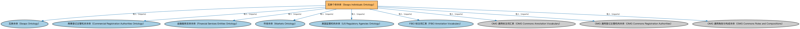

# 互换个体本体（Swaps Individuals Ontology）说明

本文档对应 `SwapsIndividuals.rdf` / `SwapsIndividuals.ttl`。

## 1. 本文件是什么

收录标准化互换合约的参考个体（如标准利率互换的市场约定）。

从机制上说，这是一个个体（individuals）文件：它本身不定义任何新的类或属性，装的全是命名个体（owl:NamedIndividual）——也就是一条条真实存在的实例数据（如具体的货币、市场、监管机构、法域）。它的 `owl:imports` 引入的是这些个体所属的类定义所在的本体。应用需要实例级参考数据时加载这类文件。

## 2. 个体构成（共 4 个）

按个体所属类型统计（类型名为中文（English）对照）：

| 类型（Class） | 个体数量 |
|---|---|
| 互换数据存库机构（SwapDataRepository） | 4 |
| 自律组织（SelfRegulatingOrganization） | 1 |
| 指定合约市场（DesignatedContractMarket） | 1 |

个体数量较少，全部列出：

| 个体 | 类型 |
|---|---|
| Bloomberg SDR | 互换数据存库机构（SwapDataRepository） |
| Chicago Mercantile Exchange | 互换数据存库机构（SwapDataRepository）、自律组织（SelfRegulatingOrganization）、指定合约市场（DesignatedContractMarket） |
| DTCC Data Repository | 互换数据存库机构（SwapDataRepository） |
| ICE Trade Vault | 互换数据存库机构（SwapDataRepository） |

## 3. 依赖的本体（owl:imports，9 个）

以下导入提供个体所属的类定义与相关参考数据：

| 导入本体 | 中文名称 | 简介 |
|---|---|---|
| `DER/DerivativesContracts/Swaps.rdf` | 互换本体（Swaps Ontology） | 定义互换（swap）合约的通用结构：互换腿（swap leg）、现金流交换与名义本金。 |
| `FBC/FunctionalEntities/CommercialRegistrationAuthorities.rdf` | 商事登记主管机关本体（Commercial Registration Authorities Ontology） | 定义负责商事登记的主管机关及其维护的登记记录。 |
| `FBC/FunctionalEntities/FinancialServicesEntities.rdf` | 金融服务实体本体（Financial Services Entities Ontology） | FBC 域核心本体，定义金融服务机构（银行、券商、保险公司、资管机构等）的功能分类体系。 |
| `FBC/FunctionalEntities/Markets.rdf` | 市场本体（Markets Ontology） | 定义金融市场（market）：交易所、场外市场及其功能。 |
| `FBC/FunctionalEntities/NorthAmericanEntities/USRegulatoryAgencies.rdf` | 美国监管机构本体（US Regulatory Agencies Ontology） | 收录美国金融监管机构个体（如美联储、证监会 SEC、货币监理署 OCC）。 |
| `FND/Utilities/AnnotationVocabulary.rdf` | FIBO 标注词汇表（FIBO Annotation Vocabulary） | 定义 FIBO 专用的标注属性（如释义来源、成熟度等级），用于本体自身的元数据标注。 |
| `https://www.omg.org/spec/Commons/AnnotationVocabulary/` | OMG 通用标注词汇表（OMG Commons Annotation Vocabulary） | OMG 通用本体库（Commons）中的标注词汇表，提供概念映射等标注属性，FIBO 用它标注术语与外部标准的对应关系。 |
| `https://www.omg.org/spec/Commons/RegistrationAuthorities/` | OMG 通用登记主管机构本体（OMG Commons Registration Authorities） | Commons 库中的登记主管机构本体，定义负责登记注册的主管机构及其登记行为的通用概念。 |
| `https://www.omg.org/spec/Commons/RolesAndCompositions/` | OMG 通用角色与构成本体（OMG Commons Roles and Compositions） | Commons 库中的角色本体，定义角色及整体—部分构成关系的通用概念。 |

## 4. 文件

- 官方 RDF/XML：`SwapsIndividuals.rdf`
- 中文 Turtle：`SwapsIndividuals.ttl`
- 结构图：`SwapsIndividuals-structure.png` / `SwapsIndividuals-structure.svg`