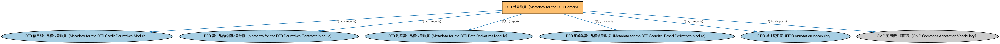

# DER 域元数据（Metadata for the DER Domain）说明

本文档对应 `MetadataDER.rdf` / `MetadataDER.ttl`。

## 1. 本文件是什么

声明衍生品（DER）域由四个模块构成：衍生品合约、利率衍生品、信用衍生品、证券类衍生品。

从机制上说，这是一个元数据清单（metadata manifest）文件：它本身不定义任何类或属性，而是通过 `dct:hasPart` 声明一个域或模块由哪些本体构成，并携带版本 IRI、版权、许可与成熟度等发布管理信息。它回答的问题是「这个域/模块包含什么、当前是什么版本」，供发布工具和文档系统按模块组织内容；它的 `owl:imports` 只引入标注词汇表，不是用来加载业务本体的入口（加载入口是 `All*` 与 `About*` 聚合文件）。

## 2. 声明的构成（dct:hasPart，4 个）

| 构成项 | 中文名称 | 简介 |
|---|---|---|
| `DER/CreditDerivatives/MetadataDERCreditDerivatives.rdf` | DER 信用衍生品模块元数据（Metadata for the DER Credit Derivatives Module） | 声明信用衍生品（Credit Derivatives）模块由信用违约互换本体构成，及版本信息。 |
| `DER/DerivativesContracts/MetadataDERDerivativesContracts.rdf` | DER 衍生品合约模块元数据（Metadata for the DER Derivatives Contracts Module） | 声明衍生品合约（Derivatives Contracts）模块的构成：衍生品基础、期权、奇异期权、期货与远期、互换、权利与权证、大宗商品合约、外汇合约、结构化工具、主协议及互换个体等本体。 |
| `DER/RateDerivatives/MetadataDERRateDerivatives.rdf` | DER 利率衍生品模块元数据（Metadata for the DER Rate Derivatives Module） | 声明利率衍生品（Rate Derivatives）模块由利率衍生品本体与利率互换本体构成，及版本信息。 |
| `DER/SecurityBasedDerivatives/MetadataDERSecurityBasedDerivatives.rdf` | DER 证券类衍生品模块元数据（Metadata for the DER Security-Based Derivatives Module） | 声明证券类衍生品（Security-Based Derivatives）模块由证券类衍生品本体与股权互换本体构成，及版本信息。 |

## 3. 标注依赖（owl:imports，6 个）

以下导入仅用于支撑元数据标注本身（如成熟度等级、概念映射），不属于业务内容：

| 导入本体 | 中文名称 | 简介 |
|---|---|---|
| `DER/CreditDerivatives/MetadataDERCreditDerivatives.rdf` | DER 信用衍生品模块元数据（Metadata for the DER Credit Derivatives Module） | 声明信用衍生品（Credit Derivatives）模块由信用违约互换本体构成，及版本信息。 |
| `DER/DerivativesContracts/MetadataDERDerivativesContracts.rdf` | DER 衍生品合约模块元数据（Metadata for the DER Derivatives Contracts Module） | 声明衍生品合约（Derivatives Contracts）模块的构成：衍生品基础、期权、奇异期权、期货与远期、互换、权利与权证、大宗商品合约、外汇合约、结构化工具、主协议及互换个体等本体。 |
| `DER/RateDerivatives/MetadataDERRateDerivatives.rdf` | DER 利率衍生品模块元数据（Metadata for the DER Rate Derivatives Module） | 声明利率衍生品（Rate Derivatives）模块由利率衍生品本体与利率互换本体构成，及版本信息。 |
| `DER/SecurityBasedDerivatives/MetadataDERSecurityBasedDerivatives.rdf` | DER 证券类衍生品模块元数据（Metadata for the DER Security-Based Derivatives Module） | 声明证券类衍生品（Security-Based Derivatives）模块由证券类衍生品本体与股权互换本体构成，及版本信息。 |
| `FND/Utilities/AnnotationVocabulary.rdf` | FIBO 标注词汇表（FIBO Annotation Vocabulary） | 定义 FIBO 专用的标注属性（如释义来源、成熟度等级），用于本体自身的元数据标注。 |
| `https://www.omg.org/spec/Commons/AnnotationVocabulary/` | OMG 通用标注词汇表（OMG Commons Annotation Vocabulary） | OMG 通用本体库（Commons）中的标注词汇表，提供概念映射等标注属性，FIBO 用它标注术语与外部标准的对应关系。 |

## 4. 文件

- 官方 RDF/XML：`MetadataDER.rdf`
- 中文 Turtle：`MetadataDER.ttl`
- 结构图：`MetadataDER-structure.png` / `MetadataDER-structure.svg`