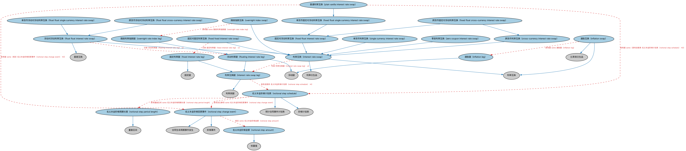

# 利率互换本体（Interest Rate Swaps Ontology）结构与公理说明

本文档对应 `IRSwaps.rdf` / `IRSwaps.ttl`，说明该本体的类、继承关系、属性和公理约定。结构图见 `IRSwaps-structure.png`（`IRSwaps-structure.svg` 为可缩放版本）。

## 1. 本体概述

定义利率互换（interest rate swap，IRS）：交换固定利率与浮动利率现金流的合约，含名义本金、浮动利率基准、重置日程等。

**在体系中的位置**：DER 利率衍生品模块的核心，是市场上交易量最大的场外衍生品之一。

**上下游关系**：上游继承互换与利率衍生品本体；下游关联 IND 参考利率（浮动端基准）与 EXMP、MD 中的示例和行情数据。

**与相近概念的差别**：与货币互换的差别——利率互换是同一货币内的固定换浮动，不交换本金；与债券的差别——IRS 只是现金流交换合约，不代表债权债务关系本身。

本本体中类与类的核心关系如下（完整细节见各类小节）：

- **跨货币利率互换（cross-currency interest rate swap）** 继承 **利率互换（interest rate swap）**
- **固定对固定利率互换（fixed fixed interest rate swap）** 继承 **利率互换（interest rate swap）**
- **跨货币固定对浮动利率互换（fixed float cross-currency interest rate swap）** 继承 **跨货币利率互换（cross-currency interest rate swap）**
- **跨货币固定对浮动利率互换（fixed float cross-currency interest rate swap）** 继承 **固定对浮动利率互换（fixed float interest rate swap）**
- **固定对浮动利率互换（fixed float interest rate swap）** 继承 **利率互换（interest rate swap）**
- **单货币固定对浮动利率互换（fixed float single currency interest rate swap）** 继承 **固定对浮动利率互换（fixed float interest rate swap）**
- **固定利率腿（fixed interest rate leg）** 继承 **固定腿（FixedLeg）**
- **固定利率腿（fixed interest rate leg）** 继承 **利率互换腿（interest rate swap leg）**
- **跨货币浮动对浮动利率互换（float float cross-currency interest rate swap）** 继承 **浮动对浮动利率互换（float float interest rate swap）**
- **浮动对浮动利率互换（float float interest rate swap）** 继承 **基差互换（BasisSwap）**
- **浮动对浮动利率互换（float float interest rate swap）** 继承 **利率互换（interest rate swap）**
- **单货币浮动对浮动利率互换（float float single currency interest rate swap）** 继承 **浮动对浮动利率互换（float float interest rate swap）**
- 其余 19 条关系从略。

## 2. 类（Class）

| 类（Class） | 定义（Definition） |
|---|---|
| 跨货币利率互换（cross-currency interest rate swap） | 两笔利息支付流使用不同货币的利率互换。 interest rate swap in which the two streams of interest payments are in different currencies |
| 固定对固定利率互换（fixed fixed interest rate swap） | 双方均支付通过互换安排之外无法获得的固定利率的利率互换。 interest rate swap in which both parties pay a fixed interest rate that they could not otherwise obtain outside of a swap arrangement |
| 跨货币固定对浮动利率互换（fixed float cross-currency interest rate swap） | 以名义本金的固定利息支付交换浮动利息支付、且两笔支付流使用不同货币的利率互换。 interest rate swap in which fixed interest payments on the notional are exchanged for floating interest payments and the two streams of interest payments are in different currencies |
| 固定对浮动利率互换（fixed float interest rate swap） | 以名义本金的固定利息支付交换浮动利息支付的利率互换。 interest rate swap in which fixed interest payments on the notional are exchanged for floating interest payments |
| 单货币固定对浮动利率互换（fixed float single currency interest rate swap） | 以名义本金的固定利息支付交换浮动利息支付、且两笔支付流使用同一货币的利率互换。 interest rate swap in which fixed interest payments on the notional are exchanged for floating interest payments and where both payment streams are expressed in terms of the same currency |
| 固定利率腿（fixed interest rate leg） | 规定固定利息金额及该利息支付条款的固定腿。 fixed leg that specifies fixed interest amounts and terms for the payment of that interest |
| 跨货币浮动对浮动利率互换（float float cross-currency interest rate swap） | 交换基于两种不同货币不同利率之现金流的利率互换。 interest rate swap that exchanges cashflows based on two different interest rates in different currencies |
| 浮动对浮动利率互换（float float interest rate swap） | 交换基于两种不同浮动利率之现金流的利率互换。 interest rate swap that exchanges cashflows based on two different floating interest rates |
| 单货币浮动对浮动利率互换（float float single currency interest rate swap） | 交换基于同一货币两种不同浮动利率之现金流的利率互换。 interest rate swap that exchanges cashflows based on two different floating interest rates in the same currency |
| 浮动利率腿（floating interest rate leg） | 就某一名义本金支付可变利息、并与某一基础利率参考挂钩的浮动腿。 floating leg in which variable interest is paid on some notional amount, linked to some underlying interest reference rate |
| 通胀腿（inflation leg） | 与通胀指数（如消费者价格指数 CPI）挂钩的通胀互换浮动利率腿。 floating rate leg of an inflation swap linked to an inflation index, such as the Consumer Price Index (CPI) |
| 通胀互换（inflation swap） | 一方按通胀率指数计算付款、另一方按另一通胀率或其他方式计算付款的利率互换。 rate swap in which one party pays an amount calculated using an inflation rate index, and the other party pays an amount calculated using another inflation rate index, or a fixed or floating interest rate |
| 利率互换（interest rate swap） | 至少一腿的参考标的为利率的互换。 swap in which the reference (underlier) for at least one leg is an interest rate |
| 利率互换腿（interest rate swap leg） | 具有利率支付流的互换腿，包括该支付流的参数化表示和现金流表示。 swap leg that has an interest rate payment stream, including both a parametric and cashflow representation for the stream of payments |
| 名义本金阶梯金额（notional step amount） | 在每个阶梯日从名义本金中减去（或增加）的金额。 the amount of money that is subtracted from the notional on each step date |
| 名义本金阶梯变更事件（notional step change event） | 某一互换腿名义本金发生阶梯式变更的事件。 event in which a step change in the notional amount for a given swap leg occurs |
| 名义本金阶梯周期长度（notional step period length） | 表示阶梯变更发生频率的重复区间，为计算计划表中计算周期的整数倍。 recurrence interval indicating the frequency with which step changes occur, which is a multiple of the calculation period in the calculation schedule |
| 名义本金阶梯计划表（notional step schedule） | 计息名义本金变更的计划表，由规则的阶梯事件序列构成。 schedule of changes in the notional amount on which interest is paid, comprising the regular sequence of step events |
| 隔夜指数互换（overnight index swap） | 一腿的定期付款基于隔夜利率指数乘以与另一腿相同名义本金的互换。 swap in which the periodic payments for one leg are based on an overnight interest rate index multiplied by the same notional amount upon which payments for the other leg of the swap are based |
| 隔夜利率指数腿（overnight rate index leg） | 定期付款基于隔夜利率指数乘以相同名义本金的浮动腿。 floating leg in which periodic payments are based on an overnight interest rate index multiplied by the same notional amount on which the payments for the other leg of the swap are based |
| 普通利率互换（plain vanilla interest rate swap） | 利息支付净额结算、名义本金不变、不内嵌任何期权或其他复杂结构的单货币固定对浮动利率互换。 fixed-float single currency interest rate swap in which interest payments are netted, the notional principal does not change, and there are no embedded options |
| 单货币利率互换（single currency interest rate swap） | 两笔利息支付流使用同一货币的利率互换。 interest rate swap in which the two streams of interest payments are in the same currency |
| 零息利率互换（zero coupon interest rate swap） | 固定利率现金流复利累积并在到期日一次性支付（而非定期支付）的利率互换。 interest rate swap in which the fixed rate cash flows are compounded and paid once on the expiration date, rather than periodically; the payments on the other side (which can be based on a floating interest rate or a fixed rate) follow typical swap payment schedules |

以下按类逐个展开：每个类给出继承关系、相关属性与公理约定；子类在父类之下降一级编号。

### 2.1 通胀腿（inflation leg）

定义：与通胀指数（如消费者价格指数 CPI）挂钩的通胀互换浮动利率腿。

- 父类：**浮动腿（FloatingLeg）**

属性：

| 属性 | 定义 | 说明 |
|---|---|---|
| **具有标的（hasUnderlier）** | — | — |

公理：

- **具有标的（hasUnderlier）**至少有一个取值，该取值满足：**由…扮演（is played by）**至少有一个取值，类型是**经济指标（EconomicIndicator）**。

### 2.2 通胀互换（inflation swap）

定义：一方按通胀率指数计算付款、另一方按另一通胀率或其他方式计算付款的利率互换。

- 父类：**比率类衍生品（RateBasedDerivative）**、**利率互换（RatesSwap）**

属性：

| 属性 | 定义 | 说明 |
|---|---|---|
| **具有腿（hasLeg）** | — | — |
| **关联后备债券（isLinkedToFallback）** | — | — |

公理：

- **关联后备债券（isLinkedToFallback）**至多有 1 个**政府债券（GovernmentBond）**。
- **具有腿（hasLeg）**至少有一个取值，类型是**通胀腿（inflation leg）**。

### 2.3 利率互换（interest rate swap）

定义：至少一腿的参考标的为利率的互换。

- 父类：**利率衍生品（InterestRateDerivative）**、**利率互换（RatesSwap）**
- 直接子类：**跨货币利率互换（cross-currency interest rate swap）**、**固定对固定利率互换（fixed fixed interest rate swap）**、**固定对浮动利率互换（fixed float interest rate swap）**、**浮动对浮动利率互换（float float interest rate swap）**、**隔夜指数互换（overnight index swap）**、**单货币利率互换（single currency interest rate swap）**、**零息利率互换（zero coupon interest rate swap）**

属性：

| 属性 | 定义 | 说明 |
|---|---|---|
| **交换（exchanges）** | — | — |

公理：

- **交换（exchanges）**恰好有 2 个**利率互换腿（interest rate swap leg）**。

#### 2.3.1 跨货币利率互换（cross-currency interest rate swap）

定义：两笔利息支付流使用不同货币的利率互换。

- 父类：**利率互换（interest rate swap）**
- 直接子类：**跨货币固定对浮动利率互换（fixed float cross-currency interest rate swap）**

属性：

| 属性 | 定义 | 说明 |
|---|---|---|
| **规定（specifies）** | — | — |

公理：

- **规定（specifies）**恰好有 2 个**货币（Currency）**。

##### 2.3.1.1 跨货币固定对浮动利率互换（fixed float cross-currency interest rate swap）

定义：以名义本金的固定利息支付交换浮动利息支付、且两笔支付流使用不同货币的利率互换。

- 父类：**跨货币利率互换（cross-currency interest rate swap）**、**固定对浮动利率互换（fixed float interest rate swap）**

#### 2.3.2 固定对固定利率互换（fixed fixed interest rate swap）

定义：双方均支付通过互换安排之外无法获得的固定利率的利率互换。

- 父类：**利率互换（interest rate swap）**

属性：

| 属性 | 定义 | 说明 |
|---|---|---|
| **交换（exchanges）** | — | — |

公理：

- **交换（exchanges）**恰好有 2 个**固定利率腿（fixed interest rate leg）**。

#### 2.3.3 固定对浮动利率互换（fixed float interest rate swap）

定义：以名义本金的固定利息支付交换浮动利息支付的利率互换。

- 父类：**利率互换（interest rate swap）**
- 直接子类：**跨货币固定对浮动利率互换（fixed float cross-currency interest rate swap）**、**单货币固定对浮动利率互换（fixed float single currency interest rate swap）**

公理：

- 该属性存在取值约束。

##### 2.3.3.2 单货币固定对浮动利率互换（fixed float single currency interest rate swap）

定义：以名义本金的固定利息支付交换浮动利息支付、且两笔支付流使用同一货币的利率互换。

- 父类：**固定对浮动利率互换（fixed float interest rate swap）**
- 直接子类：**普通利率互换（plain vanilla interest rate swap）**

###### 2.3.3.2.1 普通利率互换（plain vanilla interest rate swap）

定义：利息支付净额结算、名义本金不变、不内嵌任何期权或其他复杂结构的单货币固定对浮动利率互换。

- 父类：**单货币固定对浮动利率互换（fixed float single currency interest rate swap）**

属性：

| 属性 | 定义 | 说明 |
|---|---|---|
| **具有腿（hasLeg）** | — | — |
| **具有名义金额（hasNotionalAmount）** | — | — |

公理：

- **具有名义金额（hasNotionalAmount）**恰好有 1 个**货币数量（MonetaryAmount）**。
- **具有腿（hasLeg）**至少有一个取值，该取值满足：**具有进度表（hasSchedule）**至多有 0 个**名义本金阶梯计划表（notional step schedule）**。
- **具有腿（hasLeg）**至少有一个取值，该取值满足：**规定（specifies）**至多有 0 个**名义本金阶梯变更事件（notional step change event）**。

#### 2.3.4 浮动对浮动利率互换（float float interest rate swap）

定义：交换基于两种不同浮动利率之现金流的利率互换。

- 父类：**基差互换（BasisSwap）**、**利率互换（interest rate swap）**
- 直接子类：**跨货币浮动对浮动利率互换（float float cross-currency interest rate swap）**、**单货币浮动对浮动利率互换（float float single currency interest rate swap）**

属性：

| 属性 | 定义 | 说明 |
|---|---|---|
| **交换（exchanges）** | — | — |

公理：

- **交换（exchanges）**恰好有 2 个**浮动利率腿（floating interest rate leg）**。

##### 2.3.4.1 跨货币浮动对浮动利率互换（float float cross-currency interest rate swap）

定义：交换基于两种不同货币不同利率之现金流的利率互换。

- 父类：**浮动对浮动利率互换（float float interest rate swap）**

##### 2.3.4.2 单货币浮动对浮动利率互换（float float single currency interest rate swap）

定义：交换基于同一货币两种不同浮动利率之现金流的利率互换。

- 父类：**浮动对浮动利率互换（float float interest rate swap）**

#### 2.3.5 隔夜指数互换（overnight index swap）

定义：一腿的定期付款基于隔夜利率指数乘以与另一腿相同名义本金的互换。

- 父类：**利率互换（interest rate swap）**

属性：

| 属性 | 定义 | 说明 |
|---|---|---|
| **具有腿（hasLeg）** | — | — |

公理：

- **具有腿（hasLeg）**至少有一个取值，类型是**隔夜利率指数腿（overnight rate index leg）**。

#### 2.3.6 单货币利率互换（single currency interest rate swap）

定义：两笔利息支付流使用同一货币的利率互换。

- 父类：**利率互换（interest rate swap）**

属性：

| 属性 | 定义 | 说明 |
|---|---|---|
| **规定（specifies）** | — | — |

公理：

- **规定（specifies）**恰好有 1 个**货币（Currency）**。

#### 2.3.7 零息利率互换（zero coupon interest rate swap）

定义：固定利率现金流复利累积并在到期日一次性支付（而非定期支付）的利率互换。

- 父类：**利率互换（interest rate swap）**

属性：

| 属性 | 定义 | 说明 |
|---|---|---|
| **具有名义金额（hasNotionalAmount）** | — | — |

公理：

- **具有名义金额（hasNotionalAmount）**恰好有 1 个**货币数量（MonetaryAmount）**。

### 2.4 利率互换腿（interest rate swap leg）

定义：具有利率支付流的互换腿，包括该支付流的参数化表示和现金流表示。

- 父类：**利率类腿（RateBasedLeg）**
- 直接子类：**固定利率腿（fixed interest rate leg）**、**浮动利率腿（floating interest rate leg）**

属性：

| 属性 | 定义 | 说明 |
|---|---|---|
| **具有营业重复区间惯例（hasBusinessRecurrenceIntervalConvention）** | — | — |
| **具有进度表（hasSchedule）** | — | — |
| **具有支付进度表（hasPaymentSchedule）** | — | — |
| **规定（specifies）** | — | — |

公理：

- **具有支付进度表（hasPaymentSchedule）**可以有 0 个或多个**利息支付计划表（InterestPaymentSchedule）**。
- **具有营业重复区间惯例（hasBusinessRecurrenceIntervalConvention）**可以有 0 个或多个**计日惯例（DayCountConvention）**。
- **具有进度表（hasSchedule）**可以有 0 个或多个**名义本金阶梯计划表（notional step schedule）**。
- **规定（specifies）**可以有 0 个或多个**利息计算计划表（InterestCalculationSchedule）**。
- **规定（specifies）**恰好有 1 个**货币（Currency）**。

#### 2.4.1 固定利率腿（fixed interest rate leg）

定义：规定固定利息金额及该利息支付条款的固定腿。

- 父类：**固定腿（FixedLeg）**、**利率互换腿（interest rate swap leg）**

公理：

- 与**浮动利率腿（floating interest rate leg）**互斥：同一个体不能同时属于两者。

#### 2.4.2 浮动利率腿（floating interest rate leg）

定义：就某一名义本金支付可变利息、并与某一基础利率参考挂钩的浮动腿。

- 父类：**浮动腿（FloatingLeg）**、**利率互换腿（interest rate swap leg）**
- 直接子类：**隔夜利率指数腿（overnight rate index leg）**

属性：

| 属性 | 定义 | 说明 |
|---|---|---|
| **具有进度表（hasSchedule）** | — | — |
| **规定（specifies）** | — | — |

公理：

- **具有进度表（hasSchedule）**可以有 0 个或多个**利息计算计划表（InterestCalculationSchedule）**。
- **具有进度表（hasSchedule）**可以有 0 个或多个**利率重置计划表（InterestRateResetSchedule）**。
- **规定（specifies）**可以有 0 个或多个**利率设定事件（InterestRateSettingEvent）**。
- **规定（specifies）**可以有 0 个或多个**利率重置（InterestRateReset）**。

##### 2.4.2.1 隔夜利率指数腿（overnight rate index leg）

定义：定期付款基于隔夜利率指数乘以相同名义本金的浮动腿。

- 父类：**浮动利率腿（floating interest rate leg）**

### 2.5 名义本金阶梯金额（notional step amount）

定义：在每个阶梯日从名义本金中减去（或增加）的金额。

- 父类：**标量值（ScalarQuantityValue）**

属性：

| 属性 | 定义 | 说明 |
|---|---|---|
| **具有名义金额（hasNotionalAmount）** | — | — |

公理：

- **具有名义金额（hasNotionalAmount）**至少有一个取值，该取值满足：该属性存在取值约束。

### 2.6 名义本金阶梯变更事件（notional step change event）

定义：某一互换腿名义本金发生阶梯式变更的事件。

- 父类：**合同生命周期事件发生（ContractLifecycleEventOccurrence）**、**阶梯事件（StepEvent）**

属性：

| 属性 | 定义 | 说明 |
|---|---|---|
| **规定（specifies）** | — | — |

公理：

- **规定（specifies）**至少有一个取值，类型是**名义本金阶梯金额（notional step amount）**。

### 2.7 名义本金阶梯周期长度（notional step period length）

定义：表示阶梯变更发生频率的重复区间，为计算计划表中计算周期的整数倍。

- 父类：**重复区间（RecurrenceInterval）**

### 2.8 名义本金阶梯计划表（notional step schedule）

定义：计息名义本金变更的计划表，由规则的阶梯事件序列构成。

- 父类：**预计合同事件计划表（ProjectedContractEventSchedule）**、**阶梯计划表（StepSchedule）**

属性：

| 属性 | 定义 | 说明 |
|---|---|---|
| **具有重复区间（hasRecurrenceInterval）** | — | — |
| **具有发生事项（hasOccurrence）** | — | — |

公理：

- **具有发生事项（hasOccurrence）**至少有一个取值，类型是**名义本金阶梯变更事件（notional step change event）**。
- **具有重复区间（hasRecurrenceInterval）**至少有一个取值，类型是**名义本金阶梯周期长度（notional step period length）**。

## 3. 其他属性

以下属性未绑定到本体的具体类（定义域在外部本体或未声明）：

对象属性（Object Property）：

| 属性 | 定义 | 说明 |
|---|---|---|
| **具有首个名义本金阶梯日（has first notional step date）** | 指明名义本金阶梯计划表中的首个日期。 indicates the initial date in a notional step schedule | 值域：显式日期；子属性：具有起始日期 |
| **具有浮动利率上限（has floating rate cap）** | 指明浮动利率债务利率的可选上限。 indicates an optional ceiling (cap) on interest rates on floating rate debts | 值域：浮动利率；子属性：具有利率 |
| **具有浮动利率下限（has floating rate floor）** | 指明浮动利率债务利率的可选下限。 indicates an optional lower bound on interest rates on floating rate debts | 值域：浮动利率；子属性：具有利率 |
| **具有最后名义本金阶梯日（has last notional step date）** | 指明名义本金阶梯计划表中的最后日期。 indicates the final date in a notional step schedule | 值域：显式日期；子属性：具有结束日期 |

数据属性（Datatype Property）：

| 属性 | 定义 |
|---|---|
| **具有浮动利率利差（has floating rate spread）** | 规定可用于调整浮动利率的可选利差。 defines the spread rate that can optionally be used to adjust the floating rate |
| **具有利率乘数（has rate multiplier）** | 指明在加入浮动利率利差之前应用于票息的乘数。 indicates a multiplier applied to the coupon before adding the floating rate spread |

## 4. 依赖（owl:imports，23 个）

本本体通过 `owl:imports` 引入以下本体，各项的中文名称与简介如下：

| 导入本体 | 中文名称 | 简介 |
|---|---|---|
| `DER/DerivativesContracts/DerivativesBasics.rdf` | 衍生品基础本体（Derivatives Basics Ontology） | 定义衍生品合约（derivatives contract）的核心概念：标的资产、行权、到期等，是 DER 域的根基。 |
| `DER/DerivativesContracts/Swaps.rdf` | 互换本体（Swaps Ontology） | 定义互换（swap）合约的通用结构：互换腿（swap leg）、现金流交换与名义本金。 |
| `FBC/DebtAndEquities/Debt.rdf` | 债务本体（Debt Ontology） | 定义债务（debt）与债权债务关系的核心概念：借款人、贷款人、本金与利息义务。 |
| `FBC/FinancialInstruments/FinancialInstruments.rdf` | 金融工具本体（Financial Instruments Ontology） | FIBO 核心本体之一，定义金融工具（financial instrument）的通用概念：可交易、代表某种权利义务的合同工具，是证券、衍生品等具体工具的共同基础。 |
| `FBC/ProductsAndServices/FinancialProductsAndServices.rdf` | 金融产品与服务本体（Financial Products and Services Ontology） | 定义金融产品（financial product）与金融服务（financial service）及其提供、购买关系。 |
| `FND/Accounting/CurrencyAmount.rdf` | 货币金额本体（Currency Amount Ontology） | 定义「金额＋币种」的货币金额（currency amount）表示，是 FIBO 中表达价格、债务金额、付款额等一切带币种数值的基础构件。 |
| `FND/Agreements/Contracts.rdf` | 合同本体（Contracts Ontology） | 在协议之上定义具有法律约束力的合同（contract）：合同当事方、合同条款、义务与权利，是金融工具与交易合同建模的基石。 |
| `FND/DatesAndTimes/BusinessDates.rdf` | 营业日期本体（Business Dates Ontology） | 定义营业日、营业日历与日期调整规则（如顺延约定），支撑金融合同中的营业日计算。 |
| `FND/DatesAndTimes/FinancialDates.rdf` | 金融日期本体（Financial Dates Ontology） | 定义金融语境下的日期与期间概念：结算日、付息日、到期日、日计数基准等。 |
| `FND/DatesAndTimes/Occurrences.rdf` | 事件与发生本体（Occurrences Ontology） | 定义「发生」（occurrence）、事件与触发条件，用于表达企业行动、信用事件等「发生了什么」。 |
| `FND/ProductsAndServices/PaymentsAndSchedules.rdf` | 付款与计划表本体（Payments and Schedules Ontology） | 定义付款、付款计划表（payment schedule）及其日期与金额结构，是贷款还款、债券付息建模的基础。 |
| `FND/Relations/Relations.rdf` | 关系本体（Relations Ontology） | FIBO 最底层的基础本体，定义参考（reference）、分类（classify）等通用关系与抽象概念，全库普遍依赖。 |
| `FND/Utilities/Analytics.rdf` | 分析本体（Analytics Ontology） | 定义分析工具、度量与比率的通用概念，支撑指标与模型的表达。 |
| `FND/Utilities/AnnotationVocabulary.rdf` | FIBO 标注词汇表（FIBO Annotation Vocabulary） | 定义 FIBO 专用的标注属性（如释义来源、成熟度等级），用于本体自身的元数据标注。 |
| `IND/EconomicIndicators/EconomicIndicators.rdf` | 经济指标本体（Economic Indicators Ontology） | 定义宏观经济指标（GDP、CPI、失业率等）的通用结构：发布机构、发布频率与数值。 |
| `IND/InterestRates/InterestRates.rdf` | 利率本体（Interest Rates Ontology） | 定义利率（interest rate）的结构：基准利率、利差、期限与重置机制。 |
| `SEC/Debt/Bonds.rdf` | 债券本体（Bonds Ontology） | 定义债券（bond）：期限、票面利率、付息方式与偿还结构。 |
| `SEC/Debt/DebtInstruments.rdf` | 债务工具本体（Debt Instruments Ontology） | 定义债务工具（debt instrument）的通用概念：可交易的债权凭证，是债券、票据等的上位模型。 |
| `https://www.omg.org/spec/Commons/AnnotationVocabulary/` | OMG 通用标注词汇表（OMG Commons Annotation Vocabulary） | OMG 通用本体库（Commons）中的标注词汇表，提供概念映射等标注属性，FIBO 用它标注术语与外部标准的对应关系。 |
| `https://www.omg.org/spec/Commons/DatesAndTimes/` | OMG 通用日期与时间本体（OMG Commons Dates and Times） | Commons 库中的日期时间本体，定义日期、期间、时间点等通用时间概念。 |
| `https://www.omg.org/spec/Commons/Documents/` | OMG 通用文档本体（OMG Commons Documents） | Commons 库中的文档本体，定义文档及其组成部分的通用概念。 |
| `https://www.omg.org/spec/Commons/QuantitiesAndUnits/` | OMG 通用量与单位本体（OMG Commons Quantities and Units） | Commons 库中的量与单位本体，定义数量、度量单位、量纲的通用概念，支撑金额、比率等数值表达。 |
| `https://www.omg.org/spec/Commons/RolesAndCompositions/` | OMG 通用角色与构成本体（OMG Commons Roles and Compositions） | Commons 库中的角色本体，定义角色及整体—部分构成关系的通用概念。 |

## 5. 文件

- 官方 RDF/XML：`IRSwaps.rdf`
- 中文 Turtle：`IRSwaps.ttl`
- 结构图：`IRSwaps-structure.png` / `IRSwaps-structure.svg`