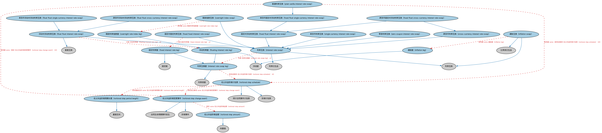

# 利率互换本体（Interest Rate Swaps Ontology）结构与公理说明

本文档对应 `IRSwaps.rdf` / `IRSwaps.ttl`，说明该本体的类、继承关系、属性和公理约定。结构图见 `IRSwaps-structure.png`（`IRSwaps-structure.svg` 为可缩放版本）。

## 1. 本体概述

定义利率互换（interest rate swap，IRS）：交换固定利率与浮动利率现金流的合约，含名义本金、浮动利率基准、重置日程等。

**在体系中的位置**：DER 利率衍生品模块的核心，是市场上交易量最大的场外衍生品之一。

**上下游关系**：上游继承互换与利率衍生品本体；下游关联 IND 参考利率（浮动端基准）与 EXMP、MD 中的示例和行情数据。

**与相近概念的差别**：与货币互换的差别——利率互换是同一货币内的固定换浮动，不交换本金；与债券的差别——IRS 只是现金流交换合约，不代表债权债务关系本身。

## 2. 类（Class）

| 类（Class） | 定义（Definition） |
|---|---|
| 跨货币利率互换（cross-currency interest rate swap） | 两笔利息支付流使用不同货币的利率互换。 |
| 固定对固定利率互换（fixed fixed interest rate swap） | 双方均支付通过互换安排之外无法获得的固定利率的利率互换。 |
| 跨货币固定对浮动利率互换（fixed float cross-currency interest rate swap） | 以名义本金的固定利息支付交换浮动利息支付、且两笔支付流使用不同货币的利率互换。 |
| 固定对浮动利率互换（fixed float interest rate swap） | 以名义本金的固定利息支付交换浮动利息支付的利率互换。 |
| 单货币固定对浮动利率互换（fixed float single currency interest rate swap） | 以名义本金的固定利息支付交换浮动利息支付、且两笔支付流使用同一货币的利率互换。 |
| 固定利率腿（fixed interest rate leg） | 规定固定利息金额及该利息支付条款的固定腿。 |
| 跨货币浮动对浮动利率互换（float float cross-currency interest rate swap） | 交换基于两种不同货币不同利率之现金流的利率互换。 |
| 浮动对浮动利率互换（float float interest rate swap） | 交换基于两种不同浮动利率之现金流的利率互换。 |
| 单货币浮动对浮动利率互换（float float single currency interest rate swap） | 交换基于同一货币两种不同浮动利率之现金流的利率互换。 |
| 浮动利率腿（floating interest rate leg） | 就某一名义本金支付可变利息、并与某一基础利率参考挂钩的浮动腿。 |
| 通胀腿（inflation leg） | 与通胀指数（如消费者价格指数 CPI）挂钩的通胀互换浮动利率腿。 |
| 通胀互换（inflation swap） | 一方按通胀率指数计算付款、另一方按另一通胀率或其他方式计算付款的利率互换。 |
| 利率互换（interest rate swap） | 至少一腿的参考标的为利率的互换。 |
| 利率互换腿（interest rate swap leg） | 具有利率支付流的互换腿，包括该支付流的参数化表示和现金流表示。 |
| 名义本金阶梯金额（notional step amount） | 在每个阶梯日从名义本金中减去（或增加）的金额。 |
| 名义本金阶梯变更事件（notional step change event） | 某一互换腿名义本金发生阶梯式变更的事件。 |
| 名义本金阶梯周期长度（notional step period length） | 表示阶梯变更发生频率的重复区间，为计算计划表中计算周期的整数倍。 |
| 名义本金阶梯计划表（notional step schedule） | 计息名义本金变更的计划表，由规则的阶梯事件序列构成。 |
| 隔夜指数互换（overnight index swap） | 一腿的定期付款基于隔夜利率指数乘以与另一腿相同名义本金的互换。 |
| 隔夜利率指数腿（overnight rate index leg） | 定期付款基于隔夜利率指数乘以相同名义本金的浮动腿。 |
| 普通利率互换（plain vanilla interest rate swap） | 利息支付净额结算、名义本金不变、不内嵌任何期权或其他复杂结构的单货币固定对浮动利率互换。 |
| 单货币利率互换（single currency interest rate swap） | 两笔利息支付流使用同一货币的利率互换。 |
| 零息利率互换（zero coupon interest rate swap） | 固定利率现金流复利累积并在到期日一次性支付（而非定期支付）的利率互换。 |

### 2.1 继承关系（Inheritance）

- 跨货币利率互换（cross-currency interest rate swap） ⊑ 利率互换（interest rate swap）
- 固定对固定利率互换（fixed fixed interest rate swap） ⊑ 利率互换（interest rate swap）
- 跨货币固定对浮动利率互换（fixed float cross-currency interest rate swap） ⊑ 跨货币利率互换（cross-currency interest rate swap）
- 跨货币固定对浮动利率互换（fixed float cross-currency interest rate swap） ⊑ 固定对浮动利率互换（fixed float interest rate swap）
- 固定对浮动利率互换（fixed float interest rate swap） ⊑ 利率互换（interest rate swap）
- 单货币固定对浮动利率互换（fixed float single currency interest rate swap） ⊑ 固定对浮动利率互换（fixed float interest rate swap）
- 固定利率腿（fixed interest rate leg） ⊑ 固定腿
- 固定利率腿（fixed interest rate leg） ⊑ 利率互换腿（interest rate swap leg）
- 跨货币浮动对浮动利率互换（float float cross-currency interest rate swap） ⊑ 浮动对浮动利率互换（float float interest rate swap）
- 浮动对浮动利率互换（float float interest rate swap） ⊑ 基差互换
- 浮动对浮动利率互换（float float interest rate swap） ⊑ 利率互换（interest rate swap）
- 单货币浮动对浮动利率互换（float float single currency interest rate swap） ⊑ 浮动对浮动利率互换（float float interest rate swap）
- 浮动利率腿（floating interest rate leg） ⊑ 浮动腿
- 浮动利率腿（floating interest rate leg） ⊑ 利率互换腿（interest rate swap leg）
- 通胀腿（inflation leg） ⊑ 浮动腿
- 通胀互换（inflation swap） ⊑ 比率类衍生品
- 通胀互换（inflation swap） ⊑ 利率互换
- 利率互换（interest rate swap） ⊑ 利率衍生品
- 利率互换（interest rate swap） ⊑ 利率互换
- 利率互换腿（interest rate swap leg） ⊑ 利率类腿
- 名义本金阶梯金额（notional step amount） ⊑ 标量值
- 名义本金阶梯变更事件（notional step change event） ⊑ 合同生命周期事件发生
- 名义本金阶梯变更事件（notional step change event） ⊑ 阶梯事件
- 名义本金阶梯周期长度（notional step period length） ⊑ 重复区间
- 名义本金阶梯计划表（notional step schedule） ⊑ 预计合同事件计划表
- 名义本金阶梯计划表（notional step schedule） ⊑ 阶梯计划表
- 隔夜指数互换（overnight index swap） ⊑ 利率互换（interest rate swap）
- 隔夜利率指数腿（overnight rate index leg） ⊑ 浮动利率腿（floating interest rate leg）
- 普通利率互换（plain vanilla interest rate swap） ⊑ 单货币固定对浮动利率互换（fixed float single currency interest rate swap）
- 单货币利率互换（single currency interest rate swap） ⊑ 利率互换（interest rate swap）
- 零息利率互换（zero coupon interest rate swap） ⊑ 利率互换（interest rate swap）

## 3. 对象属性（Object Property）

| 属性（Property） | 中文（English） | 定义（Definition） | 说明 |
|---|---|---|---|
| fibo-der-rtd-irswp:hasFirstNotionalStepDate | 具有首个名义本金阶梯日（has first notional step date） | 指明名义本金阶梯计划表中的首个日期。 | 值域（range）：显式日期；子属性（subPropertyOf）：具有起始日期 |
| fibo-der-rtd-irswp:hasFloatingRateCap | 具有浮动利率上限（has floating rate cap） | 指明浮动利率债务利率的可选上限。 | 值域（range）：浮动利率；子属性（subPropertyOf）：具有利率 |
| fibo-der-rtd-irswp:hasFloatingRateFloor | 具有浮动利率下限（has floating rate floor） | 指明浮动利率债务利率的可选下限。 | 值域（range）：浮动利率；子属性（subPropertyOf）：具有利率 |
| fibo-der-rtd-irswp:hasLastNotionalStepDate | 具有最后名义本金阶梯日（has last notional step date） | 指明名义本金阶梯计划表中的最后日期。 | 值域（range）：显式日期；子属性（subPropertyOf）：具有结束日期 |

## 4. 数据属性（Datatype Property）

| 属性（Property） | 中文（English） | 定义（Definition） |
|---|---|---|
| fibo-der-rtd-irswp:hasFloatingRateSpread | 具有浮动利率利差（has floating rate spread） | 规定可用于调整浮动利率的可选利差。 |
| fibo-der-rtd-irswp:hasRateMultiplier | 具有利率乘数（has rate multiplier） | 指明在加入浮动利率利差之前应用于票息的乘数。 |

## 5. 公理约定（Axioms）

- 跨货币利率互换（cross-currency interest rate swap）：规定 货币 =2
- 固定对固定利率互换（fixed fixed interest rate swap）：交换 固定利率腿（fixed interest rate leg） =2
- 固定对浮动利率互换（fixed float interest rate swap）：restriction
- 固定利率腿（fixed interest rate leg） 与 浮动利率腿（floating interest rate leg） 互斥（disjointWith）
- 浮动对浮动利率互换（float float interest rate swap）：交换 浮动利率腿（floating interest rate leg） =2
- 浮动利率腿（floating interest rate leg）：具有进度表 利息计算计划表 ≥0
- 浮动利率腿（floating interest rate leg）：规定 利率重置 ≥0
- 浮动利率腿（floating interest rate leg）：具有进度表 利率重置计划表 ≥0
- 浮动利率腿（floating interest rate leg）：规定 利率设定事件 ≥0
- 通胀腿（inflation leg）：具有标的 some（由…扮演（is played by） some 经济指标）
- 通胀互换（inflation swap）：关联后备债券 政府债券 ≤1
- 通胀互换（inflation swap）：具有腿 some 通胀腿（inflation leg）
- 利率互换（interest rate swap）：交换 利率互换腿（interest rate swap leg） =2
- 利率互换腿（interest rate swap leg）：具有进度表 名义本金阶梯计划表（notional step schedule） ≥0
- 利率互换腿（interest rate swap leg）：具有营业重复区间惯例 计日惯例 ≥0
- 利率互换腿（interest rate swap leg）：规定 利息计算计划表 ≥0
- 利率互换腿（interest rate swap leg）：具有支付进度表 利息支付计划表 ≥0
- 利率互换腿（interest rate swap leg）：规定 货币 =1
- 名义本金阶梯金额（notional step amount）：具有名义金额 some（restriction）
- 名义本金阶梯变更事件（notional step change event）：规定 some 名义本金阶梯金额（notional step amount）
- 名义本金阶梯计划表（notional step schedule）：具有重复区间 some 名义本金阶梯周期长度（notional step period length）
- 名义本金阶梯计划表（notional step schedule）：具有发生事项 some 名义本金阶梯变更事件（notional step change event）
- 隔夜指数互换（overnight index swap）：具有腿 some 隔夜利率指数腿（overnight rate index leg）
- 普通利率互换（plain vanilla interest rate swap）：具有名义金额 货币数量 =1
- 普通利率互换（plain vanilla interest rate swap）：具有腿 some（规定 名义本金阶梯变更事件（notional step change event） ≤0）
- 普通利率互换（plain vanilla interest rate swap）：具有腿 some（具有进度表 名义本金阶梯计划表（notional step schedule） ≤0）
- 单货币利率互换（single currency interest rate swap）：规定 货币 =1
- 零息利率互换（zero coupon interest rate swap）：具有名义金额 货币数量 =1

## 6. 依赖（owl:imports，23 个）

本本体通过 `owl:imports` 引入以下本体，各项的中文名称与简介如下：

| 导入本体 | 中文名称 | 简介 |
|---|---|---|
| `DER/DerivativesContracts/DerivativesBasics.rdf` | 衍生品基础本体（Derivatives Basics Ontology） | 定义衍生品合约（derivatives contract）的核心概念：标的资产、行权、到期等，是 DER 域的根基。 |
| `DER/DerivativesContracts/Swaps.rdf` | 互换本体（Swaps Ontology） | 定义互换（swap）合约的通用结构：互换腿（swap leg）、现金流交换与名义本金。 |
| `FBC/DebtAndEquities/Debt.rdf` | 债务本体（Debt Ontology） | 定义债务（debt）与债权债务关系的核心概念：借款人、贷款人、本金与利息义务。 |
| `FBC/FinancialInstruments/FinancialInstruments.rdf` | 金融工具本体（Financial Instruments Ontology） | FIBO 核心本体之一，定义金融工具（financial instrument）的通用概念：可交易、代表某种权利义务的合同工具，是证券、衍生品等具体工具的共同基础。 |
| `FBC/ProductsAndServices/FinancialProductsAndServices.rdf` | 金融产品与服务本体（Financial Products and Services Ontology） | 定义金融产品（financial product）与金融服务（financial service）及其提供、购买关系。 |
| `FND/Accounting/CurrencyAmount.rdf` | 货币金额本体（Currency Amount Ontology） | 定义「金额＋币种」的货币金额（currency amount）表示，是 FIBO 中表达价格、债务金额、付款额等一切带币种数值的基础构件。 |
| `FND/Agreements/Contracts.rdf` | 合同本体（Contracts Ontology） | 在协议之上定义具有法律约束力的合同（contract）：合同当事方、合同条款、义务与权利，是金融工具与交易合同建模的基石。 |
| `FND/DatesAndTimes/BusinessDates.rdf` | 营业日期本体（Business Dates Ontology） | 定义营业日、营业日历与日期调整规则（如顺延约定），支撑金融合同中的营业日计算。 |
| `FND/DatesAndTimes/FinancialDates.rdf` | 金融日期本体（Financial Dates Ontology） | 定义金融语境下的日期与期间概念：结算日、付息日、到期日、日计数基准等。 |
| `FND/DatesAndTimes/Occurrences.rdf` | 事件与发生本体（Occurrences Ontology） | 定义「发生」（occurrence）、事件与触发条件，用于表达企业行动、信用事件等「发生了什么」。 |
| `FND/ProductsAndServices/PaymentsAndSchedules.rdf` | 付款与计划表本体（Payments and Schedules Ontology） | 定义付款、付款计划表（payment schedule）及其日期与金额结构，是贷款还款、债券付息建模的基础。 |
| `FND/Relations/Relations.rdf` | 关系本体（Relations Ontology） | FIBO 最底层的基础本体，定义参考（reference）、分类（classify）等通用关系与抽象概念，全库普遍依赖。 |
| `FND/Utilities/Analytics.rdf` | 分析本体（Analytics Ontology） | 定义分析工具、度量与比率的通用概念，支撑指标与模型的表达。 |
| `FND/Utilities/AnnotationVocabulary.rdf` | FIBO 标注词汇表（FIBO Annotation Vocabulary） | 定义 FIBO 专用的标注属性（如释义来源、成熟度等级），用于本体自身的元数据标注。 |
| `IND/EconomicIndicators/EconomicIndicators.rdf` | 经济指标本体（Economic Indicators Ontology） | 定义宏观经济指标（GDP、CPI、失业率等）的通用结构：发布机构、发布频率与数值。 |
| `IND/InterestRates/InterestRates.rdf` | 利率本体（Interest Rates Ontology） | 定义利率（interest rate）的结构：基准利率、利差、期限与重置机制。 |
| `SEC/Debt/Bonds.rdf` | 债券本体（Bonds Ontology） | 定义债券（bond）：期限、票面利率、付息方式与偿还结构。 |
| `SEC/Debt/DebtInstruments.rdf` | 债务工具本体（Debt Instruments Ontology） | 定义债务工具（debt instrument）的通用概念：可交易的债权凭证，是债券、票据等的上位模型。 |
| `https://www.omg.org/spec/Commons/AnnotationVocabulary/` | OMG 通用标注词汇表（OMG Commons Annotation Vocabulary） | OMG 通用本体库（Commons）中的标注词汇表，提供概念映射等标注属性，FIBO 用它标注术语与外部标准的对应关系。 |
| `https://www.omg.org/spec/Commons/DatesAndTimes/` | OMG 通用日期与时间本体（OMG Commons Dates and Times） | Commons 库中的日期时间本体，定义日期、期间、时间点等通用时间概念。 |
| `https://www.omg.org/spec/Commons/Documents/` | OMG 通用文档本体（OMG Commons Documents） | Commons 库中的文档本体，定义文档及其组成部分的通用概念。 |
| `https://www.omg.org/spec/Commons/QuantitiesAndUnits/` | OMG 通用量与单位本体（OMG Commons Quantities and Units） | Commons 库中的量与单位本体，定义数量、度量单位、量纲的通用概念，支撑金额、比率等数值表达。 |
| `https://www.omg.org/spec/Commons/RolesAndCompositions/` | OMG 通用角色与构成本体（OMG Commons Roles and Compositions） | Commons 库中的角色本体，定义角色及整体—部分构成关系的通用概念。 |

## 7. 文件

- 官方 RDF/XML：`IRSwaps.rdf`
- 中文 Turtle：`IRSwaps.ttl`
- 结构图：`IRSwaps-structure.png` / `IRSwaps-structure.svg`