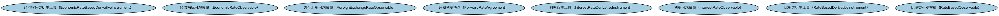

# 利率衍生品本体（Rate Derivatives Ontology）结构与公理说明

本文档对应 `RateDerivatives.rdf` / `RateDerivatives.ttl`，说明该本体的类、继承关系、属性和公理约定。结构图见 `RateDerivatives-structure.png`（`RateDerivatives-structure.svg` 为可缩放版本）。

## 1. 本体概述

定义以利率为标的的衍生品的通用概念：利率期货、利率期权、利率互换的共同特征。

**在体系中的位置**：DER 利率衍生品模块的基础本体。

**上下游关系**：上游继承衍生品基础本体并依赖 IND 利率本体（提供利率结构）；下游被利率互换本体及各类利率衍生品特化。

**与相近概念的差别**：利率衍生品以「利率水平」为标的，区别于以证券价格为标的的证券类衍生品和以信用事件为标的的信用衍生品。

## 2. 类（Class）

| 类（Class） | 定义（Definition） |
|---|---|
| 经济指标类衍生工具（EconomicRateBasedDerivativeInstrument） | 标的为某一经济指标类比率的衍生工具。 |
| 经济指标可观察量（EconomicRateObservable） | 可在市场上观察到的经济指标类比率，如物价指数、汇率等。 |
| 外汇汇率可观察量（ForeignExchangeRateObservable） | 可在市场上观察到的外汇汇率。 |
| 远期利率协议（ForwardRateAgreement） | 就未来某一日期名义本金的利率承诺进行交换的协议。 |
| 利率衍生工具（InterestRateDerivativeInstrument） | 标的为利率的衍生工具。 |
| 利率可观察量（InterestRateObservable） | 可在市场上观察到的利率。 |
| 比率类衍生工具（RateBasedDerivativeInstrument） | 标的为某一比率类可观察量的衍生工具。 |
| 比率类可观察量（RateBasedObservable） | 可在市场上观察到的比率类数值，是比率类衍生品的定价基础。 |

### 2.1 继承关系（Inheritance）

## 6. 依赖（owl:imports，4 个）

本本体通过 `owl:imports` 引入以下本体，各项的中文名称与简介如下：

| 导入本体 | 中文名称 | 简介 |
|---|---|---|
| `DER/DerivativesContracts/DerivativesBasics.rdf` | 衍生品基础本体（Derivatives Basics Ontology） | 定义衍生品合约（derivatives contract）的核心概念：标的资产、行权、到期等，是 DER 域的根基。 |
| `FBC/FinancialInstruments/FinancialInstruments.rdf` | 金融工具本体（Financial Instruments Ontology） | FIBO 核心本体之一，定义金融工具（financial instrument）的通用概念：可交易、代表某种权利义务的合同工具，是证券、衍生品等具体工具的共同基础。 |
| `FND/Utilities/AnnotationVocabulary.rdf` | FIBO 标注词汇表（FIBO Annotation Vocabulary） | 定义 FIBO 专用的标注属性（如释义来源、成熟度等级），用于本体自身的元数据标注。 |
| `https://www.omg.org/spec/Commons/AnnotationVocabulary/` | OMG 通用标注词汇表（OMG Commons Annotation Vocabulary） | OMG 通用本体库（Commons）中的标注词汇表，提供概念映射等标注属性，FIBO 用它标注术语与外部标准的对应关系。 |

## 7. 文件

- 官方 RDF/XML：`RateDerivatives.rdf`
- 中文 Turtle：`RateDerivatives.ttl`
- 结构图：`RateDerivatives-structure.png` / `RateDerivatives-structure.svg`