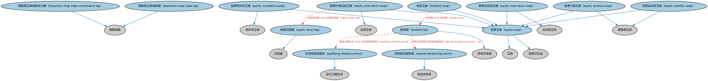

# 股权互换本体（Equity Swaps Ontology）结构与公理说明

本文档对应 `EquitySwaps.rdf` / `EquitySwaps.ttl`，说明该本体的类、继承关系、属性和公理约定。结构图见 `EquitySwaps-structure.png`（`EquitySwaps-structure.svg` 为可缩放版本）。

## 1. 本体概述

定义股权互换（equity swap）：一方支付股票或股指的收益（涨跌加分红），另一方支付利率现金流的合约。

**在体系中的位置**：DER 证券类衍生品模块的核心本体。

**上下游关系**：上游继承互换与证券类衍生品本体；下游服务股权收益风险转移、合成持股等建模。

**与相近概念的差别**：与利率互换的差别——一条腿的现金流来自股权收益而非利率；与直接持股的差别——获得股权经济收益但不拥有股票、没有表决权。

## 2. 类（Class）

| 类（Class） | 定义（Definition） |
|---|---|
| 离散度互换指数成分腿（dispersion swap index constituents leg） | 标的为给定股票指数一组成分股的离散度腿。 |
| 离散度互换指数腿（dispersion swap index leg） | 标的为某一股票指数的离散度腿。 |
| 股息腿（dividend leg） | 股息互换的浮动腿。 |
| 股息互换（dividend swap） | 至少一腿的标的为股息流的股票互换。 |
| 股票相关性互换（equity correlation swap） | 用于对冲一组标的产品价格观察平均相关性相关风险的相关性互换。 |
| 股票价格回报互换（equity price return swap） | 回报腿标的基于股票的回报互换。 |
| 股票回报腿（equity return leg） | 收益基于股票的回报腿。 |
| 股票互换（equity swap） | 支付与标的股票（如个股、股票篮子或指数）价值变动或其现金流挂钩的互换。 |
| 股票总回报互换（equity total return swap） | 回报腿标的基于股票的总回报互换。 |
| 股票方差互换（equity variance swap） | 双方约定按特定标的股票（或指数）价格变动的已实现方差与约定方差之间的差额进行支付的离散度互换。 |
| 股票波动率互换（equity volatility swap） | 以其标的股票价格变动之波动率为标的的远期合约型离散度互换。 |
| 合资格股息期间（qualifying dividend period） | 计算互换条款所指相关发行人支付的全部合资格股息之和的日期区间。 |
| 特别股息腿条款（special dividend leg terms） | 在适用特别股息和纪念股息时启用的条款。 |

### 2.1 继承关系（Inheritance）

- 离散度互换指数成分腿（dispersion swap index constituents leg） ⊑ 离散度腿
- 离散度互换指数腿（dispersion swap index leg） ⊑ 离散度腿
- 股息腿（dividend leg） ⊑ 简单回报腿
- 股息互换（dividend swap） ⊑ 股票互换（equity swap）
- 股票相关性互换（equity correlation swap） ⊑ 相关性互换
- 股票相关性互换（equity correlation swap） ⊑ 股票互换（equity swap）
- 股票价格回报互换（equity price return swap） ⊑ 回报互换
- 股票价格回报互换（equity price return swap） ⊑ 股票互换（equity swap）
- 股票回报腿（equity return leg） ⊑ 回报腿
- 股票互换（equity swap） ⊑ 互换
- 股票互换（equity swap） ⊑ 股票衍生品
- 股票总回报互换（equity total return swap） ⊑ 总回报互换
- 股票总回报互换（equity total return swap） ⊑ 股票互换（equity swap）
- 股票方差互换（equity variance swap） ⊑ 离散度互换
- 股票方差互换（equity variance swap） ⊑ 股票互换（equity swap）
- 股票波动率互换（equity volatility swap） ⊑ 离散度互换
- 股票波动率互换（equity volatility swap） ⊑ 股票互换（equity swap）
- 合资格股息期间（qualifying dividend period） ⊑ 显式日期区间
- 特别股息腿条款（special dividend leg terms） ⊑ 现金流条款

## 5. 公理约定（Axioms）

- 离散度互换指数成分腿（dispersion swap index constituents leg）：具有标的 some（由…扮演（is played by） some 股票篮子）
- 离散度互换指数腿（dispersion swap index leg）：具有标的 some（由…扮演（is played by） some 参考指数）
- 股息腿（dividend leg）：具有合同要素 特别股息腿条款（special dividend leg terms） ≥0
- 股息腿（dividend leg）：具有标的 some（由…扮演（is played by） some（restriction））
- 股息腿（dividend leg）：具有日期区间 some 合资格股息期间（qualifying dividend period）
- 股息互换（dividend swap）：具有腿 some 股息腿（dividend leg）
- 股票价格回报互换（equity price return swap）：具有回报腿 some 股票回报腿（equity return leg）
- 股票回报腿（equity return leg）：具有标的 some（由…扮演（is played by） some（restriction））
- 股票总回报互换（equity total return swap）：具有回报腿 some（restriction）

## 6. 依赖（owl:imports，13 个）

本本体通过 `owl:imports` 引入以下本体，各项的中文名称与简介如下：

| 导入本体 | 中文名称 | 简介 |
|---|---|---|
| `DER/DerivativesContracts/DerivativesBasics.rdf` | 衍生品基础本体（Derivatives Basics Ontology） | 定义衍生品合约（derivatives contract）的核心概念：标的资产、行权、到期等，是 DER 域的根基。 |
| `DER/DerivativesContracts/Swaps.rdf` | 互换本体（Swaps Ontology） | 定义互换（swap）合约的通用结构：互换腿（swap leg）、现金流交换与名义本金。 |
| `DER/SecurityBasedDerivatives/SecurityBasedDerivatives.rdf` | 证券类衍生品本体（Security-Based Derivatives Ontology） | 定义以单个证券或证券组合为标的的衍生品。 |
| `FBC/FinancialInstruments/FinancialInstruments.rdf` | 金融工具本体（Financial Instruments Ontology） | FIBO 核心本体之一，定义金融工具（financial instrument）的通用概念：可交易、代表某种权利义务的合同工具，是证券、衍生品等具体工具的共同基础。 |
| `FND/Accounting/CurrencyAmount.rdf` | 货币金额本体（Currency Amount Ontology） | 定义「金额＋币种」的货币金额（currency amount）表示，是 FIBO 中表达价格、债务金额、付款额等一切带币种数值的基础构件。 |
| `FND/Agreements/Contracts.rdf` | 合同本体（Contracts Ontology） | 在协议之上定义具有法律约束力的合同（contract）：合同当事方、合同条款、义务与权利，是金融工具与交易合同建模的基石。 |
| `FND/Utilities/Analytics.rdf` | 分析本体（Analytics Ontology） | 定义分析工具、度量与比率的通用概念，支撑指标与模型的表达。 |
| `FND/Utilities/AnnotationVocabulary.rdf` | FIBO 标注词汇表（FIBO Annotation Vocabulary） | 定义 FIBO 专用的标注属性（如释义来源、成熟度等级），用于本体自身的元数据标注。 |
| `IND/MarketIndices/BasketIndices.rdf` | 篮子指数本体（Basket Indices Ontology） | 定义以一篮子成分为基础的指数：成分、权重与计算方法。 |
| `SEC/Equities/EquityInstruments.rdf` | 股权工具本体（Equity Instruments Ontology） | 定义股票等股权工具：普通股、优先股及其附带的权利。 |
| `https://www.omg.org/spec/Commons/AnnotationVocabulary/` | OMG 通用标注词汇表（OMG Commons Annotation Vocabulary） | OMG 通用本体库（Commons）中的标注词汇表，提供概念映射等标注属性，FIBO 用它标注术语与外部标准的对应关系。 |
| `https://www.omg.org/spec/Commons/DatesAndTimes/` | OMG 通用日期与时间本体（OMG Commons Dates and Times） | Commons 库中的日期时间本体，定义日期、期间、时间点等通用时间概念。 |
| `https://www.omg.org/spec/Commons/RolesAndCompositions/` | OMG 通用角色与构成本体（OMG Commons Roles and Compositions） | Commons 库中的角色本体，定义角色及整体—部分构成关系的通用概念。 |

## 7. 文件

- 官方 RDF/XML：`EquitySwaps.rdf`
- 中文 Turtle：`EquitySwaps.ttl`
- 结构图：`EquitySwaps-structure.png` / `EquitySwaps-structure.svg`