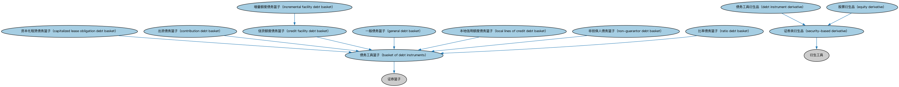

# 证券类衍生品本体（Security-Based Derivatives Ontology）结构与公理说明

本文档对应 `SecurityBasedDerivatives.rdf` / `SecurityBasedDerivatives.ttl`，说明该本体的类、继承关系、属性和公理约定。结构图见 `SecurityBasedDerivatives-structure.png`（`SecurityBasedDerivatives-structure.svg` 为可缩放版本）。

## 1. 本体概述

定义以单个证券或证券组合（股票、债券、指数）为标的的衍生品。

**在体系中的位置**：DER 证券类衍生品模块的基础本体。

**上下游关系**：上游继承衍生品基础本体并引用 SEC 证券本体（提供标的）；下游被股权互换本体特化。

**与相近概念的差别**：与利率、信用衍生品的差别在于标的类型——标的是证券的市场价格而非利率或信用事件。

## 2. 类（Class）

| 类（Class） | 定义（Definition） |
|---|---|
| 债务工具篮子（basket of debt instruments） | 成分为债务工具的证券篮子。 |
| 资本化租赁债务篮子（capitalized lease obligation debt basket） | 成分为赋予承租人临时使用资产权利、在会计上视为资产所有权之合同的债务工具篮子。 |
| 出资债务篮子（contribution debt basket） | 允许公司发生等于（或在美国顶级发起人交易中不超过）某一数额债务的债务工具篮子。 |
| 信贷额度债务篮子（credit facility debt basket） | 成分为允许借款人在较长时期内分期提取资金之信贷协议的证券篮子。 |
| 债务工具衍生品（debt instrument derivative） | 标的为债务类可观察量的证券类衍生品。 |
| 股票衍生品（equity derivative） | 标的基于股票（如个股、股票篮子或指数）或其现金流的证券类衍生品。 |
| 一般债务篮子（general debt basket） | 为潜在融资提供额外额度、且不要求所得款项用于特定用途的债务工具篮子。 |
| 增量额度债务篮子（incremental facility debt basket） | 成分为可扩展额度的信贷额度篮子，允许公司借入额外的定期贷款或循环信用额度。 |
| 本地信用额度债务篮子（local lines of credit debt basket） | 对跨国经营公司可能有意义的债务工具篮子，通常允许非担保人子公司发生债务。 |
| 非担保人债务篮子（non-guarantor debt basket） | 包含允许集团内未参与贷款担保的特定子公司发生债务之条款的债务工具篮子。 |
| 比率债务篮子（ratio debt basket） | 成分基于以总债务（而非仅有担保债务）计算的杠杆率确定的债务工具篮子。 |
| 证券类衍生品（security-based derivative） | 标的基于证券（包括证券集合和基于证券的指数）的衍生工具。 |

### 2.1 继承关系（Inheritance）

- 债务工具篮子（basket of debt instruments） ⊑ 证券篮子
- 资本化租赁债务篮子（capitalized lease obligation debt basket） ⊑ 债务工具篮子（basket of debt instruments）
- 出资债务篮子（contribution debt basket） ⊑ 债务工具篮子（basket of debt instruments）
- 信贷额度债务篮子（credit facility debt basket） ⊑ 债务工具篮子（basket of debt instruments）
- 债务工具衍生品（debt instrument derivative） ⊑ 证券类衍生品（security-based derivative）
- 股票衍生品（equity derivative） ⊑ 证券类衍生品（security-based derivative）
- 一般债务篮子（general debt basket） ⊑ 债务工具篮子（basket of debt instruments）
- 增量额度债务篮子（incremental facility debt basket） ⊑ 信贷额度债务篮子（credit facility debt basket）
- 本地信用额度债务篮子（local lines of credit debt basket） ⊑ 债务工具篮子（basket of debt instruments）
- 非担保人债务篮子（non-guarantor debt basket） ⊑ 债务工具篮子（basket of debt instruments）
- 比率债务篮子（ratio debt basket） ⊑ 债务工具篮子（basket of debt instruments）
- 证券类衍生品（security-based derivative） ⊑ 衍生工具

## 5. 公理约定（Axioms）

- 债务工具篮子（basket of debt instruments）：具有成员 some（包含 only 债务工具）
- 资本化租赁债务篮子（capitalized lease obligation debt basket）：具有成员 some（包含 only 租赁）
- 信贷额度债务篮子（credit facility debt basket）：具有成员 some（包含 only 信贷额度）
- 债务工具衍生品（debt instrument derivative）：具有标的 some（由…扮演（is played by） some（restriction））
- 股票衍生品（equity derivative）：具有标的 some（由…扮演（is played by） some（restriction））
- 本地信用额度债务篮子（local lines of credit debt basket）：具有成员 some（包含 only 循环信用额度）
- 证券类衍生品（security-based derivative）：具有标的 some（由…扮演（is played by） some（restriction））

## 6. 依赖（owl:imports，14 个）

本本体通过 `owl:imports` 引入以下本体，各项的中文名称与简介如下：

| 导入本体 | 中文名称 | 简介 |
|---|---|---|
| `DER/DerivativesContracts/DerivativesBasics.rdf` | 衍生品基础本体（Derivatives Basics Ontology） | 定义衍生品合约（derivatives contract）的核心概念：标的资产、行权、到期等，是 DER 域的根基。 |
| `DER/DerivativesContracts/Swaps.rdf` | 互换本体（Swaps Ontology） | 定义互换（swap）合约的通用结构：互换腿（swap leg）、现金流交换与名义本金。 |
| `FBC/DebtAndEquities/Debt.rdf` | 债务本体（Debt Ontology） | 定义债务（debt）与债权债务关系的核心概念：借款人、贷款人、本金与利息义务。 |
| `FBC/FinancialInstruments/FinancialInstruments.rdf` | 金融工具本体（Financial Instruments Ontology） | FIBO 核心本体之一，定义金融工具（financial instrument）的通用概念：可交易、代表某种权利义务的合同工具，是证券、衍生品等具体工具的共同基础。 |
| `FBC/ProductsAndServices/FinancialProductsAndServices.rdf` | 金融产品与服务本体（Financial Products and Services Ontology） | 定义金融产品（financial product）与金融服务（financial service）及其提供、购买关系。 |
| `FND/Utilities/AnnotationVocabulary.rdf` | FIBO 标注词汇表（FIBO Annotation Vocabulary） | 定义 FIBO 专用的标注属性（如释义来源、成熟度等级），用于本体自身的元数据标注。 |
| `IND/Indicators/Indicators.rdf` | 指标本体（Indicators Ontology） | 定义「指标」（indicator）的通用概念：对某现象的可度量表示，是经济指标、利率等的上位模型。 |
| `IND/MarketIndices/BasketIndices.rdf` | 篮子指数本体（Basket Indices Ontology） | 定义以一篮子成分为基础的指数：成分、权重与计算方法。 |
| `SEC/Debt/DebtInstruments.rdf` | 债务工具本体（Debt Instruments Ontology） | 定义债务工具（debt instrument）的通用概念：可交易的债权凭证，是债券、票据等的上位模型。 |
| `SEC/Equities/EquityInstruments.rdf` | 股权工具本体（Equity Instruments Ontology） | 定义股票等股权工具：普通股、优先股及其附带的权利。 |
| `SEC/Securities/Baskets.rdf` | 篮子本体（Baskets Ontology） | 定义证券篮子（basket）：作为整体交易或定价的一组证券。 |
| `https://www.omg.org/spec/Commons/AnnotationVocabulary/` | OMG 通用标注词汇表（OMG Commons Annotation Vocabulary） | OMG 通用本体库（Commons）中的标注词汇表，提供概念映射等标注属性，FIBO 用它标注术语与外部标准的对应关系。 |
| `https://www.omg.org/spec/Commons/Collections/` | OMG 通用集合本体（OMG Commons Collections） | Commons 库中的集合本体，定义集合、成员等通用概念。 |
| `https://www.omg.org/spec/Commons/RolesAndCompositions/` | OMG 通用角色与构成本体（OMG Commons Roles and Compositions） | Commons 库中的角色本体，定义角色及整体—部分构成关系的通用概念。 |

## 7. 文件

- 官方 RDF/XML：`SecurityBasedDerivatives.rdf`
- 中文 Turtle：`SecurityBasedDerivatives.ttl`
- 结构图：`SecurityBasedDerivatives-structure.png` / `SecurityBasedDerivatives-structure.svg`