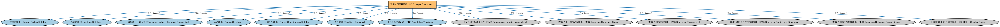

# 美国公司高管示例（US Example Executives）说明

本文档对应 `DowJonesIndustrialAverageExecutives.rdf` / `DowJonesIndustrialAverageExecutives.ttl`。

## 1. 本文件是什么

收录道指成分公司高管的示例个体。

从机制上说，这是一个个体（individuals）文件：它本身不定义任何新的类或属性，装的全是命名个体（owl:NamedIndividual）——也就是一条条真实存在的实例数据（如具体的货币、市场、监管机构、法域）。它的 `owl:imports` 引入的是这些个体所属的类定义所在的本体。应用需要实例级参考数据时加载这类文件。

## 2. 个体构成（共 17 个）

按个体所属类型统计（类型名为中文（English）对照）：

| 类型（Class） | 个体数量 |
|---|---|
| 雇佣关系（Employment） | 2 |
| 个人（Person） | 2 |
| 雇员（Employee） | 2 |
| 出生日期（DateOfBirth） | 2 |
| 人名（PersonName） | 2 |
| 显式日期（ExplicitDate） | 2 |
| 受控方（ControlledParty） | 1 |
| 雇主（Employer） | 1 |
| 公司高管（CorporateOfficer） | 1 |
| 首席执行官（ChiefExecutiveOfficer） | 1 |
| 日期区间（DatePeriod） | 1 |

个体数量较少，全部列出：

| 个体 | 类型 |
|---|---|
| Apple Inc. as controlled party | 受控方（ControlledParty） |
| Apple Inc. as employer | 雇主（Employer） |
| Employment of Katherine Adams at Apple Inc. | 雇佣关系（Employment） |
| Employment of Tim Cook at Apple Inc. | 雇佣关系（Employment） |
| Katherine Adams | 个人（Person） |
| Katherine Adams as employee | 雇员（Employee） |
| Katherine Adams as senior vice president of Government Affairs | 公司高管（CorporateOfficer） |
| Katherine Adams date of birth | 出生日期（DateOfBirth） |
| Katherine Adams full legal name | 人名（PersonName） |
| Tim Cook | 个人（Person） |
| Tim Cook as Chief Executive Officer | 首席执行官（ChiefExecutiveOfficer） |
| Tim Cook as employee | 雇员（Employee） |
| Tim Cook date of birth | 出生日期（DateOfBirth） |
| Tim Cook full legal name | 人名（PersonName） |
| Tim Cook hire date | 显式日期（ExplicitDate） |
| Tim Cook period of employment | 日期区间（DatePeriod） |
| Tim Cook retirement date | 显式日期（ExplicitDate） |

## 3. 依赖的本体（owl:imports，13 个）

以下导入提供个体所属的类定义与相关参考数据：

| 导入本体 | 中文名称 | 简介 |
|---|---|---|
| `BE/OwnershipAndControl/ControlParties.rdf` | 控制方本体（Control Parties Ontology） | 定义处于控制关系中的各方角色：控制方、被控制方、实际控制人等。 |
| `BE/OwnershipAndControl/Executives.rdf` | 高管本体（Executives Ontology） | 定义公司高管（executive）、董事会成员及其职务角色，刻画「谁在管理公司」。 |
| `EXMP/LegalEntities/DowJonesIndustrialAverageCompanies.rdf` | 道指成分公司示例（Dow Jones Industrial Average Companies） | 收录道琼斯工业平均指数成分股公司的示例个体，供演示与测试。 |
| `FND/AgentsAndPeople/People.rdf` | 人员本体（People Ontology） | 定义自然人（person）的核心属性：姓名、出生日期、国籍、身份标识与联系方式，为雇员、客户、签署人等角色提供「人」的基础模型。 |
| `FND/Organizations/FormalOrganizations.rdf` | 正式组织本体（Formal Organizations Ontology） | 定义正式组织、组织成员与组织内部角色，是公司、政府机构等组织形态建模的基础。 |
| `FND/Relations/Relations.rdf` | 关系本体（Relations Ontology） | FIBO 最底层的基础本体，定义参考（reference）、分类（classify）等通用关系与抽象概念，全库普遍依赖。 |
| `FND/Utilities/AnnotationVocabulary.rdf` | FIBO 标注词汇表（FIBO Annotation Vocabulary） | 定义 FIBO 专用的标注属性（如释义来源、成熟度等级），用于本体自身的元数据标注。 |
| `https://www.omg.org/spec/Commons/AnnotationVocabulary/` | OMG 通用标注词汇表（OMG Commons Annotation Vocabulary） | OMG 通用本体库（Commons）中的标注词汇表，提供概念映射等标注属性，FIBO 用它标注术语与外部标准的对应关系。 |
| `https://www.omg.org/spec/Commons/DatesAndTimes/` | OMG 通用日期与时间本体（OMG Commons Dates and Times） | Commons 库中的日期时间本体，定义日期、期间、时间点等通用时间概念。 |
| `https://www.omg.org/spec/Commons/Designators/` | OMG 通用指称符本体（OMG Commons Designators） | Commons 库中的指称符本体，定义名称、标识符等「指代某物的符号」的通用概念。 |
| `https://www.omg.org/spec/Commons/PartiesAndSituations/` | OMG 通用参与方与情境本体（OMG Commons Parties and Situations） | Commons 库中的参与方本体，定义独立主体、参与方及其角色扮演的通用概念，是 FIBO 参与方模型的上游。 |
| `https://www.omg.org/spec/Commons/RolesAndCompositions/` | OMG 通用角色与构成本体（OMG Commons Roles and Compositions） | Commons 库中的角色本体，定义角色及整体—部分构成关系的通用概念。 |
| `https://www.omg.org/spec/LCC/Countries/ISO3166-1-CountryCodes/` | LCC ISO 3166-1 国家代码（ISO 3166-1 Country Codes） | LCC 中 ISO 3166-1 标准的国家/地区代码个体集（如 CN、US、MX），供法域与地址建模引用。 |

## 4. 文件

- 官方 RDF/XML：`DowJonesIndustrialAverageExecutives.rdf`
- 中文 Turtle：`DowJonesIndustrialAverageExecutives.ttl`
- 结构图：`DowJonesIndustrialAverageExecutives-structure.png` / `DowJonesIndustrialAverageExecutives-structure.svg`