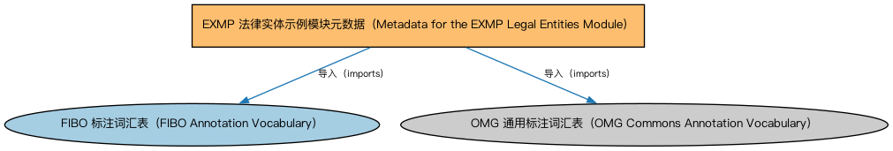

# EXMP 法律实体示例模块元数据（Metadata for the EXMP Legal Entities Module）说明

本文档对应 `MetadataEXMPLegalEntities.rdf` / `MetadataEXMPLegalEntities.ttl`。

## 1. 本文件是什么

声明法律实体示例模块的构成：道指成分公司、公司高管、金融机构、市场与交易所等示例个体本体。

从机制上说，这是一个元数据清单（metadata manifest）文件：它本身不定义任何类或属性，而是通过 `dct:hasPart` 声明一个域或模块由哪些本体构成，并携带版本 IRI、版权、许可与成熟度等发布管理信息。它回答的问题是「这个域/模块包含什么、当前是什么版本」，供发布工具和文档系统按模块组织内容；它的 `owl:imports` 只引入标注词汇表，不是用来加载业务本体的入口（加载入口是 `All*` 与 `About*` 聚合文件）。

## 2. 声明的构成（dct:hasPart，4 个）

| 构成项 | 中文名称 | 简介 |
|---|---|---|
| `EXMP/LegalEntities/DowJonesIndustrialAverageCompanies.rdf` | 道指成分公司示例（Dow Jones Industrial Average Companies） | 收录道琼斯工业平均指数成分股公司的示例个体，供演示与测试。 |
| `EXMP/LegalEntities/DowJonesIndustrialAverageExecutives.rdf` | 美国公司高管示例（US Example Executives） | 收录道指成分公司高管的示例个体。 |
| `EXMP/LegalEntities/FinancialInstitutionExamples.rdf` | 金融机构示例（Financial Institution Examples） | 收录典型金融机构的示例个体。 |
| `EXMP/LegalEntities/MarketsAndExchangesExamples.rdf` | 美国市场与交易所示例（US Markets and Exchanges Individuals） | 收录美国主要交易所与市场的示例个体。 |

## 3. 标注依赖（owl:imports，2 个）

以下导入仅用于支撑元数据标注本身（如成熟度等级、概念映射），不属于业务内容：

| 导入本体 | 中文名称 | 简介 |
|---|---|---|
| `FND/Utilities/AnnotationVocabulary.rdf` | FIBO 标注词汇表（FIBO Annotation Vocabulary） | 定义 FIBO 专用的标注属性（如释义来源、成熟度等级），用于本体自身的元数据标注。 |
| `https://www.omg.org/spec/Commons/AnnotationVocabulary/` | OMG 通用标注词汇表（OMG Commons Annotation Vocabulary） | OMG 通用本体库（Commons）中的标注词汇表，提供概念映射等标注属性，FIBO 用它标注术语与外部标准的对应关系。 |

## 4. 文件

- 官方 RDF/XML：`MetadataEXMPLegalEntities.rdf`
- 中文 Turtle：`MetadataEXMPLegalEntities.ttl`
- 结构图：`MetadataEXMPLegalEntities-structure.png` / `MetadataEXMPLegalEntities-structure.svg`