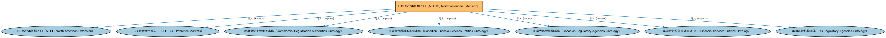

# FBC 域北美扩展入口（All FBC, North American Extension）聚合说明

本文档对应 `AllFBC-NorthAmerica.rdf` / `AllFBC-NorthAmerica.ttl`。

## 1. 本文件是什么

聚合 FBC 域中北美法域的扩展本体（美国与加拿大的金融服务实体、监管机构及受控词汇等）。

从机制上说，这是一个聚合入口（load-all）文件：它本身不定义任何新的类或属性，只通过 `owl:imports` 把一组本体打包在一起。应用只要导入这一个文件，推理机就会把它列出的所有本体一次性加载进来，免去逐个声明的麻烦。因此它的价值不在「内容」，而在「组合」——组合方式本身就表达了发布方的意图（例如按域打包、按区域扩展打包、按是否含参考数据打包）。

## 2. 聚合的本地本体（7 个）

以下本体均可在本目录结构中找到同名 `.rdf` 文件及配套中文文档：

| 导入本体 | 中文名称 | 简介 |
|---|---|---|
| `BE/AllBE-NorthAmerica.rdf` | BE 域北美扩展入口（All BE, North American Extension） | 聚合 BE 域中北美法域的扩展本体（美国、加拿大、墨西哥、加勒比地区政府实体与法域个体）。 |
| `FBC/AllFBC-ReferenceMarkets.rdf` | FBC 域参考市场入口（All FBC, Reference Markets） | 聚合全球主要金融市场的参考个体（市场、商业中心及其个体数据），用于需要市场主数据的场景。 |
| `FBC/FunctionalEntities/CommercialRegistrationAuthorities.rdf` | 商事登记主管机关本体（Commercial Registration Authorities Ontology） | 定义负责商事登记的主管机关及其维护的登记记录。 |
| `FBC/FunctionalEntities/NorthAmericanEntities/CAFinancialServicesEntities.rdf` | 加拿大金融服务实体本体（Canadian Financial Services Entities Ontology） | 定义加拿大法域下的金融服务机构类型与个体。 |
| `FBC/FunctionalEntities/NorthAmericanEntities/CARegulatoryAgencies.rdf` | 加拿大监管机构本体（Canadian Regulatory Agencies Ontology） | 收录加拿大金融监管机构个体（如加拿大金融机构监管署 OSFI）。 |
| `FBC/FunctionalEntities/NorthAmericanEntities/USFinancialServicesEntities.rdf` | 美国金融服务实体本体（US Financial Services Entities Ontology） | 定义美国法域下的金融服务机构类型与个体。 |
| `FBC/FunctionalEntities/NorthAmericanEntities/USRegulatoryAgencies.rdf` | 美国监管机构本体（US Regulatory Agencies Ontology） | 收录美国金融监管机构个体（如美联储、证监会 SEC、货币监理署 OCC）。 |

## 3. 文件

- 官方 RDF/XML：`AllFBC-NorthAmerica.rdf`
- 中文 Turtle：`AllFBC-NorthAmerica.ttl`
- 结构图：`AllFBC-NorthAmerica-structure.png` / `AllFBC-NorthAmerica-structure.svg`