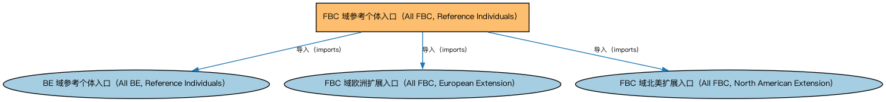

# FBC 域参考个体入口（All FBC, Reference Individuals）聚合说明

本文档对应 `AllFBC-ReferenceIndividuals.rdf` / `AllFBC-ReferenceIndividuals.ttl`。

## 1. 本文件是什么

聚合 FBC 域全部参考数据个体本体（商业中心、市场、监管机构、金融机构等实例），供需要完整参考数据的应用加载。

从机制上说，这是一个聚合入口（load-all）文件：它本身不定义任何新的类或属性，只通过 `owl:imports` 把一组本体打包在一起。应用只要导入这一个文件，推理机就会把它列出的所有本体一次性加载进来，免去逐个声明的麻烦。因此它的价值不在「内容」，而在「组合」——组合方式本身就表达了发布方的意图（例如按域打包、按区域扩展打包、按是否含参考数据打包）。

## 2. 聚合的本地本体（3 个）

以下本体均可在本目录结构中找到同名 `.rdf` 文件及配套中文文档：

| 导入本体 | 中文名称 | 简介 |
|---|---|---|
| `BE/AllBE-ReferenceIndividuals.rdf` | BE 域参考个体入口（All BE, Reference Individuals） | 聚合 BE 域的全部参考数据个体本体（全球各法域的政体、政府与法域实例），供需要完整参考数据的应用加载。 |
| `FBC/AllFBC-Europe.rdf` | FBC 域欧洲扩展入口（All FBC, European Extension） | 聚合 FBC 域中欧洲法域的扩展本体（欧盟金融服务实体、欧盟监管机构、欧洲市场参考个体等），与 AllFBC 配合用于欧洲场景。 |
| `FBC/AllFBC-NorthAmerica.rdf` | FBC 域北美扩展入口（All FBC, North American Extension） | 聚合 FBC 域中北美法域的扩展本体（美国与加拿大的金融服务实体、监管机构及受控词汇等）。 |

## 3. 文件

- 官方 RDF/XML：`AllFBC-ReferenceIndividuals.rdf`
- 中文 Turtle：`AllFBC-ReferenceIndividuals.ttl`
- 结构图：`AllFBC-ReferenceIndividuals-structure.png` / `AllFBC-ReferenceIndividuals-structure.svg`