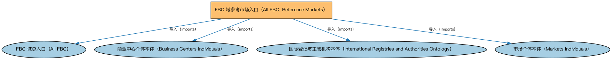

# FBC 域参考市场入口（All FBC, Reference Markets）聚合说明

本文档对应 `AllFBC-ReferenceMarkets.rdf` / `AllFBC-ReferenceMarkets.ttl`。

## 1. 本文件是什么

聚合全球主要金融市场的参考个体（市场、商业中心及其个体数据），用于需要市场主数据的场景。

从机制上说，这是一个聚合入口（load-all）文件：它本身不定义任何新的类或属性，只通过 `owl:imports` 把一组本体打包在一起。应用只要导入这一个文件，推理机就会把它列出的所有本体一次性加载进来，免去逐个声明的麻烦。因此它的价值不在「内容」，而在「组合」——组合方式本身就表达了发布方的意图（例如按域打包、按区域扩展打包、按是否含参考数据打包）。

## 2. 聚合的本地本体（4 个）

以下本体均可在本目录结构中找到同名 `.rdf` 文件及配套中文文档：

| 导入本体 | 中文名称 | 简介 |
|---|---|---|
| `FBC/AllFBC.rdf` | FBC 域总入口（All FBC） | 聚合金融商业与贸易（Financial Business and Commerce，FBC）域的全部生产本体：金融工具、金融市场、金融服务机构、监管机构、金融产品与服务、债务与担保等，一次导入即获得 FBC 域完整模型。 |
| `FBC/FunctionalEntities/BusinessCentersIndividuals.rdf` | 商业中心个体本体（Business Centers Individuals） | 收录全球主要商业中心（如纽约、伦敦、东京）的参考个体。 |
| `FBC/FunctionalEntities/InternationalRegistriesAndAuthorities.rdf` | 国际登记与主管机构本体（International Registries and Authorities Ontology） | 收录国际性登记机构与主管当局的参考个体。 |
| `FBC/FunctionalEntities/MarketsIndividuals.rdf` | 市场个体本体（Markets Individuals） | 收录全球主要金融市场的参考个体。 |

## 3. 文件

- 官方 RDF/XML：`AllFBC-ReferenceMarkets.rdf`
- 中文 Turtle：`AllFBC-ReferenceMarkets.ttl`
- 结构图：`AllFBC-ReferenceMarkets-structure.png` / `AllFBC-ReferenceMarkets-structure.svg`