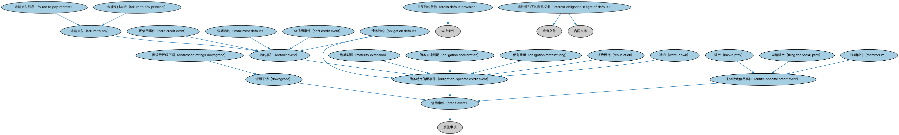

# 信用事件本体（Credit Events Ontology）结构与公理说明

本文档对应 `CreditEvents.rdf` / `CreditEvents.ttl`，说明该本体的类、继承关系、属性和公理约定。结构图见 `CreditEvents-structure.png`（`CreditEvents-structure.svg` 为可缩放版本）。

## 1. 本体概述

定义信用事件（credit event）：破产、拒付（failure to pay）、债务重组、加速到期等表明债务人信用恶化的事件类型。

**在体系中的位置**：FBC 债务与权益模块中负责「信用出了什么事」的本体，是信用衍生品结算的触发依据。

**上下游关系**：上游依赖 FND 事件与发生本体和债务本体；下游被 DER 信用违约互换本体引用（CDS 以信用事件为赔付触发条件）。

**与相近概念的差别**：信用事件≠企业行动——信用事件关乎偿付能力恶化，企业行动（分红、拆股）是正常公司治理行为；信用事件≠信用评级下调——评级是第三方评估，事件是客观发生的法律事实。

本本体中类与类的核心关系如下（完整细节见各类小节）：

- **破产（bankruptcy）** 继承 **主体特定信用事件（entity-specific credit event）**
- **信用事件（credit event）** 继承 **发生事项（Occurrence）**
- **交叉违约条款（cross default provision）** 继承 **先决条件（ConditionPrecedent）**
- **违约事件（default event）** 继承 **债务特定信用事件（obligation-specific credit event）**
- **困境级评级下调（distressed ratings downgrade）** 继承 **评级下调（downgrade）**
- **评级下调（downgrade）** 继承 **信用事件（credit event）**
- **主体特定信用事件（entity-specific credit event）** 继承 **信用事件（credit event）**
- **未能支付（failure to pay）** 继承 **违约事件（default event）**
- **未能支付利息（failure to pay interest）** 继承 **未能支付（failure to pay）**
- **未能支付本金（failure to pay principal）** 继承 **未能支付（failure to pay）**
- **申请破产（filing for bankruptcy）** 继承 **主体特定信用事件（entity-specific credit event）**
- **硬信用事件（hard credit event）** 继承 **违约事件（default event）**
- 其余 13 条关系从略。

## 2. 类（Class）

| 类（Class） | 定义（Definition） |
|---|---|
| 破产（bankruptcy） | 信用事件的一种，指一方的状态或状况发生变化、陷入资不抵债（无力清偿）的情形。 credit event involving a change in state or condition in which a party becomes insolvent |
| 信用事件（credit event） | 表明信用状况突然变化的事件，例如破产或违反债券契约、贷款协议，使人对相关方履行当前或未来义务的能力产生怀疑。 event signifying a sudden change in credit standing, such as bankruptcy or a violation of a bond indenture or loan agreement, that raises doubts about the party's ability to meet current or future obligations |
| 交叉违约条款（cross default provision） | 合同条款：当借款人在另一相关债务上违约时，触发本合同项下的违约。 contract provision that triggers a default under one contract if the borrower defaults on another related obligation |
| 违约事件（default event） | 信用事件的一种，表示未能履行合同义务，例如未能偿还贷款或证券的利息或本金等债务。 credit event representing a failure to meet a contractual obligation, such as failure to repay a debt including interest or principal on a loan or security |
| 困境级评级下调（distressed ratings downgrade） | 当某项债务的信用评级被下调至困境债务水平时触发的信用事件。 credit event triggered when the credit rating of an obligation is downgraded to a distressed debt level |
| 评级下调（downgrade） | 当某一方或某项债务的信用评级被降低时触发的信用事件。 credit event triggered when the credit rating of a party or obligation is lowered |
| 主体特定信用事件（entity-specific credit event） | 适用于某一特定法律主体的信用事件。 credit event that applies to a given legal person |
| 未能支付（failure to pay） | 在任何适用的宽限期之后仍未履行支付义务而触发的违约事件。 default event that is triggered following any applicable grace period in which a payment obligation is missed |
| 未能支付利息（failure to pay interest） | 违约事件的一种：预期利息支付完全未付，或实付金额低于应付金额。 default event that where either an expected interest payment is missed altogether or the amount paid is less than the required amount |
| 未能支付本金（failure to pay principal） | 违约事件的一种：预期本金支付完全未付，或实付金额低于应付金额。 default event that where either an expected principal payment is missed altogether or the amount paid is less than the required amount |
| 申请破产（filing for bankruptcy） | 向法院提出请求、要求被认定为破产的信用事件。 credit event that involves a request to a court to be recognized as bankrupt |
| 硬信用事件（hard credit event） | 不可修复（无法补救）的违约事件。 default event that is not repairable |
| 分期违约（installment default） | 违约事件的一种：未按协议条款如期支付多期分期款项，或未支付受益人要求的催缴款项。 default event involving non-payment of several installment payments as scheduled in the terms of the agreement, or non-payment of a call by the beneficial owner |
| 违约情形下的利息义务（interest obligation in light of default） | 就任何支付义务的违约行为所产生的利息方面的义务。 obligation in respect of default(s) in the performance of any payment obligation |
| 到期延展（maturity extension） | 将付款延长至债务原定到期日之后的信用事件。 credit event involving extension of payments beyond the original maturity date of the obligation |
| 延期偿付（moratorium） | 主体特定信用事件：在相关问题解决之前暂时中止付款。 entity-specific credit event involving a temporary suspension of payments until related issues are resolved |
| 债务加速到期（obligation acceleration） | 因参考债务发生违约或违反契约条款，导致一笔或多笔参考债务立即到期应付的信用事件。 credit event triggered when one or more reference obligations become immediately due and payable as a result of a default or covenant breach on the reference entity's other debt instruments, subject to a materiality threshold |
| 债务违约（obligation default） | 因某项特定债务违约而触发的信用事件。 credit event triggered as a result of an obligation-specific default |
| 债务重组（obligation restructuring） | 对债务产生重大影响的信用事件，例如降息、削减本金、利息或本金延期支付、偿付顺序变更等。 credit event that materially impacts an obligation, such as an interest rate reduction, principal reduction, deferral of interest or principal, change in priority ranking, or change in currency or composition of payment |
| 债务特定信用事件（obligation-specific credit event） | 与某一具体信贷协议或债务工具（参考债务）相关的信用事件。 credit event that relates to an individual credit agreement or debt instrument (reference obligation) |
| 拒绝履行（repudiation） | 拒绝履行合同条款的信用事件。 credit event involving the refusal to honor the terms of a contract |
| 软信用事件（soft credit event） | 可修复（可补救）的违约事件。 default event that is repairable |
| 减记（write-down） | 债务特定信用事件：债务的账面价值（如未偿本金余额）被调减。 obligation-specific credit event whereby the book value of the obligation, such as the outstanding principal amount, is reduced |

以下按类逐个展开：每个类给出继承关系、相关属性与公理约定；子类在父类之下降一级编号。

### 2.1 信用事件（credit event）

定义：表明信用状况突然变化的事件，例如破产或违反债券契约、贷款协议，使人对相关方履行当前或未来义务的能力产生怀疑。

- 父类：**发生事项（Occurrence）**
- 直接子类：**评级下调（downgrade）**、**主体特定信用事件（entity-specific credit event）**、**债务特定信用事件（obligation-specific credit event）**

#### 2.1.1 评级下调（downgrade）

定义：当某一方或某项债务的信用评级被降低时触发的信用事件。

- 父类：**信用事件（credit event）**
- 直接子类：**困境级评级下调（distressed ratings downgrade）**

##### 2.1.1.1 困境级评级下调（distressed ratings downgrade）

定义：当某项债务的信用评级被下调至困境债务水平时触发的信用事件。

- 父类：**评级下调（downgrade）**

#### 2.1.2 主体特定信用事件（entity-specific credit event）

定义：适用于某一特定法律主体的信用事件。

- 父类：**信用事件（credit event）**
- 直接子类：**破产（bankruptcy）**、**申请破产（filing for bankruptcy）**、**延期偿付（moratorium）**

属性：

| 属性 | 定义 | 说明 |
|---|---|---|
| **适用于（appliesTo）** | — | — |

公理：

- **适用于（appliesTo）**至少有一个取值，类型是**法律主体（LegalPerson）**。

##### 2.1.2.1 破产（bankruptcy）

定义：信用事件的一种，指一方的状态或状况发生变化、陷入资不抵债（无力清偿）的情形。

- 父类：**主体特定信用事件（entity-specific credit event）**

##### 2.1.2.2 申请破产（filing for bankruptcy）

定义：向法院提出请求、要求被认定为破产的信用事件。

- 父类：**主体特定信用事件（entity-specific credit event）**

##### 2.1.2.3 延期偿付（moratorium）

定义：主体特定信用事件：在相关问题解决之前暂时中止付款。

- 父类：**主体特定信用事件（entity-specific credit event）**

#### 2.1.3 债务特定信用事件（obligation-specific credit event）

定义：与某一具体信贷协议或债务工具（参考债务）相关的信用事件。

- 父类：**信用事件（credit event）**
- 直接子类：**违约事件（default event）**、**到期延展（maturity extension）**、**债务加速到期（obligation acceleration）**、**债务违约（obligation default）**、**债务重组（obligation restructuring）**、**拒绝履行（repudiation）**、**减记（write-down）**

属性：

| 属性 | 定义 | 说明 |
|---|---|---|
| **具有违约门槛金额（has default threshold amount）** | 规定触发未能支付、拒绝履行/延期偿付或重组事件的金额门槛。 specifies an amount of money that triggers a failure to pay, repudiation/moratorium or restructuring event | 值域：货币数量；子属性：具有货币数量 |
| **适用于（appliesTo）** | — | — |

公理：

- **具有违约门槛金额（has default threshold amount）**可以有 0 个或多个**货币数量（MonetaryAmount）**。
- **适用于（appliesTo）**至少有一个取值，类型是**信贷协议（CreditAgreement）**。

##### 2.1.3.1 违约事件（default event）

定义：信用事件的一种，表示未能履行合同义务，例如未能偿还贷款或证券的利息或本金等债务。

- 父类：**债务特定信用事件（obligation-specific credit event）**
- 直接子类：**未能支付（failure to pay）**、**硬信用事件（hard credit event）**、**分期违约（installment default）**、**债务违约（obligation default）**、**软信用事件（soft credit event）**

属性：

| 属性 | 定义 | 说明 |
|---|---|---|
| **例证（exemplifies）** | — | — |

公理：

- **例证（exemplifies）**可以有 0 个或多个**违反契约承诺（BreachOfCovenant）**。

###### 2.1.3.1.1 未能支付（failure to pay）

定义：在任何适用的宽限期之后仍未履行支付义务而触发的违约事件。

- 父类：**违约事件（default event）**
- 直接子类：**未能支付利息（failure to pay interest）**、**未能支付本金（failure to pay principal）**

属性：

| 属性 | 定义 | 说明 |
|---|---|---|
| **具有宽限期（has grace period）** | 付款到期日之后的窗口期，在此期间内一方须履行其义务，否则发生未能支付信用事件。 window following any payment due date during which a party must fulfill its obligations before a failure to pay credit event occurs | 值域：日期区间；子属性：具有日期区间 |

公理：

- **具有宽限期（has grace period）**至多有 1 个**日期区间（DatePeriod）**。

###### 2.1.3.1.1.1 未能支付利息（failure to pay interest）

定义：违约事件的一种：预期利息支付完全未付，或实付金额低于应付金额。

- 父类：**未能支付（failure to pay）**

###### 2.1.3.1.1.2 未能支付本金（failure to pay principal）

定义：违约事件的一种：预期本金支付完全未付，或实付金额低于应付金额。

- 父类：**未能支付（failure to pay）**

###### 2.1.3.1.2 硬信用事件（hard credit event）

定义：不可修复（无法补救）的违约事件。

- 父类：**违约事件（default event）**

###### 2.1.3.1.3 分期违约（installment default）

定义：违约事件的一种：未按协议条款如期支付多期分期款项，或未支付受益人要求的催缴款项。

- 父类：**违约事件（default event）**

###### 2.1.3.1.4 债务违约（obligation default）

定义：因某项特定债务违约而触发的信用事件。

- 父类：**违约事件（default event）**、**债务特定信用事件（obligation-specific credit event）**

###### 2.1.3.1.5 软信用事件（soft credit event）

定义：可修复（可补救）的违约事件。

- 父类：**违约事件（default event）**

公理：

- 与**硬信用事件（hard credit event）**互斥：同一个体不能同时属于两者。

##### 2.1.3.2 到期延展（maturity extension）

定义：将付款延长至债务原定到期日之后的信用事件。

- 父类：**债务特定信用事件（obligation-specific credit event）**

##### 2.1.3.3 债务加速到期（obligation acceleration）

定义：因参考债务发生违约或违反契约条款，导致一笔或多笔参考债务立即到期应付的信用事件。

- 父类：**债务特定信用事件（obligation-specific credit event）**

##### 2.1.3.5 债务重组（obligation restructuring）

定义：对债务产生重大影响的信用事件，例如降息、削减本金、利息或本金延期支付、偿付顺序变更等。

- 父类：**债务特定信用事件（obligation-specific credit event）**

属性：

| 属性 | 定义 | 说明 |
|---|---|---|
| **涉及多个事件（involves multiple events）** | 表明该重组跨越不止一个信用事件。 indicates that the restructuring spans more than one credit event | 值域：xsd:boolean |

##### 2.1.3.6 拒绝履行（repudiation）

定义：拒绝履行合同条款的信用事件。

- 父类：**债务特定信用事件（obligation-specific credit event）**

##### 2.1.3.7 减记（write-down）

定义：债务特定信用事件：债务的账面价值（如未偿本金余额）被调减。

- 父类：**债务特定信用事件（obligation-specific credit event）**

### 2.2 交叉违约条款（cross default provision）

定义：合同条款：当借款人在另一相关债务上违约时，触发本合同项下的违约。

- 父类：**先决条件（ConditionPrecedent）**

属性：

| 属性 | 定义 | 说明 |
|---|---|---|
| **具有违约门槛金额（has default threshold amount）** | 规定触发未能支付、拒绝履行/延期偿付或重组事件的金额门槛。 specifies an amount of money that triggers a failure to pay, repudiation/moratorium or restructuring event | 值域：货币数量；子属性：具有货币数量 |
| **适用于（appliesTo）** | — | — |

公理：

- **具有违约门槛金额（has default threshold amount）**可以有 0 个或多个**货币数量（MonetaryAmount）**。
- **适用于（appliesTo）**至少有一个取值，类型是**信贷协议（CreditAgreement）**。

### 2.3 违约情形下的利息义务（interest obligation in light of default）

定义：就任何支付义务的违约行为所产生的利息方面的义务。

- 父类：**或有义务（ContingentObligation）**、**合同义务（ContractualObligation）**

属性：

| 属性 | 定义 | 说明 |
|---|---|---|
| **具有违约利息复利基础（has default interest compounding basis）** | 指明违约利息的计算基础，以时间周期表示。 indicates the basis on which default interest is to be calculated, as a period of time | 值域：日期区间；子属性：具有日期区间 |
| **是否适用违约利息（is default interest applicable）** | 表明在法律及适用协议允许的范围内，支付义务违约方是否须支付违约利息。 indicates whether a party that defaults in the performance of any payment obligation is, to the extent permitted by law and the applicable agreement, required to pay interest (before as well as after judgment) on the overdue amount to the other party on demand in the same currency as such overdue amount, for the period from (and including) the original due date for payment to (but excluding) the date of actual payment | 值域：xsd:boolean |
| **由……授权要求（isMandatedBy）** | — | — |

公理：

- **具有违约利息复利基础（has default interest compounding basis）**至多有 1 个**日期区间（DatePeriod）**。
- **是否适用违约利息（is default interest applicable）**存在取值约束。
- **由……授权要求（isMandatedBy）**至少有一个取值，类型是**支付义务（PaymentObligation）**。

## 3. 其他属性

以下属性未绑定到本体的具体类（定义域在外部本体或未声明）：

数据属性（Datatype Property）：

| 属性 | 定义 |
|---|---|
| **宽限期是否可延长（is grace period extendable）** | 表明宽限期是否可以延长，可能因司法管辖区而异。 indicates whether or not the grace period may be extended, which may be jurisdiction specific |

## 4. 依赖（owl:imports，12 个）

本本体通过 `owl:imports` 引入以下本体，各项的中文名称与简介如下：

| 导入本体 | 中文名称 | 简介 |
|---|---|---|
| `FBC/DebtAndEquities/Debt.rdf` | 债务本体（Debt Ontology） | 定义债务（debt）与债权债务关系的核心概念：借款人、贷款人、本金与利息义务。 |
| `FND/Accounting/CurrencyAmount.rdf` | 货币金额本体（Currency Amount Ontology） | 定义「金额＋币种」的货币金额（currency amount）表示，是 FIBO 中表达价格、债务金额、付款额等一切带币种数值的基础构件。 |
| `FND/Agreements/Contracts.rdf` | 合同本体（Contracts Ontology） | 在协议之上定义具有法律约束力的合同（contract）：合同当事方、合同条款、义务与权利，是金融工具与交易合同建模的基石。 |
| `FND/DatesAndTimes/Occurrences.rdf` | 事件与发生本体（Occurrences Ontology） | 定义「发生」（occurrence）、事件与触发条件，用于表达企业行动、信用事件等「发生了什么」。 |
| `FND/Law/LegalCapacity.rdf` | 法律能力本体（Legal Capacity Ontology） | 定义法律能力、缔约能力、签章权等概念，刻画主体从事法律行为的资格。 |
| `FND/ProductsAndServices/PaymentsAndSchedules.rdf` | 付款与计划表本体（Payments and Schedules Ontology） | 定义付款、付款计划表（payment schedule）及其日期与金额结构，是贷款还款、债券付息建模的基础。 |
| `FND/Relations/Relations.rdf` | 关系本体（Relations Ontology） | FIBO 最底层的基础本体，定义参考（reference）、分类（classify）等通用关系与抽象概念，全库普遍依赖。 |
| `FND/Utilities/AnnotationVocabulary.rdf` | FIBO 标注词汇表（FIBO Annotation Vocabulary） | 定义 FIBO 专用的标注属性（如释义来源、成熟度等级），用于本体自身的元数据标注。 |
| `https://www.omg.org/spec/Commons/AnnotationVocabulary/` | OMG 通用标注词汇表（OMG Commons Annotation Vocabulary） | OMG 通用本体库（Commons）中的标注词汇表，提供概念映射等标注属性，FIBO 用它标注术语与外部标准的对应关系。 |
| `https://www.omg.org/spec/Commons/ContextualDesignators/` | OMG 通用语境指称本体（OMG Commons Contextual Designators） | Commons 库中的语境指称本体，定义「在某个语境下指代某物的名称/符号」，是地址、账户号码等语境相关标识的基础。 |
| `https://www.omg.org/spec/Commons/DatesAndTimes/` | OMG 通用日期与时间本体（OMG Commons Dates and Times） | Commons 库中的日期时间本体，定义日期、期间、时间点等通用时间概念。 |
| `https://www.omg.org/spec/Commons/Organizations/` | OMG 通用组织本体（OMG Commons Organizations） | Commons 库中的组织本体，定义组织、组织成员与组织结构的通用概念。 |

## 5. 文件

- 官方 RDF/XML：`CreditEvents.rdf`
- 中文 Turtle：`CreditEvents.ttl`
- 结构图：`CreditEvents-structure.png` / `CreditEvents-structure.svg`