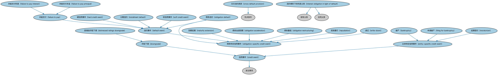

# 信用事件本体（Credit Events Ontology）结构与公理说明

本文档对应 `CreditEvents.rdf` / `CreditEvents.ttl`，说明该本体的类、继承关系、属性和公理约定。结构图见 `CreditEvents-structure.png`（`CreditEvents-structure.svg` 为可缩放版本）。

## 1. 本体概述

定义信用事件（credit event）：破产、拒付（failure to pay）、债务重组、加速到期等表明债务人信用恶化的事件类型。

**在体系中的位置**：FBC 债务与权益模块中负责「信用出了什么事」的本体，是信用衍生品结算的触发依据。

**上下游关系**：上游依赖 FND 事件与发生本体和债务本体；下游被 DER 信用违约互换本体引用（CDS 以信用事件为赔付触发条件）。

**与相近概念的差别**：信用事件≠企业行动——信用事件关乎偿付能力恶化，企业行动（分红、拆股）是正常公司治理行为；信用事件≠信用评级下调——评级是第三方评估，事件是客观发生的法律事实。

## 2. 类（Class）

| 类（Class） | 定义（Definition） |
|---|---|
| 破产（bankruptcy） | 信用事件的一种，指一方的状态或状况发生变化、陷入资不抵债（无力清偿）的情形。 |
| 信用事件（credit event） | 表明信用状况突然变化的事件，例如破产或违反债券契约、贷款协议，使人对相关方履行当前或未来义务的能力产生怀疑。 |
| 交叉违约条款（cross default provision） | 合同条款：当借款人在另一相关债务上违约时，触发本合同项下的违约。 |
| 违约事件（default event） | 信用事件的一种，表示未能履行合同义务，例如未能偿还贷款或证券的利息或本金等债务。 |
| 困境级评级下调（distressed ratings downgrade） | 当某项债务的信用评级被下调至困境债务水平时触发的信用事件。 |
| 评级下调（downgrade） | 当某一方或某项债务的信用评级被降低时触发的信用事件。 |
| 主体特定信用事件（entity-specific credit event） | 适用于某一特定法律主体的信用事件。 |
| 未能支付（failure to pay） | 在任何适用的宽限期之后仍未履行支付义务而触发的违约事件。 |
| 未能支付利息（failure to pay interest） | 违约事件的一种：预期利息支付完全未付，或实付金额低于应付金额。 |
| 未能支付本金（failure to pay principal） | 违约事件的一种：预期本金支付完全未付，或实付金额低于应付金额。 |
| 申请破产（filing for bankruptcy） | 向法院提出请求、要求被认定为破产的信用事件。 |
| 硬信用事件（hard credit event） | 不可修复（无法补救）的违约事件。 |
| 分期违约（installment default） | 违约事件的一种：未按协议条款如期支付多期分期款项，或未支付受益人要求的催缴款项。 |
| 违约情形下的利息义务（interest obligation in light of default） | 就任何支付义务的违约行为所产生的利息方面的义务。 |
| 到期延展（maturity extension） | 将付款延长至债务原定到期日之后的信用事件。 |
| 延期偿付（moratorium） | 主体特定信用事件：在相关问题解决之前暂时中止付款。 |
| 债务加速到期（obligation acceleration） | 因参考债务发生违约或违反契约条款，导致一笔或多笔参考债务立即到期应付的信用事件。 |
| 债务违约（obligation default） | 因某项特定债务违约而触发的信用事件。 |
| 债务重组（obligation restructuring） | 对债务产生重大影响的信用事件，例如降息、削减本金、利息或本金延期支付、偿付顺序变更等。 |
| 债务特定信用事件（obligation-specific credit event） | 与某一具体信贷协议或债务工具（参考债务）相关的信用事件。 |
| 拒绝履行（repudiation） | 拒绝履行合同条款的信用事件。 |
| 软信用事件（soft credit event） | 可修复（可补救）的违约事件。 |
| 减记（write-down） | 债务特定信用事件：债务的账面价值（如未偿本金余额）被调减。 |

### 2.1 继承关系（Inheritance）

- 破产（bankruptcy） ⊑ 主体特定信用事件（entity-specific credit event）
- 信用事件（credit event） ⊑ 发生事项
- 交叉违约条款（cross default provision） ⊑ 先决条件
- 违约事件（default event） ⊑ 债务特定信用事件（obligation-specific credit event）
- 困境级评级下调（distressed ratings downgrade） ⊑ 评级下调（downgrade）
- 评级下调（downgrade） ⊑ 信用事件（credit event）
- 主体特定信用事件（entity-specific credit event） ⊑ 信用事件（credit event）
- 未能支付（failure to pay） ⊑ 违约事件（default event）
- 未能支付利息（failure to pay interest） ⊑ 未能支付（failure to pay）
- 未能支付本金（failure to pay principal） ⊑ 未能支付（failure to pay）
- 申请破产（filing for bankruptcy） ⊑ 主体特定信用事件（entity-specific credit event）
- 硬信用事件（hard credit event） ⊑ 违约事件（default event）
- 分期违约（installment default） ⊑ 违约事件（default event）
- 违约情形下的利息义务（interest obligation in light of default） ⊑ 或有义务
- 违约情形下的利息义务（interest obligation in light of default） ⊑ 合同义务
- 到期延展（maturity extension） ⊑ 债务特定信用事件（obligation-specific credit event）
- 延期偿付（moratorium） ⊑ 主体特定信用事件（entity-specific credit event）
- 债务加速到期（obligation acceleration） ⊑ 债务特定信用事件（obligation-specific credit event）
- 债务违约（obligation default） ⊑ 违约事件（default event）
- 债务违约（obligation default） ⊑ 债务特定信用事件（obligation-specific credit event）
- 债务重组（obligation restructuring） ⊑ 债务特定信用事件（obligation-specific credit event）
- 债务特定信用事件（obligation-specific credit event） ⊑ 信用事件（credit event）
- 拒绝履行（repudiation） ⊑ 债务特定信用事件（obligation-specific credit event）
- 软信用事件（soft credit event） ⊑ 违约事件（default event）
- 减记（write-down） ⊑ 债务特定信用事件（obligation-specific credit event）

## 3. 对象属性（Object Property）

| 属性（Property） | 中文（English） | 定义（Definition） | 说明 |
|---|---|---|---|
| fibo-fbc-dae-cre:hasDefaultInterestCompoundingBasis | 具有违约利息复利基础（has default interest compounding basis） | 指明违约利息的计算基础，以时间周期表示。 | 定义域（domain）：违约情形下的利息义务（interest obligation in light of default）；值域（range）：日期区间；子属性（subPropertyOf）：具有日期区间 |
| fibo-fbc-dae-cre:hasDefaultThresholdAmount | 具有违约门槛金额（has default threshold amount） | 规定触发未能支付、拒绝履行/延期偿付或重组事件的金额门槛。 | 值域（range）：货币数量；子属性（subPropertyOf）：具有货币数量 |
| fibo-fbc-dae-cre:hasGracePeriod | 具有宽限期（has grace period） | 付款到期日之后的窗口期，在此期间内一方须履行其义务，否则发生未能支付信用事件。 | 值域（range）：日期区间；子属性（subPropertyOf）：具有日期区间 |

## 4. 数据属性（Datatype Property）

| 属性（Property） | 中文（English） | 定义（Definition） |
|---|---|---|
| fibo-fbc-dae-cre:involvesMultipleEvents | 涉及多个事件（involves multiple events） | 表明该重组跨越不止一个信用事件。 |
| fibo-fbc-dae-cre:isDefaultInterestApplicable | 是否适用违约利息（is default interest applicable） | 表明在法律及适用协议允许的范围内，支付义务违约方是否须支付违约利息。 |
| fibo-fbc-dae-cre:isGracePeriodExtendable | 宽限期是否可延长（is grace period extendable） | 表明宽限期是否可以延长，可能因司法管辖区而异。 |

## 5. 公理约定（Axioms）

- 交叉违约条款（cross default provision）：具有违约门槛金额（has default threshold amount） 货币数量 ≥0
- 交叉违约条款（cross default provision）：适用于 some 信贷协议
- 违约事件（default event）：例证 违反契约承诺 ≥0
- 主体特定信用事件（entity-specific credit event）：适用于 some 法律主体
- 未能支付（failure to pay）：具有宽限期（has grace period） 日期区间 ≤1
- 违约情形下的利息义务（interest obligation in light of default）：具有违约利息复利基础（has default interest compounding basis） 日期区间 ≤1
- 违约情形下的利息义务（interest obligation in light of default）：restriction
- 违约情形下的利息义务（interest obligation in light of default）：由……授权要求 some 支付义务
- 债务特定信用事件（obligation-specific credit event）：具有违约门槛金额（has default threshold amount） 货币数量 ≥0
- 债务特定信用事件（obligation-specific credit event）：适用于 some 信贷协议
- 软信用事件（soft credit event） 与 硬信用事件（hard credit event） 互斥（disjointWith）

## 6. 依赖（owl:imports，12 个）

本本体通过 `owl:imports` 引入以下本体，各项的中文名称与简介如下：

| 导入本体 | 中文名称 | 简介 |
|---|---|---|
| `FBC/DebtAndEquities/Debt.rdf` | 债务本体（Debt Ontology） | 定义债务（debt）与债权债务关系的核心概念：借款人、贷款人、本金与利息义务。 |
| `FND/Accounting/CurrencyAmount.rdf` | 货币金额本体（Currency Amount Ontology） | 定义「金额＋币种」的货币金额（currency amount）表示，是 FIBO 中表达价格、债务金额、付款额等一切带币种数值的基础构件。 |
| `FND/Agreements/Contracts.rdf` | 合同本体（Contracts Ontology） | 在协议之上定义具有法律约束力的合同（contract）：合同当事方、合同条款、义务与权利，是金融工具与交易合同建模的基石。 |
| `FND/DatesAndTimes/Occurrences.rdf` | 事件与发生本体（Occurrences Ontology） | 定义「发生」（occurrence）、事件与触发条件，用于表达企业行动、信用事件等「发生了什么」。 |
| `FND/Law/LegalCapacity.rdf` | 法律能力本体（Legal Capacity Ontology） | 定义法律能力、缔约能力、签章权等概念，刻画主体从事法律行为的资格。 |
| `FND/ProductsAndServices/PaymentsAndSchedules.rdf` | 付款与计划表本体（Payments and Schedules Ontology） | 定义付款、付款计划表（payment schedule）及其日期与金额结构，是贷款还款、债券付息建模的基础。 |
| `FND/Relations/Relations.rdf` | 关系本体（Relations Ontology） | FIBO 最底层的基础本体，定义参考（reference）、分类（classify）等通用关系与抽象概念，全库普遍依赖。 |
| `FND/Utilities/AnnotationVocabulary.rdf` | FIBO 标注词汇表（FIBO Annotation Vocabulary） | 定义 FIBO 专用的标注属性（如释义来源、成熟度等级），用于本体自身的元数据标注。 |
| `https://www.omg.org/spec/Commons/AnnotationVocabulary/` | OMG 通用标注词汇表（OMG Commons Annotation Vocabulary） | OMG 通用本体库（Commons）中的标注词汇表，提供概念映射等标注属性，FIBO 用它标注术语与外部标准的对应关系。 |
| `https://www.omg.org/spec/Commons/ContextualDesignators/` | OMG 通用语境指称本体（OMG Commons Contextual Designators） | Commons 库中的语境指称本体，定义「在某个语境下指代某物的名称/符号」，是地址、账户号码等语境相关标识的基础。 |
| `https://www.omg.org/spec/Commons/DatesAndTimes/` | OMG 通用日期与时间本体（OMG Commons Dates and Times） | Commons 库中的日期时间本体，定义日期、期间、时间点等通用时间概念。 |
| `https://www.omg.org/spec/Commons/Organizations/` | OMG 通用组织本体（OMG Commons Organizations） | Commons 库中的组织本体，定义组织、组织成员与组织结构的通用概念。 |

## 7. 文件

- 官方 RDF/XML：`CreditEvents.rdf`
- 中文 Turtle：`CreditEvents.ttl`
- 结构图：`CreditEvents-structure.png` / `CreditEvents-structure.svg`