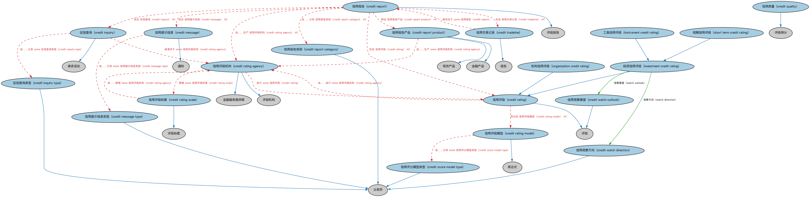

# 信用评级本体（Credit Ratings Ontology）结构与公理说明

本文档对应 `CreditRatings.rdf` / `CreditRatings.ttl`，说明该本体的类、继承关系、属性和公理约定。结构图见 `CreditRatings-structure.png`（`CreditRatings-structure.svg` 为可缩放版本）。

## 1. 本体概述

定义信用评级（credit rating）、评级机构（如穆迪、标普）与评级结果，刻画债务人或债务工具的信用水平。

**在体系中的位置**：FBC 债务与权益模块中负责「信用好不好」的本体。

**上下游关系**：上游依赖 FND 评级与评估本体；下游被贷款监管、债券、衍生品（参考实体评级）等本体引用。

**与相近概念的差别**：评级是第三方机构的主观评估（意见），与客观发生的信用事件相区分；与内部信用评分的差别——本本体侧重公开评级机构给出的等级。

本本体中类与类的核心关系如下（完整细节见各类小节）：

- **征信查询（credit inquiry）** 继承 **请求活动（RequestActivity）**
- **征信查询类型（credit inquiry type）** 继承 **分类符（Classifier）**
- **信用提示信息（credit message）** 继承 **通知（Notice）**
- **信用提示信息类型（credit message type）** 继承 **分类符（Classifier）**
- **信用质量（credit quality）** 继承 **评级得分（RatingScore）**
- **信用评级（credit rating）** 继承 **评级（Rating）**
- **信用评级机构（credit rating agency）** 继承 **金融服务提供商（FinancialServiceProvider）**
- **信用评级机构（credit rating agency）** 继承 **评级机构（RatingAgency）**
- **信用评级模型（credit rating model）** 继承 **表达式（Expression）**
- **信用评级标度（credit rating scale）** 继承 **评级标度（RatingScale）**
- **信用报告（credit report）** 继承 **评级报告（RatingReport）**
- **信用报告类别（credit report category）** 继承 **分类符（Classifier）**
- 其余 12 条关系从略。

## 2. 类（Class）

| 类（Class） | 定义（Definition） |
|---|---|
| 征信查询（credit inquiry） | 贷款人向征信机构发出的请求，以获取有关潜在借款人信用状况的信息。 request from a lender to a credit repository to obtain information regarding a prospective borrower's creditworthiness |
| 征信查询类型（credit inquiry type） | 分类器，表明征信查询是由借款人直接授权发起，还是通过其他间接方式产生。 classifier indicating whether a credit inquiry is a result of a borrower's direct authorization or by some indirect means |
| 信用提示信息（credit message） | 信用报告上的提示，用于提醒审阅者注意特殊或异常信息。 notice on a credit report to alert a reviewer of special or exceptional information |
| 信用提示信息类型（credit message type） | 对信用提示信息进行分类的分类器。 classifier that categorizes credit messages |
| 信用质量（credit quality） | 针对借贷市场中的借款人、利率或持仓，就其信用质量进行分类的分类器。 classifier for borrowers, rates, or holdings in the lending market with respect to the quality of the credit |
| 信用评级（credit rating） | 对借款人信用状况的评估，可以是总体评估，也可以针对特定债务或金融义务。 assessment of creditworthiness of a borrower generally or with respect to a particular debt or financial obligation |
| 信用评级机构（credit rating agency） | 发布评估报告的评级机构，评估借款人或法律实体的信用状况，可以是总体评估，也可以针对特定债务。 rating agency that publishes reports assessing the creditworthiness of a borrower or legal entity, either generally or with respect to a specific obligation |
| 信用评级模型（credit rating model） | 用于计算信用评级的算法。 algorithm for computing a credit rating |
| 信用评级标度（credit rating scale） | 为个人、实体或工具赋予信用评级的标度，包括定义一套代码或数值分数并说明其解读方式。 rating scale for assigning a credit rating to individual, entity, or instrument, including defining a set of codes or numeric scores and indicating how an assessment that is assigned a score based on that scale means |
| 信用报告（credit report） | 描述借款人信用状况及相关信用属性的报告。 report describing the creditworthiness and related credit attributes of a borrower |
| 信用报告类别（credit report category） | 信用报告的分类器，同类报告通常可从多家供应商获得。 classifier for credit reports, often available from multiple vendors |
| 信用报告产品（credit report product） | 市场上提供的品牌化信用报告。 branded credit report offered in the marketplace |
| 信用评分模型类型（credit score model type） | 对应于一族具有共同特征的信用评分算法的类型。 a type corresonding to a family of credit scoring algorithms sharing common characteristics |
| 信用交易记录（credit tradeline） | 由信用账户交易历史生成的记录。 report derived from the transaction history of a credit account |
| 信用观察方向（credit watch direction） | 表示投资信用评级被列入观察名单后预计变动的方向。 |
| 信用观察展望（credit watch outlook） | 表示对被评级主体的预期展望。 |
| 工具信用评级（instrument credit rating） | 投资信用评级的一种，提供对某一工具信用状况的意见，通常与其发行人的信用状况相关。 investment credit rating that provides an opinion of creditworthiness of an instrument, typically with some relationship to the creditworthiness of the issuer(s) |
| 投资信用评级（investment credit rating） | 信用评级的一种，提供对某项投资（包括但不限于工具或机构）信用状况的意见。 credit rating that provides an opinion of creditworthiness of an investment, including but not limited to an instrument or organization |
| 机构信用评级（organization credit rating） | 信用评级的一种，提供对某一机构信用状况的意见。 credit rating that provides an opinion of creditworthiness of an organization |
| 短期信用评级（short term credit rating） | 信用评级的一种，提供对个人或机构在一年内发生违约概率的意见。 credit rating that provides an opinion of the probability of an individual or organization going into default within a year |

以下按类逐个展开：每个类给出继承关系、相关属性与公理约定；子类在父类之下降一级编号。

### 2.1 征信查询（credit inquiry）

定义：贷款人向征信机构发出的请求，以获取有关潜在借款人信用状况的信息。

- 父类：**请求活动（RequestActivity）**

属性：

| 属性 | 定义 | 说明 |
|---|---|---|
| **涉及当事方（concerns party）** | 指明某事物正在或已经为其提出的当事方。 indicates the party for which something is being or has been requested | 子属性：具有参与方（has party） |
| **被请求于（isRequestedOf）** | — | — |
| **由……分类（isClassifiedBy）** | — | — |

公理：

- **涉及当事方（concerns party）**至少有一个取值，类型是**参与方（party）**。
- **由……分类（isClassifiedBy）**至少有一个取值，类型是**征信查询类型（credit inquiry type）**。
- **被请求于（isRequestedOf）**至少有一个取值，类型是**信用评级机构（credit rating agency）**。

### 2.2 征信查询类型（credit inquiry type）

定义：分类器，表明征信查询是由借款人直接授权发起，还是通过其他间接方式产生。

- 父类：**分类符（Classifier）**

### 2.3 信用提示信息（credit message）

定义：信用报告上的提示，用于提醒审阅者注意特殊或异常信息。

- 父类：**通知（Notice）**

属性：

| 属性 | 定义 | 说明 |
|---|---|---|
| **由……分类（isClassifiedBy）** | — | — |

公理：

- **由……分类（isClassifiedBy）**至少有一个取值，类型是**信用提示信息类型（credit message type）**。

### 2.4 信用提示信息类型（credit message type）

定义：对信用提示信息进行分类的分类器。

- 父类：**分类符（Classifier）**

### 2.5 信用质量（credit quality）

定义：针对借贷市场中的借款人、利率或持仓，就其信用质量进行分类的分类器。

- 父类：**评级得分（RatingScore）**

### 2.6 信用评级（credit rating）

定义：对借款人信用状况的评估，可以是总体评估，也可以针对特定债务或金融义务。

- 父类：**评级（Rating）**
- 直接子类：**投资信用评级（investment credit rating）**、**机构信用评级（organization credit rating）**

属性：

| 属性 | 定义 | 说明 |
|---|---|---|
| **由……发行（isIssuedBy）** | — | — |
| **导出自（isDerivedFrom）** | — | — |

公理：

- **导出自（isDerivedFrom）**可以有 0 个或多个**信用评级模型（credit rating model）**。
- **由……发行（isIssuedBy）**至少有一个取值，类型是**信用评级机构（credit rating agency）**。

#### 2.6.1 投资信用评级（investment credit rating）

定义：信用评级的一种，提供对某项投资（包括但不限于工具或机构）信用状况的意见。

- 父类：**信用评级（credit rating）**
- 直接子类：**工具信用评级（instrument credit rating）**、**短期信用评级（short term credit rating）**

属性：

| 属性 | 定义 | 说明 |
|---|---|---|
| **观察方向（watch direction）** | 当投资信用评级处于观察状态时，指明其预计变动的方向。 indicates direction in which an investment credit rating is expected to move in cases where that rating is on watch | 值域：信用观察方向（credit watch direction） |
| **观察展望（watch outlook）** | 指明对被评级实体的预期展望。 indicates the expected outlook for the rated entity | 值域：信用观察展望（credit watch outlook） |

##### 2.6.1.1 工具信用评级（instrument credit rating）

定义：投资信用评级的一种，提供对某一工具信用状况的意见，通常与其发行人的信用状况相关。

- 父类：**投资信用评级（investment credit rating）**

属性：

| 属性 | 定义 | 说明 |
|---|---|---|
| **评定（rates）** | — | — |

公理：

- **评定（rates）**至少有一个取值，类型是**金融工具（FinancialInstrument）**。

##### 2.6.1.2 短期信用评级（short term credit rating）

定义：信用评级的一种，提供对个人或机构在一年内发生违约概率的意见。

- 父类：**投资信用评级（investment credit rating）**

#### 2.6.2 机构信用评级（organization credit rating）

定义：信用评级的一种，提供对某一机构信用状况的意见。

- 父类：**信用评级（credit rating）**

属性：

| 属性 | 定义 | 说明 |
|---|---|---|
| **评定（rates）** | — | — |

公理：

- **评定（rates）**至少有一个取值，类型是**正式组织（FormalOrganization）**。

### 2.7 信用评级机构（credit rating agency）

定义：发布评估报告的评级机构，评估借款人或法律实体的信用状况，可以是总体评估，也可以针对特定债务。

- 父类：**金融服务提供商（FinancialServiceProvider）**、**评级机构（RatingAgency）**

属性：

| 属性 | 定义 | 说明 |
|---|---|---|
| **发行（issues）** | — | — |
| **管理（manages）** | — | — |

公理：

- **发行（issues）**至少有一个取值，类型是**信用评级（credit rating）**。
- **管理（manages）**至少有一个取值，类型是**信用评级标度（credit rating scale）**。

### 2.8 信用评级模型（credit rating model）

定义：用于计算信用评级的算法。

- 父类：**表达式（Expression）**

属性：

| 属性 | 定义 | 说明 |
|---|---|---|
| **生产（produces）** | — | — |
| **由……分类（isClassifiedBy）** | — | — |
| **具有文本名称（hasTextualName）** | — | — |

公理：

- **具有文本名称（hasTextualName）**至少有一个取值，类型是**xsd:string（string）**。
- **生产（produces）**至少有一个取值，类型是**评级得分（RatingScore）**。
- **由……分类（isClassifiedBy）**至少有一个取值，类型是**信用评分模型类型（credit score model type）**。

### 2.9 信用评级标度（credit rating scale）

定义：为个人、实体或工具赋予信用评级的标度，包括定义一套代码或数值分数并说明其解读方式。

- 父类：**评级标度（RatingScale）**

属性：

| 属性 | 定义 | 说明 |
|---|---|---|
| **由……管理（isManagedBy）** | — | — |

公理：

- **由……管理（isManagedBy）**至少有一个取值，类型是**信用评级机构（credit rating agency）**。

### 2.10 信用报告（credit report）

定义：描述借款人信用状况及相关信用属性的报告。

- 父类：**评级报告（RatingReport）**

属性：

| 属性 | 定义 | 说明 |
|---|---|---|
| **涉及当事方（concerns party）** | 指明某事物正在或已经为其提出的当事方。 indicates the party for which something is being or has been requested | 子属性：具有参与方（has party） |
| **具有覆盖期间（has coverage period）** | 将某事物（如信用报告或保险单）与其所覆盖的特定时间段关联起来。 relates something (e.g. a credit report or insurance policy) to the specific time period that it covers | 值域：日期区间；子属性：具有日期区间 |
| **具有截止日（hasAsOfDate）** | — | — |
| **例证（exemplifies）** | — | — |
| **由……生产（isProducedBy）** | — | — |
| **由……分类（isClassifiedBy）** | — | — |
| **包含（comprises）** | — | — |
| **具有数据来源（hasDataSource）** | — | — |
| **由……标识（isIdentifiedBy）** | — | — |

公理：

- **例证（exemplifies）**可以有 0 个或多个**信用报告产品（credit report product）**。
- **具有截止日（hasAsOfDate）**至少有一个取值，类型是**日期（Date）**。
- **具有数据来源（hasDataSource）**可以有 0 个或多个**N6983855db48c456784176196730ebfa5**。
- **具有覆盖期间（has coverage period）**至少有一个取值，类型是**日期区间（DatePeriod）**。
- **包含（comprises）**可以有 0 个或多个**信用交易记录（credit tradeline）**。
- **包含（comprises）**可以有 0 个或多个**信用提示信息（credit message）**。
- **包含（comprises）**可以有 0 个或多个**信用评级（credit rating）**。
- **包含（comprises）**可以有 0 个或多个**征信查询（credit inquiry）**。
- **涉及当事方（concerns party）**至少有一个取值，类型是**参与方（party）**。
- **由……分类（isClassifiedBy）**可以有 0 个或多个**信用报告类别（credit report category）**。
- **由……标识（isIdentifiedBy）**可以有 0 个或多个**标识符（Identifier）**。
- **由……生产（isProducedBy）**可以有 0 个或多个**信用评级机构（credit rating agency）**。

### 2.11 信用报告类别（credit report category）

定义：信用报告的分类器，同类报告通常可从多家供应商获得。

- 父类：**分类符（Classifier）**

### 2.12 信用报告产品（credit report product）

定义：市场上提供的品牌化信用报告。

- 父类：**金融产品（FinancialProduct）**、**现货产品（OffTheShelfProduct）**

属性：

| 属性 | 定义 | 说明 |
|---|---|---|
| **由……生产（isProducedBy）** | — | — |

公理：

- **由……生产（isProducedBy）**至少有一个取值，类型是**信用评级机构（credit rating agency）**。

### 2.13 信用评分模型类型（credit score model type）

定义：对应于一族具有共同特征的信用评分算法的类型。

- 父类：**分类符（Classifier）**

### 2.14 信用交易记录（credit tradeline）

定义：由信用账户交易历史生成的记录。

- 父类：**报告（Report）**

属性：

| 属性 | 定义 | 说明 |
|---|---|---|
| **被包含于（isIncludedIn）** | — | — |
| **导出自（isDerivedFrom）** | — | — |

公理：

- **导出自（isDerivedFrom）**至少有一个取值，类型是**账户（Account）**。
- **被包含于（isIncludedIn）**至少有一个取值，类型是**信用报告（credit report）**。

### 2.15 信用观察方向（credit watch direction）

定义：表示投资信用评级被列入观察名单后预计变动的方向。

- 父类：**分类符（Classifier）**

### 2.16 信用观察展望（credit watch outlook）

定义：表示对被评级主体的预期展望。

- 父类：**评级（Rating）**

## 3. 依赖（owl:imports，20 个）

本本体通过 `owl:imports` 引入以下本体，各项的中文名称与简介如下：

| 导入本体 | 中文名称 | 简介 |
|---|---|---|
| `FBC/FinancialInstruments/FinancialInstruments.rdf` | 金融工具本体（Financial Instruments Ontology） | FIBO 核心本体之一，定义金融工具（financial instrument）的通用概念：可交易、代表某种权利义务的合同工具，是证券、衍生品等具体工具的共同基础。 |
| `FBC/ProductsAndServices/ClientsAndAccounts.rdf` | 客户与账户本体（Clients and Accounts Ontology） | 定义金融机构的客户、账户及账户持有关系。 |
| `FBC/ProductsAndServices/FinancialProductsAndServices.rdf` | 金融产品与服务本体（Financial Products and Services Ontology） | 定义金融产品（financial product）与金融服务（financial service）及其提供、购买关系。 |
| `FND/Arrangements/Ratings.rdf` | 评级本体（Ratings Ontology） | 定义评级（rating）、评级量表与评级方的通用结构，是信用评级等具体评级体系的基础。 |
| `FND/Arrangements/Reporting.rdf` | 报告本体（Reporting Ontology） | 定义报告、报告方与报告内容的关系，支撑监管报告、财务报告等报送场景。 |
| `FND/DatesAndTimes/FinancialDates.rdf` | 金融日期本体（Financial Dates Ontology） | 定义金融语境下的日期与期间概念：结算日、付息日、到期日、日计数基准等。 |
| `FND/ProductsAndServices/ProductsAndServices.rdf` | 产品与服务本体（Products and Services Ontology） | 定义产品、服务及其提供者与客户的通用关系。 |
| `FND/Relations/Relations.rdf` | 关系本体（Relations Ontology） | FIBO 最底层的基础本体，定义参考（reference）、分类（classify）等通用关系与抽象概念，全库普遍依赖。 |
| `FND/Utilities/AnnotationVocabulary.rdf` | FIBO 标注词汇表（FIBO Annotation Vocabulary） | 定义 FIBO 专用的标注属性（如释义来源、成熟度等级），用于本体自身的元数据标注。 |
| `https://www.omg.org/spec/Commons/AnnotationVocabulary/` | OMG 通用标注词汇表（OMG Commons Annotation Vocabulary） | OMG 通用本体库（Commons）中的标注词汇表，提供概念映射等标注属性，FIBO 用它标注术语与外部标准的对应关系。 |
| `https://www.omg.org/spec/Commons/Classifiers/` | OMG 通用分类器本体（OMG Commons Classifiers） | OMG 通用本体库（Commons）中的分类器本体，定义分类方案、类别与归类关系的通用概念，FIBO 的分类建模建立在其上。 |
| `https://www.omg.org/spec/Commons/Collections/` | OMG 通用集合本体（OMG Commons Collections） | Commons 库中的集合本体，定义集合、成员等通用概念。 |
| `https://www.omg.org/spec/Commons/DatesAndTimes/` | OMG 通用日期与时间本体（OMG Commons Dates and Times） | Commons 库中的日期时间本体，定义日期、期间、时间点等通用时间概念。 |
| `https://www.omg.org/spec/Commons/Designators/` | OMG 通用指称符本体（OMG Commons Designators） | Commons 库中的指称符本体，定义名称、标识符等「指代某物的符号」的通用概念。 |
| `https://www.omg.org/spec/Commons/Documents/` | OMG 通用文档本体（OMG Commons Documents） | Commons 库中的文档本体，定义文档及其组成部分的通用概念。 |
| `https://www.omg.org/spec/Commons/Identifiers/` | OMG 通用标识符本体（OMG Commons Identifiers） | Commons 库中的标识符本体，定义标识符及其编码方案的通用概念。 |
| `https://www.omg.org/spec/Commons/Organizations/` | OMG 通用组织本体（OMG Commons Organizations） | Commons 库中的组织本体，定义组织、组织成员与组织结构的通用概念。 |
| `https://www.omg.org/spec/Commons/PartiesAndSituations/` | OMG 通用参与方与情境本体（OMG Commons Parties and Situations） | Commons 库中的参与方本体，定义独立主体、参与方及其角色扮演的通用概念，是 FIBO 参与方模型的上游。 |
| `https://www.omg.org/spec/Commons/QuantitiesAndUnits/` | OMG 通用量与单位本体（OMG Commons Quantities and Units） | Commons 库中的量与单位本体，定义数量、度量单位、量纲的通用概念，支撑金额、比率等数值表达。 |
| `https://www.omg.org/spec/Commons/RolesAndCompositions/` | OMG 通用角色与构成本体（OMG Commons Roles and Compositions） | Commons 库中的角色本体，定义角色及整体—部分构成关系的通用概念。 |

## 4. 文件

- 官方 RDF/XML：`CreditRatings.rdf`
- 中文 Turtle：`CreditRatings.ttl`
- 结构图：`CreditRatings-structure.png` / `CreditRatings-structure.svg`