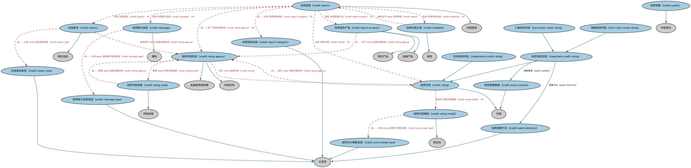

# 信用评级本体（Credit Ratings Ontology）结构与公理说明

本文档对应 `CreditRatings.rdf` / `CreditRatings.ttl`，说明该本体的类、继承关系、属性和公理约定。结构图见 `CreditRatings-structure.png`（`CreditRatings-structure.svg` 为可缩放版本）。

## 1. 本体概述

定义信用评级（credit rating）、评级机构（如穆迪、标普）与评级结果，刻画债务人或债务工具的信用水平。

**在体系中的位置**：FBC 债务与权益模块中负责「信用好不好」的本体。

**上下游关系**：上游依赖 FND 评级与评估本体；下游被贷款监管、债券、衍生品（参考实体评级）等本体引用。

**与相近概念的差别**：评级是第三方机构的主观评估（意见），与客观发生的信用事件相区分；与内部信用评分的差别——本本体侧重公开评级机构给出的等级。

## 2. 类（Class）

| 类（Class） | 定义（Definition） |
|---|---|
| 征信查询（credit inquiry） | 贷款人向征信机构发出的请求，以获取有关潜在借款人信用状况的信息。 |
| 征信查询类型（credit inquiry type） | 分类器，表明征信查询是由借款人直接授权发起，还是通过其他间接方式产生。 |
| 信用提示信息（credit message） | 信用报告上的提示，用于提醒审阅者注意特殊或异常信息。 |
| 信用提示信息类型（credit message type） | 对信用提示信息进行分类的分类器。 |
| 信用质量（credit quality） | 针对借贷市场中的借款人、利率或持仓，就其信用质量进行分类的分类器。 |
| 信用评级（credit rating） | 对借款人信用状况的评估，可以是总体评估，也可以针对特定债务或金融义务。 |
| 信用评级机构（credit rating agency） | 发布评估报告的评级机构，评估借款人或法律实体的信用状况，可以是总体评估，也可以针对特定债务。 |
| 信用评级模型（credit rating model） | 用于计算信用评级的算法。 |
| 信用评级标度（credit rating scale） | 为个人、实体或工具赋予信用评级的标度，包括定义一套代码或数值分数并说明其解读方式。 |
| 信用报告（credit report） | 描述借款人信用状况及相关信用属性的报告。 |
| 信用报告类别（credit report category） | 信用报告的分类器，同类报告通常可从多家供应商获得。 |
| 信用报告产品（credit report product） | 市场上提供的品牌化信用报告。 |
| 信用评分模型类型（credit score model type） | 对应于一族具有共同特征的信用评分算法的类型。 |
| 信用交易记录（credit tradeline） | 由信用账户交易历史生成的记录。 |
| 信用观察方向（credit watch direction） | 表示投资信用评级被列入观察名单后预计变动的方向。 |
| 信用观察展望（credit watch outlook） | 表示对被评级主体的预期展望。 |
| 工具信用评级（instrument credit rating） | 投资信用评级的一种，提供对某一工具信用状况的意见，通常与其发行人的信用状况相关。 |
| 投资信用评级（investment credit rating） | 信用评级的一种，提供对某项投资（包括但不限于工具或机构）信用状况的意见。 |
| 机构信用评级（organization credit rating） | 信用评级的一种，提供对某一机构信用状况的意见。 |
| 短期信用评级（short term credit rating） | 信用评级的一种，提供对个人或机构在一年内发生违约概率的意见。 |

### 2.1 继承关系（Inheritance）

- 征信查询（credit inquiry） ⊑ 请求活动
- 征信查询类型（credit inquiry type） ⊑ 分类符
- 信用提示信息（credit message） ⊑ 通知
- 信用提示信息类型（credit message type） ⊑ 分类符
- 信用质量（credit quality） ⊑ 评级得分
- 信用评级（credit rating） ⊑ 评级
- 信用评级机构（credit rating agency） ⊑ 金融服务提供商
- 信用评级机构（credit rating agency） ⊑ 评级机构
- 信用评级模型（credit rating model） ⊑ 表达式
- 信用评级标度（credit rating scale） ⊑ 评级标度
- 信用报告（credit report） ⊑ 评级报告
- 信用报告类别（credit report category） ⊑ 分类符
- 信用报告产品（credit report product） ⊑ 金融产品
- 信用报告产品（credit report product） ⊑ 现货产品
- 信用评分模型类型（credit score model type） ⊑ 分类符
- 信用交易记录（credit tradeline） ⊑ 报告
- 信用观察方向（credit watch direction） ⊑ 分类符
- 信用观察展望（credit watch outlook） ⊑ 评级
- 工具信用评级（instrument credit rating） ⊑ 投资信用评级（investment credit rating）
- 投资信用评级（investment credit rating） ⊑ 信用评级（credit rating）
- 机构信用评级（organization credit rating） ⊑ 信用评级（credit rating）
- 短期信用评级（short term credit rating） ⊑ 投资信用评级（investment credit rating）

## 3. 对象属性（Object Property）

| 属性（Property） | 中文（English） | 定义（Definition） | 说明 |
|---|---|---|---|
| fibo-fbc-dae-crt:concernsParty | 涉及当事方（concerns party） | 指明某事物正在或已经为其提出的当事方。 | 子属性（subPropertyOf）：具有参与方（has party） |
| fibo-fbc-dae-crt:hasCoveragePeriod | 具有覆盖期间（has coverage period） | 将某事物（如信用报告或保险单）与其所覆盖的特定时间段关联起来。 | 值域（range）：日期区间；子属性（subPropertyOf）：具有日期区间 |
| fibo-fbc-dae-crt:hasWatchDirection | 观察方向（watch direction） | 当投资信用评级处于观察状态时，指明其预计变动的方向。 | 定义域（domain）：投资信用评级（investment credit rating）；值域（range）：信用观察方向（credit watch direction） |
| fibo-fbc-dae-crt:hasWatchOutlook | 观察展望（watch outlook） | 指明对被评级实体的预期展望。 | 定义域（domain）：投资信用评级（investment credit rating）；值域（range）：信用观察展望（credit watch outlook） |

## 5. 公理约定（Axioms）

- 征信查询（credit inquiry）：涉及当事方（concerns party） some 参与方（party）
- 征信查询（credit inquiry）：被请求于 some 信用评级机构（credit rating agency）
- 征信查询（credit inquiry）：由……分类 some 征信查询类型（credit inquiry type）
- 信用提示信息（credit message）：由……分类 some 信用提示信息类型（credit message type）
- 信用评级（credit rating）：导出自 信用评级模型（credit rating model） ≥0
- 信用评级（credit rating）：由……发行 some 信用评级机构（credit rating agency）
- 信用评级机构（credit rating agency）：发行 some 信用评级（credit rating）
- 信用评级机构（credit rating agency）：管理 some 信用评级标度（credit rating scale）
- 信用评级模型（credit rating model）：生产 some 评级得分
- 信用评级模型（credit rating model）：由……分类 some 信用评分模型类型（credit score model type）
- 信用评级模型（credit rating model）：具有文本名称 some xsd:string
- 信用评级标度（credit rating scale）：由……管理 some 信用评级机构（credit rating agency）
- 信用报告（credit report）：包含 征信查询（credit inquiry） ≥0
- 信用报告（credit report）：包含 信用提示信息（credit message） ≥0
- 信用报告（credit report）：包含 信用评级（credit rating） ≥0
- 信用报告（credit report）：由……生产 信用评级机构（credit rating agency） ≥0
- 信用报告（credit report）：由……分类 信用报告类别（credit report category） ≥0
- 信用报告（credit report）：例证 信用报告产品（credit report product） ≥0
- 信用报告（credit report）：包含 信用交易记录（credit tradeline） ≥0
- 信用报告（credit report）：由……标识 标识符 ≥0
- 信用报告（credit report）：具有数据来源 Nc6f4054a40f54fa09f57852e648d8df5 ≥0
- 信用报告（credit report）：涉及当事方（concerns party） some 参与方（party）
- 信用报告（credit report）：具有覆盖期间（has coverage period） some 日期区间
- 信用报告（credit report）：具有截止日 some 日期
- 信用报告产品（credit report product）：由……生产 some 信用评级机构（credit rating agency）
- 信用交易记录（credit tradeline）：被包含于 some 信用报告（credit report）
- 信用交易记录（credit tradeline）：导出自 some 账户
- 工具信用评级（instrument credit rating）：评定 some 金融工具
- 机构信用评级（organization credit rating）：评定 some 正式组织

## 6. 依赖（owl:imports，20 个）

本本体通过 `owl:imports` 引入以下本体，各项的中文名称与简介如下：

| 导入本体 | 中文名称 | 简介 |
|---|---|---|
| `FBC/FinancialInstruments/FinancialInstruments.rdf` | 金融工具本体（Financial Instruments Ontology） | FIBO 核心本体之一，定义金融工具（financial instrument）的通用概念：可交易、代表某种权利义务的合同工具，是证券、衍生品等具体工具的共同基础。 |
| `FBC/ProductsAndServices/ClientsAndAccounts.rdf` | 客户与账户本体（Clients and Accounts Ontology） | 定义金融机构的客户、账户及账户持有关系。 |
| `FBC/ProductsAndServices/FinancialProductsAndServices.rdf` | 金融产品与服务本体（Financial Products and Services Ontology） | 定义金融产品（financial product）与金融服务（financial service）及其提供、购买关系。 |
| `FND/Arrangements/Ratings.rdf` | 评级本体（Ratings Ontology） | 定义评级（rating）、评级量表与评级方的通用结构，是信用评级等具体评级体系的基础。 |
| `FND/Arrangements/Reporting.rdf` | 报告本体（Reporting Ontology） | 定义报告、报告方与报告内容的关系，支撑监管报告、财务报告等报送场景。 |
| `FND/DatesAndTimes/FinancialDates.rdf` | 金融日期本体（Financial Dates Ontology） | 定义金融语境下的日期与期间概念：结算日、付息日、到期日、日计数基准等。 |
| `FND/ProductsAndServices/ProductsAndServices.rdf` | 产品与服务本体（Products and Services Ontology） | 定义产品、服务及其提供者与客户的通用关系。 |
| `FND/Relations/Relations.rdf` | 关系本体（Relations Ontology） | FIBO 最底层的基础本体，定义参考（reference）、分类（classify）等通用关系与抽象概念，全库普遍依赖。 |
| `FND/Utilities/AnnotationVocabulary.rdf` | FIBO 标注词汇表（FIBO Annotation Vocabulary） | 定义 FIBO 专用的标注属性（如释义来源、成熟度等级），用于本体自身的元数据标注。 |
| `https://www.omg.org/spec/Commons/AnnotationVocabulary/` | OMG 通用标注词汇表（OMG Commons Annotation Vocabulary） | OMG 通用本体库（Commons）中的标注词汇表，提供概念映射等标注属性，FIBO 用它标注术语与外部标准的对应关系。 |
| `https://www.omg.org/spec/Commons/Classifiers/` | OMG 通用分类器本体（OMG Commons Classifiers） | OMG 通用本体库（Commons）中的分类器本体，定义分类方案、类别与归类关系的通用概念，FIBO 的分类建模建立在其上。 |
| `https://www.omg.org/spec/Commons/Collections/` | OMG 通用集合本体（OMG Commons Collections） | Commons 库中的集合本体，定义集合、成员等通用概念。 |
| `https://www.omg.org/spec/Commons/DatesAndTimes/` | OMG 通用日期与时间本体（OMG Commons Dates and Times） | Commons 库中的日期时间本体，定义日期、期间、时间点等通用时间概念。 |
| `https://www.omg.org/spec/Commons/Designators/` | OMG 通用指称符本体（OMG Commons Designators） | Commons 库中的指称符本体，定义名称、标识符等「指代某物的符号」的通用概念。 |
| `https://www.omg.org/spec/Commons/Documents/` | OMG 通用文档本体（OMG Commons Documents） | Commons 库中的文档本体，定义文档及其组成部分的通用概念。 |
| `https://www.omg.org/spec/Commons/Identifiers/` | OMG 通用标识符本体（OMG Commons Identifiers） | Commons 库中的标识符本体，定义标识符及其编码方案的通用概念。 |
| `https://www.omg.org/spec/Commons/Organizations/` | OMG 通用组织本体（OMG Commons Organizations） | Commons 库中的组织本体，定义组织、组织成员与组织结构的通用概念。 |
| `https://www.omg.org/spec/Commons/PartiesAndSituations/` | OMG 通用参与方与情境本体（OMG Commons Parties and Situations） | Commons 库中的参与方本体，定义独立主体、参与方及其角色扮演的通用概念，是 FIBO 参与方模型的上游。 |
| `https://www.omg.org/spec/Commons/QuantitiesAndUnits/` | OMG 通用量与单位本体（OMG Commons Quantities and Units） | Commons 库中的量与单位本体，定义数量、度量单位、量纲的通用概念，支撑金额、比率等数值表达。 |
| `https://www.omg.org/spec/Commons/RolesAndCompositions/` | OMG 通用角色与构成本体（OMG Commons Roles and Compositions） | Commons 库中的角色本体，定义角色及整体—部分构成关系的通用概念。 |

## 7. 文件

- 官方 RDF/XML：`CreditRatings.rdf`
- 中文 Turtle：`CreditRatings.ttl`
- 结构图：`CreditRatings-structure.png` / `CreditRatings-structure.svg`