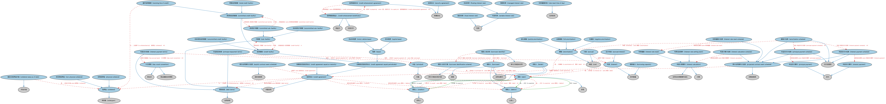

# 债务本体（Debt Ontology）结构与公理说明

本文档对应 `Debt.rdf` / `Debt.ttl`，说明该本体的类、继承关系、属性和公理约定。结构图见 `Debt-structure.png`（`Debt-structure.svg` 为可缩放版本）。

## 1. 本体概述

定义债务（debt）与债权债务关系的核心概念：借款人、贷款人、本金、利息义务与偿还安排。

**在体系中的位置**：FBC 债务与权益模块的根基，是债券、贷款、衍生品信用概念的共同上游。

**上下游关系**：上游依赖 FND 合同、货币金额、付款与计划表本体；下游被 SEC 债务工具、LOAN 贷款、DER 信用衍生品等大量本体引用。

**与相近概念的差别**：债务是「欠钱的义务」这一法律关系，区别于债务工具（可交易的债权凭证）——一笔贷款是债务，把它证券化后的债券才是工具；与担保的差别——担保是为债务增信的从属安排。

本本体中类与类的核心关系如下（完整细节见各类小节）：

- **计提（accrual）** 继承 **角色（role）**
- **应计利息（accrued interest）** 继承 **利息（interest）**
- **摊销（amortization）** 继承 **角色（role）**
- **摊销计划表（amortization schedule）** 继承 **预计合同事件计划表（projected contract event schedule）**
- **摊销计划表（amortization schedule）** 继承 **支付进度表（PaymentSchedule）**
- **借款人（borrower）** 继承 **债务人（debtor）**
- **借款人（borrower）** 继承 **合同当事方（ContractParty）**
- **借款人（borrower）** 继承 **顾客（Customer）**
- **借款人标识方案（borrower identification scheme）** 继承 **参与方角色识别方案（PartyRoleIdentificationScheme）**
- **借款人标识符（borrower identifier）** 继承 **参与方角色标识符（PartyRoleIdentifier）**
- **借款能力（borrowing capacity）** 继承 **货币数量（MonetaryAmount）**
- **资本租赁（capital lease）** 继承 **租赁（lease）**
- 其余 59 条关系从略。

## 2. 类（Class）

| 类（Class） | 定义（Definition） |
|---|---|
| 计提（accrual） | 利息或其他已赚取但尚未支付的收入逐步累积的过程。 |
| 应计利息（accrued interest） | 截至某一特定日期，贷款或其他金融义务已发生但尚未支付的利息金额。 |
| 摊销（amortization） | 通过对资产或负债的周期性扣减来逐步减少债务或其他成本的过程，例如按揭贷款的本金偿还。 |
| 摊销计划表（amortization schedule） | 规定债务余额随时间变化的周期性付款（还款分期）计划表。 |
| 借款人（borrower） | 信贷协议的一方，有义务按工具条款偿还所借款项（本金）以及利息和其他费用。 |
| 借款人标识方案（borrower identification scheme） | 为借款人分配标识符的体系。 |
| 借款人标识符（borrower identifier） | 能够唯一标识某一借款人的字符序列。 |
| 借款能力（borrowing capacity） | 截至某一时点，贷款人认为一方有能力按期偿还债务的资金总额上限。 |
| 资本租赁（capital lease） | 必须在机构资产负债表上同时列示为资产和相应负债的租赁。 |
| 抵押品（collateral） | 为确保履行对另一方的义务（如借款、授信或证券交付）而质押的担保物。 |
| 截至日抵押品价值（collateral value as of date） | 某项债务的抵押品截至给定日期的评估价值。 |
| 承诺性信贷额度（committed credit facility） | 作为借款人确定融资来源的信贷额度，只要借款人满足协议条件即可使用。 |
| 承诺性子额度（committed sub-facility） | 信贷额度中以合同承诺、可供借款人使用的部分，可能与特定抵押品相关联。 |
| 信贷协议（credit agreement） | 一种合同协议：债务人获得有价值之物，并通常承诺在未来某一日期之前以某种形式向债权人偿还。 |
| 到期偿还型信贷协议（credit agreement repaid at maturity） | 应计利息可定期偿付或到期支付，但本金在到期日一次性支付的信贷协议。 |
| 定期偿还型信贷协议（credit agreement repaid periodically） | 本金和应计利息可定期偿付或交换的信贷协议。 |
| 信用增级协议（credit enhancement agreement） | 规范双方之间抵押品交换、以缓释交易对手信用风险的抵押协议。 |
| 信用增级受益人（credit enhancement beneficiary） | 从协议设立的抵押品或担保中受益的一方，即因该安排而受到交易对手信用风险保护的一方。 |
| 信贷额度（credit facility） | 允许借款人在较长时期内分期提取资金、而无需每次重新申请贷款的信贷协议。 |
| 债权人（creditor） | 对其存在某项义务（如一笔款项、货物或某项服务之履行）的一方。 |
| 计日惯例（day-count convention） | 一种业务重复区间惯例，用于计算利息支付所涵盖的天数，适用于应计利息的金额计算。 |
| 债务（debt） | 支付某物（如一笔款项、货物、服务或工具）的义务。 |
| 债务条款（debt terms） | 规定资金借贷合同中借款人与贷款人正式权利和义务的合同条款。 |
| 债务人（debtor） | 对另一方负有债务或其他义务的一方。 |
| 明示合同事件计划表（explicit contract event schedule） | 信贷协议存续期内将发生的事件计划表，包括但不限于付款事件、利率重置事件等。 |
| 固定利率（fixed interest rate） | 在贷款或其他债务工具存续期内不发生波动的利率。 |
| 浮动利率（floating interest rate） | 以特定指数或基准利率为基础的可变利率。 |
| 全额摊销（full amortization） | 最后一期付款（若计划表计算正确，应与其他各期相等）清偿全部剩余本金的摊销方式。 |
| 利息（interest） | 使用信贷或他人资金的成本，以单位时间费率表示，由债务人为获得信贷而向债权人支付。 |
| 利息计算事件（interest calculation） | 反映利息计算的事件。 |
| 利息计算计划表（interest calculation schedule） | 合同特定的定期计划表，列明利息计算的日期。 |
| 利息支付事件（interest payment） | 反映利息实际支付的事件。 |
| 利息支付计划表（interest payment schedule） | 合同特定的定期计划表，列明利息到期应付的日期。 |
| 利息支付条款（interest payment terms） | 关于债务利息支付的合同条款。 |
| 利率重置（interest rate reset） | 反映利率可能发生调整的事件，通常对应基础基准利率或指数利差的变化。 |
| 利率重置计划表（interest rate reset schedule） | 合同特定的定期计划表，列明利率重置及相应实际利率重新计算的日期。 |
| 利率设定事件（interest rate setting event） | 为给定合同设定初始利率的事件，可能相对于其他合同生命周期事件（如放款日）发生。 |
| 租赁（lease） | 一种信贷协议：资产（如不动产、设备或车辆）的所有者（出租人）许可使用者（承租人）使用该资产。 |
| 贷款人（lender） | 向借款人提供信贷或资金、并期望获得偿还（通常附带利息）的一方。 |
| 管理利率（managed interest rate） | 金融机构对借款收取的可变利率，不是规定为基准利率加点，而是由机构不定期设定。 |
| 机动车租赁（motor vehicle lease） | 以约定金额、在固定期限内租赁机动车的租赁。 |
| 负摊销（negative amortization） | 所付款项不足以覆盖到期利息的摊销方式。 |
| 非实物抵押品（non-physical collateral） | 作为抵押品质押的金融资产（而非实物资产）。 |
| 部分摊销（partial amortization） | 最后一期到期付款可能是包含全部剩余本金和利息的大额期末整付的摊销方式。 |
| 实物抵押品（physical collateral） | 作为抵押品质押的、具有物质形态的资产，即债务人的实物资产。 |
| 本金（principal） | 就债务而言：债券或贷款等债务的募集额，须在到期时偿还；就投资而言：原始投入金额。 |
| 本金支付事件（principal payment） | 反映债务本金实际支付的事件。 |
| 本金支付计划表（principal payment schedule） | 合同特定的定期计划表，列明部分或全部本金到期应（偿）付的日期。 |
| 本金偿还条款（principal repayment terms） | 规定本金偿还要求的合同条款。 |
| 预计合同事件计划表（projected contract event schedule） | 预计在合同存续期内发生的事件计划表，包括但不限于预期付款事件、利率重置事件等。 |
| 利率重置时刻（rate reset time of day） | 由某一利率发布机构或市场数据提供商所示的利率重置的具体时刻。 |
| 零售信贷额度（retail credit facility） | 零售商和房地产公司使用的贷款或信用额度。 |
| 循环信用额度（revolving line of credit） | 允许借款人提取资金、偿还后再提取的信贷额度。 |
| 担保协议（security agreement） | 将某项抵押品上的财产性权益授予非该抵押品所有者一方的抵押协议，并规定相关条款。 |
| 子额度（sub-facility） | 信贷额度中为某一目的向借款人提供的部分，可能按额度中规定的某计划执行。 |
| 非承诺性信贷额度（uncommitted credit facility） | 尚未被确认为借款人融资来源的信贷额度。 |
| 非承诺性子额度（uncommitted sub-facility） | 尚未被确认为借款人融资来源的子额度。 |
| 可变利率（variable interest rate） | 允许在贷款或其他债务工具期限内变动的利率。 |

以下按类逐个展开：每个类给出继承关系、相关属性与公理约定；子类在父类之下降一级编号。

### 2.1 计提（accrual）

定义：利息或其他已赚取但尚未支付的收入逐步累积的过程。

- 父类：**角色（role）**

属性：

| 属性 | 定义 | 说明 |
|---|---|---|
| **适用于（appliesTo）** | — | — |

公理：

- **适用于（appliesTo）**可以有 0 个或多个**利息（interest）**。

### 2.2 摊销（amortization）

定义：通过对资产或负债的周期性扣减来逐步减少债务或其他成本的过程，例如按揭贷款的本金偿还。

- 父类：**角色（role）**
- 直接子类：**全额摊销（full amortization）**、**负摊销（negative amortization）**、**部分摊销（partial amortization）**

属性：

| 属性 | 定义 | 说明 |
|---|---|---|
| **是……的摊销（is amortization of）** | 将通过周期性扣减来减少债务或其他成本的过程与相关资产或负债关联起来。 | — |

公理：

- **是……的摊销（is amortization of）**可以有 0 个或多个**债务（debt）**。

#### 2.2.1 全额摊销（full amortization）

定义：最后一期付款（若计划表计算正确，应与其他各期相等）清偿全部剩余本金的摊销方式。

- 父类：**摊销（amortization）**

#### 2.2.2 负摊销（negative amortization）

定义：所付款项不足以覆盖到期利息的摊销方式。

- 父类：**摊销（amortization）**

#### 2.2.3 部分摊销（partial amortization）

定义：最后一期到期付款可能是包含全部剩余本金和利息的大额期末整付的摊销方式。

- 父类：**摊销（amortization）**

### 2.3 借款人标识方案（borrower identification scheme）

定义：为借款人分配标识符的体系。

- 父类：**参与方角色识别方案（PartyRoleIdentificationScheme）**

### 2.4 借款人标识符（borrower identifier）

定义：能够唯一标识某一借款人的字符序列。

- 父类：**参与方角色标识符（PartyRoleIdentifier）**

属性：

| 属性 | 定义 | 说明 |
|---|---|---|
| **定义于（isDefinedIn）** | — | — |
| **标识（identifies）** | — | — |

公理：

- **定义于（isDefinedIn）**恰好有 1 个**借款人标识方案（borrower identification scheme）**。
- **标识（identifies）**恰好有 1 个**借款人（borrower）**。

### 2.5 借款能力（borrowing capacity）

定义：截至某一时点，贷款人认为一方有能力按期偿还债务的资金总额上限。

- 父类：**货币数量（MonetaryAmount）**

属性：

| 属性 | 定义 | 说明 |
|---|---|---|
| **由……证明（isEvidencedBy）** | — | — |
| **具有评估日期（hasDateOfAssessment）** | — | — |
| **适用于（appliesTo）** | — | — |

公理：

- **具有评估日期（hasDateOfAssessment）**至少有一个取值，类型是**显式日期（ExplicitDate）**。
- **由……证明（isEvidencedBy）**至少有一个取值，类型是**评估报告（AssessmentReport）**。
- **适用于（appliesTo）**至少有一个取值，类型是**法律主体（LegalPerson）**。

### 2.6 抵押品（collateral）

定义：为确保履行对另一方的义务（如借款、授信或证券交付）而质押的担保物。

- 父类：**承受者（undergoer）**
- 直接子类：**非实物抵押品（non-physical collateral）**、**实物抵押品（physical collateral）**

属性：

| 属性 | 定义 | 说明 |
|---|---|---|
| **是……的抵押担保（is collateralization of）** | 将抵押品与质押该资产作为担保的协议关联起来。 | — |

公理：

- **是……的抵押担保（is collateralization of）**可以有 0 个或多个**资产（Asset）**。

#### 2.6.1 非实物抵押品（non-physical collateral）

定义：作为抵押品质押的金融资产（而非实物资产）。

- 父类：**抵押品（collateral）**

属性：

| 属性 | 定义 | 说明 |
|---|---|---|
| **是……的抵押担保（is collateralization of）** | 将抵押品与质押该资产作为担保的协议关联起来。 | — |

公理：

- **是……的抵押担保（is collateralization of）**可以有 0 个或多个**金融资产（FinancialAsset）**。
- 与**实物抵押品（physical collateral）**互斥：同一个体不能同时属于两者。

#### 2.6.2 实物抵押品（physical collateral）

定义：作为抵押品质押的、具有物质形态的资产，即债务人的实物资产。

- 父类：**抵押品（collateral）**

属性：

| 属性 | 定义 | 说明 |
|---|---|---|
| **是……的抵押担保（is collateralization of）** | 将抵押品与质押该资产作为担保的协议关联起来。 | — |

公理：

- **是……的抵押担保（is collateralization of）**可以有 0 个或多个**实物资产（PhysicalAsset）**。

### 2.7 截至日抵押品价值（collateral value as of date）

定义：某项债务的抵押品截至给定日期的评估价值。

- 父类：**评估价值（AppraisedValue）**

属性：

| 属性 | 定义 | 说明 |
|---|---|---|
| **具有评估日期（hasDateOfAssessment）** | — | — |
| **是……的估计价值（isEstimatedValueOf）** | — | — |

公理：

- **具有评估日期（hasDateOfAssessment）**至少有一个取值，类型是**显式日期（ExplicitDate）**。
- **是……的估计价值（isEstimatedValueOf）**至少有一个取值，类型是**抵押品（collateral）**。

### 2.8 信贷协议（credit agreement）

定义：一种合同协议：债务人获得有价值之物，并通常承诺在未来某一日期之前以某种形式向债权人偿还。

- 父类：**书面合同（WrittenContract）**
- 直接子类：**到期偿还型信贷协议（credit agreement repaid at maturity）**、**定期偿还型信贷协议（credit agreement repaid periodically）**

属性：

| 属性 | 定义 | 说明 |
|---|---|---|
| **具有债务金额（has debt amount）** | 指明债务的货币金额。 | 值域：货币数量；子属性：具有货币数量 |
| **具有初始交换日（has initial exchange date）** | 指明资产或资金初始交换发生的具体日期。 | 值域：显式日期；子属性：具有显式日期 |
| **具有到期日（has maturity date）** | 指明工具本金应向投资人偿还、利息或票息停止支付的日期。 | 值域：显式日期；子属性：具有结束日期 |
| **以……为抵押（is collateralized by）** | 将协议与质押作为担保的资产关联起来。 | 值域：抵押品（collateral） |
| **具有货币（hasCurrency）** | — | — |
| **具有合同当事方（hasContractParty）** | — | — |
| **具有合同要素（hasContractualElement）** | — | — |

公理：

- **以……为抵押（is collateralized by）**可以有 0 个或多个**抵押品（collateral）**。
- **具有初始交换日（has initial exchange date）**可以有 0 个或多个**显式日期（ExplicitDate）**。
- **具有到期日（has maturity date）**可以有 0 个或多个**显式日期（ExplicitDate）**。
- **具有合同当事方（hasContractParty）**至少有一个取值，类型是**债务人（debtor）**。
- **具有合同当事方（hasContractParty）**至少有一个取值，类型是**债权人（creditor）**。
- **具有合同要素（hasContractualElement）**可以有 0 个或多个**募集资金用途条款（UseOfProceedsProvision）**。
- **具有合同要素（hasContractualElement）**至少有一个取值，类型是**债务条款（debt terms）**。
- **具有货币（hasCurrency）**可以有 0 个或多个**货币（Currency）**。

#### 2.8.1 到期偿还型信贷协议（credit agreement repaid at maturity）

定义：应计利息可定期偿付或到期支付，但本金在到期日一次性支付的信贷协议。

- 父类：**信贷协议（credit agreement）**

属性：

| 属性 | 定义 | 说明 |
|---|---|---|
| **具有到期日（has maturity date）** | 指明工具本金应向投资人偿还、利息或票息停止支付的日期。 | 值域：显式日期；子属性：具有结束日期 |

公理：

- **具有到期日（has maturity date）**至少有一个取值，类型是**显式日期（ExplicitDate）**。

#### 2.8.2 定期偿还型信贷协议（credit agreement repaid periodically）

定义：本金和应计利息可定期偿付或交换的信贷协议。

- 父类：**信贷协议（credit agreement）**
- 直接子类：**信贷额度（credit facility）**、**租赁（lease）**

##### 2.8.2.1 信贷额度（credit facility）

定义：允许借款人在较长时期内分期提取资金、而无需每次重新申请贷款的信贷协议。

- 父类：**定期偿还型信贷协议（credit agreement repaid periodically）**
- 直接子类：**承诺性信贷额度（committed credit facility）**、**非承诺性信贷额度（uncommitted credit facility）**

属性：

| 属性 | 定义 | 说明 |
|---|---|---|
| **具有货币数量（hasMonetaryAmount）** | — | — |
| **具有合同要素（hasContractualElement）** | — | — |
| **具有成员（hasMember）** | — | — |

公理：

- **具有合同要素（hasContractualElement）**可以有 0 个或多个**先决条件（ConditionPrecedent）**。
- **具有成员（hasMember）**可以有 0 个或多个**子额度（sub-facility）**。
- **具有货币数量（hasMonetaryAmount）**至少有一个取值，类型是**货币数量（MonetaryAmount）**。

###### 2.8.2.1.1 承诺性信贷额度（committed credit facility）

定义：作为借款人确定融资来源的信贷额度，只要借款人满足协议条件即可使用。

- 父类：**信贷额度（credit facility）**
- 直接子类：**零售信贷额度（retail credit facility）**、**循环信用额度（revolving line of credit）**

属性：

| 属性 | 定义 | 说明 |
|---|---|---|
| **具有成员（hasMember）** | — | — |

公理：

- **具有成员（hasMember）**可以有 0 个或多个**承诺性子额度（committed sub-facility）**。
- 与**非承诺性信贷额度（uncommitted credit facility）**互斥：同一个体不能同时属于两者。

###### 2.8.2.1.1.1 零售信贷额度（retail credit facility）

定义：零售商和房地产公司使用的贷款或信用额度。

- 父类：**承诺性信贷额度（committed credit facility）**

###### 2.8.2.1.1.2 循环信用额度（revolving line of credit）

定义：允许借款人提取资金、偿还后再提取的信贷额度。

- 父类：**承诺性信贷额度（committed credit facility）**

属性：

| 属性 | 定义 | 说明 |
|---|---|---|
| **以……为抵押（is collateralized by）** | 将协议与质押作为担保的资产关联起来。 | 值域：抵押品（collateral） |

公理：

- **以……为抵押（is collateralized by）**可以有 0 个或多个**抵押品（collateral）**。

###### 2.8.2.1.2 非承诺性信贷额度（uncommitted credit facility）

定义：尚未被确认为借款人融资来源的信贷额度。

- 父类：**信贷额度（credit facility）**

##### 2.8.2.2 租赁（lease）

定义：一种信贷协议：资产（如不动产、设备或车辆）的所有者（出租人）许可使用者（承租人）使用该资产。

- 父类：**定期偿还型信贷协议（credit agreement repaid periodically）**
- 直接子类：**资本租赁（capital lease）**、**机动车租赁（motor vehicle lease）**

###### 2.8.2.2.1 资本租赁（capital lease）

定义：必须在机构资产负债表上同时列示为资产和相应负债的租赁。

- 父类：**租赁（lease）**

###### 2.8.2.2.2 机动车租赁（motor vehicle lease）

定义：以约定金额、在固定期限内租赁机动车的租赁。

- 父类：**租赁（lease）**

### 2.9 信用增级协议（credit enhancement agreement）

定义：规范双方之间抵押品交换、以缓释交易对手信用风险的抵押协议。

- 父类：**附属协议（CollateralAgreement）**

属性：

| 属性 | 定义 | 说明 |
|---|---|---|
| **具有受益人（hasBeneficiary）** | — | — |
| **由……提供（isProvidedBy）** | — | — |

公理：

- **具有受益人（hasBeneficiary）**至少有一个取值，类型是**信用增级受益人（credit enhancement beneficiary）**。
- **由……提供（isProvidedBy）**至少有一个取值，类型是**合同主当事方（ContractPrincipal）**。

### 2.10 信用增级受益人（credit enhancement beneficiary）

定义：从协议设立的抵押品或担保中受益的一方，即因该安排而受到交易对手信用风险保护的一方。

- 父类：**受益方（Beneficiary）**、**交易对手（Counterparty）**

属性：

| 属性 | 定义 | 说明 |
|---|---|---|
| **由…扮演（is played by）** | — | — |

公理：

- **由…扮演（is played by）**至少有一个取值，该取值满足：**是…的参与方（is a party to）**可以有 0 个或多个**信用增级协议（credit enhancement agreement）**。

### 2.11 债权人（creditor）

定义：对其存在某项义务（如一笔款项、货物或某项服务之履行）的一方。

- 父类：**权利人（Obligee）**
- 直接子类：**贷款人（lender）**

属性：

| 属性 | 定义 | 说明 |
|---|---|---|
| **被欠付（is owed）** | 将债权人与欠付并应向其支付的债务关联起来。 | 值域：债务（debt） |
| **由…扮演（is played by）** | — | — |

公理：

- **由…扮演（is played by）**的所有取值只能是**法律主体（LegalPerson）**。
- **被欠付（is owed）**至少有一个取值，类型是**债务（debt）**。

#### 2.11.1 贷款人（lender）

定义：向借款人提供信贷或资金、并期望获得偿还（通常附带利息）的一方。

- 父类：**债权人（creditor）**、**合同当事方（ContractParty）**

属性：

| 属性 | 定义 | 说明 |
|---|---|---|
| **由…扮演（is played by）** | — | — |

公理：

- **由…扮演（is played by）**至少有一个取值，该取值满足：**是…的参与方（is a party to）**至少有一个取值，类型是**信贷协议（credit agreement）**。

### 2.12 计日惯例（day-count convention）

定义：一种业务重复区间惯例，用于计算利息支付所涵盖的天数，适用于应计利息的金额计算。

- 父类：**营业重复区间惯例（BusinessRecurrenceIntervalConvention）**、**表达式（Expression）**

### 2.13 债务（debt）

定义：支付某物（如一笔款项、货物、服务或工具）的义务。

- 父类：**承诺（Commitment）**

属性：

| 属性 | 定义 | 说明 |
|---|---|---|
| **由……欠付（is owed by）** | 将债务与欠付该债务的一方关联起来。 | 值域：债务人（debtor）；逆属性：欠付（owes） |
| **欠付给（is owed to）** | 将债务与其应支付的一方关联起来。 | 值域：债权人（creditor） |

公理：

- **欠付给（is owed to）**至少有一个取值，类型是**债权人（creditor）**。
- **由……欠付（is owed by）**至少有一个取值，类型是**债务人（debtor）**。

### 2.14 债务条款（debt terms）

定义：规定资金借贷合同中借款人与贷款人正式权利和义务的合同条款。

- 父类：**合同承诺（ContractualCommitment）**
- 直接子类：**利息支付条款（interest payment terms）**、**本金偿还条款（principal repayment terms）**

属性：

| 属性 | 定义 | 说明 |
|---|---|---|
| **规范……的支付（governs payment of）** | 将合同中内嵌的合同条款（如利息条款或还款条款）与其所适用的对象关联起来。 | 子属性：管辖 |

#### 2.14.1 利息支付条款（interest payment terms）

定义：关于债务利息支付的合同条款。

- 父类：**债务条款（debt terms）**

属性：

| 属性 | 定义 | 说明 |
|---|---|---|
| **规范……的支付（governs payment of）** | 将合同中内嵌的合同条款（如利息条款或还款条款）与其所适用的对象关联起来。 | 子属性：管辖 |
| **具有计提基础（has accrual basis）** | 标识规定利息如何计提的惯例，即计算时采用的每月天数和每年天数。 | 值域：计日惯例（day-count convention）；子属性：具有营业重复区间惯例 |
| **具有复利频率（has compounding frequency）** | 在协议期间内利息计入债务本金的频率。 | 值域：重复区间；子属性：具有重复区间 |
| **具有利息起计日（has initial interest accrual date）** | 利息开始计提的日期。 | 值域：日期；子属性：具有起始日期 |
| **具有首次利息支付日（has initial interest payment date）** | 第一期利息的到期支付日期。 | 值域：日期；子属性：具有起始日期 |
| **具有付息日（has interest payment day）** | 每月须支付债务利息的日期。 | 值域：重复区间；子属性：具有重复区间 |
| **具有付息频率（has interest payment frequency）** | 债务利息须支付的频率。 | 值域：重复区间；子属性：具有重复区间 |
| **具有利率（has interest rate）** | 将协议或债务工具等与债务人应向债权人支付的（通常为年化）利率关联起来。 | 值域：利率；子属性：具有量值 |
| **具有利率上限（has interest rate cap）** | 将协议或债务工具等与可变利率债务的（通常为年化）利率上限关联起来。 | 值域：利率；子属性：具有利率（has interest rate） |

公理：

- **具有付息日（has interest payment day）**可以有 0 个或多个**月中日（DayOfMonth）**。
- **具有付息频率（has interest payment frequency）**可以有 0 个或多个**重复区间（RecurrenceInterval）**。
- **具有利息起计日（has initial interest accrual date）**可以有 0 个或多个**日期（Date）**。
- **具有利率上限（has interest rate cap）**可以有 0 个或多个**利率（InterestRate）**。
- **具有利率（has interest rate）**可以有 0 个或多个**利率（InterestRate）**。
- **具有复利频率（has compounding frequency）**可以有 0 个或多个**重复区间（RecurrenceInterval）**。
- **具有计提基础（has accrual basis）**可以有 0 个或多个**计日惯例（day-count convention）**。
- **具有首次利息支付日（has initial interest payment date）**可以有 0 个或多个**日期（Date）**。
- **规范……的支付（governs payment of）**至少有一个取值，类型是**利息（interest）**。

#### 2.14.2 本金偿还条款（principal repayment terms）

定义：规定本金偿还要求的合同条款。

- 父类：**债务条款（debt terms）**

属性：

| 属性 | 定义 | 说明 |
|---|---|---|
| **规范……的支付（governs payment of）** | 将合同中内嵌的合同条款（如利息条款或还款条款）与其所适用的对象关联起来。 | 子属性：管辖 |
| **具有首次本金支付日（has initial principal payment date）** | 第一期本金的到期支付日期。 | 值域：日期；子属性：具有起始日期 |
| **具有本金支付日（has principal payment day）** | 每月须支付本金的日期。 | 值域：重复区间；子属性：具有重复区间 |
| **具有本金支付频率（has principal payment frequency）** | 本金须支付的频率。 | 值域：重复区间；子属性：具有重复区间 |
| **具有本金偿还日（has principal repayment date）** | 将工具与其本金须全额偿还的日期关联起来。 | 值域：日期；子属性：具有结束日期 |
| **具有展期条款（hasExtensionProvision）** | — | — |

公理：

- **具有展期条款（hasExtensionProvision）**至多有 1 个**展期条款（ExtensionProvision）**。
- **具有本金偿还日（has principal repayment date）**可以有 0 个或多个**日期（Date）**。
- **具有本金支付日（has principal payment day）**可以有 0 个或多个**月中日（DayOfMonth）**。
- **具有本金支付频率（has principal payment frequency）**可以有 0 个或多个**重复区间（RecurrenceInterval）**。
- **具有首次本金支付日（has initial principal payment date）**可以有 0 个或多个**日期（Date）**。
- **规范……的支付（governs payment of）**至少有一个取值，类型是**本金（principal）**。

### 2.15 债务人（debtor）

定义：对另一方负有债务或其他义务的一方。

- 父类：**义务人（Obligor）**
- 直接子类：**借款人（borrower）**

属性：

| 属性 | 定义 | 说明 |
|---|---|---|
| **欠付（owes）** | 将一方与其所欠付的债务关联起来。 | 值域：债务（debt） |
| **由…扮演（is played by）** | — | — |

公理：

- **欠付（owes）**可以有 0 个或多个**债务（debt）**。
- **由…扮演（is played by）**的所有取值只能是**法律主体（LegalPerson）**。

#### 2.15.1 借款人（borrower）

定义：信贷协议的一方，有义务按工具条款偿还所借款项（本金）以及利息和其他费用。

- 父类：**债务人（debtor）**、**合同当事方（ContractParty）**、**顾客（Customer）**

属性：

| 属性 | 定义 | 说明 |
|---|---|---|
| **欠付（owes）** | 将一方与其所欠付的债务关联起来。 | 值域：债务（debt） |
| **由…扮演（is played by）** | — | — |

公理：

- **欠付（owes）**至少有一个取值，类型是**债务（debt）**。
- **由…扮演（is played by）**至少有一个取值，该取值满足：**是…的参与方（is a party to）**至少有一个取值，类型是**信贷协议（credit agreement）**。

### 2.16 明示合同事件计划表（explicit contract event schedule）

定义：信贷协议存续期内将发生的事件计划表，包括但不限于付款事件、利率重置事件等。

- 父类：**临时进度表（AdHocSchedule）**

属性：

| 属性 | 定义 | 说明 |
|---|---|---|
| **适用于（appliesTo）** | — | — |

公理：

- **适用于（appliesTo）**至少有一个取值，类型是**信贷协议（credit agreement）**。

### 2.17 固定利率（fixed interest rate）

定义：在贷款或其他债务工具存续期内不发生波动的利率。

- 父类：**利率（InterestRate）**

### 2.18 利息（interest）

定义：使用信贷或他人资金的成本，以单位时间费率表示，由债务人为获得信贷而向债权人支付。

- 父类：**货币数量（MonetaryAmount）**
- 直接子类：**应计利息（accrued interest）**

属性：

| 属性 | 定义 | 说明 |
|---|---|---|
| **具有利率（has interest rate）** | 将协议或债务工具等与债务人应向债权人支付的（通常为年化）利率关联起来。 | 值域：利率；子属性：具有量值 |
| **是……的利息（is interest on）** | 将作为使用信贷成本的货币金额与其所适用的债务关联起来。 | — |
| **具有日期区间（hasDatePeriod）** | — | — |

公理：

- **具有利率（has interest rate）**的所有取值只能是**利率（InterestRate）**。
- **具有日期区间（hasDatePeriod）**的所有取值只能是**日期区间（DatePeriod）**。
- **是……的利息（is interest on）**至少有一个取值，类型是**债务（debt）**。

#### 2.18.1 应计利息（accrued interest）

定义：截至某一特定日期，贷款或其他金融义务已发生但尚未支付的利息金额。

- 父类：**利息（interest）**

属性：

| 属性 | 定义 | 说明 |
|---|---|---|
| **具有截止日（hasAsOfDate）** | — | — |

公理：

- **具有截止日（hasAsOfDate）**至少有一个取值，类型是**显式日期（ExplicitDate）**。

### 2.19 利息计算事件（interest calculation）

定义：反映利息计算的事件。

- 父类：**合同生命周期事件发生（ContractLifecycleEventOccurrence）**、**计算（Calculation）**
- 直接子类：**利率重置（interest rate reset）**、**利率设定事件（interest rate setting event）**

属性：

| 属性 | 定义 | 说明 |
|---|---|---|
| **具有利率（has interest rate）** | 将协议或债务工具等与债务人应向债权人支付的（通常为年化）利率关联起来。 | 值域：利率；子属性：具有量值 |
| **具有货币数量（hasMonetaryAmount）** | — | — |

公理：

- **具有利率（has interest rate）**恰好有 1 个**利率（InterestRate）**。
- **具有货币数量（hasMonetaryAmount）**恰好有 1 个**货币数量（MonetaryAmount）**。

#### 2.19.1 利率重置（interest rate reset）

定义：反映利率可能发生调整的事件，通常对应基础基准利率或指数利差的变化。

- 父类：**利息计算事件（interest calculation）**

#### 2.19.2 利率设定事件（interest rate setting event）

定义：为给定合同设定初始利率的事件，可能相对于其他合同生命周期事件（如放款日）发生。

- 父类：**利息计算事件（interest calculation）**

### 2.20 利息支付事件（interest payment）

定义：反映利息实际支付的事件。

- 父类：**支付（Payment）**

### 2.21 本金（principal）

定义：就债务而言：债券或贷款等债务的募集额，须在到期时偿还；就投资而言：原始投入金额。

- 父类：**方面（Aspect）**

属性：

| 属性 | 定义 | 说明 |
|---|---|---|
| **是……的本金（is principal of）** | 将债务的价值（不含利息或其他信贷使用成本）与其所适用的债务关联起来。 | — |

公理：

- **是……的本金（is principal of）**至少有一个取值，类型是**债务（debt）**。
- 该属性存在取值约束。

### 2.22 本金支付事件（principal payment）

定义：反映债务本金实际支付的事件。

- 父类：**支付（Payment）**

### 2.23 预计合同事件计划表（projected contract event schedule）

定义：预计在合同存续期内发生的事件计划表，包括但不限于预期付款事件、利率重置事件等。

- 父类：**定期进度表（RegularSchedule）**
- 直接子类：**摊销计划表（amortization schedule）**、**利息计算计划表（interest calculation schedule）**、**利息支付计划表（interest payment schedule）**、**利率重置计划表（interest rate reset schedule）**、**本金支付计划表（principal payment schedule）**

属性：

| 属性 | 定义 | 说明 |
|---|---|---|
| **具有预计付款次数（has anticipated number of payments）** | 假定全部付款均按合同条款履行时，合同存续期内承诺的付款次数。 | 值域：xsd:positiveInteger；子属性：具有计数 |
| **适用于（appliesTo）** | — | — |

公理：

- **具有预计付款次数（has anticipated number of payments）**至少有一个取值，类型是**xsd:positiveInteger（positiveInteger）**。
- **适用于（appliesTo）**可以有 0 个或多个**信贷协议（credit agreement）**。

#### 2.23.1 摊销计划表（amortization schedule）

定义：规定债务余额随时间变化的周期性付款（还款分期）计划表。

- 父类：**预计合同事件计划表（projected contract event schedule）**、**支付进度表（PaymentSchedule）**

属性：

| 属性 | 定义 | 说明 |
|---|---|---|
| **体现（embodies）** | — | — |
| **包含（comprises）** | — | — |

公理：

- **体现（embodies）**至少有一个取值，类型是**摊销（amortization）**。
- **包含（comprises）**可以有 0 个或多个**利息支付计划表（interest payment schedule）**。
- **包含（comprises）**可以有 0 个或多个**本金支付计划表（principal payment schedule）**。

#### 2.23.2 利息计算计划表（interest calculation schedule）

定义：合同特定的定期计划表，列明利息计算的日期。

- 父类：**预计合同事件计划表（projected contract event schedule）**

属性：

| 属性 | 定义 | 说明 |
|---|---|---|
| **具有发生事项（hasOccurrence）** | — | — |

公理：

- **具有发生事项（hasOccurrence）**至少有一个取值，类型是**利息计算事件（interest calculation）**。

#### 2.23.3 利息支付计划表（interest payment schedule）

定义：合同特定的定期计划表，列明利息到期应付的日期。

- 父类：**预计合同事件计划表（projected contract event schedule）**、**支付进度表（PaymentSchedule）**

属性：

| 属性 | 定义 | 说明 |
|---|---|---|
| **具有发生事项（hasOccurrence）** | — | — |

公理：

- **具有发生事项（hasOccurrence）**至少有一个取值，类型是**利息支付事件（interest payment）**。

#### 2.23.4 利率重置计划表（interest rate reset schedule）

定义：合同特定的定期计划表，列明利率重置及相应实际利率重新计算的日期。

- 父类：**预计合同事件计划表（projected contract event schedule）**

属性：

| 属性 | 定义 | 说明 |
|---|---|---|
| **具有发生事项（hasOccurrence）** | — | — |

公理：

- **具有发生事项（hasOccurrence）**至少有一个取值，类型是**利率重置（interest rate reset）**。

#### 2.23.5 本金支付计划表（principal payment schedule）

定义：合同特定的定期计划表，列明部分或全部本金到期应（偿）付的日期。

- 父类：**预计合同事件计划表（projected contract event schedule）**、**支付进度表（PaymentSchedule）**

属性：

| 属性 | 定义 | 说明 |
|---|---|---|
| **具有发生事项（hasOccurrence）** | — | — |

公理：

- **具有发生事项（hasOccurrence）**至少有一个取值，类型是**本金支付事件（principal payment）**。

### 2.24 利率重置时刻（rate reset time of day）

定义：由某一利率发布机构或市场数据提供商所示的利率重置的具体时刻。

- 父类：**日内时间（TimeOfDay）**

属性：

| 属性 | 定义 | 说明 |
|---|---|---|
| **具有商业中心（hasBusinessCenter）** | — | — |

公理：

- **具有商业中心（hasBusinessCenter）**可以有 0 个或多个**商业中心（BusinessCenter）**。

### 2.25 担保协议（security agreement）

定义：将某项抵押品上的财产性权益授予非该抵押品所有者一方的抵押协议，并规定相关条款。

- 父类：**附属协议（CollateralAgreement）**

### 2.26 子额度（sub-facility）

定义：信贷额度中为某一目的向借款人提供的部分，可能按额度中规定的某计划执行。

- 父类：**书面合同（WrittenContract）**
- 直接子类：**承诺性子额度（committed sub-facility）**、**非承诺性子额度（uncommitted sub-facility）**

属性：

| 属性 | 定义 | 说明 |
|---|---|---|
| **具有货币数量（hasMonetaryAmount）** | — | — |
| **是……的组成成分（isConstituentOf）** | — | — |

公理：

- **具有货币数量（hasMonetaryAmount）**至少有一个取值，类型是**货币数量（MonetaryAmount）**。
- **是……的组成成分（isConstituentOf）**恰好有 1 个**信贷额度（credit facility）**。

#### 2.26.1 承诺性子额度（committed sub-facility）

定义：信贷额度中以合同承诺、可供借款人使用的部分，可能与特定抵押品相关联。

- 父类：**子额度（sub-facility）**

属性：

| 属性 | 定义 | 说明 |
|---|---|---|
| **是……的组成成分（isConstituentOf）** | — | — |

公理：

- **是……的组成成分（isConstituentOf）**至少有一个取值，类型是**承诺性信贷额度（committed credit facility）**。
- 与**非承诺性子额度（uncommitted sub-facility）**互斥：同一个体不能同时属于两者。

#### 2.26.2 非承诺性子额度（uncommitted sub-facility）

定义：尚未被确认为借款人融资来源的子额度。

- 父类：**子额度（sub-facility）**

### 2.27 可变利率（variable interest rate）

定义：允许在贷款或其他债务工具期限内变动的利率。

- 父类：**利率（InterestRate）**
- 直接子类：**浮动利率（floating interest rate）**、**管理利率（managed interest rate）**

公理：

- 与**固定利率（fixed interest rate）**互斥：同一个体不能同时属于两者。

#### 2.27.1 浮动利率（floating interest rate）

定义：以特定指数或基准利率为基础的可变利率。

- 父类：**可变利率（variable interest rate）**

#### 2.27.2 管理利率（managed interest rate）

定义：金融机构对借款收取的可变利率，不是规定为基准利率加点，而是由机构不定期设定。

- 父类：**可变利率（variable interest rate）**

属性：

| 属性 | 定义 | 说明 |
|---|---|---|
| **由……管理（isManagedBy）** | — | — |

公理：

- **由……管理（isManagedBy）**至少有一个取值，类型是**金融服务提供商（FinancialServiceProvider）**。

## 3. 其他属性

以下属性未绑定到本体的具体类（定义域在外部本体或未声明）：

对象属性（Object Property）：

| 属性 | 定义 | 说明 |
|---|---|---|
| **具有已提供信贷金额（has amount of credit extended）** | 指明截至某一时点，就特定协议已向借款人提供的信贷总额。 | 子属性：具有货币数量 |
| **具有可用金额（has available amount）** | 指明个人或机构可供借用的资金金额。 | 值域：货币数量；子属性：具有货币数量 |
| **具有借款人（has borrower）** | 将合同（如债务工具或信贷协议）与承担债务的一方或多方关联起来。 | 值域：借款人（borrower）；子属性：具有合同当事方 |
| **具有信用限额（has credit limit）** | 规定就特定协议（如信用额度）可借用的信贷最高金额。 | 子属性：具有货币数量 |
| **具有面额（has denomination）** | 货币单位、硬币或证券的票面价值。 | 值域：货币数量；子属性：具有货币数量 |
| **具有最终利息支付日（has final interest payment date）** | 最后一期利息的到期支付日期。 | 值域：日期；子属性：具有结束日期 |
| **具有贷款人（has lender）** | 将合同（如债务工具或信贷协议）与为债务提供融资的一方或多方关联起来。 | 值域：贷款人（lender）；子属性：具有合同当事方 |
| **具有单次最高提取金额（has maximum advance amount）** | 规定借款人就特定协议单次请求可提取的信贷金额上限。 | 子属性：具有货币数量 |
| **具有未偿金额（has outstanding amount）** | 指明某一时点欠付的本金、利息或其他金额。 | 值域：货币数量；子属性：具有货币数量 |
| **具有本金（has principal）** | 指明债券或贷款等债务须在到期时偿还的票面价值，即按揭或其他融资所募集的基础金额。 | 值域：本金（principal） |
| **具有距到期期限（has time to maturity）** | 指明信贷协议或发行的存续期，即自发行日至预定到期日的时长。 | 值域：显式时长；子属性：具有时长 |
| **基于（is based on）** | 将某事物与其所依托或在某方面支撑它的另一事物关联起来。 | 子属性：适用于 |

## 4. 依赖（owl:imports，29 个）

本本体通过 `owl:imports` 引入以下本体，各项的中文名称与简介如下：

| 导入本体 | 中文名称 | 简介 |
|---|---|---|
| `FBC/ProductsAndServices/FinancialProductsAndServices.rdf` | 金融产品与服务本体（Financial Products and Services Ontology） | 定义金融产品（financial product）与金融服务（financial service）及其提供、购买关系。 |
| `FND/Accounting/CurrencyAmount.rdf` | 货币金额本体（Currency Amount Ontology） | 定义「金额＋币种」的货币金额（currency amount）表示，是 FIBO 中表达价格、债务金额、付款额等一切带币种数值的基础构件。 |
| `FND/Agreements/Agreements.rdf` | 协议本体（Agreements Ontology） | 定义两个或以上参与方之间协议（agreement）的通用概念：协议的当事方、条款、生效与终止，是合同等一切契约性安排的上位模型。 |
| `FND/Agreements/Contracts.rdf` | 合同本体（Contracts Ontology） | 在协议之上定义具有法律约束力的合同（contract）：合同当事方、合同条款、义务与权利，是金融工具与交易合同建模的基石。 |
| `FND/Arrangements/Assessments.rdf` | 评估本体（Assessments Ontology） | 定义评估活动、评估结果与评估方的通用结构，为信用评级、风险打分等判断性活动提供基础模型。 |
| `FND/DatesAndTimes/BusinessDates.rdf` | 营业日期本体（Business Dates Ontology） | 定义营业日、营业日历与日期调整规则（如顺延约定），支撑金融合同中的营业日计算。 |
| `FND/DatesAndTimes/FinancialDates.rdf` | 金融日期本体（Financial Dates Ontology） | 定义金融语境下的日期与期间概念：结算日、付息日、到期日、日计数基准等。 |
| `FND/DatesAndTimes/Occurrences.rdf` | 事件与发生本体（Occurrences Ontology） | 定义「发生」（occurrence）、事件与触发条件，用于表达企业行动、信用事件等「发生了什么」。 |
| `FND/Law/LegalCapacity.rdf` | 法律能力本体（Legal Capacity Ontology） | 定义法律能力、缔约能力、签章权等概念，刻画主体从事法律行为的资格。 |
| `FND/OwnershipAndControl/Ownership.rdf` | 所有权本体（Ownership Ontology） | 定义「拥有」关系：所有者、被拥有资产及所有权份额。 |
| `FND/Parties/Parties.rdf` | 参与方本体（Parties Ontology） | 定义参与方（party）、独立主体（autonomous agent）与「角色扮演」（party in role），是 FIBO 全库使用最广的基础本体之一。 |
| `FND/ProductsAndServices/PaymentsAndSchedules.rdf` | 付款与计划表本体（Payments and Schedules Ontology） | 定义付款、付款计划表（payment schedule）及其日期与金额结构，是贷款还款、债券付息建模的基础。 |
| `FND/ProductsAndServices/ProductsAndServices.rdf` | 产品与服务本体（Products and Services Ontology） | 定义产品、服务及其提供者与客户的通用关系。 |
| `FND/Relations/Relations.rdf` | 关系本体（Relations Ontology） | FIBO 最底层的基础本体，定义参考（reference）、分类（classify）等通用关系与抽象概念，全库普遍依赖。 |
| `FND/Utilities/AnnotationVocabulary.rdf` | FIBO 标注词汇表（FIBO Annotation Vocabulary） | 定义 FIBO 专用的标注属性（如释义来源、成熟度等级），用于本体自身的元数据标注。 |
| `https://www.omg.org/spec/Commons/AnnotationVocabulary/` | OMG 通用标注词汇表（OMG Commons Annotation Vocabulary） | OMG 通用本体库（Commons）中的标注词汇表，提供概念映射等标注属性，FIBO 用它标注术语与外部标准的对应关系。 |
| `https://www.omg.org/spec/Commons/Classifiers/` | OMG 通用分类器本体（OMG Commons Classifiers） | OMG 通用本体库（Commons）中的分类器本体，定义分类方案、类别与归类关系的通用概念，FIBO 的分类建模建立在其上。 |
| `https://www.omg.org/spec/Commons/Collections/` | OMG 通用集合本体（OMG Commons Collections） | Commons 库中的集合本体，定义集合、成员等通用概念。 |
| `https://www.omg.org/spec/Commons/ContextualDesignators/` | OMG 通用语境指称本体（OMG Commons Contextual Designators） | Commons 库中的语境指称本体，定义「在某个语境下指代某物的名称/符号」，是地址、账户号码等语境相关标识的基础。 |
| `https://www.omg.org/spec/Commons/DatesAndTimes/` | OMG 通用日期与时间本体（OMG Commons Dates and Times） | Commons 库中的日期时间本体，定义日期、期间、时间点等通用时间概念。 |
| `https://www.omg.org/spec/Commons/Designators/` | OMG 通用指称符本体（OMG Commons Designators） | Commons 库中的指称符本体，定义名称、标识符等「指代某物的符号」的通用概念。 |
| `https://www.omg.org/spec/Commons/Documents/` | OMG 通用文档本体（OMG Commons Documents） | Commons 库中的文档本体，定义文档及其组成部分的通用概念。 |
| `https://www.omg.org/spec/Commons/Identifiers/` | OMG 通用标识符本体（OMG Commons Identifiers） | Commons 库中的标识符本体，定义标识符及其编码方案的通用概念。 |
| `https://www.omg.org/spec/Commons/Locations/` | OMG 通用位置本体（OMG Commons Locations） | Commons 库中的位置本体，定义地理位置、地点的通用概念。 |
| `https://www.omg.org/spec/Commons/Organizations/` | OMG 通用组织本体（OMG Commons Organizations） | Commons 库中的组织本体，定义组织、组织成员与组织结构的通用概念。 |
| `https://www.omg.org/spec/Commons/PartiesAndSituations/` | OMG 通用参与方与情境本体（OMG Commons Parties and Situations） | Commons 库中的参与方本体，定义独立主体、参与方及其角色扮演的通用概念，是 FIBO 参与方模型的上游。 |
| `https://www.omg.org/spec/Commons/QuantitiesAndUnits/` | OMG 通用量与单位本体（OMG Commons Quantities and Units） | Commons 库中的量与单位本体，定义数量、度量单位、量纲的通用概念，支撑金额、比率等数值表达。 |
| `https://www.omg.org/spec/Commons/RegulatoryAgencies/` | OMG 通用监管机构本体（OMG Commons Regulatory Agencies） | Commons 库中的监管机构本体，定义监管机构及其监管职权的通用概念。 |
| `https://www.omg.org/spec/Commons/RolesAndCompositions/` | OMG 通用角色与构成本体（OMG Commons Roles and Compositions） | Commons 库中的角色本体，定义角色及整体—部分构成关系的通用概念。 |

## 5. 文件

- 官方 RDF/XML：`Debt.rdf`
- 中文 Turtle：`Debt.ttl`
- 结构图：`Debt-structure.png` / `Debt-structure.svg`