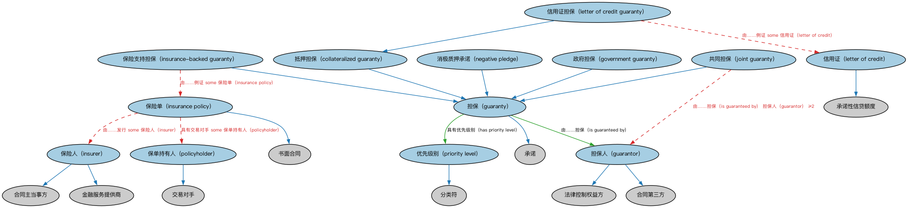

# 担保本体（Guaranty Ontology）结构与公理说明

本文档对应 `Guaranty.rdf` / `Guaranty.ttl`，说明该本体的类、继承关系、属性和公理约定。结构图见 `Guaranty-structure.png`（`Guaranty-structure.svg` 为可缩放版本）。

## 1. 本体概述

定义担保（guaranty）：担保人承诺在债务人违约时代为偿付的安排，含担保范围与担保方式。

**在体系中的位置**：FBC 债务与权益模块中负责「信用增级」的本体。

**上下游关系**：上游依赖债务与 FND 合同本体；下游被贷款、债券发行引用（母公司担保、政府担保）。

**与相近概念的差别**：担保≠抵押——担保是第三人的信用承诺（人的担保），抵押是以特定财产作偿（物的担保，见 LOAN 抵押贷款）；担保≠保险——担保是从属于主债务的法律安排。

本本体中类与类的核心关系如下（完整细节见各类小节）：

- **抵押担保（collateralized guaranty）** 继承 **担保（guaranty）**
- **政府担保（government guaranty）** 继承 **担保（guaranty）**
- **担保人（guarantor）** 继承 **法律控制权益方（DeJureControllingInterestParty）**
- **担保人（guarantor）** 继承 **合同第三方（ContractThirdParty）**
- **担保（guaranty）** 继承 **承诺（Commitment）**
- **保险单（insurance policy）** 继承 **书面合同（WrittenContract）**
- **保险支持担保（insurance-backed guaranty）** 继承 **担保（guaranty）**
- **保险人（insurer）** 继承 **金融服务提供商（FinancialServiceProvider）**
- **保险人（insurer）** 继承 **合同主当事方（ContractPrincipal）**
- **共同担保（joint guaranty）** 继承 **担保（guaranty）**
- **信用证（letter of credit）** 继承 **承诺性信贷额度（CommittedCreditFacility）**
- **信用证担保（letter of credit guaranty）** 继承 **抵押担保（collateralized guaranty）**
- 其余 5 条关系从略。

## 2. 类（Class）

| 类（Class） | 定义（Definition） |
|---|---|
| 抵押担保（collateralized guaranty） | 以借款人向贷款人质押某项资产为形式的担保（通常用于换取贷款）。 |
| 政府担保（government guaranty） | 由政府实体提供的担保，例如政府支持证券的担保。 |
| 担保人（guarantor） | 为其他方的某项义务提供保证、背书或赔偿的当事方。 |
| 担保（guaranty） | 一种承诺：当承担首要责任的一方未能履约时，由担保方正式保证相关事项得到履行。 |
| 保险单（insurance policy） | 一种合同：（1）使赔偿责任保障生效；（2）作为保险协议的法律凭证；（3）列明保险的确切条款。 |
| 保险支持担保（insurance-backed guaranty） | 以保险单形式实现的担保。 |
| 保险人（insurer） | 签发保险单的金融服务提供方。 |
| 共同担保（joint guaranty） | 由至少两方共同连带提供的担保。 |
| 信用证（letter of credit） | 由银行或其他资信良好的机构出具的函件，保证买方对卖方的付款将按时、足额收到。 |
| 信用证担保（letter of credit guaranty） | 以信用证形式提供的担保，即由银行签发、保证在特定期限内支付不超过规定金额款项的文件。 |
| 消极质押承诺（negative pledge） | 一种担保承诺：发行人承诺不质押任何资产，以免降低贷款人或投资人的受保障程度。 |
| 保单持有人（policyholder） | 保险单的相对方，通常也是保险单的所有者。 |
| 优先级别（priority level） | 担保在合同语境中的相对排序，例如信用增级的优先顺序。 |

以下按类逐个展开：每个类给出继承关系、相关属性与公理约定；子类在父类之下降一级编号。

### 2.1 担保人（guarantor）

定义：为其他方的某项义务提供保证、背书或赔偿的当事方。

- 父类：**法律控制权益方（DeJureControllingInterestParty）**、**合同第三方（ContractThirdParty）**

属性：

| 属性 | 定义 | 说明 |
|---|---|---|
| **是……的担保人（is guarantor of）** | 标识担保人因提供担保而对之拥有一定程度控制权的当事方。 | 值域：受控方；子属性：是控制方 |
| **由…扮演（is played by）** | — | — |

公理：

- **由…扮演（is played by）**的所有取值只能是**法律主体（LegalPerson）**。
- **由…扮演（is played by）**至少有一个取值，该取值满足：**是…的参与方（is a party to）**至少有一个取值，类型是**合同（Contract）**。

### 2.2 担保（guaranty）

定义：一种承诺：当承担首要责任的一方未能履约时，由担保方正式保证相关事项得到履行。

- 父类：**承诺（Commitment）**
- 直接子类：**抵押担保（collateralized guaranty）**、**政府担保（government guaranty）**、**保险支持担保（insurance-backed guaranty）**、**共同担保（joint guaranty）**、**消极质押承诺（negative pledge）**

属性：

| 属性 | 定义 | 说明 |
|---|---|---|
| **具有担保金额（has guaranteed amount）** | 将担保与其所担保的货币金额关联起来。 | 值域：货币数量；子属性：具有货币数量 |
| **具有优先级别（has priority level）** | 将担保与其在合同语境中的相对排序关联起来，例如信用增级优先顺序。 | 值域：优先级别（priority level）；子属性：由……分类 |
| **由……担保（is guaranteed by）** | 将担保与合同担保人（即提供担保的法律主体）关联起来。 | 值域：担保人（guarantor） |
| **具有到期日（hasExpirationDate）** | — | — |
| **在…期间保持（holds during）** | — | — |

公理：

- **具有优先级别（has priority level）**的所有取值只能是**优先级别（priority level）**。
- **具有到期日（hasExpirationDate）**的所有取值只能是**日期（Date）**。
- **具有担保金额（has guaranteed amount）**的所有取值只能是**货币数量（MonetaryAmount）**。
- **在…期间保持（holds during）**的所有取值只能是**日期区间（DatePeriod）**。
- **由……担保（is guaranteed by）**的所有取值只能是**担保人（guarantor）**。

#### 2.2.1 抵押担保（collateralized guaranty）

定义：以借款人向贷款人质押某项资产为形式的担保（通常用于换取贷款）。

- 父类：**担保（guaranty）**
- 直接子类：**信用证担保（letter of credit guaranty）**

属性：

| 属性 | 定义 | 说明 |
|---|---|---|
| **以……为抵押（isCollateralizedBy）** | — | — |

公理：

- **以……为抵押（isCollateralizedBy）**至少有一个取值，类型是**抵押品（Collateral）**。

##### 2.2.1.1 信用证担保（letter of credit guaranty）

定义：以信用证形式提供的担保，即由银行签发、保证在特定期限内支付不超过规定金额款项的文件。

- 父类：**抵押担保（collateralized guaranty）**

属性：

| 属性 | 定义 | 说明 |
|---|---|---|
| **由……例证（isExemplifiedBy）** | — | — |

公理：

- **由……例证（isExemplifiedBy）**至少有一个取值，类型是**信用证（letter of credit）**。

#### 2.2.2 政府担保（government guaranty）

定义：由政府实体提供的担保，例如政府支持证券的担保。

- 父类：**担保（guaranty）**

属性：

| 属性 | 定义 | 说明 |
|---|---|---|
| **由……担保（is guaranteed by）** | 将担保与合同担保人（即提供担保的法律主体）关联起来。 | 值域：担保人（guarantor） |

公理：

- **由……担保（is guaranteed by）**至少有一个取值，该取值满足：**由…扮演（is played by）**至少有一个取值，类型是**政体（Polity）**。

#### 2.2.3 保险支持担保（insurance-backed guaranty）

定义：以保险单形式实现的担保。

- 父类：**担保（guaranty）**

属性：

| 属性 | 定义 | 说明 |
|---|---|---|
| **由……例证（isExemplifiedBy）** | — | — |

公理：

- **由……例证（isExemplifiedBy）**至少有一个取值，类型是**保险单（insurance policy）**。

#### 2.2.4 共同担保（joint guaranty）

定义：由至少两方共同连带提供的担保。

- 父类：**担保（guaranty）**

属性：

| 属性 | 定义 | 说明 |
|---|---|---|
| **由……担保（is guaranteed by）** | 将担保与合同担保人（即提供担保的法律主体）关联起来。 | 值域：担保人（guarantor） |

公理：

- **由……担保（is guaranteed by）**至少有 2 个**担保人（guarantor）**。

#### 2.2.5 消极质押承诺（negative pledge）

定义：一种担保承诺：发行人承诺不质押任何资产，以免降低贷款人或投资人的受保障程度。

- 父类：**担保（guaranty）**

### 2.3 保险单（insurance policy）

定义：一种合同：（1）使赔偿责任保障生效；（2）作为保险协议的法律凭证；（3）列明保险的确切条款。

- 父类：**书面合同（WrittenContract）**

属性：

| 属性 | 定义 | 说明 |
|---|---|---|
| **具有交易对手（hasCounterparty）** | — | — |
| **由……发行（isIssuedBy）** | — | — |

公理：

- **具有交易对手（hasCounterparty）**至少有一个取值，类型是**保单持有人（policyholder）**。
- **由……发行（isIssuedBy）**至少有一个取值，类型是**保险人（insurer）**。

### 2.4 保险人（insurer）

定义：签发保险单的金融服务提供方。

- 父类：**金融服务提供商（FinancialServiceProvider）**、**合同主当事方（ContractPrincipal）**

### 2.5 信用证（letter of credit）

定义：由银行或其他资信良好的机构出具的函件，保证买方对卖方的付款将按时、足额收到。

- 父类：**承诺性信贷额度（CommittedCreditFacility）**

属性：

| 属性 | 定义 | 说明 |
|---|---|---|
| **由……发行（isIssuedBy）** | — | — |
| **扮演角色（plays role）** | — | — |

公理：

- **扮演角色（plays role）**至少有一个取值，类型是**金融资产（FinancialAsset）**。
- **由……发行（isIssuedBy）**至少有一个取值，类型是**参与方角色（party role）**。

### 2.6 保单持有人（policyholder）

定义：保险单的相对方，通常也是保险单的所有者。

- 父类：**交易对手（Counterparty）**

### 2.7 优先级别（priority level）

定义：担保在合同语境中的相对排序，例如信用增级的优先顺序。

- 父类：**分类符（Classifier）**

## 3. 其他属性

以下属性未绑定到本体的具体类（定义域在外部本体或未声明）：

对象属性（Object Property）：

| 属性 | 定义 | 说明 |
|---|---|---|
| **具有担保人（has guarantor）** | 将担保人与被担保的合同关联起来。 | 值域：担保人（guarantor）；子属性：具有第三方 |
| **具有担保当事方（has guarantor party）** | 指明为其义务提供保证、背书或赔偿的当事方。 | 值域：担保人（guarantor）；逆属性：是……的担保人（is guarantor of）；子属性：具有控制方 |

## 4. 依赖（owl:imports，18 个）

本本体通过 `owl:imports` 引入以下本体，各项的中文名称与简介如下：

| 导入本体 | 中文名称 | 简介 |
|---|---|---|
| `BE/GovernmentEntities/GovernmentEntities.rdf` | 政府实体本体（Government Entities Ontology） | 定义政府、政体（polity）、法域（jurisdiction）及政府实体的核心概念，是各区域政府实体本体的共同基础。 |
| `BE/OwnershipAndControl/ControlParties.rdf` | 控制方本体（Control Parties Ontology） | 定义处于控制关系中的各方角色：控制方、被控制方、实际控制人等。 |
| `FBC/DebtAndEquities/Debt.rdf` | 债务本体（Debt Ontology） | 定义债务（debt）与债权债务关系的核心概念：借款人、贷款人、本金与利息义务。 |
| `FBC/ProductsAndServices/FinancialProductsAndServices.rdf` | 金融产品与服务本体（Financial Products and Services Ontology） | 定义金融产品（financial product）与金融服务（financial service）及其提供、购买关系。 |
| `FND/Accounting/CurrencyAmount.rdf` | 货币金额本体（Currency Amount Ontology） | 定义「金额＋币种」的货币金额（currency amount）表示，是 FIBO 中表达价格、债务金额、付款额等一切带币种数值的基础构件。 |
| `FND/Agreements/Agreements.rdf` | 协议本体（Agreements Ontology） | 定义两个或以上参与方之间协议（agreement）的通用概念：协议的当事方、条款、生效与终止，是合同等一切契约性安排的上位模型。 |
| `FND/Agreements/Contracts.rdf` | 合同本体（Contracts Ontology） | 在协议之上定义具有法律约束力的合同（contract）：合同当事方、合同条款、义务与权利，是金融工具与交易合同建模的基石。 |
| `FND/Arrangements/Documents.rdf` | 文档本体（Documents Ontology） | 定义文档、文档类型及文档与其所记载内容的关系，为合同文本、募集说明书等法律文书建模。 |
| `FND/OwnershipAndControl/Control.rdf` | 控制本体（Control Ontology） | 定义「控制」关系：控制方、被控制方与控制程度，用于公司治理与合并报表判断。 |
| `FND/OwnershipAndControl/Ownership.rdf` | 所有权本体（Ownership Ontology） | 定义「拥有」关系：所有者、被拥有资产及所有权份额。 |
| `FND/Relations/Relations.rdf` | 关系本体（Relations Ontology） | FIBO 最底层的基础本体，定义参考（reference）、分类（classify）等通用关系与抽象概念，全库普遍依赖。 |
| `FND/Utilities/AnnotationVocabulary.rdf` | FIBO 标注词汇表（FIBO Annotation Vocabulary） | 定义 FIBO 专用的标注属性（如释义来源、成熟度等级），用于本体自身的元数据标注。 |
| `https://www.omg.org/spec/Commons/AnnotationVocabulary/` | OMG 通用标注词汇表（OMG Commons Annotation Vocabulary） | OMG 通用本体库（Commons）中的标注词汇表，提供概念映射等标注属性，FIBO 用它标注术语与外部标准的对应关系。 |
| `https://www.omg.org/spec/Commons/Classifiers/` | OMG 通用分类器本体（OMG Commons Classifiers） | OMG 通用本体库（Commons）中的分类器本体，定义分类方案、类别与归类关系的通用概念，FIBO 的分类建模建立在其上。 |
| `https://www.omg.org/spec/Commons/DatesAndTimes/` | OMG 通用日期与时间本体（OMG Commons Dates and Times） | Commons 库中的日期时间本体，定义日期、期间、时间点等通用时间概念。 |
| `https://www.omg.org/spec/Commons/Organizations/` | OMG 通用组织本体（OMG Commons Organizations） | Commons 库中的组织本体，定义组织、组织成员与组织结构的通用概念。 |
| `https://www.omg.org/spec/Commons/PartiesAndSituations/` | OMG 通用参与方与情境本体（OMG Commons Parties and Situations） | Commons 库中的参与方本体，定义独立主体、参与方及其角色扮演的通用概念，是 FIBO 参与方模型的上游。 |
| `https://www.omg.org/spec/Commons/RolesAndCompositions/` | OMG 通用角色与构成本体（OMG Commons Roles and Compositions） | Commons 库中的角色本体，定义角色及整体—部分构成关系的通用概念。 |

## 5. 文件

- 官方 RDF/XML：`Guaranty.rdf`
- 中文 Turtle：`Guaranty.ttl`
- 结构图：`Guaranty-structure.png` / `Guaranty-structure.svg`