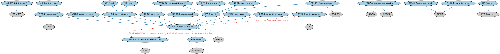

# 金融工具本体（Financial Instruments Ontology）结构与公理说明

本文档对应 `FinancialInstruments.rdf` / `FinancialInstruments.ttl`，说明该本体的类、继承关系、属性和公理约定。结构图见 `FinancialInstruments-structure.png`（`FinancialInstruments-structure.svg` 为可缩放版本）。

## 1. 本体概述

定义金融工具（financial instrument）的通用概念：可交易、代表某种权利义务的合同工具，是 FIBO 最核心的本体之一。

**在体系中的位置**：FBC 金融工具模块的核心，上承 FND 合同，下接 SEC 证券、DER 衍生品、LOAN 贷款等一切具体工具。

**上下游关系**：上游依赖 FND 合同与协议本体；下游被 SEC、DER、LOAN、IND 各域广泛引用，是全库被依赖最多的本体之一。

**与相近概念的差别**：金融工具≠金融产品——工具是可交易的合约凭证，产品是金融机构打包提供的服务组合（见金融产品与服务本体）；工具也≠资产——工具强调合同属性。

## 2. 类（Class）

| 类（Class） | 定义（Definition） |
|---|---|
| 计算代理人（calculation agent） | 负责确定工具价值的一方，在某些情况下还确定双方相互应付的金额。 |
| 现金类工具（cash instrument） | 价值由市场决定且易于转让（高流动性）的金融工具。 |
| 商品工具（commodity instrument） | 代表大宗商品（如原材料和初级农产品）所有权权益的金融工具。 |
| 货币工具（currency instrument） | 用于货币交易目的的金融工具。 |
| 债务工具（debt instrument） | 作为信贷协议的金融工具，证明发行人按既定条款对持有人负有欠款。 |
| 衍生工具（derivative instrument） | 赋予持有人特定权利或义务、其价值来源于一种或多种标的资产的金融工具。 |
| 权益凭证（entitlement） | 使持有人按既定条款获得特定资产的权益、认购特权或收取权的金融工具。 |
| 权益工具（equity instrument） | 代表对某一实体或资产池的所有权权益的金融工具。 |
| 豁免证券（exempt security） | 免于适用某些监管规则的证券。 |
| 金融工具（financial instrument） | 同时产生一方金融资产和另一方金融负债的书面合同。 |
| 金融工具标识符（financial instrument identifier） | 在特定情境下为某一目的唯一标识金融工具的字符序列。 |
| 期货（future） | 衍生工具：买方有义务在约定价格接收、卖方有义务交付约定资产，于未来某一时点执行。 |
| 发行人（issuer） | 以某种明确且通常正式的方式发行（或拟发行）一种或多种金融工具的一方所扮演的角色。 |
| 可转让证券（negotiable security） | 可转让给他方的证券。 |
| 不可转让证券（non-negotiable security） | 不可转让给他方的证券。 |
| 期权（option） | 衍生工具：赋予持有人按预定价格买入或卖出约定资产的特权。 |
| 打包金融产品（packaged financial product） | 作为容器容纳至少一种金融工具（包括其他金融产品）、且其价值来源于所含成分的金融产品。 |
| 本票（promissory note） | 一种债务工具：一方向另一方出具的书面承诺，承诺按要求或在规定期限内支付指定金额。 |
| 赎回条款（redemption provision） | 使发行人（签发方）能够通过偿付约定价格重新取得所有权的合同条款。 |
| 证券交易（securities transaction） | 两方或多方之间涉及通用定义金融产品交换的交易。 |
| 证券（security） | 可以买入或卖出的金融工具。 |
| 即期合约（spot contract） | 在指定日期即时交割结算的金融工具。 |
| 标准化条款（standardized terms） | 组合在一起、在众多合同中被一致复用、由某机构发布且可被机器处理的合同条款。 |
| 标的（underlier） | 可在市场上被赋予价值、构成衍生品或资产池支持工具基础的事物。 |

### 2.1 继承关系（Inheritance）

- 计算代理人（calculation agent） ⊑ 第三方代理人
- 现金类工具（cash instrument） ⊑ 金融工具（financial instrument）
- 商品工具（commodity instrument） ⊑ 金融工具（financial instrument）
- 货币工具（currency instrument） ⊑ 金融工具（financial instrument）
- 债务工具（debt instrument） ⊑ 信贷协议
- 债务工具（debt instrument） ⊑ 金融工具（financial instrument）
- 衍生工具（derivative instrument） ⊑ 金融工具（financial instrument）
- 权益凭证（entitlement） ⊑ 金融工具（financial instrument）
- 权益工具（equity instrument） ⊑ 证券（security）
- 豁免证券（exempt security） ⊑ 证券（security）
- 金融工具（financial instrument） ⊑ 书面合同
- 金融工具标识符（financial instrument identifier） ⊑ 标识符
- 期货（future） ⊑ 衍生工具（derivative instrument）
- 发行人（issuer） ⊑ 合同主当事方
- 可转让证券（negotiable security） ⊑ 证券（security）
- 可转让证券（negotiable security） ⊑ 可转让合同
- 不可转让证券（non-negotiable security） ⊑ 证券（security）
- 期权（option） ⊑ 衍生工具（derivative instrument）
- 打包金融产品（packaged financial product） ⊑ 金融产品
- 打包金融产品（packaged financial product） ⊑ 合同型产品
- 本票（promissory note） ⊑ 债务工具（debt instrument）
- 赎回条款（redemption provision） ⊑ 合同承诺
- 证券交易（securities transaction） ⊑ 交易
- 证券（security） ⊑ 金融工具（financial instrument）
- 即期合约（spot contract） ⊑ 金融工具（financial instrument）
- 标准化条款（standardized terms） ⊑ 合同承诺
- 标的（underlier） ⊑ 承受者（undergoer）

## 3. 对象属性（Object Property）

| 属性（Property） | 中文（English） | 定义（Definition） | 说明 |
|---|---|---|---|
| fibo-fbc-fi-fi:hasBuyingCurrency | 具有买入货币（has buying currency） | 指明货币或相关工具中买入的货币。 | 值域（range）：货币；子属性（subPropertyOf）：具有交易货币 |
| fibo-fbc-fi-fi:hasCalculationAgent | 具有计算代理人（has calculation agent） | 指明负责确定工具价值的一方（角色）。 | 值域（range）：计算代理人（calculation agent）；子属性（subPropertyOf）：由……提供 |
| fibo-fbc-fi-fi:hasCommodityValueAsOfExecutionDate | 具有执行日商品价值（has commodity value as of execution date） | 指明合同执行日某商品的单位价值。 | 值域（range）：货币数量；子属性（subPropertyOf）：具有货币数量 |
| fibo-fbc-fi-fi:hasNominalValue | 具有名义价值（has nominal value） | 指明合同的票面价值。 | 值域（range）：货币数量；子属性（subPropertyOf）：具有货币数量 |
| fibo-fbc-fi-fi:hasPrincipalExecutiveOfficeAddress | 具有主要办公地址（has principal executive office address） | 将机构（具体为金融工具发行人）与其主要办公地址关联起来，为发行该工具所需。 | 定义域（domain）：法律主体；值域（range）：常规街道地址；子属性（subPropertyOf）：具有注册地址 |
| fibo-fbc-fi-fi:hasRedemptionProvision | 具有赎回条款（has redemption terms） | 指明工具或相关合同文件中规定的赎回具体条款。 | 值域（range）：赎回条款（redemption provision）；子属性（subPropertyOf）：具有合同要素 |
| fibo-fbc-fi-fi:hasSellingCurrency | 具有卖出货币（has selling currency） | 指明货币或相关工具中卖出的货币。 | 值域（range）：货币；子属性（subPropertyOf）：具有基准货币 |
| fibo-fbc-fi-fi:hasShareholder | 具有股东（has shareholder） | 指明持有发行人股份的一方。 | 定义域（domain）：发行人（issuer）；值域（range）：股东；子属性（subPropertyOf）：受…影响（is affected by） |
| fibo-fbc-fi-fi:hasUnderlier | 具有标的（has underlier） | 将衍生品与合约所基于的标的事物关联起来。 | 值域（range）：标的（underlier）；子属性（subPropertyOf）：具有承受者（has undergoer） |
| fibo-fbc-fi-fi:hasValueExpressedIn | 价值以……表示（has value expressed in） | 将工具或指数等与其价值通常表示所用的货币关联起来。 | 值域（range）：货币；子属性（subPropertyOf）：具有货币 |
| fibo-fbc-fi-fi:holdsSharesIn | 持有……的股份（holds shares in） | 指明股东持有权益头寸的发行人。 | 定义域（domain）：股东；值域（range）：发行人（issuer）；逆属性（inverseOf）：具有股东（has shareholder）；子属性（subPropertyOf）：对…采取行动（acts on） |
| fibo-fbc-fi-fi:isDenominatedIn | 以……计价（is denominated in） | 指明金融工具发行所用的货币。 | 定义域（domain）：金融工具（financial instrument）；值域（range）：货币；子属性（subPropertyOf）：具有货币 |
| fibo-fbc-fi-fi:isLegallyRecordedIn | 法律登记于（is legally recorded in） | 金融工具为监管或税务目的进行法律登记的司法管辖区（国家、县、州、省、市）。 | 定义域（domain）：金融工具（financial instrument）；值域（range）：管辖权；子属性（subPropertyOf）：具有管辖辖区 |

## 4. 数据属性（Datatype Property）

| 属性（Property） | 中文（English） | 定义（Definition） |
|---|---|---|
| fibo-fbc-fi-fi:isNegotiable | 是否可转让（is negotiable） | 指明某一金融工具是否可转让。 |

## 5. 公理约定（Axioms）

- 商品工具（commodity instrument）：具有执行日商品价值（has commodity value as of execution date） 货币数量 ≥0
- 商品工具（commodity instrument）：涉及 商品 ≥0
- 商品工具（commodity instrument）：具有量值 标量值 ≥0
- 货币工具（currency instrument）：具有买入货币（has buying currency） 货币 ≥0
- 货币工具（currency instrument）：具有卖出货币（has selling currency） 货币 ≥0
- 债务工具（debt instrument）：具有借款人 some 借款人
- 债务工具（debt instrument）：具有贷款人 some 贷款人
- 衍生工具（derivative instrument）：具有初始交换日 显式日期 ≥0
- 衍生工具（derivative instrument） 与 现金类工具（cash instrument） 互斥（disjointWith）
- 金融工具（financial instrument）：由……标识 金融工具标识符（financial instrument identifier） ≥0
- 金融工具（financial instrument）：具有名义价值（has nominal value） 货币数量 ≥0
- 金融工具（financial instrument）：法律登记于（is legally recorded in） 管辖权 ≥0
- 金融工具（financial instrument）：restriction
- 金融工具（financial instrument）：以……计价（is denominated in） some 货币
- 金融工具（financial instrument）：由……发行 some 发行人（issuer）
- 金融工具标识符（financial instrument identifier）：标识 金融工具（financial instrument） ≥0
- 发行人（issuer）：发行 some（restriction）
- 发行人（issuer）：由…扮演（is played by） some（是…的参与方（is a party to） some 金融工具（financial instrument））
- 可转让证券（negotiable security）：restriction
- 不可转让证券（non-negotiable security） 与 可转让证券（negotiable security） 互斥（disjointWith）
- 打包金融产品（packaged financial product）：被包含于 金融产品目录 ≥0
- 打包金融产品（packaged financial product）：包含 some（restriction）
- 证券交易（securities transaction）：适用于 some 金融工具（financial instrument）
- 证券（security）：法律登记于（is legally recorded in） 管辖权 =1

## 6. 依赖（owl:imports，21 个）

本本体通过 `owl:imports` 引入以下本体，各项的中文名称与简介如下：

| 导入本体 | 中文名称 | 简介 |
|---|---|---|
| `BE/LegalEntities/FormalBusinessOrganizations.rdf` | 正式商业组织本体（Formal Business Organizations Ontology） | 定义以营利为目的、依法注册的正式商业组织，连接法律实体与其商业功能。 |
| `BE/OwnershipAndControl/CorporateOwnership.rdf` | 公司所有权本体（Corporate Ownership Ontology） | 定义公司层面的所有权关系：股东、股份持有与受益所有权。 |
| `FBC/DebtAndEquities/Debt.rdf` | 债务本体（Debt Ontology） | 定义债务（debt）与债权债务关系的核心概念：借款人、贷款人、本金与利息义务。 |
| `FBC/ProductsAndServices/FinancialProductsAndServices.rdf` | 金融产品与服务本体（Financial Products and Services Ontology） | 定义金融产品（financial product）与金融服务（financial service）及其提供、购买关系。 |
| `FND/Accounting/CurrencyAmount.rdf` | 货币金额本体（Currency Amount Ontology） | 定义「金额＋币种」的货币金额（currency amount）表示，是 FIBO 中表达价格、债务金额、付款额等一切带币种数值的基础构件。 |
| `FND/Agreements/Contracts.rdf` | 合同本体（Contracts Ontology） | 在协议之上定义具有法律约束力的合同（contract）：合同当事方、合同条款、义务与权利，是金融工具与交易合同建模的基石。 |
| `FND/Arrangements/IdentifiersAndIndices.rdf` | 标识符与索引本体（Identifiers and Indices Ontology） | 定义标识符（identifier）、标识方案与索引（index）的基本结构，是 ISIN、LEI、CUSIP 等编码体系建模的基础。 |
| `FND/Places/Addresses.rdf` | 地址本体（Addresses Ontology） | 定义邮政地址及其组成部分，为机构注册地、通讯地址建模。 |
| `FND/ProductsAndServices/ProductsAndServices.rdf` | 产品与服务本体（Products and Services Ontology） | 定义产品、服务及其提供者与客户的通用关系。 |
| `FND/Relations/Relations.rdf` | 关系本体（Relations Ontology） | FIBO 最底层的基础本体，定义参考（reference）、分类（classify）等通用关系与抽象概念，全库普遍依赖。 |
| `FND/Utilities/AnnotationVocabulary.rdf` | FIBO 标注词汇表（FIBO Annotation Vocabulary） | 定义 FIBO 专用的标注属性（如释义来源、成熟度等级），用于本体自身的元数据标注。 |
| `https://www.omg.org/spec/Commons/AnnotationVocabulary/` | OMG 通用标注词汇表（OMG Commons Annotation Vocabulary） | OMG 通用本体库（Commons）中的标注词汇表，提供概念映射等标注属性，FIBO 用它标注术语与外部标准的对应关系。 |
| `https://www.omg.org/spec/Commons/Collections/` | OMG 通用集合本体（OMG Commons Collections） | Commons 库中的集合本体，定义集合、成员等通用概念。 |
| `https://www.omg.org/spec/Commons/ContextualDesignators/` | OMG 通用语境指称本体（OMG Commons Contextual Designators） | Commons 库中的语境指称本体，定义「在某个语境下指代某物的名称/符号」，是地址、账户号码等语境相关标识的基础。 |
| `https://www.omg.org/spec/Commons/DatesAndTimes/` | OMG 通用日期与时间本体（OMG Commons Dates and Times） | Commons 库中的日期时间本体，定义日期、期间、时间点等通用时间概念。 |
| `https://www.omg.org/spec/Commons/Identifiers/` | OMG 通用标识符本体（OMG Commons Identifiers） | Commons 库中的标识符本体，定义标识符及其编码方案的通用概念。 |
| `https://www.omg.org/spec/Commons/Organizations/` | OMG 通用组织本体（OMG Commons Organizations） | Commons 库中的组织本体，定义组织、组织成员与组织结构的通用概念。 |
| `https://www.omg.org/spec/Commons/PartiesAndSituations/` | OMG 通用参与方与情境本体（OMG Commons Parties and Situations） | Commons 库中的参与方本体，定义独立主体、参与方及其角色扮演的通用概念，是 FIBO 参与方模型的上游。 |
| `https://www.omg.org/spec/Commons/QuantitiesAndUnits/` | OMG 通用量与单位本体（OMG Commons Quantities and Units） | Commons 库中的量与单位本体，定义数量、度量单位、量纲的通用概念，支撑金额、比率等数值表达。 |
| `https://www.omg.org/spec/Commons/RegulatoryAgencies/` | OMG 通用监管机构本体（OMG Commons Regulatory Agencies） | Commons 库中的监管机构本体，定义监管机构及其监管职权的通用概念。 |
| `https://www.omg.org/spec/Commons/RolesAndCompositions/` | OMG 通用角色与构成本体（OMG Commons Roles and Compositions） | Commons 库中的角色本体，定义角色及整体—部分构成关系的通用概念。 |

## 7. 文件

- 官方 RDF/XML：`FinancialInstruments.rdf`
- 中文 Turtle：`FinancialInstruments.ttl`
- 结构图：`FinancialInstruments-structure.png` / `FinancialInstruments-structure.svg`