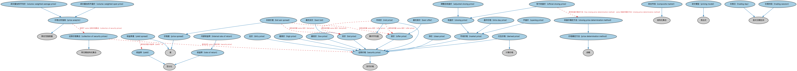

# 工具定价本体（Instrument Pricing Ontology）结构与公理说明

本文档对应 `InstrumentPricing.rdf` / `InstrumentPricing.ttl`，说明该本体的类、继承关系、属性和公理约定。结构图见 `InstrumentPricing-structure.png`（`InstrumentPricing-structure.svg` 为可缩放版本）。

## 1. 本体概述

定义金融工具的价格（price）、报价（quote）与估值（valuation）相关概念。

**在体系中的位置**：FBC 金融工具模块的配套本体，与结算本体并列。

**上下游关系**：上游依赖金融工具、货币金额与 IND 指标本体；下游被 MD 市场数据各时序本体引用（时序数据就是价格的历史记录）。

**与相近概念的差别**：价格≠价值——价格是市场成交或报价的数值，估值是模型推算的理论价值；本本体两者都覆盖但侧重市场报价结构。

## 2. 类（Class）

| 类（Class） | 定义（Definition） |
|---|---|
| 调整后收盘价（adjusted closing price） | 在计入拆股、分红、配股等公司行为后，经修正以反映证券价值的收盘价。 |
| 最优买价（best bid） | 潜在买方在特定时点就某一证券愿意支付的最高买入价。 |
| 最优卖价（best offer） | 潜在卖方在特定时点就某一证券可接受的最低卖出价。 |
| 买卖价差（bid ask spread） | 卖出（要价）与买入（出价）之间的差额。 |
| 买价（bid price） | 潜在买方愿意支付的价格。 |
| 净价（clean price） | 不含应计利息的债务工具价格。 |
| 收盘价（closing price） | 市场收盘前最后一笔成交价格的现金价值。 |
| 收盘价确定方法（closing price determination method） | 计算或以其他方式确定官方收盘价的策略。 |
| 证券价格集合（collection of security prices） | 由一系列价格组成的集合，每一价格均与特定日期和时间相关联。 |
| 综合市场（composite market） | 为定价目的而参考的一组交易所和交易场所。 |
| 衍生价格（derived price） | 来源于其他数据源或计算、而非报价或基于实际交易数据的价格。 |
| 全价（dirty price） | 含应计利息的债务工具价格。 |
| 最高价（high price） | 指定期间内某一证券的最高价格。 |
| 内部收益率（internal rate of return） | 使一系列未来现金流净现值（NPV）为零的折现率。 |
| 盘中价格（intra day price） | 交易所开盘价与官方收盘价之间某一时点的证券价格。 |
| 最低价（low price） | 指定期间内某一证券的最低价格。 |
| 市场价格（market price） | 证券最近一次成交的报告价格。 |
| 中间价（mid price） | 买价与卖价的算术平均值。 |
| 卖价（offer price） | 潜在卖方在特定时点就某一证券提出的价格。 |
| 官方收盘价（official closing price） | 某一交易所交易日结束时证券最后一笔成交的价格。 |
| 开盘价（opening price） | 交易日开始时的首次成交价格。 |
| 价格分析指标（price analytic） | 涉及证券价格的统计度量。 |
| 价格确定方法（price determination method） | 计算或以其他方式确立某物价格的策略。 |
| 价格差（price spread） | 两个价格之间的差额。 |
| 定价模型（pricing model） | 用于确定工具在某一时点价值的表达式。 |
| 收益率（rate of return） | 投资在规定期间内的净收益或净损失，以占投资初始成本或某一时点价值的百分比表示。 |
| 证券价格（security price） | 金融工具在某一时点的货币价格。 |
| 交易日（trading day） | 某一交易场所开放的时间跨度。 |
| 交易时段（trading session） | 交易日内可以提交并成交订单的时间窗口。 |
| 成交量加权平均价（volume-weighted average price） | 证券在全日交易中的平均价格，由每笔成交价格乘以其成交量后加总，再除以总成交量得出。 |
| 成交量加权开盘价（volume-weighted open price） | 由每笔成交价格乘以其成交量后加总，再除以交易日内某一期间的成交量得出的价格。 |
| 收益率（yield） | 投资人资本投资的回报。 |
| 收益率差（yield spread） | 两个项目收益率之间的差值。 |

### 2.1 继承关系（Inheritance）

- 调整后收盘价（adjusted closing price） ⊑ 收盘价（closing price）
- 最优买价（best bid） ⊑ 买价（bid price）
- 最优卖价（best offer） ⊑ 卖价（offer price）
- 买卖价差（bid ask spread） ⊑ 价格差（price spread）
- 买价（bid price） ⊑ 证券价格（security price）
- 净价（clean price） ⊑ 证券价格（security price）
- 收盘价（closing price） ⊑ 市场价格（market price）
- 收盘价确定方法（closing price determination method） ⊑ 价格确定方法（price determination method）
- 证券价格集合（collection of security prices） ⊑ 带日期结构化集合
- 综合市场（composite market） ⊑ 结构化集合
- 衍生价格（derived price） ⊑ 证券价格（security price）
- 衍生价格（derived price） ⊑ 计算价格
- 全价（dirty price） ⊑ 证券价格（security price）
- 最高价（high price） ⊑ 证券价格（security price）
- 内部收益率（internal rate of return） ⊑ 收益率（rate of return）
- 盘中价格（intra day price） ⊑ 市场价格（market price）
- 最低价（low price） ⊑ 证券价格（security price）
- 市场价格（market price） ⊑ 证券价格（security price）
- 中间价（mid price） ⊑ 证券价格（security price）
- 中间价（mid price） ⊑ 算术平均值
- 卖价（offer price） ⊑ 证券价格（security price）
- 官方收盘价（official closing price） ⊑ 收盘价（closing price）
- 开盘价（opening price） ⊑ 市场价格（market price）
- 价格分析指标（price analytic） ⊑ 限定范围度量
- 价格确定方法（price determination method） ⊑ 战略
- 价格差（price spread） ⊑ 差
- 定价模型（pricing model） ⊑ 表达式
- 收益率（rate of return） ⊑ 百分比
- 证券价格（security price） ⊑ 货币价格
- 交易日（trading day） ⊑ 显式日期区间
- 交易时段（trading session） ⊑ 显式日期区间
- 成交量加权平均价（volume-weighted average price） ⊑ 价格分析指标（price analytic）
- 成交量加权开盘价（volume-weighted open price） ⊑ 价格分析指标（price analytic）
- 收益率（yield） ⊑ 百分比
- 收益率差（yield spread） ⊑ 差

## 3. 对象属性（Object Property）

| 属性（Property） | 中文（English） | 定义（Definition） | 说明 |
|---|---|---|---|
| fibo-fbc-fi-ip:hasClosingPriceDeterminationMethod | 具有收盘价确定方法（has closing price determination method） | 指明确定官方收盘价所采用的策略。 | 值域（range）：收盘价确定方法（closing price determination method）；子属性（subPropertyOf）：具有价格确定方法（has price determination method） |
| fibo-fbc-fi-ip:hasPriceDeterminationMethod | 具有价格确定方法（has price determination method） | 指明确定某一价格所采用的策略。 | 值域（range）：价格确定方法（price determination method）；子属性（subPropertyOf）：具有战略 |
| fibo-fbc-fi-ip:hasPricingSource | 具有定价来源（has pricing source） | 指明金融工具某一报价或价格的来源。 | 子属性（subPropertyOf）：引用 |
| fibo-fbc-fi-ip:hasRateOfReturn | 具有收益率（has rate of return） | 指明某一金融工具在一段时间内的回顾性收益率。 | 定义域（domain）：金融工具；值域（range）：收益率（rate of return）；子属性（subPropertyOf）：具有量值 |
| fibo-fbc-fi-ip:hasTradingDateTime | 具有交易日期时间（has trading date time） | 指明与某一价格相关联的具体日期和时间。 | 定义域（domain）：证券价格（security price）；值域（range）：日期时间；子属性（subPropertyOf）：具有日期时间 |

## 4. 数据属性（Datatype Property）

| 属性（Property） | 中文（English） | 定义（Definition） |
|---|---|---|
| fibo-fbc-fi-ip:hasBookDepth | 具有盘口深度（has book depth） | 指明价格所对应的订单簿深度。 |
| fibo-fbc-fi-ip:hasLotSize | 具有批量规模（has lot size） | 项目的规模（即总数量）。 |
| fibo-fbc-fi-ip:hasNumberOfDaysAccrued | 具有应计天数（has number of days accrued） | 指明利息已计提但尚未收到的天数。 |
| fibo-fbc-fi-ip:hasQuoteLotSize | 具有报价批量规模（has quote lot size） | 报价所对应标的的规模。 |
| fibo-fbc-fi-ip:hasRoundLotSize | 具有整手规模（has round lot size） | 交易所证券交易的标准手数。 |
| fibo-fbc-fi-ip:hasTradingVolume | 具有成交量（has trading volume） | 指明某一交易日成交的股份/单位数量。 |

## 5. 公理约定（Axioms）

- 最优买价（best bid）：具有适用期间 some 日期区间
- 最优卖价（best offer）：具有适用期间 some 日期区间
- 买卖价差（bid ask spread）：具有自变量 some 买价（bid price）
- 买卖价差（bid ask spread）：具有自变量 some 卖价（offer price）
- 买价（bid price） 与 卖价（offer price） 互斥（disjointWith）
- 净价（clean price） 与 全价（dirty price） 互斥（disjointWith）
- 证券价格集合（collection of security prices）：具有成员 some 证券价格（security price）
- 综合市场（composite market）：具有成员 some 交易所
- 全价（dirty price）：包含 some 应计利息
- 最高价（high price）：具有适用期间 some 日期区间
- 最低价（low price）：具有适用期间 some 日期区间
- 市场价格（market price）：具有定价来源（has pricing source） some（restriction）
- 中间价（mid price）：具有货币 货币 =1
- 中间价（mid price）：具有适用期间 some 日期区间
- 中间价（mid price）：具有自变量 some 买价（bid price）
- 中间价（mid price）：具有自变量 some 卖价（offer price）
- 官方收盘价（official closing price）：具有收盘价确定方法（has closing price determination method） some 收盘价确定方法（closing price determination method）
- 价格分析指标（price analytic）：适用于 some 证券价格集合（collection of security prices）
- 价格分析指标（price analytic）：具有适用期间 some 日期区间
- 价格分析指标（price analytic）：引用 some 证券
- 价格差（price spread）：具有自变量 货币价格 =2
- 价格差（price spread）：具有适用期间 some 日期区间
- 收益率（rate of return）：具有适用期间 some 日期区间
- 收益率（rate of return）：引用 some 证券
- 证券价格（security price）：具有定价来源（has pricing source） N6142c323344a4b6c89f5617dbe1ae4d8 ≥0
- 证券价格（security price）：restriction
- 证券价格（security price）：是……的价格 some 证券
- 交易日（trading day）：restriction
- 交易日（trading day）：restriction
- 交易日（trading day）：restriction
- 交易时段（trading session）：restriction
- 交易时段（trading session）：restriction
- 收益率（yield）：具有货币 货币 =1
- 收益率（yield）：具有适用期间 some 日期区间
- 收益率（yield）：引用 some 证券
- 收益率差（yield spread）：具有自变量 收益率（yield） =2

## 6. 依赖（owl:imports，17 个）

本本体通过 `owl:imports` 引入以下本体，各项的中文名称与简介如下：

| 导入本体 | 中文名称 | 简介 |
|---|---|---|
| `BE/FunctionalEntities/Publishers.rdf` | 出版方本体（Publishers Ontology） | 定义出版方及其出版物，用于标识金融信息与文档的发布来源。 |
| `FBC/DebtAndEquities/Debt.rdf` | 债务本体（Debt Ontology） | 定义债务（debt）与债权债务关系的核心概念：借款人、贷款人、本金与利息义务。 |
| `FBC/FinancialInstruments/FinancialInstruments.rdf` | 金融工具本体（Financial Instruments Ontology） | FIBO 核心本体之一，定义金融工具（financial instrument）的通用概念：可交易、代表某种权利义务的合同工具，是证券、衍生品等具体工具的共同基础。 |
| `FBC/FunctionalEntities/Markets.rdf` | 市场本体（Markets Ontology） | 定义金融市场（market）：交易所、场外市场及其功能。 |
| `FBC/ProductsAndServices/FinancialProductsAndServices.rdf` | 金融产品与服务本体（Financial Products and Services Ontology） | 定义金融产品（financial product）与金融服务（financial service）及其提供、购买关系。 |
| `FND/Accounting/CurrencyAmount.rdf` | 货币金额本体（Currency Amount Ontology） | 定义「金额＋币种」的货币金额（currency amount）表示，是 FIBO 中表达价格、债务金额、付款额等一切带币种数值的基础构件。 |
| `FND/DatesAndTimes/FinancialDates.rdf` | 金融日期本体（Financial Dates Ontology） | 定义金融语境下的日期与期间概念：结算日、付息日、到期日、日计数基准等。 |
| `FND/GoalsAndObjectives/Objectives.rdf` | 目标本体（Objectives Ontology） | 定义目标（objective）及其与组织、计划的关系，用于表达机构的经营目标与投资目标。 |
| `FND/OwnershipAndControl/Ownership.rdf` | 所有权本体（Ownership Ontology） | 定义「拥有」关系：所有者、被拥有资产及所有权份额。 |
| `FND/Utilities/Analytics.rdf` | 分析本体（Analytics Ontology） | 定义分析工具、度量与比率的通用概念，支撑指标与模型的表达。 |
| `FND/Utilities/AnnotationVocabulary.rdf` | FIBO 标注词汇表（FIBO Annotation Vocabulary） | 定义 FIBO 专用的标注属性（如释义来源、成熟度等级），用于本体自身的元数据标注。 |
| `https://www.omg.org/spec/Commons/AnnotationVocabulary/` | OMG 通用标注词汇表（OMG Commons Annotation Vocabulary） | OMG 通用本体库（Commons）中的标注词汇表，提供概念映射等标注属性，FIBO 用它标注术语与外部标准的对应关系。 |
| `https://www.omg.org/spec/Commons/Collections/` | OMG 通用集合本体（OMG Commons Collections） | Commons 库中的集合本体，定义集合、成员等通用概念。 |
| `https://www.omg.org/spec/Commons/ContextualDesignators/` | OMG 通用语境指称本体（OMG Commons Contextual Designators） | Commons 库中的语境指称本体，定义「在某个语境下指代某物的名称/符号」，是地址、账户号码等语境相关标识的基础。 |
| `https://www.omg.org/spec/Commons/DatesAndTimes/` | OMG 通用日期与时间本体（OMG Commons Dates and Times） | Commons 库中的日期时间本体，定义日期、期间、时间点等通用时间概念。 |
| `https://www.omg.org/spec/Commons/Documents/` | OMG 通用文档本体（OMG Commons Documents） | Commons 库中的文档本体，定义文档及其组成部分的通用概念。 |
| `https://www.omg.org/spec/Commons/QuantitiesAndUnits/` | OMG 通用量与单位本体（OMG Commons Quantities and Units） | Commons 库中的量与单位本体，定义数量、度量单位、量纲的通用概念，支撑金额、比率等数值表达。 |

## 7. 文件

- 官方 RDF/XML：`InstrumentPricing.rdf`
- 中文 Turtle：`InstrumentPricing.ttl`
- 结构图：`InstrumentPricing-structure.png` / `InstrumentPricing-structure.svg`