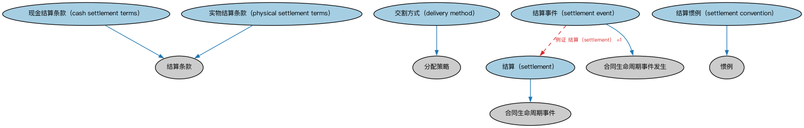

# 结算本体（Settlement Ontology）结构与公理说明

本文档对应 `Settlement.rdf` / `Settlement.ttl`，说明该本体的类、继承关系、属性和公理约定。结构图见 `Settlement-structure.png`（`Settlement-structure.svg` 为可缩放版本）。

## 1. 本体概述

定义交易结算（settlement）：券款对付（DVP）、结算日期、结算方式与结算参与方。

**在体系中的位置**：FBC 金融工具模块的配套本体，覆盖交易生命周期的最后环节。

**上下游关系**：上游依赖金融工具、金融日期与付款计划表本体；下游被证券交易、清算机构建模引用。

**与相近概念的差别**：结算≠交易——交易是达成买卖协议，结算是协议的实际履行（交钱交券）；T+1、T+2 等表述的就是成交到结算的间隔。

## 2. 类（Class）

| 类（Class） | 定义（Definition） |
|---|---|
| 现金结算条款（cash settlement terms） | 以现金方式结算的合同承诺。 |
| 交割方式（delivery method） | 按合同结算条款转让商品、货币、证券、现金或其他工具的方式与承诺。 |
| 实物结算条款（physical settlement terms） | 承诺在指定交割日交付实际标的资产，而非现金。 |
| 结算（settlement） | 完成交易的行为，包括但不限于完成账务处理、交换对价以及依法登记文件等。 |
| 结算惯例（settlement convention） | 在证券或工具交易结算过程中，用于（根据既定结算日）确定截止日期的惯例。 |
| 结算事件（settlement event） | 完成交易或其一部分的具体事件，包括但不限于完成账务处理、交换对价等。 |

### 2.1 继承关系（Inheritance）

- 现金结算条款（cash settlement terms） ⊑ 结算条款
- 交割方式（delivery method） ⊑ 分配策略
- 实物结算条款（physical settlement terms） ⊑ 结算条款
- 结算（settlement） ⊑ 合同生命周期事件
- 结算惯例（settlement convention） ⊑ 惯例
- 结算事件（settlement event） ⊑ 合同生命周期事件发生

## 3. 对象属性（Object Property）

| 属性（Property） | 中文（English） | 定义（Definition） | 说明 |
|---|---|---|---|
| fibo-fbc-fi-stl:hasPreferredSettlementCurrency | 具有首选结算货币（has preferred settlement currency） | 指明结算所用的首选货币。 | 定义域（domain）：结算条款；值域（range）：货币；子属性（subPropertyOf）：具有货币 |
| fibo-fbc-fi-stl:hasSettlementAmount | 具有结算金额（has settlement amount） | 指明现金结算所需的货币金额。 | 定义域（domain）：结算条款；值域（range）：货币数量；子属性（subPropertyOf）：具有货币数量 |
| fibo-fbc-fi-stl:hasDeliveryMethod | 具有结算方式（has settlement method） | 从交割角度规定结算策略。 | 定义域（domain）：结算条款；值域（range）：交割方式（delivery method）；子属性（subPropertyOf）：具有战略 |

## 4. 数据属性（Datatype Property）

| 属性（Property） | 中文（English） | 定义（Definition） |
|---|---|---|
| fibo-fbc-fi-stl:isFractionalEligible | 是否允许零碎份额（is fractional eligible） | 表明该证券是否可以包含零碎份额或零碎数量。 |
| fibo-fbc-fi-stl:isFullyAutomatedSecuritiesTransferApplicable | 是否适用全自动证券过户（is fully automated securities transfer applicable） | 表明该证券是否作为 FAST（全自动证券过户）计划的一部分由过户代理机构持有。 |

## 5. 公理约定（Axioms）

- 现金结算条款（cash settlement terms）：restriction
- 现金结算条款（cash settlement terms）：具有价格 证券价格 ≥0
- 现金结算条款（cash settlement terms）：具有结算金额（has settlement amount） some 货币数量
- 实物结算条款（physical settlement terms）：restriction
- 结算惯例（settlement convention）：具有数值 some xsd:positiveInteger
- 结算事件（settlement event）：具有价格 证券价格 ≥0
- 结算事件（settlement event）：涉及 价值评估 ≥0
- 结算事件（settlement event）：例证 结算（settlement） =1

## 6. 依赖（owl:imports，13 个）

本本体通过 `owl:imports` 引入以下本体，各项的中文名称与简介如下：

| 导入本体 | 中文名称 | 简介 |
|---|---|---|
| `FBC/FinancialInstruments/InstrumentPricing.rdf` | 工具定价本体（Instrument Pricing Ontology） | 定义金融工具的价格、报价与估值概念。 |
| `FBC/ProductsAndServices/FinancialProductsAndServices.rdf` | 金融产品与服务本体（Financial Products and Services Ontology） | 定义金融产品（financial product）与金融服务（financial service）及其提供、购买关系。 |
| `FND/Accounting/CurrencyAmount.rdf` | 货币金额本体（Currency Amount Ontology） | 定义「金额＋币种」的货币金额（currency amount）表示，是 FIBO 中表达价格、债务金额、付款额等一切带币种数值的基础构件。 |
| `FND/Agreements/Contracts.rdf` | 合同本体（Contracts Ontology） | 在协议之上定义具有法律约束力的合同（contract）：合同当事方、合同条款、义务与权利，是金融工具与交易合同建模的基石。 |
| `FND/DatesAndTimes/BusinessDates.rdf` | 营业日期本体（Business Dates Ontology） | 定义营业日、营业日历与日期调整规则（如顺延约定），支撑金融合同中的营业日计算。 |
| `FND/DatesAndTimes/Occurrences.rdf` | 事件与发生本体（Occurrences Ontology） | 定义「发生」（occurrence）、事件与触发条件，用于表达企业行动、信用事件等「发生了什么」。 |
| `FND/GoalsAndObjectives/Objectives.rdf` | 目标本体（Objectives Ontology） | 定义目标（objective）及其与组织、计划的关系，用于表达机构的经营目标与投资目标。 |
| `FND/Relations/Relations.rdf` | 关系本体（Relations Ontology） | FIBO 最底层的基础本体，定义参考（reference）、分类（classify）等通用关系与抽象概念，全库普遍依赖。 |
| `FND/Utilities/AnnotationVocabulary.rdf` | FIBO 标注词汇表（FIBO Annotation Vocabulary） | 定义 FIBO 专用的标注属性（如释义来源、成熟度等级），用于本体自身的元数据标注。 |
| `https://www.omg.org/spec/Commons/AnnotationVocabulary/` | OMG 通用标注词汇表（OMG Commons Annotation Vocabulary） | OMG 通用本体库（Commons）中的标注词汇表，提供概念映射等标注属性，FIBO 用它标注术语与外部标准的对应关系。 |
| `https://www.omg.org/spec/Commons/ContextualDesignators/` | OMG 通用语境指称本体（OMG Commons Contextual Designators） | Commons 库中的语境指称本体，定义「在某个语境下指代某物的名称/符号」，是地址、账户号码等语境相关标识的基础。 |
| `https://www.omg.org/spec/Commons/Documents/` | OMG 通用文档本体（OMG Commons Documents） | Commons 库中的文档本体，定义文档及其组成部分的通用概念。 |
| `https://www.omg.org/spec/Commons/QuantitiesAndUnits/` | OMG 通用量与单位本体（OMG Commons Quantities and Units） | Commons 库中的量与单位本体，定义数量、度量单位、量纲的通用概念，支撑金额、比率等数值表达。 |

## 7. 文件

- 官方 RDF/XML：`Settlement.rdf`
- 中文 Turtle：`Settlement.ttl`
- 结构图：`Settlement-structure.png` / `Settlement-structure.svg`