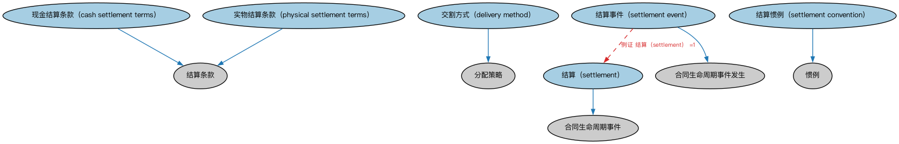

# 结算本体（Settlement Ontology）结构与公理说明

本文档对应 `Settlement.rdf` / `Settlement.ttl`，说明该本体的类、继承关系、属性和公理约定。结构图见 `Settlement-structure.png`（`Settlement-structure.svg` 为可缩放版本）。

## 1. 本体概述

定义交易结算（settlement）：券款对付（DVP）、结算日期、结算方式与结算参与方。

**在体系中的位置**：FBC 金融工具模块的配套本体，覆盖交易生命周期的最后环节。

**上下游关系**：上游依赖金融工具、金融日期与付款计划表本体；下游被证券交易、清算机构建模引用。

**与相近概念的差别**：结算≠交易——交易是达成买卖协议，结算是协议的实际履行（交钱交券）；T+1、T+2 等表述的就是成交到结算的间隔。

本本体中类与类的核心关系如下（完整细节见各类小节）：

- **现金结算条款（cash settlement terms）** 继承 **结算条款（SettlementTerms）**
- **交割方式（delivery method）** 继承 **分配策略（DistributionStrategy）**
- **实物结算条款（physical settlement terms）** 继承 **结算条款（SettlementTerms）**
- **结算（settlement）** 继承 **合同生命周期事件（ContractLifecycleEvent）**
- **结算惯例（settlement convention）** 继承 **惯例（Convention）**
- **结算事件（settlement event）** 继承 **合同生命周期事件发生（ContractLifecycleEventOccurrence）**

## 2. 类（Class）

| 类（Class） | 定义（Definition） |
|---|---|
| 现金结算条款（cash settlement terms） | 以现金方式结算的合同承诺。 contractual commitment to settle in cash |
| 交割方式（delivery method） | 按合同结算条款转让商品、货币、证券、现金或其他工具的方式与承诺。 method and commitment to transfer a commodity, currency, security, cash or another instrument as defined in the settlement terms of the contract |
| 实物结算条款（physical settlement terms） | 承诺在指定交割日交付实际标的资产，而非现金。 commitment to deliver the actual underlying asset on the specified delivery date, rather than cash |
| 结算（settlement） | 完成交易的行为，包括但不限于完成账务处理、交换对价以及依法登记文件等。 act of finalizing a transaction, including but not limited to finalizing accounting, exchanging consideration, and/or legally recording documents, as applicable |
| 结算惯例（settlement convention） | 在证券或工具交易结算过程中，用于（根据既定结算日）确定截止日期的惯例。 convention employed to determine the closing date (from the stated settlement date) in the process of settling a transaction on which securities or interests in securities are delivered, usually against (in simultaneous exchange for) payment of some consideration |
| 结算事件（settlement event） | 完成交易或其一部分的具体事件，包括但不限于完成账务处理、交换对价等。 specific event involving the finalization a transaction or portion thereof, including but not limited to finalizing accounting, exchanging consideration, and/or legally recording documents, as applicable |

以下按类逐个展开：每个类给出继承关系、相关属性与公理约定；子类在父类之下降一级编号。

### 2.1 现金结算条款（cash settlement terms）

定义：以现金方式结算的合同承诺。

- 父类：**结算条款（SettlementTerms）**

属性：

| 属性 | 定义 | 说明 |
|---|---|---|
| **具有结算方式（has settlement method）** | 从交割角度规定结算策略。 specifies the strategy for settlement from a delivery perspective | 值域：交割方式（delivery method）；子属性：具有战略 |
| **具有结算金额（has settlement amount）** | 指明现金结算所需的货币金额。 indicates the monetary amount required for cash settlement | 值域：货币数量；子属性：具有货币数量 |
| **具有价格（hasPrice）** | — | — |

公理：

- **具有价格（hasPrice）**可以有 0 个或多个**证券价格（SecurityPrice）**。
- **具有结算方式（has settlement method）**的取值固定为 DeliveryInCash。
- **具有结算金额（has settlement amount）**至少有一个取值，类型是**货币数量（MonetaryAmount）**。

### 2.2 交割方式（delivery method）

定义：按合同结算条款转让商品、货币、证券、现金或其他工具的方式与承诺。

- 父类：**分配策略（DistributionStrategy）**

### 2.3 实物结算条款（physical settlement terms）

定义：承诺在指定交割日交付实际标的资产，而非现金。

- 父类：**结算条款（SettlementTerms）**

属性：

| 属性 | 定义 | 说明 |
|---|---|---|
| **具有结算方式（has settlement method）** | 从交割角度规定结算策略。 specifies the strategy for settlement from a delivery perspective | 值域：交割方式（delivery method）；子属性：具有战略 |

公理：

- **具有结算方式（has settlement method）**的取值固定为 PhysicalDeliveryMethod。

### 2.4 结算（settlement）

定义：完成交易的行为，包括但不限于完成账务处理、交换对价以及依法登记文件等。

- 父类：**合同生命周期事件（ContractLifecycleEvent）**

### 2.5 结算惯例（settlement convention）

定义：在证券或工具交易结算过程中，用于（根据既定结算日）确定截止日期的惯例。

- 父类：**惯例（Convention）**

属性：

| 属性 | 定义 | 说明 |
|---|---|---|
| **具有数值（hasNumericValue）** | — | — |

公理：

- **具有数值（hasNumericValue）**至少有一个取值，类型是**xsd:positiveInteger（positiveInteger）**。

### 2.6 结算事件（settlement event）

定义：完成交易或其一部分的具体事件，包括但不限于完成账务处理、交换对价等。

- 父类：**合同生命周期事件发生（ContractLifecycleEventOccurrence）**

属性：

| 属性 | 定义 | 说明 |
|---|---|---|
| **具有价格（hasPrice）** | — | — |
| **例证（exemplifies）** | — | — |
| **涉及（involves）** | — | — |

公理：

- **例证（exemplifies）**恰好有 1 个**结算（settlement）**。
- **具有价格（hasPrice）**可以有 0 个或多个**证券价格（SecurityPrice）**。
- **涉及（involves）**可以有 0 个或多个**价值评估（ValueAssessment）**。

## 3. 其他属性

以下属性未绑定到本体的具体类（定义域在外部本体或未声明）：

对象属性（Object Property）：

| 属性 | 定义 | 说明 |
|---|---|---|
| **具有首选结算货币（has preferred settlement currency）** | 指明结算所用的首选货币。 indicates the preferred currency for settlement purposes | 值域：货币；子属性：具有货币 |

数据属性（Datatype Property）：

| 属性 | 定义 |
|---|---|
| **是否允许零碎份额（is fractional eligible）** | 表明该证券是否可以包含零碎份额或零碎数量。 indicates whether the security can contain fractional share/amounts |
| **是否适用全自动证券过户（is fully automated securities transfer applicable）** | 表明该证券是否作为 FAST（全自动证券过户）计划的一部分由过户代理机构持有。 indicates whether the security is to be held at the transfer agent as part of the FAST (Fully Automated Securities Transfer) program |

## 4. 依赖（owl:imports，13 个）

本本体通过 `owl:imports` 引入以下本体，各项的中文名称与简介如下：

| 导入本体 | 中文名称 | 简介 |
|---|---|---|
| `FBC/FinancialInstruments/InstrumentPricing.rdf` | 工具定价本体（Instrument Pricing Ontology） | 定义金融工具的价格、报价与估值概念。 |
| `FBC/ProductsAndServices/FinancialProductsAndServices.rdf` | 金融产品与服务本体（Financial Products and Services Ontology） | 定义金融产品（financial product）与金融服务（financial service）及其提供、购买关系。 |
| `FND/Accounting/CurrencyAmount.rdf` | 货币金额本体（Currency Amount Ontology） | 定义「金额＋币种」的货币金额（currency amount）表示，是 FIBO 中表达价格、债务金额、付款额等一切带币种数值的基础构件。 |
| `FND/Agreements/Contracts.rdf` | 合同本体（Contracts Ontology） | 在协议之上定义具有法律约束力的合同（contract）：合同当事方、合同条款、义务与权利，是金融工具与交易合同建模的基石。 |
| `FND/DatesAndTimes/BusinessDates.rdf` | 营业日期本体（Business Dates Ontology） | 定义营业日、营业日历与日期调整规则（如顺延约定），支撑金融合同中的营业日计算。 |
| `FND/DatesAndTimes/Occurrences.rdf` | 事件与发生本体（Occurrences Ontology） | 定义「发生」（occurrence）、事件与触发条件，用于表达企业行动、信用事件等「发生了什么」。 |
| `FND/GoalsAndObjectives/Objectives.rdf` | 目标本体（Objectives Ontology） | 定义目标（objective）及其与组织、计划的关系，用于表达机构的经营目标与投资目标。 |
| `FND/Relations/Relations.rdf` | 关系本体（Relations Ontology） | FIBO 最底层的基础本体，定义参考（reference）、分类（classify）等通用关系与抽象概念，全库普遍依赖。 |
| `FND/Utilities/AnnotationVocabulary.rdf` | FIBO 标注词汇表（FIBO Annotation Vocabulary） | 定义 FIBO 专用的标注属性（如释义来源、成熟度等级），用于本体自身的元数据标注。 |
| `https://www.omg.org/spec/Commons/AnnotationVocabulary/` | OMG 通用标注词汇表（OMG Commons Annotation Vocabulary） | OMG 通用本体库（Commons）中的标注词汇表，提供概念映射等标注属性，FIBO 用它标注术语与外部标准的对应关系。 |
| `https://www.omg.org/spec/Commons/ContextualDesignators/` | OMG 通用语境指称本体（OMG Commons Contextual Designators） | Commons 库中的语境指称本体，定义「在某个语境下指代某物的名称/符号」，是地址、账户号码等语境相关标识的基础。 |
| `https://www.omg.org/spec/Commons/Documents/` | OMG 通用文档本体（OMG Commons Documents） | Commons 库中的文档本体，定义文档及其组成部分的通用概念。 |
| `https://www.omg.org/spec/Commons/QuantitiesAndUnits/` | OMG 通用量与单位本体（OMG Commons Quantities and Units） | Commons 库中的量与单位本体，定义数量、度量单位、量纲的通用概念，支撑金额、比率等数值表达。 |

## 5. 文件

- 官方 RDF/XML：`Settlement.rdf`
- 中文 Turtle：`Settlement.ttl`
- 结构图：`Settlement-structure.png` / `Settlement-structure.svg`