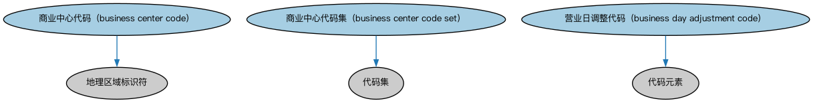

# 商业中心本体（Business Centers Ontology）结构与公理说明

本文档对应 `BusinessCenters.rdf` / `BusinessCenters.ttl`，说明该本体的类、继承关系、属性和公理约定。结构图见 `BusinessCenters-structure.png`（`BusinessCenters-structure.svg` 为可缩放版本）。

## 1. 本体概述

定义商业中心（business center）：金融中心、商业中心等功能性地点概念，用于确定市场所在地与营业日历。

**在体系中的位置**：FBC 功能实体模块中处理「金融活动发生在哪里」的本体。

**上下游关系**：上游依赖 BE 功能实体与 FND 地点本体；下游配套的商业中心个体本体提供全球主要金融中心实例，市场本体用商业中心定位。

**与相近概念的差别**：商业中心≠法域——商业中心是市场功能意义上的地点（如「伦敦市场」），法域是法律效力范围；一个商业中心可能跨多个法域。

## 2. 类（Class）

| 类（Class） | 定义（Definition） |
|---|---|
| 商业中心代码（business center code） | 用于表示开展商业活动的都会区域的代码。 |
| 商业中心代码集（business center code set） | 用于定义城市或商业中心代码集合的编码方案。 |
| 营业日调整代码（business day adjustment code） | 用于表示当某日恰逢某城市或商业中心的周末或节假日时如何处理之惯例的代码。 |

### 2.1 继承关系（Inheritance）

- 商业中心代码（business center code） ⊑ 地理区域标识符
- 商业中心代码集（business center code set） ⊑ 代码集
- 营业日调整代码（business day adjustment code） ⊑ 代码元素

## 5. 公理约定（Axioms）

- 商业中心代码（business center code）：标识 some 商业中心
- 营业日调整代码（business day adjustment code）：标识 some 营业日惯例

## 6. 依赖（owl:imports，8 个）

本本体通过 `owl:imports` 引入以下本体，各项的中文名称与简介如下：

| 导入本体 | 中文名称 | 简介 |
|---|---|---|
| `FND/DatesAndTimes/BusinessDates.rdf` | 营业日期本体（Business Dates Ontology） | 定义营业日、营业日历与日期调整规则（如顺延约定），支撑金融合同中的营业日计算。 |
| `FND/Utilities/AnnotationVocabulary.rdf` | FIBO 标注词汇表（FIBO Annotation Vocabulary） | 定义 FIBO 专用的标注属性（如释义来源、成熟度等级），用于本体自身的元数据标注。 |
| `https://www.omg.org/spec/Commons/AnnotationVocabulary/` | OMG 通用标注词汇表（OMG Commons Annotation Vocabulary） | OMG 通用本体库（Commons）中的标注词汇表，提供概念映射等标注属性，FIBO 用它标注术语与外部标准的对应关系。 |
| `https://www.omg.org/spec/Commons/CodesAndCodeSets/` | OMG 通用代码与代码集本体（OMG Commons Codes and Code Sets） | Commons 库中的代码本体，定义代码、代码集及其维护方的通用概念，是 ISO 4217、ISO 3166 等编码体系建模的基础。 |
| `https://www.omg.org/spec/Commons/Collections/` | OMG 通用集合本体（OMG Commons Collections） | Commons 库中的集合本体，定义集合、成员等通用概念。 |
| `https://www.omg.org/spec/Commons/Designators/` | OMG 通用指称符本体（OMG Commons Designators） | Commons 库中的指称符本体，定义名称、标识符等「指代某物的符号」的通用概念。 |
| `https://www.omg.org/spec/Commons/Identifiers/` | OMG 通用标识符本体（OMG Commons Identifiers） | Commons 库中的标识符本体，定义标识符及其编码方案的通用概念。 |
| `https://www.omg.org/spec/Commons/Locations/` | OMG 通用位置本体（OMG Commons Locations） | Commons 库中的位置本体，定义地理位置、地点的通用概念。 |

## 7. 文件

- 官方 RDF/XML：`BusinessCenters.rdf`
- 中文 Turtle：`BusinessCenters.ttl`
- 结构图：`BusinessCenters-structure.png` / `BusinessCenters-structure.svg`