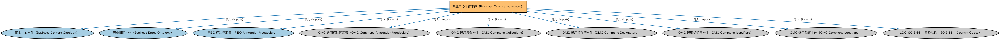

# 商业中心个体本体（Business Centers Individuals）说明

本文档对应 `BusinessCentersIndividuals.rdf` / `BusinessCentersIndividuals.ttl`。

## 1. 本文件是什么

收录全球主要商业中心（如纽约、伦敦、东京）的参考个体。

从机制上说，这是一个个体（individuals）文件：它本身不定义任何新的类或属性，装的全是命名个体（owl:NamedIndividual）——也就是一条条真实存在的实例数据（如具体的货币、市场、监管机构、法域）。它的 `owl:imports` 引入的是这些个体所属的类定义所在的本体。应用需要实例级参考数据时加载这类文件。

## 2. 个体构成（共 618 个）

按个体所属类型统计（类型名为中文（English）对照）：

| 类型（Class） | 个体数量 |
|---|---|
| 市政区（Municipality） | 211 |
| 商业中心代码（BusinessCenterCode） | 195 |
| 商业中心（BusinessCenter） | 195 |
| 营业日调整代码（BusinessDayAdjustmentCode） | 8 |
| 营业日惯例（BusinessDayConvention） | 8 |
| 商业中心代码集（BusinessCenterCodeScheme） | 1 |

个体数量较多，仅举前 10 个示例，完整清单见同名 `.ttl` 文件：

| 个体（示例） | 类型 |
|---|---|
| AEAB | 营业日调整代码（BusinessDayAdjustmentCode） |
| AEAD | 营业日调整代码（BusinessDayAdjustmentCode） |
| AEDU | 商业中心代码（BusinessCenterCode） |
| AMYE | 商业中心代码（BusinessCenterCode） |
| AOLU | 商业中心代码（BusinessCenterCode） |
| ARBA | 商业中心代码（BusinessCenterCode） |
| ATVI | 商业中心代码（BusinessCenterCode） |
| AUAD | 商业中心代码（BusinessCenterCode） |
| AUBR | 商业中心代码（BusinessCenterCode） |
| AUCA | 商业中心代码（BusinessCenterCode） |

## 3. 依赖的本体（owl:imports，9 个）

以下导入提供个体所属的类定义与相关参考数据：

| 导入本体 | 中文名称 | 简介 |
|---|---|---|
| `FBC/FunctionalEntities/BusinessCenters.rdf` | 商业中心本体（Business Centers Ontology） | 定义金融中心、商业中心等功能性地点概念，用于确定市场所在地与营业日历。 |
| `FND/DatesAndTimes/BusinessDates.rdf` | 营业日期本体（Business Dates Ontology） | 定义营业日、营业日历与日期调整规则（如顺延约定），支撑金融合同中的营业日计算。 |
| `FND/Utilities/AnnotationVocabulary.rdf` | FIBO 标注词汇表（FIBO Annotation Vocabulary） | 定义 FIBO 专用的标注属性（如释义来源、成熟度等级），用于本体自身的元数据标注。 |
| `https://www.omg.org/spec/Commons/AnnotationVocabulary/` | OMG 通用标注词汇表（OMG Commons Annotation Vocabulary） | OMG 通用本体库（Commons）中的标注词汇表，提供概念映射等标注属性，FIBO 用它标注术语与外部标准的对应关系。 |
| `https://www.omg.org/spec/Commons/Collections/` | OMG 通用集合本体（OMG Commons Collections） | Commons 库中的集合本体，定义集合、成员等通用概念。 |
| `https://www.omg.org/spec/Commons/Designators/` | OMG 通用指称符本体（OMG Commons Designators） | Commons 库中的指称符本体，定义名称、标识符等「指代某物的符号」的通用概念。 |
| `https://www.omg.org/spec/Commons/Identifiers/` | OMG 通用标识符本体（OMG Commons Identifiers） | Commons 库中的标识符本体，定义标识符及其编码方案的通用概念。 |
| `https://www.omg.org/spec/Commons/Locations/` | OMG 通用位置本体（OMG Commons Locations） | Commons 库中的位置本体，定义地理位置、地点的通用概念。 |
| `https://www.omg.org/spec/LCC/Countries/ISO3166-1-CountryCodes/` | LCC ISO 3166-1 国家代码（ISO 3166-1 Country Codes） | LCC 中 ISO 3166-1 标准的国家/地区代码个体集（如 CN、US、MX），供法域与地址建模引用。 |

## 4. 文件

- 官方 RDF/XML：`BusinessCentersIndividuals.rdf`
- 中文 Turtle：`BusinessCentersIndividuals.ttl`
- 结构图：`BusinessCentersIndividuals-structure.png` / `BusinessCentersIndividuals-structure.svg`