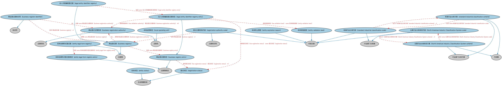

# 商业登记机构本体（Business Registries Ontology）结构与公理说明

本文档对应 `BusinessRegistries.rdf` / `BusinessRegistries.ttl`，说明该本体的类、继承关系、属性和公理约定。结构图见 `BusinessRegistries-structure.png`（`BusinessRegistries-structure.svg` 为可缩放版本）。

## 1. 本体概述

定义商业登记机构（business registry）：负责企业注册登记的机构（如州务卿办公室、公司注册处）及其登记职能。

**在体系中的位置**：FBC 功能实体模块中处理「企业在哪里登记」的本体。

**上下游关系**：上游依赖 BE 功能实体与登记主管机构相关概念；下游配套商事登记主管机关本体及其个体数据。

**与相近概念的差别**：登记机构≠监管机构——登记机构负责「记录主体存在」（发照注册），监管机构负责「监督行为合规」；与 LEI 登记的差别——LEI 是身份编码登记，商业登记是法人设立登记。

本本体中类与类的核心关系如下（完整细节见各类小节）：

- **北美行业分类体系代码（North American Industry Classification System code）** 继承 **行业部门分类器（IndustrySectorClassifier）**
- **北美行业分类体系代码（North American Industry Classification System code）** 继承 **代码元素（CodeElement）**
- **北美行业分类体系方案（North American Industry Classification System scheme）** 继承 **行业部门分类方案（IndustrySectorClassificationScheme）**
- **北美行业分类体系方案（North American Industry Classification System scheme）** 继承 **代码集（CodeSet）**
- **商业登记册标识符（business register identifier）** 继承 **标识符（Identifier）**
- **商业登记主管机构（business registration authority）** 继承 **注册员（Registrar）**
- **商业登记主管机构（business registration authority）** 继承 **注册机构（RegistrationAuthority）**
- **商业登记册（business registry）** 继承 **注册簿（Registry）**
- **商业登记册条目（business registry entry）** 继承 **注册簿条目（RegistryEntry）**
- **实体终止原因（entity expiration reason）** 继承 **代码元素（CodeElement）**
- **实体法律形式登记册（entity legal form registry）** 继承 **注册簿（Registry）**
- **实体法律形式登记册条目（entity legal form registry entry）** 继承 **注册簿条目（RegistryEntry）**
- 其余 12 条关系从略。

## 2. 类（Class）

| 类（Class） | 定义（Definition） |
|---|---|
| 北美行业分类体系代码（North American Industry Classification System code） | 代表某一行业的北美行业分类体系（NAICS）代码。 the North American Industry Classification System (NAICS) code representing an industry |
| 北美行业分类体系方案（North American Industry Classification System scheme） | 定义北美行业分类体系（NAICS）代码的方案。 the scheme defining the North American Industry Classification System (NAICS) Codes |
| 商业登记册标识符（business register identifier） | 唯一标识商业登记册的标识符，例如由全球法人识别编码基金会（GLEIF）登记册标识的登记册。 identifier that uniquely identifies a business register, such as a register identified by the Global Legal Entity Identifier Foundation (GLEIF) registration authorities list |
| 商业登记主管机构（business registration authority） | 负责维护商业实体登记册的登记主管机构。 registration authority that is responsible for maintaining a registry of business entities |
| 商业登记册（business registry） | 用于登记和维护商业实体信息的登记册。 registry for registering and maintaining information about business entities |
| 商业登记册条目（business registry entry） | 商业登记册中的一条记录。 entry in a business registry |
| 实体终止原因（entity expiration reason） | 表示法律实体终止存在和/或终止运营原因的代码。 code for the reason that a legal entity ceased to exist and/or operate |
| 实体法律形式登记册（entity legal form registry） | 按照特定司法管辖区规定，登记和维护商业实体有效法律形式信息的登记册。 registry for registering and maintaining information about the legal forms that are valid for business entities for a particular jurisdiction following the ISO 20275 standard |
| 实体法律形式登记册条目（entity legal form registry entry） | 符合 ISO 20275 标准的实体法律形式登记册记录。 entry in an entity legal form registry that conforms to ISO 20275 |
| 实体状态（entity status） | 表明实体运营和/或法律状态的生命周期阶段。 lifecycle stage indicating the operational and/or legal status of an entity |
| 实体核验级别（entity validation level） | 表示全球法人识别编码基金会（GLEIF）或本地运营单位（LOU）对注册人提供的参考数据所执行核验级别的代码。 code for the level of validation performed by the GLEIF or LOU with respect to the reference data provided by the registrant |
| 法人识别编码登记册（legal entity identifier registry） | 为特定司法管辖区登记和维护商业实体信息的登记册。 registry for registering and maintaining information about business entities for a particular jurisdiction |
| 法人识别编码登记册条目（legal entity identifier registry entry） | 符合 ISO 17442 及全球法人识别编码基金会（GLEIF）通用数据格式（CDF）的登记册记录。 entry in a legal entity identifier registry that conforms to ISO 17442 and the Global Legal Entity Identifier Foundation (GLEIF) Common Data Format (CDF) |
| 本地运营单位（local operating unit） | 经全球法人识别编码基金会授权、可签发法人识别编码（LEI）的注册机构。 registrar that is authorized by the Global LEI Foundation to issue legal entity identifiers |
| 登记主管机构代码（registration authority code） | 唯一标识商业登记册、并与登记主管机构和司法管辖区相关联的标识符，由全球法人识别编码基金会签发。 identifier that uniquely identifies a business registry, and is associated with a registration authority and jurisdiction, issued by the Global Legal Entity Identifier Foundation (GLEIF) |
| 登记状态（registration status） | 表明某事物（如企业或法律实体）特定登记状态的生命周期阶段，由登记主管机构规定。 lifecycle stage indicating the status of a given registration of something, such as a business or legal entity, as specified by the registration authority |
| 标准行业分类代码（standard industrial classification code） | 代表某一行业的标准行业分类（SIC）代码。 the SIC code representing an industry |
| 标准行业分类方案（standard industrial classification scheme） | 定义标准行业分类（SIC）代码表的方案。 the scheme defining the Standard Industrial Classification (SIC) Code List |

以下按类逐个展开：每个类给出继承关系、相关属性与公理约定；子类在父类之下降一级编号。

### 2.1 北美行业分类体系代码（North American Industry Classification System code）

定义：代表某一行业的北美行业分类体系（NAICS）代码。

- 父类：**行业部门分类器（IndustrySectorClassifier）**、**代码元素（CodeElement）**

属性：

| 属性 | 定义 | 说明 |
|---|---|---|
| **分类（classifies）** | — | — |
| **具有标签（hasTag）** | — | — |
| **定义于（isDefinedIn）** | — | — |

公理：

- **具有标签（hasTag）**存在取值约束。
- **分类（classifies）**至少有一个取值，类型是**正式组织（FormalOrganization）**。
- **定义于（isDefinedIn）**恰好有 1 个**北美行业分类体系方案（North American Industry Classification System scheme）**。

### 2.2 北美行业分类体系方案（North American Industry Classification System scheme）

定义：定义北美行业分类体系（NAICS）代码的方案。

- 父类：**行业部门分类方案（IndustrySectorClassificationScheme）**、**代码集（CodeSet）**

属性：

| 属性 | 定义 | 说明 |
|---|---|---|
| **定义（defines）** | — | — |

公理：

- **定义（defines）**至少有一个取值，类型是**北美行业分类体系代码（North American Industry Classification System code）**。

### 2.3 商业登记册标识符（business register identifier）

定义：唯一标识商业登记册的标识符，例如由全球法人识别编码基金会（GLEIF）登记册标识的登记册。

- 父类：**标识符（Identifier）**

属性：

| 属性 | 定义 | 说明 |
|---|---|---|
| **标识（identifies）** | — | — |
| **由……注册（isRegisteredBy）** | — | — |

公理：

- **标识（identifies）**恰好有 1 个**商业登记册（business registry）**。
- **由……注册（isRegisteredBy）**至少有一个取值，类型是**商业登记主管机构（business registration authority）**。

### 2.4 商业登记主管机构（business registration authority）

定义：负责维护商业实体登记册的登记主管机构。

- 父类：**注册员（Registrar）**、**注册机构（RegistrationAuthority）**

属性：

| 属性 | 定义 | 说明 |
|---|---|---|
| **管理（manages）** | — | — |
| **登记（registers）** | — | — |

公理：

- **登记（registers）**至少有一个取值，类型是**注册标识符（RegistrationIdentifier）**。
- **管理（manages）**至少有一个取值，类型是**商业登记册（business registry）**。

### 2.5 商业登记册（business registry）

定义：用于登记和维护商业实体信息的登记册。

- 父类：**注册簿（Registry）**
- 直接子类：**法人识别编码登记册（legal entity identifier registry）**

属性：

| 属性 | 定义 | 说明 |
|---|---|---|
| **具有登记册名称（has registry name）** | 表示登记册的名称，例如登记法律实体商业登记标识符的商业登记册。 denotes a name for the registry, for example, for a business registry in which a business registration identifier for the legal entity is registered | 子属性：具有文本名称 |
| **包含（comprises）** | — | — |
| **由……管理（isManagedBy）** | — | — |

公理：

- **具有登记册名称（has registry name）**存在取值约束。
- **包含（comprises）**至少有一个取值，类型是**商业登记册条目（business registry entry）**。
- **由……管理（isManagedBy）**恰好有 1 个**商业登记主管机构（business registration authority）**。

#### 2.5.1 法人识别编码登记册（legal entity identifier registry）

定义：为特定司法管辖区登记和维护商业实体信息的登记册。

- 父类：**商业登记册（business registry）**

属性：

| 属性 | 定义 | 说明 |
|---|---|---|
| **包含（comprises）** | — | — |

公理：

- **包含（comprises）**至少有一个取值，类型是**法人识别编码登记册条目（legal entity identifier registry entry）**。

### 2.6 商业登记册条目（business registry entry）

定义：商业登记册中的一条记录。

- 父类：**注册簿条目（RegistryEntry）**
- 直接子类：**法人识别编码登记册条目（legal entity identifier registry entry）**

属性：

| 属性 | 定义 | 说明 |
|---|---|---|
| **具有登记状态（has registration status）** | 指明特定登记（如标识符或许可证的登记）的状态。 indicates the status of a specific registration, such as for an identifier or license | 值域：登记状态（registration status）；子属性：具有阶段 |
| **包含（comprises）** | — | — |
| **具有注册日期（hasRegistrationDate）** | — | — |

公理：

- **具有注册日期（hasRegistrationDate）**至少有一个取值，类型是**cmns-dt:CombinedDateTime（CombinedDateTime）**。
- **具有登记状态（has registration status）**至多有 1 个**登记状态（registration status）**。
- **包含（comprises）**至少有一个取值，类型是**注册标识符（RegistrationIdentifier）**。

#### 2.6.1 法人识别编码登记册条目（legal entity identifier registry entry）

定义：符合 ISO 17442 及全球法人识别编码基金会（GLEIF）通用数据格式（CDF）的登记册记录。

- 父类：**商业登记册条目（business registry entry）**

属性：

| 属性 | 定义 | 说明 |
|---|---|---|
| **具有管理本地运营单位（has managing local operating unit）** | 将法人识别记录与注册相关法人识别编码的本地运营单位标识符关联起来。 relates a legal entity identification record to the identifier for the local operating unit that registered the relevant legal entity identifier | — |
| **具有登记状态（has registration status）** | 指明特定登记（如标识符或许可证的登记）的状态。 indicates the status of a specific registration, such as for an identifier or license | 值域：登记状态（registration status）；子属性：具有阶段 |
| **具有核验机构（has validation authority）** | 标识法律实体的商业登记主管机构，本地运营单位（LOU）以其作为核验依据。 identifies the business registration authority for the legal entity, used by the Local Operating Unit (LOU) as the basis for validation, as defined in the GLEIF Registration Authorities List | 值域：商业登记主管机构（business registration authority）；子属性：具有参与方角色（has party role） |
| **具有核验级别（has validation level）** | 指明注册机构对法律实体执行的核验级别。 indicates the level of validation performed by the registrar with respect to the legal entity | 值域：实体核验级别（entity validation level） |
| **包含（comprises）** | — | — |

公理：

- **具有核验机构（has validation authority）**可以有 0 个或多个**商业登记主管机构（business registration authority）**。
- **具有核验级别（has validation level）**至少有一个取值，类型是**实体核验级别（entity validation level）**。
- **具有登记状态（has registration status）**至少有一个取值，类型是**登记状态（registration status）**。
- **具有管理本地运营单位（has managing local operating unit）**的所有取值只能是**法律实体标识符（LegalEntityIdentifier）**。
- **包含（comprises）**至少有一个取值，类型是**法律实体标识符（LegalEntityIdentifier）**。

### 2.7 实体终止原因（entity expiration reason）

定义：表示法律实体终止存在和/或终止运营原因的代码。

- 父类：**代码元素（CodeElement）**

属性：

| 属性 | 定义 | 说明 |
|---|---|---|
| **具有标签（hasTag）** | — | — |

公理：

- **具有标签（hasTag）**存在取值约束。

### 2.8 实体法律形式登记册（entity legal form registry）

定义：按照特定司法管辖区规定，登记和维护商业实体有效法律形式信息的登记册。

- 父类：**注册簿（Registry）**

属性：

| 属性 | 定义 | 说明 |
|---|---|---|
| **包含（comprises）** | — | — |

公理：

- **包含（comprises）**至少有一个取值，类型是**实体法律形式登记册条目（entity legal form registry entry）**。

### 2.9 实体法律形式登记册条目（entity legal form registry entry）

定义：符合 ISO 20275 标准的实体法律形式登记册记录。

- 父类：**注册簿条目（RegistryEntry）**

属性：

| 属性 | 定义 | 说明 |
|---|---|---|
| **包含（comprises）** | — | — |

公理：

- **包含（comprises）**至少有一个取值，类型是**实体法律形式标识符（EntityLegalFormIdentifier）**。

### 2.10 实体状态（entity status）

定义：表明实体运营和/或法律状态的生命周期阶段。

- 父类：**生命周期阶段（LifecycleStage）**

### 2.11 实体核验级别（entity validation level）

定义：表示全球法人识别编码基金会（GLEIF）或本地运营单位（LOU）对注册人提供的参考数据所执行核验级别的代码。

- 父类：**代码元素（CodeElement）**

属性：

| 属性 | 定义 | 说明 |
|---|---|---|
| **具有标签（hasTag）** | — | — |

公理：

- **具有标签（hasTag）**存在取值约束。

### 2.12 本地运营单位（local operating unit）

定义：经全球法人识别编码基金会授权、可签发法人识别编码（LEI）的注册机构。

- 父类：**注册员（Registrar）**

属性：

| 属性 | 定义 | 说明 |
|---|---|---|
| **发行（issues）** | — | — |
| **登记（registers）** | — | — |

公理：

- **发行（issues）**至少有一个取值，类型是**法律实体标识符（LegalEntityIdentifier）**。
- **登记（registers）**至少有一个取值，类型是**法律实体标识符（LegalEntityIdentifier）**。

### 2.13 登记主管机构代码（registration authority code）

定义：唯一标识商业登记册、并与登记主管机构和司法管辖区相关联的标识符，由全球法人识别编码基金会签发。

- 父类：**代码元素（CodeElement）**、**注册标识符（RegisteredIdentifier）**

属性：

| 属性 | 定义 | 说明 |
|---|---|---|
| **标识（identifies）** | — | — |

公理：

- **标识（identifies）**恰好有 1 个**商业登记册（business registry）**。

### 2.14 登记状态（registration status）

定义：表明某事物（如企业或法律实体）特定登记状态的生命周期阶段，由登记主管机构规定。

- 父类：**生命周期阶段（LifecycleStage）**

### 2.15 标准行业分类代码（standard industrial classification code）

定义：代表某一行业的标准行业分类（SIC）代码。

- 父类：**行业部门分类器（IndustrySectorClassifier）**、**代码元素（CodeElement）**

属性：

| 属性 | 定义 | 说明 |
|---|---|---|
| **分类（classifies）** | — | — |
| **具有标签（hasTag）** | — | — |
| **定义于（isDefinedIn）** | — | — |

公理：

- **具有标签（hasTag）**存在取值约束。
- **分类（classifies）**至少有一个取值，类型是**正式组织（FormalOrganization）**。
- **定义于（isDefinedIn）**恰好有 1 个**标准行业分类方案（standard industrial classification scheme）**。

### 2.16 标准行业分类方案（standard industrial classification scheme）

定义：定义标准行业分类（SIC）代码表的方案。

- 父类：**行业部门分类方案（IndustrySectorClassificationScheme）**、**代码集（CodeSet）**

属性：

| 属性 | 定义 | 说明 |
|---|---|---|
| **定义（defines）** | — | — |

公理：

- **定义（defines）**至少有一个取值，类型是**标准行业分类代码（standard industrial classification code）**。

## 3. 其他属性

以下属性未绑定到本体的具体类（定义域在外部本体或未声明）：

对象属性（Object Property）：

| 属性 | 定义 | 说明 |
|---|---|---|
| **具有实体终止原因（has entity expiration reason）** | 指明实体终止存在的原因（如解散、与其他实体合并等）。 indicates the reason that an entity ceased to exist (i.e., disolved, merged with another entity, etc.) | 值域：实体终止原因（entity expiration reason）；子属性：由……表示 |
| **具有实体状态（has entity status）** | 指明实体的状态（如存续、注销）。 indicates the status of the entity (i.e., active, inactive) | 值域：实体状态（entity status）；子属性：具有阶段 |

数据属性（Datatype Property）：

| 属性 | 定义 |
|---|---|
| **具有替代语言法定名称（has alternative language legal name）** | 表示实体在其注册司法管辖区所使用的替代语言的注册法定名称。 denotes a registered legal name for the entity in an alternative language used in the legal jurisdiction in which the entity is registered |
| **具有自动转写法定名称（has automatically transliterated legal name）** | 表示实体法定名称的自动生成的 ASCII 转写形式。 denotes an auto-generated ASCII-transliterated representation of the legal name for the entity |
| **具有实体终止日期（has entity expiration date）** | 指明实体终止存在的日期。 indicates the date on which an entity ceases(d) to exist |
| **具有到期日（has expiry date）** | 指明某事物终止存在的日期。 indicates the date on which something ceases(d) to exist |
| **具有初始登记日期（has initial registration date）** | 指明标识符或其他登记项目创建和/或首次登记的日期。 indicates the date on which an identifier or other registered item was created and/or first registered |
| **具有首选转写法定名称（has preferred transliterated legal name）** | 表示实体法定名称的首选 ASCII 转写形式。 denotes a preferred ASCII-transliterated representation of the legal name for the entity |
| **具有曾用法定名称（has prior legal name）** | 表示实体此前使用过的主要法定名称。 denotes a primary legal name that was used previously for the entity |
| **具有登记状态修订日期（has registration status revision date）** | 指明登记册中特定登记状态被修订的日期。 indicates the date that the status of a specific registration in the registry was revised |
| **具有续展日期（has renewal date）** | 指明登记册中特定登记须续展或更新的日期。 indicates the date by which a specific registration in the registry must be renewed or updated |
| **具有经营名称（has trading or operational name）** | 表示实体当前使用的「以……名义经营」「品牌名」等名称，该名称是对法定名称的补充而非替代。 denotes a 'trading as', 'brand name', 'doing business as', or 'operating under' name currently used by the entity in addition to, but not replacing, the (primary) legal, official registered name |
| **具有转写法定名称（has transliterated legal name）** | 表示实体法定名称的可选 ASCII 转写（即拉丁化/罗马化）形式。 denotes an optional ASCII-transliterated (i.e. Latin- or Romanized) representation of the legal name for the entity |
| **具有核验日期（has validation date）** | 指明登记册中特定登记最近一次被审核和核验的日期。 indicates the date that a specific registration in the registry was most recently reviewed and validated |
| **是否自行维护（is self-maintained）** | 表明实体信息是由内部维护还是由第三方维护。 indicates whether the information about the entity is maintained internally or by a third-party |

## 4. 依赖（owl:imports，20 个）

本本体通过 `owl:imports` 引入以下本体，各项的中文名称与简介如下：

| 导入本体 | 中文名称 | 简介 |
|---|---|---|
| `BE/LegalEntities/CorporateBodies.rdf` | 法人团体本体（Corporate Bodies Ontology） | 定义依法设立、具有独立法律人格的法人团体（corporate body），是股份有限公司等具体法人类型的上位概念。 |
| `BE/LegalEntities/FormalBusinessOrganizations.rdf` | 正式商业组织本体（Formal Business Organizations Ontology） | 定义以营利为目的、依法注册的正式商业组织，连接法律实体与其商业功能。 |
| `BE/LegalEntities/LEIEntities.rdf` | LEI 法人实体本体（Legal Entity Identifier Entities Ontology） | 定义持有全球法人识别编码（LEI）的法人实体，对接 ISO 17442 标准的 LEI 体系。 |
| `FBC/FunctionalEntities/FinancialServicesEntities.rdf` | 金融服务实体本体（Financial Services Entities Ontology） | FBC 域核心本体，定义金融服务机构（银行、券商、保险公司、资管机构等）的功能分类体系。 |
| `FND/AgentsAndPeople/People.rdf` | 人员本体（People Ontology） | 定义自然人（person）的核心属性：姓名、出生日期、国籍、身份标识与联系方式，为雇员、客户、签署人等角色提供「人」的基础模型。 |
| `FND/Arrangements/ClassificationSchemes.rdf` | 分类方案本体（Classification Schemes Ontology） | 定义分类方案（classification scheme）、类别及「将事物归入类别」的关系，支撑证券分类、行业分类等具体分类体系。 |
| `FND/Places/Addresses.rdf` | 地址本体（Addresses Ontology） | 定义邮政地址及其组成部分，为机构注册地、通讯地址建模。 |
| `FND/Relations/Relations.rdf` | 关系本体（Relations Ontology） | FIBO 最底层的基础本体，定义参考（reference）、分类（classify）等通用关系与抽象概念，全库普遍依赖。 |
| `FND/Utilities/AnnotationVocabulary.rdf` | FIBO 标注词汇表（FIBO Annotation Vocabulary） | 定义 FIBO 专用的标注属性（如释义来源、成熟度等级），用于本体自身的元数据标注。 |
| `https://www.omg.org/spec/Commons/AnnotationVocabulary/` | OMG 通用标注词汇表（OMG Commons Annotation Vocabulary） | OMG 通用本体库（Commons）中的标注词汇表，提供概念映射等标注属性，FIBO 用它标注术语与外部标准的对应关系。 |
| `https://www.omg.org/spec/Commons/Classifiers/` | OMG 通用分类器本体（OMG Commons Classifiers） | OMG 通用本体库（Commons）中的分类器本体，定义分类方案、类别与归类关系的通用概念，FIBO 的分类建模建立在其上。 |
| `https://www.omg.org/spec/Commons/CodesAndCodeSets/` | OMG 通用代码与代码集本体（OMG Commons Codes and Code Sets） | Commons 库中的代码本体，定义代码、代码集及其维护方的通用概念，是 ISO 4217、ISO 3166 等编码体系建模的基础。 |
| `https://www.omg.org/spec/Commons/Collections/` | OMG 通用集合本体（OMG Commons Collections） | Commons 库中的集合本体，定义集合、成员等通用概念。 |
| `https://www.omg.org/spec/Commons/DatesAndTimes/` | OMG 通用日期与时间本体（OMG Commons Dates and Times） | Commons 库中的日期时间本体，定义日期、期间、时间点等通用时间概念。 |
| `https://www.omg.org/spec/Commons/Designators/` | OMG 通用指称符本体（OMG Commons Designators） | Commons 库中的指称符本体，定义名称、标识符等「指代某物的符号」的通用概念。 |
| `https://www.omg.org/spec/Commons/Identifiers/` | OMG 通用标识符本体（OMG Commons Identifiers） | Commons 库中的标识符本体，定义标识符及其编码方案的通用概念。 |
| `https://www.omg.org/spec/Commons/Organizations/` | OMG 通用组织本体（OMG Commons Organizations） | Commons 库中的组织本体，定义组织、组织成员与组织结构的通用概念。 |
| `https://www.omg.org/spec/Commons/PartiesAndSituations/` | OMG 通用参与方与情境本体（OMG Commons Parties and Situations） | Commons 库中的参与方本体，定义独立主体、参与方及其角色扮演的通用概念，是 FIBO 参与方模型的上游。 |
| `https://www.omg.org/spec/Commons/RegistrationAuthorities/` | OMG 通用登记主管机构本体（OMG Commons Registration Authorities） | Commons 库中的登记主管机构本体，定义负责登记注册的主管机构及其登记行为的通用概念。 |
| `https://www.omg.org/spec/Commons/RolesAndCompositions/` | OMG 通用角色与构成本体（OMG Commons Roles and Compositions） | Commons 库中的角色本体，定义角色及整体—部分构成关系的通用概念。 |

## 5. 文件

- 官方 RDF/XML：`BusinessRegistries.rdf`
- 中文 Turtle：`BusinessRegistries.ttl`
- 结构图：`BusinessRegistries-structure.png` / `BusinessRegistries-structure.svg`