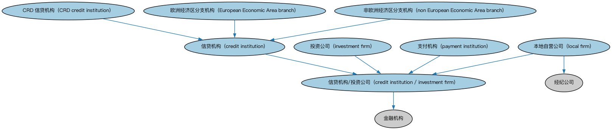

# 欧盟金融服务实体本体（EU Financial Services Entities Ontology）结构与公理说明

本文档对应 `EUFinancialServicesEntities.rdf` / `EUFinancialServicesEntities.ttl`，说明该本体的类、继承关系、属性和公理约定。结构图见 `EUFinancialServicesEntities-structure.png`（`EUFinancialServicesEntities-structure.svg` 为可缩放版本）。

## 1. 本体概述

定义欧盟法域下的金融服务机构类型与个体（如欧盟层面的银行、投资机构类别）。

**在体系中的位置**：FBC 功能实体模块的欧洲区域扩展，与北美扩展（美国、加拿大金融服务实体）平行。

**上下游关系**：上游继承金融服务实体本体并依赖 BE 欧盟法域个体；下游配套的欧洲个体本体提供具体机构实例。

**与相近概念的差别**：与美国金融服务实体本体的差别——监管框架不同：欧盟以牌照指令（如 MiFID）划分机构类型，美国以注册类型划分，两者机构分类不可直接对应。

本本体中类与类的核心关系如下（完整细节见各类小节）：

- **CRD 信贷机构（CRD credit institution）** 继承 **信贷机构（credit institution）**
- **欧洲经济区分支机构（European Economic Area branch）** 继承 **信贷机构（credit institution）**
- **信贷机构（credit institution）** 继承 **信贷机构/投资公司（credit institution / investment firm）**
- **信贷机构/投资公司（credit institution / investment firm）** 继承 **金融机构（FinancialInstitution）**
- **投资公司（investment firm）** 继承 **信贷机构/投资公司（credit institution / investment firm）**
- **本地自营公司（local firm）** 继承 **信贷机构/投资公司（credit institution / investment firm）**
- **本地自营公司（local firm）** 继承 **经纪公司（BrokerageFirm）**
- **非欧洲经济区分支机构（non European Economic Area branch）** 继承 **信贷机构（credit institution）**
- **支付机构（payment institution）** 继承 **信贷机构/投资公司（credit institution / investment firm）**

## 2. 类（Class）

| 类（Class） | 定义（Definition） |
|---|---|
| CRD 信贷机构（CRD credit institution） | 依资本要求指令（CRD）定义、业务为从公众吸收存款或其他可偿还资金并以自己名义发放信贷的企业。 an undertaking whose business is to receive deposits or other repayable funds from the public and to grant credits for its own account as defined by the European Banking Authority (EBA) |
| 欧洲经济区分支机构（European Economic Area branch） | 在另一欧洲经济区（EEA）国家获得授权、有权将其业务通行证化至其他成员国的信贷机构分支机构。 a branch of a credit institution authorised in another European Economic Area (EEA) country that has the right to passport its activities |
| 信贷机构（credit institution） | 业务为从公众吸收存款或其他可偿还资金并以自己名义发放信贷的企业。 an undertaking the business of which is to take deposits or other repayable funds from the public and to grant credits for its own account, and to which authorisation has been granted to operate within the European Union and European Economic Area countries (EEA) |
| 信贷机构/投资公司（credit institution / investment firm） | 欧洲金融机构特有的分类，依欧洲银行管理局（EBA）的定义将其指定为信贷机构/投资公司。 classification specific to European financial institutions that designates them as credit institutions / investment firms as defined by the European Banking Authority (EBA) |
| 投资公司（investment firm） | 日常职业或业务为向第三方提供一项或多项投资服务和/或从事一项或多项投资活动的任何法人。 any legal person whose regular occupation or business is the provision of one or more investment services to third parties and/or the performance of one or more investment activities on a professional basis |
| 本地自营公司（local firm） | 在金融期货、期权或其他衍生品市场及现货市场上自营交易、仅以对冲为目的的公司。 a firm dealing for its own account on markets in financial futures or options or other derivatives and on cash markets for the sole purpose of hedging positions on derivatives markets, or dealing for the accounts of other members of those markets and being guaranteed by clearing members of the same markets, where responsibility for ensuring the performance of contracts entered into by such a firm is assumed by clearing members of the same markets |
| 非欧洲经济区分支机构（non European Economic Area branch） | 总部设在第三国的信贷机构分支机构。 a branch of a credit institution whose Head Office is in a third country |
| 支付机构（payment institution） | 依第 10 条获得授权、可在整个欧洲共同体内提供和执行支付服务的法人。 a legal person that has been granted authorisation in accordance with Article 10 to provide and execute payment services throughout the European community |

以下按类逐个展开：每个类给出继承关系、相关属性与公理约定；子类在父类之下降一级编号。

### 2.1 信贷机构/投资公司（credit institution / investment firm）

定义：欧洲金融机构特有的分类，依欧洲银行管理局（EBA）的定义将其指定为信贷机构/投资公司。

- 父类：**金融机构（FinancialInstitution）**
- 直接子类：**信贷机构（credit institution）**、**投资公司（investment firm）**、**本地自营公司（local firm）**、**支付机构（payment institution）**

#### 2.1.1 信贷机构（credit institution）

定义：业务为从公众吸收存款或其他可偿还资金并以自己名义发放信贷的企业。

- 父类：**信贷机构/投资公司（credit institution / investment firm）**
- 直接子类：**CRD 信贷机构（CRD credit institution）**、**欧洲经济区分支机构（European Economic Area branch）**、**非欧洲经济区分支机构（non European Economic Area branch）**

##### 2.1.1.1 CRD 信贷机构（CRD credit institution）

定义：依资本要求指令（CRD）定义、业务为从公众吸收存款或其他可偿还资金并以自己名义发放信贷的企业。

- 父类：**信贷机构（credit institution）**

公理：

- 与**欧洲经济区分支机构（European Economic Area branch）**互斥：同一个体不能同时属于两者。
- 与**非欧洲经济区分支机构（non European Economic Area branch）**互斥：同一个体不能同时属于两者。

##### 2.1.1.2 欧洲经济区分支机构（European Economic Area branch）

定义：在另一欧洲经济区（EEA）国家获得授权、有权将其业务通行证化至其他成员国的信贷机构分支机构。

- 父类：**信贷机构（credit institution）**

公理：

- 与**非欧洲经济区分支机构（non European Economic Area branch）**互斥：同一个体不能同时属于两者。

##### 2.1.1.3 非欧洲经济区分支机构（non European Economic Area branch）

定义：总部设在第三国的信贷机构分支机构。

- 父类：**信贷机构（credit institution）**

#### 2.1.2 投资公司（investment firm）

定义：日常职业或业务为向第三方提供一项或多项投资服务和/或从事一项或多项投资活动的任何法人。

- 父类：**信贷机构/投资公司（credit institution / investment firm）**

公理：

- 该属性存在取值约束。
- 与**信贷机构（credit institution）**互斥：同一个体不能同时属于两者。
- 与**本地自营公司（local firm）**互斥：同一个体不能同时属于两者。

#### 2.1.3 本地自营公司（local firm）

定义：在金融期货、期权或其他衍生品市场及现货市场上自营交易、仅以对冲为目的的公司。

- 父类：**信贷机构/投资公司（credit institution / investment firm）**、**经纪公司（BrokerageFirm）**

#### 2.1.4 支付机构（payment institution）

定义：依第 10 条获得授权、可在整个欧洲共同体内提供和执行支付服务的法人。

- 父类：**信贷机构/投资公司（credit institution / investment firm）**

属性：

| 属性 | 定义 | 说明 |
|---|---|---|
| **提供（provides）** | — | — |

公理：

- **提供（provides）**至少有一个取值，类型是**支付服务（PaymentService）**。

## 3. 依赖（owl:imports，5 个）

本本体通过 `owl:imports` 引入以下本体，各项的中文名称与简介如下：

| 导入本体 | 中文名称 | 简介 |
|---|---|---|
| `FBC/FunctionalEntities/FinancialServicesEntities.rdf` | 金融服务实体本体（Financial Services Entities Ontology） | FBC 域核心本体，定义金融服务机构（银行、券商、保险公司、资管机构等）的功能分类体系。 |
| `FBC/ProductsAndServices/FinancialProductsAndServices.rdf` | 金融产品与服务本体（Financial Products and Services Ontology） | 定义金融产品（financial product）与金融服务（financial service）及其提供、购买关系。 |
| `FND/Utilities/AnnotationVocabulary.rdf` | FIBO 标注词汇表（FIBO Annotation Vocabulary） | 定义 FIBO 专用的标注属性（如释义来源、成熟度等级），用于本体自身的元数据标注。 |
| `https://www.omg.org/spec/Commons/AnnotationVocabulary/` | OMG 通用标注词汇表（OMG Commons Annotation Vocabulary） | OMG 通用本体库（Commons）中的标注词汇表，提供概念映射等标注属性，FIBO 用它标注术语与外部标准的对应关系。 |
| `https://www.omg.org/spec/Commons/Organizations/` | OMG 通用组织本体（OMG Commons Organizations） | Commons 库中的组织本体，定义组织、组织成员与组织结构的通用概念。 |

## 4. 文件

- 官方 RDF/XML：`EUFinancialServicesEntities.rdf`
- 中文 Turtle：`EUFinancialServicesEntities.ttl`
- 结构图：`EUFinancialServicesEntities-structure.png` / `EUFinancialServicesEntities-structure.svg`