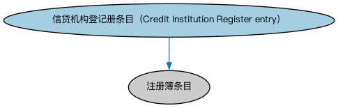

# 欧盟监管机构本体（EU Regulatory Agencies Ontology）结构与公理说明

本文档对应 `EURegulatoryAgencies.rdf` / `EURegulatoryAgencies.ttl`，说明该本体的类、继承关系、属性和公理约定。结构图见 `EURegulatoryAgencies-structure.png`（`EURegulatoryAgencies-structure.svg` 为可缩放版本）。

## 1. 本体概述

收录欧盟层面的金融监管机构个体：欧洲央行（ECB）、欧洲证券和市场管理局（ESMA）、欧洲银行管理局（EBA）等。

**在体系中的位置**：FBC 功能实体模块的欧洲区域扩展，是监管机构本体的欧盟实例层。

**上下游关系**：上游依赖监管机构本体与 BE 欧盟法域个体；下游为欧洲监管归属判断提供实例。

**与相近概念的差别**：与美国监管机构本体的差别——欧盟是「超国家机构＋成员国机构」双层监管，美国是「联邦＋州」双层，机构设置逻辑不同。

## 2. 类（Class）

| 类（Class） | 定义（Definition） |
|---|---|
| 信贷机构登记册条目（Credit Institution Register entry） | 信贷机构登记册中的条目；该登记册是由欧洲银行管理局（EBA）依据各国主管机构提供的信息汇集的信贷机构信息库。 |

### 2.1 继承关系（Inheritance）

- 信贷机构登记册条目（Credit Institution Register entry） ⊑ 注册簿条目

## 5. 公理约定（Axioms）

- 信贷机构登记册条目（Credit Institution Register entry）：适用于 only 信贷机构
- 信贷机构登记册条目（Credit Institution Register entry）：restriction
- 信贷机构登记册条目（Credit Institution Register entry）：包含 some 信贷机构

## 6. 依赖（owl:imports，25 个）

本本体通过 `owl:imports` 引入以下本体，各项的中文名称与简介如下：

| 导入本体 | 中文名称 | 简介 |
|---|---|---|
| `BE/GovernmentEntities/EuropeanJurisdiction/EUGovernmentEntitiesAndJurisdictions.rdf` | 欧盟政府实体与法域本体（EU Government Entities and Jurisdictions Ontology） | 收录欧盟层面的政体、机构与法域个体（欧盟本身及其超国家机构）。 |
| `BE/GovernmentEntities/EuropeanJurisdiction/UKGovernmentEntitiesAndJurisdictions.rdf` | 英国政府实体与法域本体（UK Government Entities and Jurisdictions Ontology） | 收录大不列颠及北爱尔兰联合王国的政体、政府与法域个体（英格兰、苏格兰、威尔士、北爱尔兰）。 |
| `BE/GovernmentEntities/GovernmentEntities.rdf` | 政府实体本体（Government Entities Ontology） | 定义政府、政体（polity）、法域（jurisdiction）及政府实体的核心概念，是各区域政府实体本体的共同基础。 |
| `BE/LegalEntities/FormalBusinessOrganizations.rdf` | 正式商业组织本体（Formal Business Organizations Ontology） | 定义以营利为目的、依法注册的正式商业组织，连接法律实体与其商业功能。 |
| `BE/LegalEntities/LEIEntities.rdf` | LEI 法人实体本体（Legal Entity Identifier Entities Ontology） | 定义持有全球法人识别编码（LEI）的法人实体，对接 ISO 17442 标准的 LEI 体系。 |
| `FBC/FunctionalEntities/BusinessCentersIndividuals.rdf` | 商业中心个体本体（Business Centers Individuals） | 收录全球主要商业中心（如纽约、伦敦、东京）的参考个体。 |
| `FBC/FunctionalEntities/BusinessRegistries.rdf` | 商业登记机构本体（Business Registries Ontology） | 定义商业登记机构（如公司注册处）及其登记职能。 |
| `FBC/FunctionalEntities/CommercialRegistrationAuthorities.rdf` | 商事登记主管机关本体（Commercial Registration Authorities Ontology） | 定义负责商事登记的主管机关及其维护的登记记录。 |
| `FBC/FunctionalEntities/EuropeanEntities/EUFinancialServicesEntities.rdf` | 欧盟金融服务实体本体（EU Financial Services Entities Ontology） | 定义欧盟法域下的金融服务机构类型与个体。 |
| `FBC/FunctionalEntities/FinancialServicesEntities.rdf` | 金融服务实体本体（Financial Services Entities Ontology） | FBC 域核心本体，定义金融服务机构（银行、券商、保险公司、资管机构等）的功能分类体系。 |
| `FND/Places/Addresses.rdf` | 地址本体（Addresses Ontology） | 定义邮政地址及其组成部分，为机构注册地、通讯地址建模。 |
| `FND/Relations/Relations.rdf` | 关系本体（Relations Ontology） | FIBO 最底层的基础本体，定义参考（reference）、分类（classify）等通用关系与抽象概念，全库普遍依赖。 |
| `FND/Utilities/AnnotationVocabulary.rdf` | FIBO 标注词汇表（FIBO Annotation Vocabulary） | 定义 FIBO 专用的标注属性（如释义来源、成熟度等级），用于本体自身的元数据标注。 |
| `https://www.omg.org/spec/Commons/AnnotationVocabulary/` | OMG 通用标注词汇表（OMG Commons Annotation Vocabulary） | OMG 通用本体库（Commons）中的标注词汇表，提供概念映射等标注属性，FIBO 用它标注术语与外部标准的对应关系。 |
| `https://www.omg.org/spec/Commons/Collections/` | OMG 通用集合本体（OMG Commons Collections） | Commons 库中的集合本体，定义集合、成员等通用概念。 |
| `https://www.omg.org/spec/Commons/ContextualDesignators/` | OMG 通用语境指称本体（OMG Commons Contextual Designators） | Commons 库中的语境指称本体，定义「在某个语境下指代某物的名称/符号」，是地址、账户号码等语境相关标识的基础。 |
| `https://www.omg.org/spec/Commons/Designators/` | OMG 通用指称符本体（OMG Commons Designators） | Commons 库中的指称符本体，定义名称、标识符等「指代某物的符号」的通用概念。 |
| `https://www.omg.org/spec/Commons/Documents/` | OMG 通用文档本体（OMG Commons Documents） | Commons 库中的文档本体，定义文档及其组成部分的通用概念。 |
| `https://www.omg.org/spec/Commons/Identifiers/` | OMG 通用标识符本体（OMG Commons Identifiers） | Commons 库中的标识符本体，定义标识符及其编码方案的通用概念。 |
| `https://www.omg.org/spec/Commons/Locations/` | OMG 通用位置本体（OMG Commons Locations） | Commons 库中的位置本体，定义地理位置、地点的通用概念。 |
| `https://www.omg.org/spec/Commons/Organizations/` | OMG 通用组织本体（OMG Commons Organizations） | Commons 库中的组织本体，定义组织、组织成员与组织结构的通用概念。 |
| `https://www.omg.org/spec/Commons/RegistrationAuthorities/` | OMG 通用登记主管机构本体（OMG Commons Registration Authorities） | Commons 库中的登记主管机构本体，定义负责登记注册的主管机构及其登记行为的通用概念。 |
| `https://www.omg.org/spec/Commons/RegulatoryAgencies/` | OMG 通用监管机构本体（OMG Commons Regulatory Agencies） | Commons 库中的监管机构本体，定义监管机构及其监管职权的通用概念。 |
| `https://www.omg.org/spec/Commons/RolesAndCompositions/` | OMG 通用角色与构成本体（OMG Commons Roles and Compositions） | Commons 库中的角色本体，定义角色及整体—部分构成关系的通用概念。 |
| `https://www.omg.org/spec/LCC/Countries/ISO3166-1-CountryCodes/` | LCC ISO 3166-1 国家代码（ISO 3166-1 Country Codes） | LCC 中 ISO 3166-1 标准的国家/地区代码个体集（如 CN、US、MX），供法域与地址建模引用。 |

## 7. 文件

- 官方 RDF/XML：`EURegulatoryAgencies.rdf`
- 中文 Turtle：`EURegulatoryAgencies.ttl`
- 结构图：`EURegulatoryAgencies-structure.png` / `EURegulatoryAgencies-structure.svg`