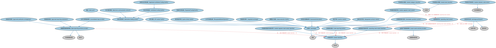

# 市场本体（Markets Ontology）结构与公理说明

本文档对应 `Markets.rdf` / `Markets.ttl`，说明该本体的类、继承关系、属性和公理约定。结构图见 `Markets-structure.png`（`Markets-structure.svg` 为可缩放版本）。

## 1. 本体概述

定义金融市场（market）：交易所（exchange）、场外市场（OTC）及其功能与参与方。

**在体系中的位置**：FBC 功能实体模块的核心之一，市场个体本体（8000 余个实例）以此为基础。

**上下游关系**：上游依赖 BE 功能实体、商业中心与 FND 地点本体；下游被 SEC 证券上市、IND 市场指数、MD 行情数据引用。

**与相近概念的差别**：市场≠交易所——交易所是有组织的集中市场，市场还包括场外交易网络；市场≠商业中心——商业中心是地理功能概念，市场是交易机制概念。

## 2. 类（Class）

| 类（Class） | 定义（Definition） |
|---|---|
| 有组织交易设施（OrganizedTradingFacility） | 既非受监管市场（RM）也非多边交易设施（MTF）的多边系统，其中多方第三方就债券、结构化金融产品等的买卖利益进行撮合。 |
| 认可市场营运者（RecognizedMarketOperator） | 由依特定证券法规注册的营运者运营或维护、撮合证券买卖双方的交易所。 |
| 系统性内部撮合商（SystematicInternaliser） | 以有组织、频繁、系统性和实质性的方式，在受监管市场之外通过执行客户订单进行自营交易的投资公司。 |
| 另类交易系统（alternative trading system） | 监管要求比受监管交易所更为宽松的交易场所。 |
| 核准发布安排（approved publication arrangement） | 获授权代表银行、投资公司等发布特定交易报告的数据报告服务提供商。 |
| 核准报告机制（approved reporting mechanism） | 获授权向主管当局或欧洲证券及市场管理局（ESMA）报告交易详情的数据报告服务提供商。 |
| 竞价市场（auction market） | 买卖双方提交竞争性报价、不涉及双方直接谈判、作为预定拍卖环节一部分的交易所。 |
| 合并行情带提供商（consolidated tape provider） | 获授权从受监管市场收集金融工具交易报告的数据报告服务提供商。 |
| 加密资产服务提供商（crypto asset services provider） | 为加密资产提供服务的金融服务提供商，能够控制加密资产并参与或提供相关金融服务。 |
| 暗池（dark pool） | 私人组织的另类交易系统，允许机构投资者在交易完成前不暴露交易意向地进行交易。 |
| 数据报告服务提供商（data reporting services provider） | 报告和/或发布证券交易数据的市场数据提供方和报告方，包括此类交易的法定监管报告。 |
| 指定合约市场（designated contract market） | 可挂牌交易基于任何商品、指数或工具的期货或期权合约的交易所、交易系统或平台。 |
| 电子通讯网络（electronic communication network） | 在市场中自动撮合证券买卖订单的另类交易系统。 |
| 交易所（exchange） | 任何组织、协会或团体，无论是否注册成立，只要构成、维持或提供撮合证券买卖的设施即为交易所。 |
| 交易所参与者（exchange participant） | 按照交易所规则可在交易所内或通过交易所交易、其名称列入名册的注册会员。 |
| 交易商间报价系统（interdealer quotation system） | 组织和传播经纪商与交易商报价、促进证券电子交易的自动化系统。 |
| 市场类别分类器（market category classifier） | 表示在可能情况下描绘交易所或数据报告服务提供商性质的受控词汇表。 |
| 市场标识符（market identifier） | 以通用方法标识交易所、交易平台、受监管或非受监管市场以及数据报告服务提供商的标识符。 |
| 市场标识代码状态（market indicator code status） | 表明市场标识代码（MIC）状态的生命周期阶段，由注册机构规定。 |
| 市场层级分类器（market level classifier） | 指明交易所或数据报告服务提供商属于运营层级还是市场板块层级设施的分类器。 |
| 市场板块层级市场（market segment-level market） | 交易所/市场/交易报告设施中专营一种或多种特定工具、或受不同监管的部分。 |
| 市场板块层级市场标识符（market segment-level market identifier） | 标识交易所/市场/交易报告设施中特定板块的市场标识符。 |
| 多边交易设施（multilateral trading facility） | 促进多方之间金融工具交换的交易系统。 |
| 场外设施（off-market facility） | 用于报告场外（OTC）及其他不经交易所执行但通过交易所报告的直接交易的设施。 |
| 运营层级市场（operating-level market） | 位于特定市场/国家的交易所/市场/交易报告设施。 |
| 运营层级市场标识符（operating-level market identifier） | 标识特定市场/国家的交易所/市场/交易报告设施的市场标识符。 |
| 报价驱动市场（quote-driven market） | 价格由做市商、交易商或特许交易商的买卖报价决定的交易所。 |
| 注册多边交易设施（registered multilateral trading facility） | 由投资公司或市场营运者运营、撮合多方第三方金融工具买卖利益的多边系统。 |
| 受监管交易所（regulated exchange） | 由市场营运者运营和/或管理、撮合或促进多方第三方买卖利益汇合的受监管市场。 |
| 掉期执行设施（swap execution facility） | 使参与者能够执行和交易掉期的交易所。 |
| 交易报告设施（trade reporting facility） | 为在交易所以外达成的交易提供报告机制的设施。 |

### 2.1 继承关系（Inheritance）

- 有组织交易设施（OrganizedTradingFacility） ⊑ 另类交易系统（alternative trading system）
- 认可市场营运者（RecognizedMarketOperator） ⊑ 交易所（exchange）
- 系统性内部撮合商（SystematicInternaliser） ⊑ 交易所（exchange）
- 另类交易系统（alternative trading system） ⊑ 交易所（exchange）
- 核准发布安排（approved publication arrangement） ⊑ 数据报告服务提供商（data reporting services provider）
- 核准报告机制（approved reporting mechanism） ⊑ 数据报告服务提供商（data reporting services provider）
- 竞价市场（auction market） ⊑ 交易所（exchange）
- 合并行情带提供商（consolidated tape provider） ⊑ 数据报告服务提供商（data reporting services provider）
- 加密资产服务提供商（crypto asset services provider） ⊑ 金融服务提供商
- 暗池（dark pool） ⊑ 另类交易系统（alternative trading system）
- 数据报告服务提供商（data reporting services provider） ⊑ 市场数据提供商
- 数据报告服务提供商（data reporting services provider） ⊑ 报告方
- 指定合约市场（designated contract market） ⊑ 交易所（exchange）
- 电子通讯网络（electronic communication network） ⊑ 另类交易系统（alternative trading system）
- 交易所（exchange） ⊑ 设施
- 交易所参与者（exchange participant） ⊑ 注册代理人
- 交易所参与者（exchange participant） ⊑ 组织成员
- 交易商间报价系统（interdealer quotation system） ⊑ 交易所（exchange）
- 市场类别分类器（market category classifier） ⊑ 分类符
- 市场标识符（market identifier） ⊑ 标识符
- 市场标识代码状态（market indicator code status） ⊑ 生命周期阶段
- 市场层级分类器（market level classifier） ⊑ 分类符
- 市场板块层级市场（market segment-level market） ⊑ 交易所（exchange）
- 市场板块层级市场标识符（market segment-level market identifier） ⊑ 市场标识符（market identifier）
- 多边交易设施（multilateral trading facility） ⊑ 另类交易系统（alternative trading system）
- 场外设施（off-market facility） ⊑ 交易所（exchange）
- 运营层级市场（operating-level market） ⊑ 交易所（exchange）
- 运营层级市场标识符（operating-level market identifier） ⊑ 市场标识符（market identifier）
- 报价驱动市场（quote-driven market） ⊑ 交易所（exchange）
- 注册多边交易设施（registered multilateral trading facility） ⊑ 多边交易设施（multilateral trading facility）
- 受监管交易所（regulated exchange） ⊑ 交易所（exchange）
- 掉期执行设施（swap execution facility） ⊑ 交易所（exchange）
- 交易报告设施（trade reporting facility） ⊑ 设施

## 3. 对象属性（Object Property）

| 属性（Property） | 中文（English） | 定义（Definition） | 说明 |
|---|---|---|---|
| fibo-fbc-fct-mkt:hasMarketIdentifierCodeStatus | 具有市场标识代码状态（has market identifier code status） | 指明特定市场标识代码（MIC）的状态。 | 值域（range）：市场标识代码状态（market indicator code status）；子属性（subPropertyOf）：具有登记状态 |
| fibo-fbc-fct-mkt:operatesInCountry | 运营所在国（operates in country） | 指明交易所、数据报告服务提供商或加密资产服务提供商运营所在的 ISO 3166-1 国家。 | 值域（range）：国家；子属性（subPropertyOf）：具有国家 |
| fibo-fbc-fct-mkt:operatesInMunicipality | 运营所在城市（operates in municipality） | 指明交易所、数据报告服务提供商或加密资产服务提供商运营所在的城市或商业中心。 | 值域（range）：市政区；子属性（subPropertyOf）：具有市政区 |

## 4. 数据属性（Datatype Property）

| 属性（Property） | 中文（English） | 定义（Definition） |
|---|---|---|
| fibo-fbc-fct-mkt:hasFacilityAcronym | 具有设施缩写（has facility acronym） | 指明该市场的已知缩写。 |

## 5. 公理约定（Axioms）

- 有组织交易设施（OrganizedTradingFacility）：由……管理 only 金融服务提供商
- 有组织交易设施（OrganizedTradingFacility）：restriction
- 有组织交易设施（OrganizedTradingFacility）：受……管辖 some 管辖权
- 认可市场营运者（RecognizedMarketOperator）：restriction
- 系统性内部撮合商（SystematicInternaliser）：restriction
- 另类交易系统（alternative trading system）：restriction
- 核准发布安排（approved publication arrangement）：restriction
- 核准报告机制（approved reporting mechanism）：restriction
- 合并行情带提供商（consolidated tape provider）：restriction
- 加密资产服务提供商（crypto asset services provider）：restriction
- 加密资产服务提供商（crypto asset services provider）：由……标识 市场标识符（market identifier） ≥0
- 加密资产服务提供商（crypto asset services provider）：restriction
- 加密资产服务提供商（crypto asset services provider）：restriction
- 加密资产服务提供商（crypto asset services provider）：运营所在国（operates in country） some 国家
- 加密资产服务提供商（crypto asset services provider）：运营所在城市（operates in municipality） some 市政区
- 数据报告服务提供商（data reporting services provider）：由……标识 市场标识符（market identifier） ≥0
- 数据报告服务提供商（data reporting services provider）：restriction
- 数据报告服务提供商（data reporting services provider）：restriction
- 数据报告服务提供商（data reporting services provider）：运营所在国（operates in country） some 国家
- 数据报告服务提供商（data reporting services provider）：运营所在城市（operates in municipality） some 市政区
- 指定合约市场（designated contract market）：restriction
- 交易所（exchange）：由……标识 市场标识符（market identifier） ≥0
- 交易所（exchange）：由……管理 金融服务提供商 ≥0
- 交易所（exchange）：restriction
- 交易所（exchange）：restriction
- 交易所（exchange）：运营所在国（operates in country） some 国家
- 交易所（exchange）：运营所在城市（operates in municipality） some 市政区
- 交易所参与者（exchange participant）：由……注册 some 交易所（exchange）
- 交易所参与者（exchange participant）：由…扮演（is played by） some（是……的成员 some（扮演角色（plays role） some 交易所（exchange）））
- 交易商间报价系统（interdealer quotation system）：restriction
- 市场类别分类器（market category classifier）：restriction
- 市场类别分类器（market category classifier）：分类 some（restriction）
- 市场标识符（market identifier）：标识 some（restriction）
- 市场层级分类器（market level classifier）：restriction
- 市场层级分类器（market level classifier）：分类 some（restriction）
- 市场板块层级市场（market segment-level market）：restriction
- 市场板块层级市场（market segment-level market）：是……的部分 some 运营层级市场（operating-level market）
- 多边交易设施（multilateral trading facility）：restriction
- 运营层级市场（operating-level market）：restriction
- 运营层级市场（operating-level market）：由……标识 运营层级市场标识符（operating-level market identifier） ≥0
- 注册多边交易设施（registered multilateral trading facility）：由……管理 some 金融服务提供商
- 注册多边交易设施（registered multilateral trading facility）：由……注册 some 注册机构
- 注册多边交易设施（registered multilateral trading facility）：受……管辖 some 管辖权
- 受监管交易所（regulated exchange）：restriction
- 受监管交易所（regulated exchange）：受……管辖 some 管辖权
- 受监管交易所（regulated exchange）：受……监管 some 监管机构
- 掉期执行设施（swap execution facility）：restriction
- 交易报告设施（trade reporting facility）：restriction
- 交易报告设施（trade reporting facility）：由……标识 市场标识符（market identifier） ≥0
- 交易报告设施（trade reporting facility）：由……管理 金融服务提供商 ≥0
- 交易报告设施（trade reporting facility）：restriction
- 交易报告设施（trade reporting facility）：restriction
- 交易报告设施（trade reporting facility）：运营所在国（operates in country） some 国家
- 交易报告设施（trade reporting facility）：运营所在城市（operates in municipality） some 市政区

## 6. 依赖（owl:imports，18 个）

本本体通过 `owl:imports` 引入以下本体，各项的中文名称与简介如下：

| 导入本体 | 中文名称 | 简介 |
|---|---|---|
| `BE/FunctionalEntities/Publishers.rdf` | 出版方本体（Publishers Ontology） | 定义出版方及其出版物，用于标识金融信息与文档的发布来源。 |
| `FBC/FunctionalEntities/BusinessRegistries.rdf` | 商业登记机构本体（Business Registries Ontology） | 定义商业登记机构（如公司注册处）及其登记职能。 |
| `FBC/ProductsAndServices/FinancialProductsAndServices.rdf` | 金融产品与服务本体（Financial Products and Services Ontology） | 定义金融产品（financial product）与金融服务（financial service）及其提供、购买关系。 |
| `FND/Arrangements/Lifecycles.rdf` | 生命周期本体（Lifecycles Ontology） | 定义生命周期、生命周期阶段与状态转移，用于描述合同、金融工具、机构从创设到终止的演化过程。 |
| `FND/Arrangements/Reporting.rdf` | 报告本体（Reporting Ontology） | 定义报告、报告方与报告内容的关系，支撑监管报告、财务报告等报送场景。 |
| `FND/Relations/Relations.rdf` | 关系本体（Relations Ontology） | FIBO 最底层的基础本体，定义参考（reference）、分类（classify）等通用关系与抽象概念，全库普遍依赖。 |
| `FND/Utilities/AnnotationVocabulary.rdf` | FIBO 标注词汇表（FIBO Annotation Vocabulary） | 定义 FIBO 专用的标注属性（如释义来源、成熟度等级），用于本体自身的元数据标注。 |
| `https://www.omg.org/spec/Commons/AnnotationVocabulary/` | OMG 通用标注词汇表（OMG Commons Annotation Vocabulary） | OMG 通用本体库（Commons）中的标注词汇表，提供概念映射等标注属性，FIBO 用它标注术语与外部标准的对应关系。 |
| `https://www.omg.org/spec/Commons/Classifiers/` | OMG 通用分类器本体（OMG Commons Classifiers） | OMG 通用本体库（Commons）中的分类器本体，定义分类方案、类别与归类关系的通用概念，FIBO 的分类建模建立在其上。 |
| `https://www.omg.org/spec/Commons/Collections/` | OMG 通用集合本体（OMG Commons Collections） | Commons 库中的集合本体，定义集合、成员等通用概念。 |
| `https://www.omg.org/spec/Commons/Designators/` | OMG 通用指称符本体（OMG Commons Designators） | Commons 库中的指称符本体，定义名称、标识符等「指代某物的符号」的通用概念。 |
| `https://www.omg.org/spec/Commons/Identifiers/` | OMG 通用标识符本体（OMG Commons Identifiers） | Commons 库中的标识符本体，定义标识符及其编码方案的通用概念。 |
| `https://www.omg.org/spec/Commons/Locations/` | OMG 通用位置本体（OMG Commons Locations） | Commons 库中的位置本体，定义地理位置、地点的通用概念。 |
| `https://www.omg.org/spec/Commons/Organizations/` | OMG 通用组织本体（OMG Commons Organizations） | Commons 库中的组织本体，定义组织、组织成员与组织结构的通用概念。 |
| `https://www.omg.org/spec/Commons/RegistrationAuthorities/` | OMG 通用登记主管机构本体（OMG Commons Registration Authorities） | Commons 库中的登记主管机构本体，定义负责登记注册的主管机构及其登记行为的通用概念。 |
| `https://www.omg.org/spec/Commons/RegulatoryAgencies/` | OMG 通用监管机构本体（OMG Commons Regulatory Agencies） | Commons 库中的监管机构本体，定义监管机构及其监管职权的通用概念。 |
| `https://www.omg.org/spec/Commons/RolesAndCompositions/` | OMG 通用角色与构成本体（OMG Commons Roles and Compositions） | Commons 库中的角色本体，定义角色及整体—部分构成关系的通用概念。 |
| `https://www.omg.org/spec/Commons/SitesAndFacilities/` | OMG 通用场所与设施本体（OMG Commons Sites and Facilities） | Commons 库中的场所与设施本体，定义物理场所、设施及其位置的通用概念。 |

## 7. 文件

- 官方 RDF/XML：`Markets.rdf`
- 中文 Turtle：`Markets.ttl`
- 结构图：`Markets-structure.png` / `Markets-structure.svg`