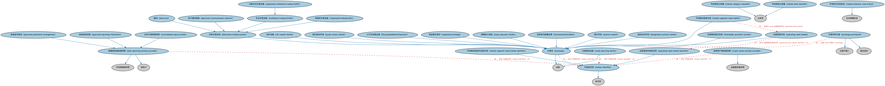

# 市场本体（Markets Ontology）结构与公理说明

本文档对应 `Markets.rdf` / `Markets.ttl`，说明该本体的类、继承关系、属性和公理约定。结构图见 `Markets-structure.png`（`Markets-structure.svg` 为可缩放版本）。

## 1. 本体概述

定义金融市场（market）：交易所（exchange）、场外市场（OTC）及其功能与参与方。

**在体系中的位置**：FBC 功能实体模块的核心之一，市场个体本体（8000 余个实例）以此为基础。

**上下游关系**：上游依赖 BE 功能实体、商业中心与 FND 地点本体；下游被 SEC 证券上市、IND 市场指数、MD 行情数据引用。

**与相近概念的差别**：市场≠交易所——交易所是有组织的集中市场，市场还包括场外交易网络；市场≠商业中心——商业中心是地理功能概念，市场是交易机制概念。

本本体中类与类的核心关系如下（完整细节见各类小节）：

- **有组织交易设施（OrganizedTradingFacility）** 继承 **另类交易系统（alternative trading system）**
- **认可市场营运者（RecognizedMarketOperator）** 继承 **交易所（exchange）**
- **系统性内部撮合商（SystematicInternaliser）** 继承 **交易所（exchange）**
- **另类交易系统（alternative trading system）** 继承 **交易所（exchange）**
- **核准发布安排（approved publication arrangement）** 继承 **数据报告服务提供商（data reporting services provider）**
- **核准报告机制（approved reporting mechanism）** 继承 **数据报告服务提供商（data reporting services provider）**
- **竞价市场（auction market）** 继承 **交易所（exchange）**
- **合并行情带提供商（consolidated tape provider）** 继承 **数据报告服务提供商（data reporting services provider）**
- **加密资产服务提供商（crypto asset services provider）** 继承 **金融服务提供商（FinancialServiceProvider）**
- **暗池（dark pool）** 继承 **另类交易系统（alternative trading system）**
- **数据报告服务提供商（data reporting services provider）** 继承 **市场数据提供商（MarketDataProvider）**
- **数据报告服务提供商（data reporting services provider）** 继承 **报告方（ReportingParty）**
- 其余 21 条关系从略。

## 2. 类（Class）

| 类（Class） | 定义（Definition） |
|---|---|
| 有组织交易设施（OrganizedTradingFacility） | 既非受监管市场（RM）也非多边交易设施（MTF）的多边系统，其中多方第三方就债券、结构化金融产品等的买卖利益进行撮合。 multi-lateral system which is not an RM or an MTF and in which multiple third-party buying and selling interests in bonds, structured finance products, emission allowances or derivatives are able to interact in the system in a way that results in a contract in accordance with the provisions of Title II of MiFID II |
| 认可市场营运者（RecognizedMarketOperator） | 由依特定证券法规注册的营运者运营或维护、撮合证券买卖双方的交易所。 exchange that is operated or maintained by an operator registered under certain securities regulations that brings together purchasers and sellers of capital market products |
| 系统性内部撮合商（SystematicInternaliser） | 以有组织、频繁、系统性和实质性的方式，在受监管市场之外通过执行客户订单进行自营交易的投资公司。 investment firm that, on an organised, frequent, systematic and substantial basis, deals on its own account by executing client orders outside a regulated exchange, MTF or OTF without operating a multilateral system |
| 另类交易系统（alternative trading system） | 监管要求比受监管交易所更为宽松的交易场所。 trading venue that is more loosely regulated than a regulated exchange |
| 核准发布安排（approved publication arrangement） | 获授权代表银行、投资公司等发布特定交易报告的数据报告服务提供商。 data reporting services provider that is authorized to provide the service of publishing certain trade reports on behalf of banks, investment firms, or asset management companies |
| 核准报告机制（approved reporting mechanism） | 获授权向主管当局或欧洲证券及市场管理局（ESMA）报告交易详情的数据报告服务提供商。 data reporting services provider that is authorized to provide the service of reporting details of transactions to competent authorities or ESMA (the European Securities and Markets Authority) on behalf of investment firms |
| 竞价市场（auction market） | 买卖双方提交竞争性报价、不涉及双方直接谈判、作为预定拍卖环节一部分的交易所。 exchange in which buyers and sellers submit competitive bids that do not involve direct negotiations between parties, as part of an auction scheduled either on demand or on a periodic basis |
| 合并行情带提供商（consolidated tape provider） | 获授权从受监管市场收集金融工具交易报告的数据报告服务提供商。 data reporting services provider that is authorized to provide the service of collecting trade reports for financial instruments from regulated markets, MTFs, OTFs and APAs and consolidating them into a continuous electronic live data stream providing price and volume data per financial instrument |
| 加密资产服务提供商（crypto asset services provider） | 为加密资产提供服务的金融服务提供商，能够控制加密资产并参与或提供相关金融服务。 financial services provider that provides services for crypto assets that enable the control of crypto assets, and participate in, or provide, financial services for issuers' offers, or sale, of crypto assets |
| 暗池（dark pool） | 私人组织的另类交易系统，允许机构投资者在交易完成前不暴露交易意向地进行交易。 privately organized alternative trading system, that allows institutional investors the ability to trade without exposure until after the trade has been executed and reported |
| 数据报告服务提供商（data reporting services provider） | 报告和/或发布证券交易数据的市场数据提供方和报告方，包括此类交易的法定监管报告。 market data provider and reporting party that reports and/or publishes data on securities transactions, including required regulatory reporting for such transactions, and as such is subject to regulatory supervision |
| 指定合约市场（designated contract market） | 可挂牌交易基于任何商品、指数或工具的期货或期权合约的交易所、交易系统或平台。 exchange, trading system, or platform that enables listing for trading futures or option contracts based on any underlying commodity, index or instrument |
| 电子通讯网络（electronic communication network） | 在市场中自动撮合证券买卖订单的另类交易系统。 alternative trading system that automatically matches buy and sell orders for securities in the market |
| 交易所（exchange） | 任何组织、协会或团体，无论是否注册成立，只要构成、维持或提供撮合证券买卖的设施即为交易所。 any organization, association, or group of persons, whether incorporated or unincorporated, which constitutes, maintains, or provides a facility for bringing together purchasers and sellers of financial instruments, commodities, or other products, services, or goods, and includes the market place and facilities maintained by such exchange |
| 交易所参与者（exchange participant） | 按照交易所规则可在交易所内或通过交易所交易、其名称列入名册的注册会员。 registered agent who, in accordance with the rules of an exchange, may trade on or through the exchange and whose name is entered in a list, register or roll kept by the exchange as an agent who may trade on or through the exchange |
| 交易商间报价系统（interdealer quotation system） | 组织和传播经纪商与交易商报价、促进证券电子交易的自动化系统。 automated system for organizing and disseminating price quotes by brokers and dealer firms that facilitates electronic trading in securities |
| 市场类别分类器（market category classifier） | 表示在可能情况下描绘交易所或数据报告服务提供商性质的受控词汇表。 classifier representing the controlled vocabulary that delineates the nature of the exchange or data reporting services provider where possible |
| 市场标识符（market identifier） | 以通用方法标识交易所、交易平台、受监管或非受监管市场以及数据报告服务提供商的标识符。 identifier that specifies a universal method of identifying exchanges, trading platforms, regulated or non-regulated markets, and data reporting services providers as sources of prices and related information in order to facilitate automated processing |
| 市场标识代码状态（market indicator code status） | 表明市场标识代码（MIC）状态的生命周期阶段，由注册机构规定。 lifecycle stage indicating the status of the MIC code, as specified by the registration authority |
| 市场层级分类器（market level classifier） | 指明交易所或数据报告服务提供商属于运营层级还是市场板块层级设施的分类器。 classifier that indicates whether the exchange or data reporting services provider is an operating level or market segment level facility |
| 市场板块层级市场（market segment-level market） | 交易所/市场/交易报告设施中专营一种或多种特定工具、或受不同监管的部分。 section of an exchange/market/trade reporting facility that specialises in one or more specific instruments or that is regulated differently |
| 市场板块层级市场标识符（market segment-level market identifier） | 标识交易所/市场/交易报告设施中特定板块的市场标识符。 market identifier that identifies a section of an exchange/market/trade reporting facility that specialises in one or more specific instruments or that is regulated differently |
| 多边交易设施（multilateral trading facility） | 促进多方之间金融工具交换的交易系统。 trading system that facilitates the exchange of financial instruments between multiple parties |
| 场外设施（off-market facility） | 用于报告场外（OTC）及其他不经交易所执行但通过交易所报告的直接交易的设施。 facility used for reporting over-the-counter (OTC) and other direct trades that are not executed by the exchange but are reported through the exchange |
| 运营层级市场（operating-level market） | 位于特定市场/国家的交易所/市场/交易报告设施。 exchange/market/trade reporting facility in a specific market/country |
| 运营层级市场标识符（operating-level market identifier） | 标识特定市场/国家的交易所/市场/交易报告设施的市场标识符。 market identifier that identifies an exchange/market/trade reporting facility in a specific market/country |
| 报价驱动市场（quote-driven market） | 价格由做市商、交易商或特许交易商的买卖报价决定的交易所。 exchange in which prices are determined from bid and ask quotations made by market makers, dealers, or specialists |
| 注册多边交易设施（registered multilateral trading facility） | 由投资公司或市场营运者运营、撮合多方第三方金融工具买卖利益的多边系统。 multilateral system operated by an investment firm or market operator, which brings together multiple third-party buying and selling interests in financial instruments in the system, in accordance with non-discretionary rules, in a way that results in a contract in accordance with the provisions of Title II of the MiFID II |
| 受监管交易所（regulated exchange） | 由市场营运者运营和/或管理、撮合或促进多方第三方买卖利益汇合的受监管市场。 regulated market that is operated by and/or managed by a market operator that brings together or facilitates the bringing together of multiple third-party buying and selling interests in financial instruments |
| 掉期执行设施（swap execution facility） | 使参与者能够执行和交易掉期的交易所。 exchange that enables participants to execute and trade swaps |
| 交易报告设施（trade reporting facility） | 为在交易所以外达成的交易提供报告机制的设施。 facility that provides a mechanism for the reporting of transactions effected otherwise than on an exchange |

以下按类逐个展开：每个类给出继承关系、相关属性与公理约定；子类在父类之下降一级编号。

### 2.1 加密资产服务提供商（crypto asset services provider）

定义：为加密资产提供服务的金融服务提供商，能够控制加密资产并参与或提供相关金融服务。

- 父类：**金融服务提供商（FinancialServiceProvider）**

属性：

| 属性 | 定义 | 说明 |
|---|---|---|
| **具有设施缩写（has facility acronym）** | 指明该市场的已知缩写。 indicates a known acronym of the market | 子属性：具有别名 |
| **运营所在国（operates in country）** | 指明交易所、数据报告服务提供商或加密资产服务提供商运营所在的 ISO 3166-1 国家。 indicates the ISO 3166-1 country in which an exchange, data reporting services provider, or crypto asset services provider operates | 值域：国家；子属性：具有国家 |
| **运营所在城市（operates in municipality）** | 指明交易所、数据报告服务提供商或加密资产服务提供商运营所在的城市或商业中心。 indicates the municipality or business center in which in which an exchange, data reporting services provider, or crypto asset services provider operates | 值域：市政区；子属性：具有市政区 |
| **具有正式名称（hasFormalName）** | — | — |
| **由……分类（isClassifiedBy）** | — | — |
| **由……标识（isIdentifiedBy）** | — | — |

公理：

- **具有正式名称（hasFormalName）**存在取值约束。
- **具有设施缩写（has facility acronym）**存在取值约束。
- **由……分类（isClassifiedBy）**的取值固定为 MarketCategoryClassifier-CASP。
- **由……标识（isIdentifiedBy）**可以有 0 个或多个**市场标识符（market identifier）**。
- **运营所在国（operates in country）**至少有一个取值，类型是**国家（Country）**。
- **运营所在城市（operates in municipality）**至少有一个取值，类型是**市政区（Municipality）**。

### 2.2 数据报告服务提供商（data reporting services provider）

定义：报告和/或发布证券交易数据的市场数据提供方和报告方，包括此类交易的法定监管报告。

- 父类：**市场数据提供商（MarketDataProvider）**、**报告方（ReportingParty）**
- 直接子类：**核准发布安排（approved publication arrangement）**、**核准报告机制（approved reporting mechanism）**、**合并行情带提供商（consolidated tape provider）**

属性：

| 属性 | 定义 | 说明 |
|---|---|---|
| **具有设施缩写（has facility acronym）** | 指明该市场的已知缩写。 indicates a known acronym of the market | 子属性：具有别名 |
| **运营所在国（operates in country）** | 指明交易所、数据报告服务提供商或加密资产服务提供商运营所在的 ISO 3166-1 国家。 indicates the ISO 3166-1 country in which an exchange, data reporting services provider, or crypto asset services provider operates | 值域：国家；子属性：具有国家 |
| **运营所在城市（operates in municipality）** | 指明交易所、数据报告服务提供商或加密资产服务提供商运营所在的城市或商业中心。 indicates the municipality or business center in which in which an exchange, data reporting services provider, or crypto asset services provider operates | 值域：市政区；子属性：具有市政区 |
| **具有正式名称（hasFormalName）** | — | — |
| **由……标识（isIdentifiedBy）** | — | — |

公理：

- **具有正式名称（hasFormalName）**存在取值约束。
- **具有设施缩写（has facility acronym）**存在取值约束。
- **由……标识（isIdentifiedBy）**可以有 0 个或多个**市场标识符（market identifier）**。
- **运营所在国（operates in country）**至少有一个取值，类型是**国家（Country）**。
- **运营所在城市（operates in municipality）**至少有一个取值，类型是**市政区（Municipality）**。

#### 2.2.1 核准发布安排（approved publication arrangement）

定义：获授权代表银行、投资公司等发布特定交易报告的数据报告服务提供商。

- 父类：**数据报告服务提供商（data reporting services provider）**

属性：

| 属性 | 定义 | 说明 |
|---|---|---|
| **由……分类（isClassifiedBy）** | — | — |

公理：

- **由……分类（isClassifiedBy）**的取值固定为 MarketCategoryClassifier-APPA。

#### 2.2.2 核准报告机制（approved reporting mechanism）

定义：获授权向主管当局或欧洲证券及市场管理局（ESMA）报告交易详情的数据报告服务提供商。

- 父类：**数据报告服务提供商（data reporting services provider）**

属性：

| 属性 | 定义 | 说明 |
|---|---|---|
| **由……分类（isClassifiedBy）** | — | — |

公理：

- **由……分类（isClassifiedBy）**的取值固定为 MarketCategoryClassifier-ARMS。

#### 2.2.3 合并行情带提供商（consolidated tape provider）

定义：获授权从受监管市场收集金融工具交易报告的数据报告服务提供商。

- 父类：**数据报告服务提供商（data reporting services provider）**

属性：

| 属性 | 定义 | 说明 |
|---|---|---|
| **由……分类（isClassifiedBy）** | — | — |

公理：

- **由……分类（isClassifiedBy）**的取值固定为 MarketCategoryClassifier-CTPS。

### 2.3 交易所（exchange）

定义：任何组织、协会或团体，无论是否注册成立，只要构成、维持或提供撮合证券买卖的设施即为交易所。

- 父类：**设施（Facility）**
- 直接子类：**认可市场营运者（RecognizedMarketOperator）**、**系统性内部撮合商（SystematicInternaliser）**、**另类交易系统（alternative trading system）**、**竞价市场（auction market）**、**指定合约市场（designated contract market）**、**交易商间报价系统（interdealer quotation system）**、**市场板块层级市场（market segment-level market）**、**场外设施（off-market facility）**、**运营层级市场（operating-level market）**、**报价驱动市场（quote-driven market）**、**受监管交易所（regulated exchange）**、**掉期执行设施（swap execution facility）**

属性：

| 属性 | 定义 | 说明 |
|---|---|---|
| **具有设施缩写（has facility acronym）** | 指明该市场的已知缩写。 indicates a known acronym of the market | 子属性：具有别名 |
| **运营所在国（operates in country）** | 指明交易所、数据报告服务提供商或加密资产服务提供商运营所在的 ISO 3166-1 国家。 indicates the ISO 3166-1 country in which an exchange, data reporting services provider, or crypto asset services provider operates | 值域：国家；子属性：具有国家 |
| **运营所在城市（operates in municipality）** | 指明交易所、数据报告服务提供商或加密资产服务提供商运营所在的城市或商业中心。 indicates the municipality or business center in which in which an exchange, data reporting services provider, or crypto asset services provider operates | 值域：市政区；子属性：具有市政区 |
| **具有正式名称（hasFormalName）** | — | — |
| **由……标识（isIdentifiedBy）** | — | — |
| **由……管理（isManagedBy）** | — | — |

公理：

- **具有正式名称（hasFormalName）**存在取值约束。
- **具有设施缩写（has facility acronym）**存在取值约束。
- **由……标识（isIdentifiedBy）**可以有 0 个或多个**市场标识符（market identifier）**。
- **由……管理（isManagedBy）**可以有 0 个或多个**金融服务提供商（FinancialServiceProvider）**。
- **运营所在国（operates in country）**至少有一个取值，类型是**国家（Country）**。
- **运营所在城市（operates in municipality）**至少有一个取值，类型是**市政区（Municipality）**。

#### 2.3.1 认可市场营运者（RecognizedMarketOperator）

定义：由依特定证券法规注册的营运者运营或维护、撮合证券买卖双方的交易所。

- 父类：**交易所（exchange）**

属性：

| 属性 | 定义 | 说明 |
|---|---|---|
| **由……分类（isClassifiedBy）** | — | — |

公理：

- **由……分类（isClassifiedBy）**的取值固定为 MarketCategoryClassifier-RMOS。

#### 2.3.2 系统性内部撮合商（SystematicInternaliser）

定义：以有组织、频繁、系统性和实质性的方式，在受监管市场之外通过执行客户订单进行自营交易的投资公司。

- 父类：**交易所（exchange）**

属性：

| 属性 | 定义 | 说明 |
|---|---|---|
| **由……分类（isClassifiedBy）** | — | — |

公理：

- **由……分类（isClassifiedBy）**的取值固定为 MarketCategoryClassifier-SINT。

#### 2.3.3 另类交易系统（alternative trading system）

定义：监管要求比受监管交易所更为宽松的交易场所。

- 父类：**交易所（exchange）**
- 直接子类：**有组织交易设施（OrganizedTradingFacility）**、**暗池（dark pool）**、**电子通讯网络（electronic communication network）**、**多边交易设施（multilateral trading facility）**

属性：

| 属性 | 定义 | 说明 |
|---|---|---|
| **由……分类（isClassifiedBy）** | — | — |

公理：

- **由……分类（isClassifiedBy）**的取值固定为 MarketCategoryClassifier-ATSS。

##### 2.3.3.1 有组织交易设施（OrganizedTradingFacility）

定义：既非受监管市场（RM）也非多边交易设施（MTF）的多边系统，其中多方第三方就债券、结构化金融产品等的买卖利益进行撮合。

- 父类：**另类交易系统（alternative trading system）**

属性：

| 属性 | 定义 | 说明 |
|---|---|---|
| **由……分类（isClassifiedBy）** | — | — |
| **由……管理（isManagedBy）** | — | — |
| **受……管辖（isGovernedBy）** | — | — |

公理：

- **受……管辖（isGovernedBy）**至少有一个取值，类型是**管辖权（Jurisdiction）**。
- **由……分类（isClassifiedBy）**的取值固定为 MarketCategoryClassifier-OTFS。
- **由……管理（isManagedBy）**的所有取值只能是**金融服务提供商（FinancialServiceProvider）**。

##### 2.3.3.2 暗池（dark pool）

定义：私人组织的另类交易系统，允许机构投资者在交易完成前不暴露交易意向地进行交易。

- 父类：**另类交易系统（alternative trading system）**

##### 2.3.3.3 电子通讯网络（electronic communication network）

定义：在市场中自动撮合证券买卖订单的另类交易系统。

- 父类：**另类交易系统（alternative trading system）**

##### 2.3.3.4 多边交易设施（multilateral trading facility）

定义：促进多方之间金融工具交换的交易系统。

- 父类：**另类交易系统（alternative trading system）**
- 直接子类：**注册多边交易设施（registered multilateral trading facility）**

属性：

| 属性 | 定义 | 说明 |
|---|---|---|
| **由……分类（isClassifiedBy）** | — | — |

公理：

- **由……分类（isClassifiedBy）**的取值固定为 MarketCategoryClassifier-MLTF。

###### 2.3.3.4.1 注册多边交易设施（registered multilateral trading facility）

定义：由投资公司或市场营运者运营、撮合多方第三方金融工具买卖利益的多边系统。

- 父类：**多边交易设施（multilateral trading facility）**

属性：

| 属性 | 定义 | 说明 |
|---|---|---|
| **由……管理（isManagedBy）** | — | — |
| **由……注册（isRegisteredBy）** | — | — |
| **受……管辖（isGovernedBy）** | — | — |

公理：

- **受……管辖（isGovernedBy）**至少有一个取值，类型是**管辖权（Jurisdiction）**。
- **由……注册（isRegisteredBy）**至少有一个取值，类型是**注册机构（RegistrationAuthority）**。
- **由……管理（isManagedBy）**至少有一个取值，类型是**金融服务提供商（FinancialServiceProvider）**。

#### 2.3.4 竞价市场（auction market）

定义：买卖双方提交竞争性报价、不涉及双方直接谈判、作为预定拍卖环节一部分的交易所。

- 父类：**交易所（exchange）**

#### 2.3.5 指定合约市场（designated contract market）

定义：可挂牌交易基于任何商品、指数或工具的期货或期权合约的交易所、交易系统或平台。

- 父类：**交易所（exchange）**

属性：

| 属性 | 定义 | 说明 |
|---|---|---|
| **由……分类（isClassifiedBy）** | — | — |

公理：

- **由……分类（isClassifiedBy）**的取值固定为 MarketCategoryClassifier-DCMS。

#### 2.3.6 交易商间报价系统（interdealer quotation system）

定义：组织和传播经纪商与交易商报价、促进证券电子交易的自动化系统。

- 父类：**交易所（exchange）**

属性：

| 属性 | 定义 | 说明 |
|---|---|---|
| **由……分类（isClassifiedBy）** | — | — |

公理：

- **由……分类（isClassifiedBy）**的取值固定为 MarketCategoryClassifier-IDQS。

#### 2.3.7 市场板块层级市场（market segment-level market）

定义：交易所/市场/交易报告设施中专营一种或多种特定工具、或受不同监管的部分。

- 父类：**交易所（exchange）**

属性：

| 属性 | 定义 | 说明 |
|---|---|---|
| **由……分类（isClassifiedBy）** | — | — |
| **是……的部分（isPartOf）** | — | — |

公理：

- **是……的部分（isPartOf）**至少有一个取值，类型是**运营层级市场（operating-level market）**。
- **由……分类（isClassifiedBy）**的取值固定为 MarketLevelClassifier-SGMT。

#### 2.3.8 场外设施（off-market facility）

定义：用于报告场外（OTC）及其他不经交易所执行但通过交易所报告的直接交易的设施。

- 父类：**交易所（exchange）**

#### 2.3.9 运营层级市场（operating-level market）

定义：位于特定市场/国家的交易所/市场/交易报告设施。

- 父类：**交易所（exchange）**

属性：

| 属性 | 定义 | 说明 |
|---|---|---|
| **由……分类（isClassifiedBy）** | — | — |
| **由……标识（isIdentifiedBy）** | — | — |

公理：

- **由……分类（isClassifiedBy）**的取值固定为 MarketLevelClassifier-OPRT。
- **由……标识（isIdentifiedBy）**可以有 0 个或多个**运营层级市场标识符（operating-level market identifier）**。

#### 2.3.10 报价驱动市场（quote-driven market）

定义：价格由做市商、交易商或特许交易商的买卖报价决定的交易所。

- 父类：**交易所（exchange）**

#### 2.3.11 受监管交易所（regulated exchange）

定义：由市场营运者运营和/或管理、撮合或促进多方第三方买卖利益汇合的受监管市场。

- 父类：**交易所（exchange）**

属性：

| 属性 | 定义 | 说明 |
|---|---|---|
| **由……分类（isClassifiedBy）** | — | — |
| **受……管辖（isGovernedBy）** | — | — |
| **受……监管（isRegulatedBy）** | — | — |

公理：

- **受……监管（isRegulatedBy）**至少有一个取值，类型是**监管机构（RegulatoryAgency）**。
- **受……管辖（isGovernedBy）**至少有一个取值，类型是**管辖权（Jurisdiction）**。
- **由……分类（isClassifiedBy）**的取值固定为 MarketCategoryClassifier-RMKT。

#### 2.3.12 掉期执行设施（swap execution facility）

定义：使参与者能够执行和交易掉期的交易所。

- 父类：**交易所（exchange）**

属性：

| 属性 | 定义 | 说明 |
|---|---|---|
| **由……分类（isClassifiedBy）** | — | — |

公理：

- **由……分类（isClassifiedBy）**的取值固定为 MarketCategoryClassifier-SEFS。

### 2.4 交易所参与者（exchange participant）

定义：按照交易所规则可在交易所内或通过交易所交易、其名称列入名册的注册会员。

- 父类：**注册代理人（RegisteredAgent）**、**组织成员（OrganizationMember）**

属性：

| 属性 | 定义 | 说明 |
|---|---|---|
| **由……注册（isRegisteredBy）** | — | — |
| **由…扮演（is played by）** | — | — |

公理：

- **由……注册（isRegisteredBy）**至少有一个取值，类型是**交易所（exchange）**。
- **由…扮演（is played by）**至少有一个取值，该取值满足：**是……的成员（isMemberOf）**至少有一个取值，该取值满足：**扮演角色（plays role）**至少有一个取值，类型是**交易所（exchange）**。

### 2.5 市场类别分类器（market category classifier）

定义：表示在可能情况下描绘交易所或数据报告服务提供商性质的受控词汇表。

- 父类：**分类符（Classifier）**

属性：

| 属性 | 定义 | 说明 |
|---|---|---|
| **分类（classifies）** | — | — |
| **定义于（isDefinedIn）** | — | — |

公理：

- **分类（classifies）**至少有一个取值，该取值满足：该属性存在取值约束。
- **定义于（isDefinedIn）**的取值固定为 ISO10383-ClassificationScheme。

### 2.6 市场标识符（market identifier）

定义：以通用方法标识交易所、交易平台、受监管或非受监管市场以及数据报告服务提供商的标识符。

- 父类：**标识符（Identifier）**
- 直接子类：**市场板块层级市场标识符（market segment-level market identifier）**、**运营层级市场标识符（operating-level market identifier）**

属性：

| 属性 | 定义 | 说明 |
|---|---|---|
| **标识（identifies）** | — | — |

公理：

- **标识（identifies）**至少有一个取值，该取值满足：该属性存在取值约束。

#### 2.6.1 市场板块层级市场标识符（market segment-level market identifier）

定义：标识交易所/市场/交易报告设施中特定板块的市场标识符。

- 父类：**市场标识符（market identifier）**

#### 2.6.2 运营层级市场标识符（operating-level market identifier）

定义：标识特定市场/国家的交易所/市场/交易报告设施的市场标识符。

- 父类：**市场标识符（market identifier）**

### 2.7 市场标识代码状态（market indicator code status）

定义：表明市场标识代码（MIC）状态的生命周期阶段，由注册机构规定。

- 父类：**生命周期阶段（LifecycleStage）**

### 2.8 市场层级分类器（market level classifier）

定义：指明交易所或数据报告服务提供商属于运营层级还是市场板块层级设施的分类器。

- 父类：**分类符（Classifier）**

属性：

| 属性 | 定义 | 说明 |
|---|---|---|
| **分类（classifies）** | — | — |
| **定义于（isDefinedIn）** | — | — |

公理：

- **分类（classifies）**至少有一个取值，该取值满足：该属性存在取值约束。
- **定义于（isDefinedIn）**的取值固定为 ISO10383-ClassificationScheme。

### 2.9 交易报告设施（trade reporting facility）

定义：为在交易所以外达成的交易提供报告机制的设施。

- 父类：**设施（Facility）**

属性：

| 属性 | 定义 | 说明 |
|---|---|---|
| **具有设施缩写（has facility acronym）** | 指明该市场的已知缩写。 indicates a known acronym of the market | 子属性：具有别名 |
| **运营所在国（operates in country）** | 指明交易所、数据报告服务提供商或加密资产服务提供商运营所在的 ISO 3166-1 国家。 indicates the ISO 3166-1 country in which an exchange, data reporting services provider, or crypto asset services provider operates | 值域：国家；子属性：具有国家 |
| **运营所在城市（operates in municipality）** | 指明交易所、数据报告服务提供商或加密资产服务提供商运营所在的城市或商业中心。 indicates the municipality or business center in which in which an exchange, data reporting services provider, or crypto asset services provider operates | 值域：市政区；子属性：具有市政区 |
| **具有正式名称（hasFormalName）** | — | — |
| **由……分类（isClassifiedBy）** | — | — |
| **由……标识（isIdentifiedBy）** | — | — |
| **由……管理（isManagedBy）** | — | — |

公理：

- **具有正式名称（hasFormalName）**存在取值约束。
- **具有设施缩写（has facility acronym）**存在取值约束。
- **由……分类（isClassifiedBy）**的取值固定为 MarketCategoryClassifier-TRFS。
- **由……标识（isIdentifiedBy）**可以有 0 个或多个**市场标识符（market identifier）**。
- **由……管理（isManagedBy）**可以有 0 个或多个**金融服务提供商（FinancialServiceProvider）**。
- **运营所在国（operates in country）**至少有一个取值，类型是**国家（Country）**。
- **运营所在城市（operates in municipality）**至少有一个取值，类型是**市政区（Municipality）**。

## 3. 其他属性

以下属性未绑定到本体的具体类（定义域在外部本体或未声明）：

对象属性（Object Property）：

| 属性 | 定义 | 说明 |
|---|---|---|
| **具有市场标识代码状态（has market identifier code status）** | 指明特定市场标识代码（MIC）的状态。 indicates the status of a specific market identifier code (MIC) | 值域：市场标识代码状态（market indicator code status）；子属性：具有登记状态 |

## 4. 依赖（owl:imports，18 个）

本本体通过 `owl:imports` 引入以下本体，各项的中文名称与简介如下：

| 导入本体 | 中文名称 | 简介 |
|---|---|---|
| `BE/FunctionalEntities/Publishers.rdf` | 出版方本体（Publishers Ontology） | 定义出版方及其出版物，用于标识金融信息与文档的发布来源。 |
| `FBC/FunctionalEntities/BusinessRegistries.rdf` | 商业登记机构本体（Business Registries Ontology） | 定义商业登记机构（如公司注册处）及其登记职能。 |
| `FBC/ProductsAndServices/FinancialProductsAndServices.rdf` | 金融产品与服务本体（Financial Products and Services Ontology） | 定义金融产品（financial product）与金融服务（financial service）及其提供、购买关系。 |
| `FND/Arrangements/Lifecycles.rdf` | 生命周期本体（Lifecycles Ontology） | 定义生命周期、生命周期阶段与状态转移，用于描述合同、金融工具、机构从创设到终止的演化过程。 |
| `FND/Arrangements/Reporting.rdf` | 报告本体（Reporting Ontology） | 定义报告、报告方与报告内容的关系，支撑监管报告、财务报告等报送场景。 |
| `FND/Relations/Relations.rdf` | 关系本体（Relations Ontology） | FIBO 最底层的基础本体，定义参考（reference）、分类（classify）等通用关系与抽象概念，全库普遍依赖。 |
| `FND/Utilities/AnnotationVocabulary.rdf` | FIBO 标注词汇表（FIBO Annotation Vocabulary） | 定义 FIBO 专用的标注属性（如释义来源、成熟度等级），用于本体自身的元数据标注。 |
| `https://www.omg.org/spec/Commons/AnnotationVocabulary/` | OMG 通用标注词汇表（OMG Commons Annotation Vocabulary） | OMG 通用本体库（Commons）中的标注词汇表，提供概念映射等标注属性，FIBO 用它标注术语与外部标准的对应关系。 |
| `https://www.omg.org/spec/Commons/Classifiers/` | OMG 通用分类器本体（OMG Commons Classifiers） | OMG 通用本体库（Commons）中的分类器本体，定义分类方案、类别与归类关系的通用概念，FIBO 的分类建模建立在其上。 |
| `https://www.omg.org/spec/Commons/Collections/` | OMG 通用集合本体（OMG Commons Collections） | Commons 库中的集合本体，定义集合、成员等通用概念。 |
| `https://www.omg.org/spec/Commons/Designators/` | OMG 通用指称符本体（OMG Commons Designators） | Commons 库中的指称符本体，定义名称、标识符等「指代某物的符号」的通用概念。 |
| `https://www.omg.org/spec/Commons/Identifiers/` | OMG 通用标识符本体（OMG Commons Identifiers） | Commons 库中的标识符本体，定义标识符及其编码方案的通用概念。 |
| `https://www.omg.org/spec/Commons/Locations/` | OMG 通用位置本体（OMG Commons Locations） | Commons 库中的位置本体，定义地理位置、地点的通用概念。 |
| `https://www.omg.org/spec/Commons/Organizations/` | OMG 通用组织本体（OMG Commons Organizations） | Commons 库中的组织本体，定义组织、组织成员与组织结构的通用概念。 |
| `https://www.omg.org/spec/Commons/RegistrationAuthorities/` | OMG 通用登记主管机构本体（OMG Commons Registration Authorities） | Commons 库中的登记主管机构本体，定义负责登记注册的主管机构及其登记行为的通用概念。 |
| `https://www.omg.org/spec/Commons/RegulatoryAgencies/` | OMG 通用监管机构本体（OMG Commons Regulatory Agencies） | Commons 库中的监管机构本体，定义监管机构及其监管职权的通用概念。 |
| `https://www.omg.org/spec/Commons/RolesAndCompositions/` | OMG 通用角色与构成本体（OMG Commons Roles and Compositions） | Commons 库中的角色本体，定义角色及整体—部分构成关系的通用概念。 |
| `https://www.omg.org/spec/Commons/SitesAndFacilities/` | OMG 通用场所与设施本体（OMG Commons Sites and Facilities） | Commons 库中的场所与设施本体，定义物理场所、设施及其位置的通用概念。 |

## 5. 文件

- 官方 RDF/XML：`Markets.rdf`
- 中文 Turtle：`Markets.ttl`
- 结构图：`Markets-structure.png` / `Markets-structure.svg`