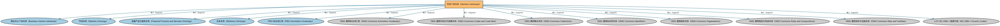

# 市场个体本体（Markets Individuals）说明

本文档对应 `MarketsIndividuals.rdf` / `MarketsIndividuals.ttl`。

## 1. 本文件是什么

收录全球主要金融市场的参考个体。

从机制上说，这是一个个体（individuals）文件：它本身不定义任何新的类或属性，装的全是命名个体（owl:NamedIndividual）——也就是一条条真实存在的实例数据（如具体的货币、市场、监管机构、法域）。它的 `owl:imports` 引入的是这些个体所属的类定义所在的本体。应用需要实例级参考数据时加载这类文件。

## 2. 个体构成（共 8061 个）

按个体所属类型统计（类型名为中文（English）对照）：

| 类型（Class） | 个体数量 |
|---|---|
| 金融服务提供商（FinancialServiceProvider） | 1649 |
| 运营层级市场标识符（OperatingLevelMarketIdentifier） | 1594 |
| 运营层级市场（OperatingLevelMarket） | 1546 |
| 市场板块层级市场标识符（MarketSegmentLevelMarketIdentifier） | 1289 |
| 市场板块层级市场（MarketSegmentLevelMarket） | 1273 |
| 法律实体（LegalEntity） | 613 |
| 多边交易设施（MultilateralTradingFacility） | 381 |
| 系统性内部撮合商（SystematicInternaliser） | 354 |
| 受监管交易所（RegulatedExchange） | 303 |
| 有组织交易设施（OrganizedTradingFacility） | 128 |
| 另类交易系统（AlternativeTradingSystem） | 88 |
| 设施（Facility） | 61 |
| 暗池（DarkPool） | 53 |
| 掉期执行设施（SwapExecutionFacility） | 37 |
| 加密资产服务提供商（CryptoAssetServicesProvider） | 28 |
| 认可市场营运者（RecognizedMarketOperator） | 27 |
| 指定合约市场（DesignatedContractMarket） | 26 |
| 核准发布安排（ApprovedPublicationArrangement） | 25 |
| 电子通讯网络（ElectronicCommunicationNetwork） | 12 |
| 报价驱动市场（QuoteDrivenMarket） | 7 |
| 场外设施（OffMarketFacility） | 5 |
| 竞价市场（AuctionMarket） | 4 |
| 交易报告设施（TradeReportingFacility） | 2 |
| 交易商间报价系统（InterdealerQuotationSystem） | 1 |
| 代码集（CodeSet） | 1 |

个体数量较多，仅举前 10 个示例，完整清单见同名 `.ttl` 文件：

| 个体（示例） | 类型 |
|---|---|
| 21X | 运营层级市场（OperatingLevelMarket） |
| 21X AG as service provider | 金融服务提供商（FinancialServiceProvider） |
| 21X operating-level market identifier | 运营层级市场标识符（OperatingLevelMarketIdentifier） |
| 24 EXCHANGE | 运营层级市场（OperatingLevelMarket） |
| 24 EXCHANGE operating-level market identifier | 运营层级市场标识符（OperatingLevelMarketIdentifier） |
| 24X BERMUDA LIMITED as service provider | 金融服务提供商（FinancialServiceProvider） |
| 24X NATIONAL EXCHANGE - DARK | 市场板块层级市场（MarketSegmentLevelMarket）、受监管交易所（RegulatedExchange） |
| 24X NATIONAL EXCHANGE - DARK market segment-level market identifier | 市场板块层级市场标识符（MarketSegmentLevelMarketIdentifier） |
| 24X NATIONAL EXCHANGE LLC | 运营层级市场（OperatingLevelMarket）、受监管交易所（RegulatedExchange） |
| 24X NATIONAL EXCHANGE LLC as service provider | 金融服务提供商（FinancialServiceProvider） |

## 3. 依赖的本体（owl:imports，13 个）

以下导入提供个体所属的类定义与相关参考数据：

| 导入本体 | 中文名称 | 简介 |
|---|---|---|
| `FBC/FunctionalEntities/BusinessCentersIndividuals.rdf` | 商业中心个体本体（Business Centers Individuals） | 收录全球主要商业中心（如纽约、伦敦、东京）的参考个体。 |
| `FBC/FunctionalEntities/Markets.rdf` | 市场本体（Markets Ontology） | 定义金融市场（market）：交易所、场外市场及其功能。 |
| `FBC/ProductsAndServices/FinancialProductsAndServices.rdf` | 金融产品与服务本体（Financial Products and Services Ontology） | 定义金融产品（financial product）与金融服务（financial service）及其提供、购买关系。 |
| `FND/Relations/Relations.rdf` | 关系本体（Relations Ontology） | FIBO 最底层的基础本体，定义参考（reference）、分类（classify）等通用关系与抽象概念，全库普遍依赖。 |
| `FND/Utilities/AnnotationVocabulary.rdf` | FIBO 标注词汇表（FIBO Annotation Vocabulary） | 定义 FIBO 专用的标注属性（如释义来源、成熟度等级），用于本体自身的元数据标注。 |
| `https://www.omg.org/spec/Commons/AnnotationVocabulary/` | OMG 通用标注词汇表（OMG Commons Annotation Vocabulary） | OMG 通用本体库（Commons）中的标注词汇表，提供概念映射等标注属性，FIBO 用它标注术语与外部标准的对应关系。 |
| `https://www.omg.org/spec/Commons/CodesAndCodeSets/` | OMG 通用代码与代码集本体（OMG Commons Codes and Code Sets） | Commons 库中的代码本体，定义代码、代码集及其维护方的通用概念，是 ISO 4217、ISO 3166 等编码体系建模的基础。 |
| `https://www.omg.org/spec/Commons/Collections/` | OMG 通用集合本体（OMG Commons Collections） | Commons 库中的集合本体，定义集合、成员等通用概念。 |
| `https://www.omg.org/spec/Commons/Identifiers/` | OMG 通用标识符本体（OMG Commons Identifiers） | Commons 库中的标识符本体，定义标识符及其编码方案的通用概念。 |
| `https://www.omg.org/spec/Commons/Organizations/` | OMG 通用组织本体（OMG Commons Organizations） | Commons 库中的组织本体，定义组织、组织成员与组织结构的通用概念。 |
| `https://www.omg.org/spec/Commons/RolesAndCompositions/` | OMG 通用角色与构成本体（OMG Commons Roles and Compositions） | Commons 库中的角色本体，定义角色及整体—部分构成关系的通用概念。 |
| `https://www.omg.org/spec/Commons/SitesAndFacilities/` | OMG 通用场所与设施本体（OMG Commons Sites and Facilities） | Commons 库中的场所与设施本体，定义物理场所、设施及其位置的通用概念。 |
| `https://www.omg.org/spec/LCC/Countries/ISO3166-1-CountryCodes/` | LCC ISO 3166-1 国家代码（ISO 3166-1 Country Codes） | LCC 中 ISO 3166-1 标准的国家/地区代码个体集（如 CN、US、MX），供法域与地址建模引用。 |

## 4. 文件

- 官方 RDF/XML：`MarketsIndividuals.rdf`
- 中文 Turtle：`MarketsIndividuals.ttl`
- 结构图：`MarketsIndividuals-structure.png` / `MarketsIndividuals-structure.svg`