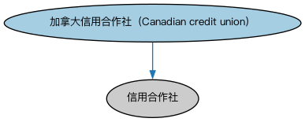

# 加拿大金融服务实体本体（Canadian Financial Services Entities Ontology）结构与公理说明

本文档对应 `CAFinancialServicesEntities.rdf` / `CAFinancialServicesEntities.ttl`，说明该本体的类、继承关系、属性和公理约定。结构图见 `CAFinancialServicesEntities-structure.png`（`CAFinancialServicesEntities-structure.svg` 为可缩放版本）。

## 1. 本体概述

定义加拿大法域下的金融服务机构类型与个体。

**在体系中的位置**：FBC 功能实体模块的北美扩展之一，与美国金融服务实体本体平行。

**上下游关系**：上游继承金融服务实体本体并依赖 BE 加拿大法域个体；下游为加拿大机构建模提供类型。

**与相近概念的差别**：与美国体系的差别——加拿大金融业由联邦特许银行主导、省级监管证券，机构类型体系比美国简单集中。

## 2. 类（Class）

| 类（Class） | 定义（Definition） |
|---|---|
| 加拿大信用合作社（Canadian credit union） | 非营利性金融机构，通常由公司雇员、工会或宗教团体成员组成，以合作互助协会形式运营。 |

### 2.1 继承关系（Inheritance）

- 加拿大信用合作社（Canadian credit union） ⊑ 信用合作社

## 5. 公理约定（Axioms）

- 加拿大信用合作社（Canadian credit union）：由…扮演（is played by） 协会 =1

## 6. 依赖（owl:imports，6 个）

本本体通过 `owl:imports` 引入以下本体，各项的中文名称与简介如下：

| 导入本体 | 中文名称 | 简介 |
|---|---|---|
| `BE/FunctionalEntities/FunctionalEntities.rdf` | 功能实体本体（Functional Entities Ontology） | 定义「功能实体」：按其在商业中承担的功能（而非法律形式）刻画的实体，是出版方、登记机构等功能性主体的基础。 |
| `BE/LegalEntities/CorporateBodies.rdf` | 法人团体本体（Corporate Bodies Ontology） | 定义依法设立、具有独立法律人格的法人团体（corporate body），是股份有限公司等具体法人类型的上位概念。 |
| `FBC/FunctionalEntities/FinancialServicesEntities.rdf` | 金融服务实体本体（Financial Services Entities Ontology） | FBC 域核心本体，定义金融服务机构（银行、券商、保险公司、资管机构等）的功能分类体系。 |
| `FND/Utilities/AnnotationVocabulary.rdf` | FIBO 标注词汇表（FIBO Annotation Vocabulary） | 定义 FIBO 专用的标注属性（如释义来源、成熟度等级），用于本体自身的元数据标注。 |
| `https://www.omg.org/spec/Commons/AnnotationVocabulary/` | OMG 通用标注词汇表（OMG Commons Annotation Vocabulary） | OMG 通用本体库（Commons）中的标注词汇表，提供概念映射等标注属性，FIBO 用它标注术语与外部标准的对应关系。 |
| `https://www.omg.org/spec/Commons/RolesAndCompositions/` | OMG 通用角色与构成本体（OMG Commons Roles and Compositions） | Commons 库中的角色本体，定义角色及整体—部分构成关系的通用概念。 |

## 7. 文件

- 官方 RDF/XML：`CAFinancialServicesEntities.rdf`
- 中文 Turtle：`CAFinancialServicesEntities.ttl`
- 结构图：`CAFinancialServicesEntities-structure.png` / `CAFinancialServicesEntities-structure.svg`