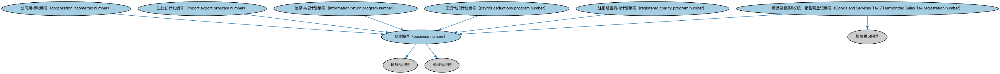

# 加拿大监管机构本体（Canadian Regulatory Agencies Ontology）结构与公理说明

本文档对应 `CARegulatoryAgencies.rdf` / `CARegulatoryAgencies.ttl`，说明该本体的类、继承关系、属性和公理约定。结构图见 `CARegulatoryAgencies-structure.png`（`CARegulatoryAgencies-structure.svg` 为可缩放版本）。

## 1. 本体概述

收录加拿大金融监管机构个体：加拿大金融机构监管署（OSFI）、加拿大银行（央行）等。

**在体系中的位置**：FBC 功能实体模块的北美扩展，监管机构本体的加拿大实例层。

**上下游关系**：上游依赖监管机构本体与 BE 加拿大法域个体；下游为加拿大监管归属判断提供实例。

**与相近概念的差别**：与美国监管机构本体的差别——加拿大银行监管集中在联邦层面（OSFI），证券监管分散在各省，没有全国统一的证监会。

## 2. 类（Class）

| 类（Class） | 定义（Definition） |
|---|---|
| 商品及服务税/统一销售税登记编号（Goods and Services Tax / Harmonized Sales Tax registration number） | 由实体的商业编号、'RT'缩写和用于申报 GST/HST 的 4 位子账户编号拼接而成。 |
| 商业编号（business number） | 加拿大法律实体（通常为企业）的标准标识符，是唯一的 9 位数字编号。 |
| 公司所得税编号（corporation income tax number） | 由实体的商业编号、'RC'缩写和用于申报公司所得税的 4 位子账户编号拼接而成。 |
| 进出口计划编号（import export program number） | 由实体的商业编号、'RM'缩写和用于海关及进出口申报的 4 位子账户编号拼接而成。 |
| 信息申报计划编号（information return program number） | 由实体的商业编号、'RZ'缩写和用于信息申报的 4 位子账户编号拼接而成。 |
| 工资代扣计划编号（payroll deductions program number） | 由实体的商业编号、'RP'缩写和用于申报工资代扣的 4 位子账户编号拼接而成。 |
| 注册慈善机构计划编号（registered charity program number） | 由实体的商业编号、'RR'缩写和用于注册慈善机构捐赠申报的 4 位子账户编号拼接而成。 |

### 2.1 继承关系（Inheritance）

- 商品及服务税/统一销售税登记编号（Goods and Services Tax / Harmonized Sales Tax registration number） ⊑ 增值税识别号
- 商品及服务税/统一销售税登记编号（Goods and Services Tax / Harmonized Sales Tax registration number） ⊑ 商业编号（business number）
- 商业编号（business number） ⊑ 税务标识符
- 商业编号（business number） ⊑ 组织标识符
- 公司所得税编号（corporation income tax number） ⊑ 商业编号（business number）
- 进出口计划编号（import export program number） ⊑ 商业编号（business number）
- 信息申报计划编号（information return program number） ⊑ 商业编号（business number）
- 工资代扣计划编号（payroll deductions program number） ⊑ 商业编号（business number）
- 注册慈善机构计划编号（registered charity program number） ⊑ 商业编号（business number）

## 5. 公理约定（Axioms）

- 商品及服务税/统一销售税登记编号（Goods and Services Tax / Harmonized Sales Tax registration number）：restriction
- 商品及服务税/统一销售税登记编号（Goods and Services Tax / Harmonized Sales Tax registration number）：restriction
- 商品及服务税/统一销售税登记编号（Goods and Services Tax / Harmonized Sales Tax registration number）：标识 分类账户 ≥0
- 商业编号（business number）：restriction
- 商业编号（business number）：restriction
- 公司所得税编号（corporation income tax number）：restriction
- 公司所得税编号（corporation income tax number）：restriction
- 公司所得税编号（corporation income tax number）：标识 分类账户 ≥0
- 进出口计划编号（import export program number）：restriction
- 进出口计划编号（import export program number）：restriction
- 进出口计划编号（import export program number）：标识 分类账户 ≥0
- 信息申报计划编号（information return program number）：restriction
- 信息申报计划编号（information return program number）：restriction
- 信息申报计划编号（information return program number）：标识 分类账户 ≥0
- 工资代扣计划编号（payroll deductions program number）：restriction
- 工资代扣计划编号（payroll deductions program number）：restriction
- 工资代扣计划编号（payroll deductions program number）：标识 分类账户 ≥0
- 注册慈善机构计划编号（registered charity program number）：restriction
- 注册慈善机构计划编号（registered charity program number）：restriction
- 注册慈善机构计划编号（registered charity program number）：标识 分类账户 ≥0

## 6. 依赖（owl:imports，27 个）

本本体通过 `owl:imports` 引入以下本体，各项的中文名称与简介如下：

| 导入本体 | 中文名称 | 简介 |
|---|---|---|
| `BE/GovernmentEntities/GovernmentEntities.rdf` | 政府实体本体（Government Entities Ontology） | 定义政府、政体（polity）、法域（jurisdiction）及政府实体的核心概念，是各区域政府实体本体的共同基础。 |
| `BE/GovernmentEntities/NorthAmericanJurisdiction/CAGovernmentEntitiesAndJurisdictions.rdf` | 加拿大政府实体与法域本体（Canadian Government Entities and Jurisdictions Ontology） | 收录加拿大的政体、联邦与省政府、法域个体。 |
| `BE/LegalEntities/CorporateBodies.rdf` | 法人团体本体（Corporate Bodies Ontology） | 定义依法设立、具有独立法律人格的法人团体（corporate body），是股份有限公司等具体法人类型的上位概念。 |
| `BE/LegalEntities/FormalBusinessOrganizations.rdf` | 正式商业组织本体（Formal Business Organizations Ontology） | 定义以营利为目的、依法注册的正式商业组织，连接法律实体与其商业功能。 |
| `BE/LegalEntities/LEIEntities.rdf` | LEI 法人实体本体（Legal Entity Identifier Entities Ontology） | 定义持有全球法人识别编码（LEI）的法人实体，对接 ISO 17442 标准的 LEI 体系。 |
| `FBC/FunctionalEntities/BusinessCentersIndividuals.rdf` | 商业中心个体本体（Business Centers Individuals） | 收录全球主要商业中心（如纽约、伦敦、东京）的参考个体。 |
| `FBC/FunctionalEntities/BusinessRegistries.rdf` | 商业登记机构本体（Business Registries Ontology） | 定义商业登记机构（如公司注册处）及其登记职能。 |
| `FBC/FunctionalEntities/CommercialRegistrationAuthorities.rdf` | 商事登记主管机关本体（Commercial Registration Authorities Ontology） | 定义负责商事登记的主管机关及其维护的登记记录。 |
| `FBC/FunctionalEntities/FinancialServicesEntities.rdf` | 金融服务实体本体（Financial Services Entities Ontology） | FBC 域核心本体，定义金融服务机构（银行、券商、保险公司、资管机构等）的功能分类体系。 |
| `FBC/ProductsAndServices/ClientsAndAccounts.rdf` | 客户与账户本体（Clients and Accounts Ontology） | 定义金融机构的客户、账户及账户持有关系。 |
| `FND/Parties/Parties.rdf` | 参与方本体（Parties Ontology） | 定义参与方（party）、独立主体（autonomous agent）与「角色扮演」（party in role），是 FIBO 全库使用最广的基础本体之一。 |
| `FND/Places/Addresses.rdf` | 地址本体（Addresses Ontology） | 定义邮政地址及其组成部分，为机构注册地、通讯地址建模。 |
| `FND/Relations/Relations.rdf` | 关系本体（Relations Ontology） | FIBO 最底层的基础本体，定义参考（reference）、分类（classify）等通用关系与抽象概念，全库普遍依赖。 |
| `FND/Utilities/AnnotationVocabulary.rdf` | FIBO 标注词汇表（FIBO Annotation Vocabulary） | 定义 FIBO 专用的标注属性（如释义来源、成熟度等级），用于本体自身的元数据标注。 |
| `https://www.omg.org/spec/Commons/AnnotationVocabulary/` | OMG 通用标注词汇表（OMG Commons Annotation Vocabulary） | OMG 通用本体库（Commons）中的标注词汇表，提供概念映射等标注属性，FIBO 用它标注术语与外部标准的对应关系。 |
| `https://www.omg.org/spec/Commons/Collections/` | OMG 通用集合本体（OMG Commons Collections） | Commons 库中的集合本体，定义集合、成员等通用概念。 |
| `https://www.omg.org/spec/Commons/ContextualDesignators/` | OMG 通用语境指称本体（OMG Commons Contextual Designators） | Commons 库中的语境指称本体，定义「在某个语境下指代某物的名称/符号」，是地址、账户号码等语境相关标识的基础。 |
| `https://www.omg.org/spec/Commons/Designators/` | OMG 通用指称符本体（OMG Commons Designators） | Commons 库中的指称符本体，定义名称、标识符等「指代某物的符号」的通用概念。 |
| `https://www.omg.org/spec/Commons/Documents/` | OMG 通用文档本体（OMG Commons Documents） | Commons 库中的文档本体，定义文档及其组成部分的通用概念。 |
| `https://www.omg.org/spec/Commons/Identifiers/` | OMG 通用标识符本体（OMG Commons Identifiers） | Commons 库中的标识符本体，定义标识符及其编码方案的通用概念。 |
| `https://www.omg.org/spec/Commons/Locations/` | OMG 通用位置本体（OMG Commons Locations） | Commons 库中的位置本体，定义地理位置、地点的通用概念。 |
| `https://www.omg.org/spec/Commons/Organizations/` | OMG 通用组织本体（OMG Commons Organizations） | Commons 库中的组织本体，定义组织、组织成员与组织结构的通用概念。 |
| `https://www.omg.org/spec/Commons/RegistrationAuthorities/` | OMG 通用登记主管机构本体（OMG Commons Registration Authorities） | Commons 库中的登记主管机构本体，定义负责登记注册的主管机构及其登记行为的通用概念。 |
| `https://www.omg.org/spec/Commons/RegulatoryAgencies/` | OMG 通用监管机构本体（OMG Commons Regulatory Agencies） | Commons 库中的监管机构本体，定义监管机构及其监管职权的通用概念。 |
| `https://www.omg.org/spec/Commons/RolesAndCompositions/` | OMG 通用角色与构成本体（OMG Commons Roles and Compositions） | Commons 库中的角色本体，定义角色及整体—部分构成关系的通用概念。 |
| `https://www.omg.org/spec/LCC/Countries/ISO3166-1-CountryCodes/` | LCC ISO 3166-1 国家代码（ISO 3166-1 Country Codes） | LCC 中 ISO 3166-1 标准的国家/地区代码个体集（如 CN、US、MX），供法域与地址建模引用。 |
| `https://www.omg.org/spec/LCC/Countries/Regions/ISO3166-2-SubdivisionCodes-CA/` | LCC ISO 3166-2 子分区代码·CA（ISO 3166-2 Subdivision Codes for 加拿大） | LCC 中 ISO 3166-2 标准下加拿大的省/州级行政区代码个体集。 |

## 7. 文件

- 官方 RDF/XML：`CARegulatoryAgencies.rdf`
- 中文 Turtle：`CARegulatoryAgencies.ttl`
- 结构图：`CARegulatoryAgencies-structure.png` / `CARegulatoryAgencies-structure.svg`