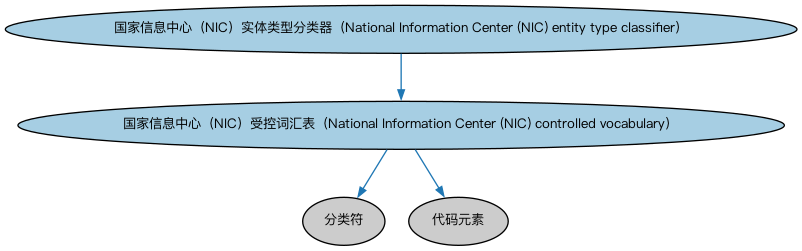

# 美国国家信息中心受控词汇本体（US NIC Controlled Vocabularies Ontology）结构与公理说明

本文档对应 `USNationalInformationCenterControlledVocabularies.rdf` / `USNationalInformationCenterControlledVocabularies.ttl`，说明该本体的类、继承关系、属性和公理约定。结构图见 `USNationalInformationCenterControlledVocabularies-structure.png`（`USNationalInformationCenterControlledVocabularies-structure.svg` 为可缩放版本）。

## 1. 本体概述

收录美联储国家信息中心（NIC）用于描述金融机构属性的受控词汇个体（机构类型、活动代码等）。

**在体系中的位置**：FBC 功能实体模块的美国参考数据本体。

**上下游关系**：上游依赖美国金融服务实体与监管机构本体；下游为对接美联储 NIC 数据库（机构主数据）的应用提供标准取值。

**与相近概念的差别**：受控词汇是「标准取值清单」，区别于定义概念结构的本体——它服务数据对接而非概念推理。

## 2. 类（Class）

| 类（Class） | 定义（Definition） |
|---|---|
| 国家信息中心（NIC）受控词汇表（National Information Center (NIC) controlled vocabulary） | 用于刻画国家信息中心（NIC）所管理金融服务提供商内容之某项特征或方面的受控词汇表。 |
| 国家信息中心（NIC）实体类型分类器（National Information Center (NIC) entity type classifier） | 用于描述国家信息中心（NIC）信息库所管理功能实体性质的受控词汇表和代码。 |

### 2.1 继承关系（Inheritance）

- 国家信息中心（NIC）受控词汇表（National Information Center (NIC) controlled vocabulary） ⊑ 分类符
- 国家信息中心（NIC）受控词汇表（National Information Center (NIC) controlled vocabulary） ⊑ 代码元素
- 国家信息中心（NIC）实体类型分类器（National Information Center (NIC) entity type classifier） ⊑ 国家信息中心（NIC）受控词汇表（National Information Center (NIC) controlled vocabulary）

## 5. 公理约定（Axioms）

- 国家信息中心（NIC）受控词汇表（National Information Center (NIC) controlled vocabulary）：restriction
- 国家信息中心（NIC）受控词汇表（National Information Center (NIC) controlled vocabulary）：restriction
- 国家信息中心（NIC）实体类型分类器（National Information Center (NIC) entity type classifier）：分类 金融服务提供商 ≥0

## 6. 依赖（owl:imports，11 个）

本本体通过 `owl:imports` 引入以下本体，各项的中文名称与简介如下：

| 导入本体 | 中文名称 | 简介 |
|---|---|---|
| `FBC/FunctionalEntities/FinancialServicesEntities.rdf` | 金融服务实体本体（Financial Services Entities Ontology） | FBC 域核心本体，定义金融服务机构（银行、券商、保险公司、资管机构等）的功能分类体系。 |
| `FBC/FunctionalEntities/NorthAmericanEntities/USFinancialServicesEntities.rdf` | 美国金融服务实体本体（US Financial Services Entities Ontology） | 定义美国法域下的金融服务机构类型与个体。 |
| `FBC/FunctionalEntities/NorthAmericanEntities/USRegulatoryAgencies.rdf` | 美国监管机构本体（US Regulatory Agencies Ontology） | 收录美国金融监管机构个体（如美联储、证监会 SEC、货币监理署 OCC）。 |
| `FBC/ProductsAndServices/FinancialProductsAndServices.rdf` | 金融产品与服务本体（Financial Products and Services Ontology） | 定义金融产品（financial product）与金融服务（financial service）及其提供、购买关系。 |
| `FND/Utilities/AnnotationVocabulary.rdf` | FIBO 标注词汇表（FIBO Annotation Vocabulary） | 定义 FIBO 专用的标注属性（如释义来源、成熟度等级），用于本体自身的元数据标注。 |
| `https://www.omg.org/spec/Commons/AnnotationVocabulary/` | OMG 通用标注词汇表（OMG Commons Annotation Vocabulary） | OMG 通用本体库（Commons）中的标注词汇表，提供概念映射等标注属性，FIBO 用它标注术语与外部标准的对应关系。 |
| `https://www.omg.org/spec/Commons/Classifiers/` | OMG 通用分类器本体（OMG Commons Classifiers） | OMG 通用本体库（Commons）中的分类器本体，定义分类方案、类别与归类关系的通用概念，FIBO 的分类建模建立在其上。 |
| `https://www.omg.org/spec/Commons/CodesAndCodeSets/` | OMG 通用代码与代码集本体（OMG Commons Codes and Code Sets） | Commons 库中的代码本体，定义代码、代码集及其维护方的通用概念，是 ISO 4217、ISO 3166 等编码体系建模的基础。 |
| `https://www.omg.org/spec/Commons/Collections/` | OMG 通用集合本体（OMG Commons Collections） | Commons 库中的集合本体，定义集合、成员等通用概念。 |
| `https://www.omg.org/spec/Commons/Designators/` | OMG 通用指称符本体（OMG Commons Designators） | Commons 库中的指称符本体，定义名称、标识符等「指代某物的符号」的通用概念。 |
| `https://www.omg.org/spec/Commons/TextDatatype/` | OMG 通用文本数据类型（OMG Commons Text Datatype） | Commons 库中的文本数据类型定义，提供带语言标记的文本等基础数据类型。 |

## 7. 文件

- 官方 RDF/XML：`USNationalInformationCenterControlledVocabularies.rdf`
- 中文 Turtle：`USNationalInformationCenterControlledVocabularies.ttl`
- 结构图：`USNationalInformationCenterControlledVocabularies-structure.png` / `USNationalInformationCenterControlledVocabularies-structure.svg`