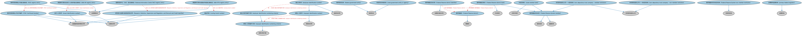

# 美国监管机构本体（US Regulatory Agencies Ontology）结构与公理说明

本文档对应 `USRegulatoryAgencies.rdf` / `USRegulatoryAgencies.ttl`，说明该本体的类、继承关系、属性和公理约定。结构图见 `USRegulatoryAgencies-structure.png`（`USRegulatoryAgencies-structure.svg` 为可缩放版本）。

## 1. 本体概述

收录美国金融监管机构个体：美联储（Fed）、证监会（SEC）、货币监理署（OCC）、联邦存款保险公司（FDIC）、商品期货交易委员会（CFTC）等。

**在体系中的位置**：FBC 功能实体模块的北美扩展，监管机构本体的美国实例层。

**上下游关系**：上游依赖监管机构本体与 BE 美国法域个体；下游为美国监管归属判断与合规建模提供实例。

**与相近概念的差别**：与欧盟监管机构的差别——美国按「功能分业」设置多家机构（银行、证券、期货分管），各机构管辖范围有交叉，这是美式监管的典型特征。

## 2. 类（Class）

| 类（Class） | 定义（Definition） |
|---|---|
| 美国银行家协会发行人识别号登记册条目（ABA IIN registry entry） | 美国银行家协会（ABA）发行人识别号（IIN）登记册中的条目，是 ABA 为其签发 IIN 的机构所收集的金融机构特征信息库。 |
| 美国银行家协会路由号码登记册条目（ABA RTN registry entry） | 美国银行家协会（ABA）路由号码（RTN）登记册中的条目，是 ABA 注册机构代表 ABA 收集的金融机构特征信息库。 |
| 联邦存款保险公司证书编号（FDIC Certificate Number） | 联邦存款保险公司（FDIC）在批准存款性机构参保申请后向其签发的标识符。 |
| 联邦存款保险公司登记册条目（FDIC registry entry） | 联邦存款保险公司（FDIC）机构名录中的条目，是 FDIC 就其承保机构收集的金融机构特征信息库。 |
| 联邦储备体系成员（Federal Reserve System member） | 属于联邦储备体系（FRS）成员的金融机构。 |
| 联邦储备体系非成员机构（Federal Reserve System non-member institution） | 不属于联邦储备体系（FRS）成员的存款性机构。 |
| 联邦储备区（Federal Reserve district） | 标识某一联邦储备银行管辖范围的美国区域，以该储备银行所在城市编号和命名。 |
| 联邦储备区银行（Federal Reserve district bank） | 对美国特定区域拥有管辖权的联邦储备区成员银行，以储备银行所在城市命名。 |
| 联邦储备区标识符（Federal Reserve district identifier） | 与某一联邦储备区相关联的标识符。 |
| 国家信息中心（NIC）登记册条目（National Information Center (NIC) registry entry） | 国家信息中心（NIC）信息库中的条目，该信息库由联邦储备收集金融数据和机构特征信息。 |
| 研究统计监管与贴现信贷标识符（Research, Statistics, Supervision and Regulation, and Discount and Credit identifier） | 联邦储备为监管和监督目的向金融机构分配的唯一标识符（RSSD ID）。 |
| 雇主识别号（employer identification number） | 由美国国税局（IRS）为在美国经营的企业实体分配的唯一九位数字编号，用于身份识别。 |
| 雇主识别号编号方案（employer identification numbering scheme） | 美国用于标识企业实体的纳税人识别编号方案。 |
| 联邦政府实体（federal government entity） | 美国政府机构体系中的独立机构、直属机构或其他永久或半永久性正式组织。 |
| 发行人识别号（issuer identification number） | 一种编号体系，用于将信用卡、借记卡或其他卡片识别为由特定金融机构发行。 |
| 非存款性信托公司——成员机构（non-depository trust company - member institution） | 属于联邦储备体系成员的非存款性信托公司。 |
| 非存款性信托公司——非成员机构（non-depository trust company - non-member institution） | 不属于联邦储备体系成员的非存款性信托公司。 |
| 主要联邦监管机构（primary federal regulator） | 被指定为对某一机构负主要监督职责的联邦监管机构。 |
| 路由号码（routing transit number） | 主要用于美国的九位数字唯一标识符，用于在资金清算时标识银行或其他金融机构。 |
| 州政府实体或机构（state government entity or agency） | 州政府机构体系中的独立机构、直属机构或其他永久或半永久性正式组织。 |
| 州成员银行（state member bank） | 属于联邦储备体系（FRS）成员的州特许银行。 |
| 纳税人识别号（taxpayer identification number） | 美国国税局（IRS）在税收管理中使用的识别编号。 |
| 纳税人识别编号方案（taxpayer identification numbering scheme） | 美国使用的税务识别编号方案。 |

### 2.1 继承关系（Inheritance）

- 美国银行家协会发行人识别号登记册条目（ABA IIN registry entry） ⊑ 注册簿条目
- 美国银行家协会路由号码登记册条目（ABA RTN registry entry） ⊑ 注册簿条目
- 联邦存款保险公司证书编号（FDIC Certificate Number） ⊑ 金融服务提供商标识符
- 联邦存款保险公司证书编号（FDIC Certificate Number） ⊑ 注册标识符
- 联邦存款保险公司登记册条目（FDIC registry entry） ⊑ 注册簿条目
- 联邦储备体系成员（Federal Reserve System member） ⊑ 金融机构
- 联邦储备体系成员（Federal Reserve System member） ⊑ 组织成员
- 联邦储备体系非成员机构（Federal Reserve System non-member institution） ⊑ 存款性机构
- 联邦储备区（Federal Reserve district） ⊑ 管辖权
- 联邦储备区银行（Federal Reserve district bank） ⊑ 中央银行
- 联邦储备区银行（Federal Reserve district bank） ⊑ 联邦储备体系成员（Federal Reserve System member）
- 联邦储备区标识符（Federal Reserve district identifier） ⊑ 地理区域标识符
- 国家信息中心（NIC）登记册条目（National Information Center (NIC) registry entry） ⊑ 注册簿条目
- 研究统计监管与贴现信贷标识符（Research, Statistics, Supervision and Regulation, and Discount and Credit identifier） ⊑ 金融服务提供商标识符
- 研究统计监管与贴现信贷标识符（Research, Statistics, Supervision and Regulation, and Discount and Credit identifier） ⊑ 注册标识符
- 雇主识别号（employer identification number） ⊑ 纳税人识别号（taxpayer identification number）
- 雇主识别号（employer identification number） ⊑ 组织标识符
- 雇主识别号编号方案（employer identification numbering scheme） ⊑ 纳税人识别编号方案（taxpayer identification numbering scheme）
- 联邦政府实体（federal government entity） ⊑ 政府机关
- 发行人识别号（issuer identification number） ⊑ 金融服务提供商标识符
- 发行人识别号（issuer identification number） ⊑ 注册标识符
- 非存款性信托公司——成员机构（non-depository trust company - member institution） ⊑ 非存款性信托公司
- 非存款性信托公司——成员机构（non-depository trust company - member institution） ⊑ 联邦储备体系成员（Federal Reserve System member）
- 非存款性信托公司——非成员机构（non-depository trust company - non-member institution） ⊑ 非存款性信托公司
- 主要联邦监管机构（primary federal regulator） ⊑ 监管机构
- 路由号码（routing transit number） ⊑ 金融服务提供商标识符
- 路由号码（routing transit number） ⊑ 注册标识符
- 州政府实体或机构（state government entity or agency） ⊑ 政府机关
- 州成员银行（state member bank） ⊑ 州特许银行
- 州成员银行（state member bank） ⊑ 联邦储备体系成员（Federal Reserve System member）
- 纳税人识别号（taxpayer identification number） ⊑ 税务标识符
- 纳税人识别编号方案（taxpayer identification numbering scheme） ⊑ 税务识别方案

## 3. 对象属性（Object Property）

| 属性（Property） | 中文（English） | 定义（Definition） | 说明 |
|---|---|---|---|
| fibo-fbc-fct-usjrga:hasPrimaryFederalRegulator | 具有主要联邦监管机构（has primary federal regulator） | 标识某一机构的主要联邦监管机构。 | 定义域（domain）：金融服务提供商；值域（range）：主要联邦监管机构（primary federal regulator）；子属性（subPropertyOf）：受……监管 |
| fibo-fbc-fct-usjrga:hasSecondaryFederalRegulator | 具有次要联邦监管机构（has secondary federal regulator） | 标识某一机构在主要联邦监管机构之外的其他联邦监管机构。 | 定义域（domain）：金融服务提供商；值域（range）：监管机构；子属性（subPropertyOf）：受……监管 |

## 5. 公理约定（Axioms）

- 美国银行家协会发行人识别号登记册条目（ABA IIN registry entry）：适用于 only 金融机构
- 美国银行家协会发行人识别号登记册条目（ABA IIN registry entry）：restriction
- 美国银行家协会发行人识别号登记册条目（ABA IIN registry entry）：包含 some 发行人识别号（issuer identification number）
- 美国银行家协会路由号码登记册条目（ABA RTN registry entry）：适用于 only 金融机构
- 美国银行家协会路由号码登记册条目（ABA RTN registry entry）：restriction
- 美国银行家协会路由号码登记册条目（ABA RTN registry entry）：包含 some 路由号码（routing transit number）
- 联邦存款保险公司证书编号（FDIC Certificate Number）：restriction
- 联邦存款保险公司证书编号（FDIC Certificate Number）：restriction
- 联邦存款保险公司登记册条目（FDIC registry entry）：适用于 only 存款性机构
- 联邦存款保险公司登记册条目（FDIC registry entry）：restriction
- 联邦存款保险公司登记册条目（FDIC registry entry）：包含 some 联邦存款保险公司证书编号（FDIC Certificate Number）
- 联邦储备体系成员（Federal Reserve System member）：由…扮演（is played by） some（restriction）
- 联邦储备体系非成员机构（Federal Reserve System non-member institution）：restriction
- 联邦储备体系非成员机构（Federal Reserve System non-member institution）：由…扮演（is played by） some（restriction）
- 联邦储备体系非成员机构（Federal Reserve System non-member institution） 与 联邦储备体系成员（Federal Reserve System member） 互斥（disjointWith）
- 联邦储备区银行（Federal Reserve district bank）：restriction
- 联邦储备区银行（Federal Reserve district bank）：具有管辖权 联邦储备区（Federal Reserve district） =1
- 联邦储备区标识符（Federal Reserve district identifier）：标识 联邦储备区（Federal Reserve district） =1
- 国家信息中心（NIC）登记册条目（National Information Center (NIC) registry entry）：适用于 only 金融服务提供商
- 国家信息中心（NIC）登记册条目（National Information Center (NIC) registry entry）：restriction
- 国家信息中心（NIC）登记册条目（National Information Center (NIC) registry entry）：包含 some 研究统计监管与贴现信贷标识符（Research, Statistics, Supervision and Regulation, and Discount and Credit identifier）
- 研究统计监管与贴现信贷标识符（Research, Statistics, Supervision and Regulation, and Discount and Credit identifier）：restriction
- 研究统计监管与贴现信贷标识符（Research, Statistics, Supervision and Regulation, and Discount and Credit identifier）：restriction
- 雇主识别号（employer identification number）：是……的成员 雇主识别号编号方案（employer identification numbering scheme） =1
- 联邦政府实体（federal government entity）：restriction
- 联邦政府实体（federal government entity）：restriction
- 发行人识别号（issuer identification number）：restriction
- 发行人识别号（issuer identification number）：restriction
- 发行人识别号（issuer identification number）：restriction
- 发行人识别号（issuer identification number）：标识 金融机构 =1
- 非存款性信托公司——非成员机构（non-depository trust company - non-member institution） 与 非存款性信托公司——成员机构（non-depository trust company - member institution） 互斥（disjointWith）
- 主要联邦监管机构（primary federal regulator）：由…扮演（is played by） 政府机关 =1
- 路由号码（routing transit number）：restriction
- 路由号码（routing transit number）：restriction
- 路由号码（routing transit number）：restriction
- 州政府实体或机构（state government entity or agency）：restriction
- 州政府实体或机构（state government entity or agency）：具有管辖权 some（具有覆盖范围 some（restriction））
- 纳税人识别号（taxpayer identification number）：restriction
- 纳税人识别号（taxpayer identification number）：是……的成员 纳税人识别编号方案（taxpayer identification numbering scheme） =1
- 纳税人识别编号方案（taxpayer identification numbering scheme）：restriction

## 6. 依赖（owl:imports，29 个）

本本体通过 `owl:imports` 引入以下本体，各项的中文名称与简介如下：

| 导入本体 | 中文名称 | 简介 |
|---|---|---|
| `BE/GovernmentEntities/GovernmentEntities.rdf` | 政府实体本体（Government Entities Ontology） | 定义政府、政体（polity）、法域（jurisdiction）及政府实体的核心概念，是各区域政府实体本体的共同基础。 |
| `BE/GovernmentEntities/NorthAmericanJurisdiction/USGovernmentEntitiesAndJurisdictions.rdf` | 美国政府实体与法域本体（US Government Entities and Jurisdictions Ontology） | 收录美国的政体、联邦与各州政府、法域个体，是北美金融建模最常用的法域参考数据。 |
| `BE/LegalEntities/CorporateBodies.rdf` | 法人团体本体（Corporate Bodies Ontology） | 定义依法设立、具有独立法律人格的法人团体（corporate body），是股份有限公司等具体法人类型的上位概念。 |
| `BE/LegalEntities/FormalBusinessOrganizations.rdf` | 正式商业组织本体（Formal Business Organizations Ontology） | 定义以营利为目的、依法注册的正式商业组织，连接法律实体与其商业功能。 |
| `BE/LegalEntities/LEIEntities.rdf` | LEI 法人实体本体（Legal Entity Identifier Entities Ontology） | 定义持有全球法人识别编码（LEI）的法人实体，对接 ISO 17442 标准的 LEI 体系。 |
| `BE/OwnershipAndControl/Executives.rdf` | 高管本体（Executives Ontology） | 定义公司高管（executive）、董事会成员及其职务角色，刻画「谁在管理公司」。 |
| `FBC/FunctionalEntities/BusinessCentersIndividuals.rdf` | 商业中心个体本体（Business Centers Individuals） | 收录全球主要商业中心（如纽约、伦敦、东京）的参考个体。 |
| `FBC/FunctionalEntities/BusinessRegistries.rdf` | 商业登记机构本体（Business Registries Ontology） | 定义商业登记机构（如公司注册处）及其登记职能。 |
| `FBC/FunctionalEntities/CommercialRegistrationAuthorities.rdf` | 商事登记主管机关本体（Commercial Registration Authorities Ontology） | 定义负责商事登记的主管机关及其维护的登记记录。 |
| `FBC/FunctionalEntities/FinancialServicesEntities.rdf` | 金融服务实体本体（Financial Services Entities Ontology） | FBC 域核心本体，定义金融服务机构（银行、券商、保险公司、资管机构等）的功能分类体系。 |
| `FBC/FunctionalEntities/NorthAmericanEntities/USFinancialServicesEntities.rdf` | 美国金融服务实体本体（US Financial Services Entities Ontology） | 定义美国法域下的金融服务机构类型与个体。 |
| `FBC/ProductsAndServices/FinancialProductsAndServices.rdf` | 金融产品与服务本体（Financial Products and Services Ontology） | 定义金融产品（financial product）与金融服务（financial service）及其提供、购买关系。 |
| `FND/Parties/Parties.rdf` | 参与方本体（Parties Ontology） | 定义参与方（party）、独立主体（autonomous agent）与「角色扮演」（party in role），是 FIBO 全库使用最广的基础本体之一。 |
| `FND/Places/Addresses.rdf` | 地址本体（Addresses Ontology） | 定义邮政地址及其组成部分，为机构注册地、通讯地址建模。 |
| `FND/Relations/Relations.rdf` | 关系本体（Relations Ontology） | FIBO 最底层的基础本体，定义参考（reference）、分类（classify）等通用关系与抽象概念，全库普遍依赖。 |
| `FND/Utilities/AnnotationVocabulary.rdf` | FIBO 标注词汇表（FIBO Annotation Vocabulary） | 定义 FIBO 专用的标注属性（如释义来源、成熟度等级），用于本体自身的元数据标注。 |
| `https://www.omg.org/spec/Commons/AnnotationVocabulary/` | OMG 通用标注词汇表（OMG Commons Annotation Vocabulary） | OMG 通用本体库（Commons）中的标注词汇表，提供概念映射等标注属性，FIBO 用它标注术语与外部标准的对应关系。 |
| `https://www.omg.org/spec/Commons/Collections/` | OMG 通用集合本体（OMG Commons Collections） | Commons 库中的集合本体，定义集合、成员等通用概念。 |
| `https://www.omg.org/spec/Commons/ContextualDesignators/` | OMG 通用语境指称本体（OMG Commons Contextual Designators） | Commons 库中的语境指称本体，定义「在某个语境下指代某物的名称/符号」，是地址、账户号码等语境相关标识的基础。 |
| `https://www.omg.org/spec/Commons/Designators/` | OMG 通用指称符本体（OMG Commons Designators） | Commons 库中的指称符本体，定义名称、标识符等「指代某物的符号」的通用概念。 |
| `https://www.omg.org/spec/Commons/Documents/` | OMG 通用文档本体（OMG Commons Documents） | Commons 库中的文档本体，定义文档及其组成部分的通用概念。 |
| `https://www.omg.org/spec/Commons/Identifiers/` | OMG 通用标识符本体（OMG Commons Identifiers） | Commons 库中的标识符本体，定义标识符及其编码方案的通用概念。 |
| `https://www.omg.org/spec/Commons/Locations/` | OMG 通用位置本体（OMG Commons Locations） | Commons 库中的位置本体，定义地理位置、地点的通用概念。 |
| `https://www.omg.org/spec/Commons/Organizations/` | OMG 通用组织本体（OMG Commons Organizations） | Commons 库中的组织本体，定义组织、组织成员与组织结构的通用概念。 |
| `https://www.omg.org/spec/Commons/RegistrationAuthorities/` | OMG 通用登记主管机构本体（OMG Commons Registration Authorities） | Commons 库中的登记主管机构本体，定义负责登记注册的主管机构及其登记行为的通用概念。 |
| `https://www.omg.org/spec/Commons/RegulatoryAgencies/` | OMG 通用监管机构本体（OMG Commons Regulatory Agencies） | Commons 库中的监管机构本体，定义监管机构及其监管职权的通用概念。 |
| `https://www.omg.org/spec/Commons/RolesAndCompositions/` | OMG 通用角色与构成本体（OMG Commons Roles and Compositions） | Commons 库中的角色本体，定义角色及整体—部分构成关系的通用概念。 |
| `https://www.omg.org/spec/LCC/Countries/ISO3166-1-CountryCodes/` | LCC ISO 3166-1 国家代码（ISO 3166-1 Country Codes） | LCC 中 ISO 3166-1 标准的国家/地区代码个体集（如 CN、US、MX），供法域与地址建模引用。 |
| `https://www.omg.org/spec/LCC/Countries/Regions/ISO3166-2-SubdivisionCodes-US/` | LCC ISO 3166-2 子分区代码·US（ISO 3166-2 Subdivision Codes for 美国） | LCC 中 ISO 3166-2 标准下美国的省/州级行政区代码个体集。 |

## 7. 文件

- 官方 RDF/XML：`USRegulatoryAgencies.rdf`
- 中文 Turtle：`USRegulatoryAgencies.ttl`
- 结构图：`USRegulatoryAgencies-structure.png` / `USRegulatoryAgencies-structure.svg`