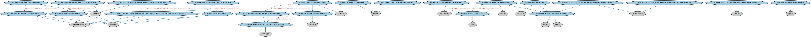

# 美国监管机构本体（US Regulatory Agencies Ontology）结构与公理说明

本文档对应 `USRegulatoryAgencies.rdf` / `USRegulatoryAgencies.ttl`，说明该本体的类、继承关系、属性和公理约定。结构图见 `USRegulatoryAgencies-structure.png`（`USRegulatoryAgencies-structure.svg` 为可缩放版本）。

## 1. 本体概述

收录美国金融监管机构个体：美联储（Fed）、证监会（SEC）、货币监理署（OCC）、联邦存款保险公司（FDIC）、商品期货交易委员会（CFTC）等。

**在体系中的位置**：FBC 功能实体模块的北美扩展，监管机构本体的美国实例层。

**上下游关系**：上游依赖监管机构本体与 BE 美国法域个体；下游为美国监管归属判断与合规建模提供实例。

**与相近概念的差别**：与欧盟监管机构的差别——美国按「功能分业」设置多家机构（银行、证券、期货分管），各机构管辖范围有交叉，这是美式监管的典型特征。

本本体中类与类的核心关系如下（完整细节见各类小节）：

- **美国银行家协会发行人识别号登记册条目（ABA IIN registry entry）** 继承 **注册簿条目（RegistryEntry）**
- **美国银行家协会路由号码登记册条目（ABA RTN registry entry）** 继承 **注册簿条目（RegistryEntry）**
- **联邦存款保险公司证书编号（FDIC Certificate Number）** 继承 **金融服务提供商标识符（FinancialServiceProviderIdentifier）**
- **联邦存款保险公司证书编号（FDIC Certificate Number）** 继承 **注册标识符（RegisteredIdentifier）**
- **联邦存款保险公司登记册条目（FDIC registry entry）** 继承 **注册簿条目（RegistryEntry）**
- **联邦储备体系成员（Federal Reserve System member）** 继承 **金融机构（FinancialInstitution）**
- **联邦储备体系成员（Federal Reserve System member）** 继承 **组织成员（OrganizationMember）**
- **联邦储备体系非成员机构（Federal Reserve System non-member institution）** 继承 **存款性机构（DepositoryInstitution）**
- **联邦储备区（Federal Reserve district）** 继承 **管辖权（Jurisdiction）**
- **联邦储备区银行（Federal Reserve district bank）** 继承 **中央银行（CentralBank）**
- **联邦储备区银行（Federal Reserve district bank）** 继承 **联邦储备体系成员（Federal Reserve System member）**
- **联邦储备区标识符（Federal Reserve district identifier）** 继承 **地理区域标识符（GeographicRegionIdentifier）**
- 其余 20 条关系从略。

## 2. 类（Class）

| 类（Class） | 定义（Definition） |
|---|---|
| 美国银行家协会发行人识别号登记册条目（ABA IIN registry entry） | 美国银行家协会（ABA）发行人识别号（IIN）登记册中的条目，是 ABA 为其签发 IIN 的机构所收集的金融机构特征信息库。 an entry in the ABA IIN registry, a repository of financial institution characteristics collected by the ABA for those institutions to which they issue IINs |
| 美国银行家协会路由号码登记册条目（ABA RTN registry entry） | 美国银行家协会（ABA）路由号码（RTN）登记册中的条目，是 ABA 注册机构代表 ABA 收集的金融机构特征信息库。 an entry in the ABA RTN registry, a repository of financial institution characteristics collected by the ABA Registrar on behalf of the ABA |
| 联邦存款保险公司证书编号（FDIC Certificate Number） | 联邦存款保险公司（FDIC）在批准存款性机构参保申请后向其签发的标识符。 identifier issued to a depository institution by the FDIC on approval of that institution's application for insurance |
| 联邦存款保险公司登记册条目（FDIC registry entry） | 联邦存款保险公司（FDIC）机构名录中的条目，是 FDIC 就其承保机构收集的金融机构特征信息库。 an entry in the FDIC institution directory, a repository of financial institution characteristics collected by the FDIC related to the institutions they insure |
| 联邦储备体系成员（Federal Reserve System member） | 属于联邦储备体系（FRS）成员的金融机构。 financial institution that is a member of the Federal Reserve System (FRS) |
| 联邦储备体系非成员机构（Federal Reserve System non-member institution） | 不属于联邦储备体系（FRS）成员的存款性机构。 depository institution that is not member of the Federal Reserve System (FRS) |
| 联邦储备区（Federal Reserve district） | 标识某一联邦储备银行管辖范围的美国区域，以该储备银行所在城市编号和命名。 a region of the US identifying the jurisdiction of a Federal Reserve Bank, numbered and named for the city in which that reserve bank is located |
| 联邦储备区银行（Federal Reserve district bank） | 对美国特定区域拥有管辖权的联邦储备区成员银行，以储备银行所在城市命名。 Federal Reserve district and member bank, with jurisdiction over a specific region of the US, named for the city in which the reserve bank is located |
| 联邦储备区标识符（Federal Reserve district identifier） | 与某一联邦储备区相关联的标识符。 identifier associated with a Federal Reserve district |
| 国家信息中心（NIC）登记册条目（National Information Center (NIC) registry entry） | 国家信息中心（NIC）信息库中的条目，该信息库由联邦储备收集金融数据和机构特征信息。 an entry in the the National Information Center (NIC) repository, a repository of financial data and institution characteristics collected by the Federal Reserve System |
| 研究统计监管与贴现信贷标识符（Research, Statistics, Supervision and Regulation, and Discount and Credit identifier） | 联邦储备为监管和监督目的向金融机构分配的唯一标识符（RSSD ID）。 unique identifier assigned by the Federal Reserve to financial institutions for regulatory and oversight purposes |
| 雇主识别号（employer identification number） | 由美国国税局（IRS）为在美国经营的企业实体分配的唯一九位数字编号，用于身份识别。 unique nine-digit number assigned by the Internal Revenue Service (IRS) to business entities operating in the United States for the purposes of identification |
| 雇主识别号编号方案（employer identification numbering scheme） | 美国用于标识企业实体的纳税人识别编号方案。 taxpayer identification numbering scheme used in the United States to identify business entities |
| 联邦政府实体（federal government entity） | 美国政府机构体系中的独立机构、直属机构或其他永久或半永久性正式组织。 formal organization that is an independent agency, instrumentality or other permanent or semi-permanent organization in the machinery of government in the United States, authorized by the executive branch or by Congress, that operates at the national (federal) level |
| 发行人识别号（issuer identification number） | 一种编号体系，用于将信用卡、借记卡或其他卡片识别为由特定金融机构发行。 a numbering system that allows a credit, debit, or other card to be identified as having been issued by a particular financial institution |
| 非存款性信托公司——成员机构（non-depository trust company - member institution） | 属于联邦储备体系成员的非存款性信托公司。 non-depository trust company that is a member of the Federal Reserve system |
| 非存款性信托公司——非成员机构（non-depository trust company - non-member institution） | 不属于联邦储备体系成员的非存款性信托公司。 non-depository trust company that is not a member of the Federal Reserve system |
| 主要联邦监管机构（primary federal regulator） | 被指定为对某一机构负主要监督职责的联邦监管机构。 federal regulatory agency that is designated as the main agency responsible for oversight of a given institution for an institution |
| 路由号码（routing transit number） | 主要用于美国的九位数字唯一标识符，用于在资金清算时标识银行或其他金融机构。 unique nine digit identifier, used primarily in the United States, to identify a banking or other financial institution for clearing funds, and, as it appears on a check, denotes the banking institution that holds the account from which funds are to be drawn |
| 州政府实体或机构（state government entity or agency） | 州政府机构体系中的独立机构、直属机构或其他永久或半永久性正式组织。 formal organization that is an independent agency, instrumentality or other permanent or semi-permanent organization in the machinery of government of any one of the states or territories of the United States |
| 州成员银行（state member bank） | 属于联邦储备体系（FRS）成员的州特许银行。 state-chartered bank that is a member of the Federal Reserve System (FRS) |
| 纳税人识别号（taxpayer identification number） | 美国国税局（IRS）在税收管理中使用的识别编号。 identification number used by the Internal Revenue Service (IRS) in the administration of tax laws in the United States |
| 纳税人识别编号方案（taxpayer identification numbering scheme） | 美国使用的税务识别编号方案。 tax identification scheme used in the United States |

以下按类逐个展开：每个类给出继承关系、相关属性与公理约定；子类在父类之下降一级编号。

### 2.1 美国银行家协会发行人识别号登记册条目（ABA IIN registry entry）

定义：美国银行家协会（ABA）发行人识别号（IIN）登记册中的条目，是 ABA 为其签发 IIN 的机构所收集的金融机构特征信息库。

- 父类：**注册簿条目（RegistryEntry）**

属性：

| 属性 | 定义 | 说明 |
|---|---|---|
| **包含（comprises）** | — | — |
| **被包含于（isIncludedIn）** | — | — |
| **适用于（appliesTo）** | — | — |

公理：

- **包含（comprises）**至少有一个取值，类型是**发行人识别号（issuer identification number）**。
- **被包含于（isIncludedIn）**的取值固定为 ABAIINRegistry。
- **适用于（appliesTo）**的所有取值只能是**金融机构（FinancialInstitution）**。

### 2.2 美国银行家协会路由号码登记册条目（ABA RTN registry entry）

定义：美国银行家协会（ABA）路由号码（RTN）登记册中的条目，是 ABA 注册机构代表 ABA 收集的金融机构特征信息库。

- 父类：**注册簿条目（RegistryEntry）**

属性：

| 属性 | 定义 | 说明 |
|---|---|---|
| **包含（comprises）** | — | — |
| **被包含于（isIncludedIn）** | — | — |
| **适用于（appliesTo）** | — | — |

公理：

- **包含（comprises）**至少有一个取值，类型是**路由号码（routing transit number）**。
- **被包含于（isIncludedIn）**的取值固定为 ABARTNRegistry。
- **适用于（appliesTo）**的所有取值只能是**金融机构（FinancialInstitution）**。

### 2.3 联邦存款保险公司证书编号（FDIC Certificate Number）

定义：联邦存款保险公司（FDIC）在批准存款性机构参保申请后向其签发的标识符。

- 父类：**金融服务提供商标识符（FinancialServiceProviderIdentifier）**、**注册标识符（RegisteredIdentifier）**

属性：

| 属性 | 定义 | 说明 |
|---|---|---|
| **由……注册（isRegisteredBy）** | — | — |
| **注册于（isRegisteredIn）** | — | — |

公理：

- **注册于（isRegisteredIn）**的取值固定为 FDICInstitutionDirectory。
- **由……注册（isRegisteredBy）**的取值固定为 FederalDepositInsurerAndRegulator。

### 2.4 联邦存款保险公司登记册条目（FDIC registry entry）

定义：联邦存款保险公司（FDIC）机构名录中的条目，是 FDIC 就其承保机构收集的金融机构特征信息库。

- 父类：**注册簿条目（RegistryEntry）**

属性：

| 属性 | 定义 | 说明 |
|---|---|---|
| **包含（comprises）** | — | — |
| **被包含于（isIncludedIn）** | — | — |
| **适用于（appliesTo）** | — | — |

公理：

- **包含（comprises）**至少有一个取值，类型是**联邦存款保险公司证书编号（FDIC Certificate Number）**。
- **被包含于（isIncludedIn）**的取值固定为 FDICInstitutionDirectory。
- **适用于（appliesTo）**的所有取值只能是**存款性机构（DepositoryInstitution）**。

### 2.5 联邦储备体系成员（Federal Reserve System member）

定义：属于联邦储备体系（FRS）成员的金融机构。

- 父类：**金融机构（FinancialInstitution）**、**组织成员（OrganizationMember）**
- 直接子类：**联邦储备区银行（Federal Reserve district bank）**、**非存款性信托公司——成员机构（non-depository trust company - member institution）**、**州成员银行（state member bank）**

属性：

| 属性 | 定义 | 说明 |
|---|---|---|
| **由…扮演（is played by）** | — | — |

公理：

- **由…扮演（is played by）**至少有一个取值，该取值满足：**是……的成员（isMemberOf）**的取值固定为 FederalReserveSystem。

#### 2.5.1 联邦储备区银行（Federal Reserve district bank）

定义：对美国特定区域拥有管辖权的联邦储备区成员银行，以储备银行所在城市命名。

- 父类：**中央银行（CentralBank）**、**联邦储备体系成员（Federal Reserve System member）**

属性：

| 属性 | 定义 | 说明 |
|---|---|---|
| **是……的部分（isPartOf）** | — | — |
| **具有管辖权（hasJurisdiction）** | — | — |

公理：

- **具有管辖权（hasJurisdiction）**恰好有 1 个**联邦储备区（Federal Reserve district）**。
- **是……的部分（isPartOf）**的取值固定为 FederalReserveRegulatoryAgencyAndCentralBank。

#### 2.5.2 非存款性信托公司——成员机构（non-depository trust company - member institution）

定义：属于联邦储备体系成员的非存款性信托公司。

- 父类：**非存款性信托公司（NonDepositoryTrustCompany）**、**联邦储备体系成员（Federal Reserve System member）**

#### 2.5.3 州成员银行（state member bank）

定义：属于联邦储备体系（FRS）成员的州特许银行。

- 父类：**州特许银行（StateCharteredBank）**、**联邦储备体系成员（Federal Reserve System member）**

### 2.6 联邦储备体系非成员机构（Federal Reserve System non-member institution）

定义：不属于联邦储备体系（FRS）成员的存款性机构。

- 父类：**存款性机构（DepositoryInstitution）**

属性：

| 属性 | 定义 | 说明 |
|---|---|---|
| **由…扮演（is played by）** | — | — |

公理：

- **由…扮演（is played by）**至少有一个取值，该取值满足：该属性存在取值约束。
- 该属性存在取值约束。
- 与**联邦储备体系成员（Federal Reserve System member）**互斥：同一个体不能同时属于两者。

### 2.7 联邦储备区（Federal Reserve district）

定义：标识某一联邦储备银行管辖范围的美国区域，以该储备银行所在城市编号和命名。

- 父类：**管辖权（Jurisdiction）**

### 2.8 联邦储备区标识符（Federal Reserve district identifier）

定义：与某一联邦储备区相关联的标识符。

- 父类：**地理区域标识符（GeographicRegionIdentifier）**

属性：

| 属性 | 定义 | 说明 |
|---|---|---|
| **标识（identifies）** | — | — |

公理：

- **标识（identifies）**恰好有 1 个**联邦储备区（Federal Reserve district）**。

### 2.9 国家信息中心（NIC）登记册条目（National Information Center (NIC) registry entry）

定义：国家信息中心（NIC）信息库中的条目，该信息库由联邦储备收集金融数据和机构特征信息。

- 父类：**注册簿条目（RegistryEntry）**

属性：

| 属性 | 定义 | 说明 |
|---|---|---|
| **包含（comprises）** | — | — |
| **被包含于（isIncludedIn）** | — | — |
| **适用于（appliesTo）** | — | — |

公理：

- **包含（comprises）**至少有一个取值，类型是**研究统计监管与贴现信贷标识符（Research, Statistics, Supervision and Regulation, and Discount and Credit identifier）**。
- **被包含于（isIncludedIn）**的取值固定为 NationalInformationCenterRepository。
- **适用于（appliesTo）**的所有取值只能是**金融服务提供商（FinancialServiceProvider）**。

### 2.10 研究统计监管与贴现信贷标识符（Research, Statistics, Supervision and Regulation, and Discount and Credit identifier）

定义：联邦储备为监管和监督目的向金融机构分配的唯一标识符（RSSD ID）。

- 父类：**金融服务提供商标识符（FinancialServiceProviderIdentifier）**、**注册标识符（RegisteredIdentifier）**

属性：

| 属性 | 定义 | 说明 |
|---|---|---|
| **由……注册（isRegisteredBy）** | — | — |
| **注册于（isRegisteredIn）** | — | — |

公理：

- **注册于（isRegisteredIn）**的取值固定为 NationalInformationCenterRepository。
- **由……注册（isRegisteredBy）**的取值固定为 FederalReserveRegulatoryAgencyAndCentralBank。

### 2.11 联邦政府实体（federal government entity）

定义：美国政府机构体系中的独立机构、直属机构或其他永久或半永久性正式组织。

- 父类：**政府机关（GovernmentBody）**

属性：

| 属性 | 定义 | 说明 |
|---|---|---|
| **具有管辖权（hasJurisdiction）** | — | — |

公理：

- **具有管辖权（hasJurisdiction）**的取值固定为 UnitedStatesJurisdiction。
- 该属性存在取值约束。

### 2.12 发行人识别号（issuer identification number）

定义：一种编号体系，用于将信用卡、借记卡或其他卡片识别为由特定金融机构发行。

- 父类：**金融服务提供商标识符（FinancialServiceProviderIdentifier）**、**注册标识符（RegisteredIdentifier）**

属性：

| 属性 | 定义 | 说明 |
|---|---|---|
| **标识（identifies）** | — | — |
| **具有注册机构（hasRegistrationAuthority）** | — | — |
| **由……注册（isRegisteredBy）** | — | — |
| **注册于（isRegisteredIn）** | — | — |

公理：

- **具有注册机构（hasRegistrationAuthority）**的取值固定为 AmericanBankersAssociationRegistrationAuthority。
- **标识（identifies）**恰好有 1 个**金融机构（FinancialInstitution）**。
- **注册于（isRegisteredIn）**的取值固定为 ABAIINRegistry。
- **由……注册（isRegisteredBy）**的取值固定为 AmericanBankersAssociationRegistrationAuthority。

### 2.13 非存款性信托公司——非成员机构（non-depository trust company - non-member institution）

定义：不属于联邦储备体系成员的非存款性信托公司。

- 父类：**非存款性信托公司（NonDepositoryTrustCompany）**

公理：

- 与**非存款性信托公司——成员机构（non-depository trust company - member institution）**互斥：同一个体不能同时属于两者。

### 2.14 主要联邦监管机构（primary federal regulator）

定义：被指定为对某一机构负主要监督职责的联邦监管机构。

- 父类：**监管机构（RegulatoryAgency）**

属性：

| 属性 | 定义 | 说明 |
|---|---|---|
| **由…扮演（is played by）** | — | — |

公理：

- **由…扮演（is played by）**恰好有 1 个**政府机关（GovernmentBody）**。

### 2.15 路由号码（routing transit number）

定义：主要用于美国的九位数字唯一标识符，用于在资金清算时标识银行或其他金融机构。

- 父类：**金融服务提供商标识符（FinancialServiceProviderIdentifier）**、**注册标识符（RegisteredIdentifier）**

属性：

| 属性 | 定义 | 说明 |
|---|---|---|
| **具有注册机构（hasRegistrationAuthority）** | — | — |
| **由……注册（isRegisteredBy）** | — | — |
| **注册于（isRegisteredIn）** | — | — |

公理：

- **具有注册机构（hasRegistrationAuthority）**的取值固定为 AmericanBankersAssociationRegistrationAuthority。
- **注册于（isRegisteredIn）**的取值固定为 ABARTNRegistry。
- **由……注册（isRegisteredBy）**的取值固定为 AmericanBankersAssociationRTNRegistrar。

### 2.16 州政府实体或机构（state government entity or agency）

定义：州政府机构体系中的独立机构、直属机构或其他永久或半永久性正式组织。

- 父类：**政府机关（GovernmentBody）**

属性：

| 属性 | 定义 | 说明 |
|---|---|---|
| **具有管辖权（hasJurisdiction）** | — | — |

公理：

- **具有管辖权（hasJurisdiction）**至少有一个取值，该取值满足：**具有覆盖范围（hasReach）**至少有一个取值，该取值满足：该属性存在取值约束。
- 该属性存在取值约束。

### 2.17 纳税人识别号（taxpayer identification number）

定义：美国国税局（IRS）在税收管理中使用的识别编号。

- 父类：**税务标识符（TaxIdentifier）**
- 直接子类：**雇主识别号（employer identification number）**

属性：

| 属性 | 定义 | 说明 |
|---|---|---|
| **是……的成员（isMemberOf）** | — | — |
| **适用于情境（isApplicableIn）** | — | — |

公理：

- **是……的成员（isMemberOf）**恰好有 1 个**纳税人识别编号方案（taxpayer identification numbering scheme）**。
- **适用于情境（isApplicableIn）**的取值固定为 UnitedStatesJurisdiction。

#### 2.17.1 雇主识别号（employer identification number）

定义：由美国国税局（IRS）为在美国经营的企业实体分配的唯一九位数字编号，用于身份识别。

- 父类：**纳税人识别号（taxpayer identification number）**、**组织标识符（OrganizationIdentifier）**

属性：

| 属性 | 定义 | 说明 |
|---|---|---|
| **是……的成员（isMemberOf）** | — | — |

公理：

- **是……的成员（isMemberOf）**恰好有 1 个**雇主识别号编号方案（employer identification numbering scheme）**。

### 2.18 纳税人识别编号方案（taxpayer identification numbering scheme）

定义：美国使用的税务识别编号方案。

- 父类：**税务识别方案（TaxIdentificationScheme）**
- 直接子类：**雇主识别号编号方案（employer identification numbering scheme）**

属性：

| 属性 | 定义 | 说明 |
|---|---|---|
| **适用于情境（isApplicableIn）** | — | — |

公理：

- **适用于情境（isApplicableIn）**的取值固定为 UnitedStatesJurisdiction。

#### 2.18.1 雇主识别号编号方案（employer identification numbering scheme）

定义：美国用于标识企业实体的纳税人识别编号方案。

- 父类：**纳税人识别编号方案（taxpayer identification numbering scheme）**

## 3. 其他属性

以下属性未绑定到本体的具体类（定义域在外部本体或未声明）：

对象属性（Object Property）：

| 属性 | 定义 | 说明 |
|---|---|---|
| **具有主要联邦监管机构（has primary federal regulator）** | 标识某一机构的主要联邦监管机构。 identifies the primary federal regulator for an institution | 值域：主要联邦监管机构（primary federal regulator）；子属性：受……监管 |
| **具有次要联邦监管机构（has secondary federal regulator）** | 标识某一机构在主要联邦监管机构之外的其他联邦监管机构。 identifies an additional federal regulator, over and above the primary federal regulator, for an institution | 值域：监管机构；子属性：受……监管 |

## 4. 依赖（owl:imports，29 个）

本本体通过 `owl:imports` 引入以下本体，各项的中文名称与简介如下：

| 导入本体 | 中文名称 | 简介 |
|---|---|---|
| `BE/GovernmentEntities/GovernmentEntities.rdf` | 政府实体本体（Government Entities Ontology） | 定义政府、政体（polity）、法域（jurisdiction）及政府实体的核心概念，是各区域政府实体本体的共同基础。 |
| `BE/GovernmentEntities/NorthAmericanJurisdiction/USGovernmentEntitiesAndJurisdictions.rdf` | 美国政府实体与法域本体（US Government Entities and Jurisdictions Ontology） | 收录美国的政体、联邦与各州政府、法域个体，是北美金融建模最常用的法域参考数据。 |
| `BE/LegalEntities/CorporateBodies.rdf` | 法人团体本体（Corporate Bodies Ontology） | 定义依法设立、具有独立法律人格的法人团体（corporate body），是股份有限公司等具体法人类型的上位概念。 |
| `BE/LegalEntities/FormalBusinessOrganizations.rdf` | 正式商业组织本体（Formal Business Organizations Ontology） | 定义以营利为目的、依法注册的正式商业组织，连接法律实体与其商业功能。 |
| `BE/LegalEntities/LEIEntities.rdf` | LEI 法人实体本体（Legal Entity Identifier Entities Ontology） | 定义持有全球法人识别编码（LEI）的法人实体，对接 ISO 17442 标准的 LEI 体系。 |
| `BE/OwnershipAndControl/Executives.rdf` | 高管本体（Executives Ontology） | 定义公司高管（executive）、董事会成员及其职务角色，刻画「谁在管理公司」。 |
| `FBC/FunctionalEntities/BusinessCentersIndividuals.rdf` | 商业中心个体本体（Business Centers Individuals） | 收录全球主要商业中心（如纽约、伦敦、东京）的参考个体。 |
| `FBC/FunctionalEntities/BusinessRegistries.rdf` | 商业登记机构本体（Business Registries Ontology） | 定义商业登记机构（如公司注册处）及其登记职能。 |
| `FBC/FunctionalEntities/CommercialRegistrationAuthorities.rdf` | 商事登记主管机关本体（Commercial Registration Authorities Ontology） | 定义负责商事登记的主管机关及其维护的登记记录。 |
| `FBC/FunctionalEntities/FinancialServicesEntities.rdf` | 金融服务实体本体（Financial Services Entities Ontology） | FBC 域核心本体，定义金融服务机构（银行、券商、保险公司、资管机构等）的功能分类体系。 |
| `FBC/FunctionalEntities/NorthAmericanEntities/USFinancialServicesEntities.rdf` | 美国金融服务实体本体（US Financial Services Entities Ontology） | 定义美国法域下的金融服务机构类型与个体。 |
| `FBC/ProductsAndServices/FinancialProductsAndServices.rdf` | 金融产品与服务本体（Financial Products and Services Ontology） | 定义金融产品（financial product）与金融服务（financial service）及其提供、购买关系。 |
| `FND/Parties/Parties.rdf` | 参与方本体（Parties Ontology） | 定义参与方（party）、独立主体（autonomous agent）与「角色扮演」（party in role），是 FIBO 全库使用最广的基础本体之一。 |
| `FND/Places/Addresses.rdf` | 地址本体（Addresses Ontology） | 定义邮政地址及其组成部分，为机构注册地、通讯地址建模。 |
| `FND/Relations/Relations.rdf` | 关系本体（Relations Ontology） | FIBO 最底层的基础本体，定义参考（reference）、分类（classify）等通用关系与抽象概念，全库普遍依赖。 |
| `FND/Utilities/AnnotationVocabulary.rdf` | FIBO 标注词汇表（FIBO Annotation Vocabulary） | 定义 FIBO 专用的标注属性（如释义来源、成熟度等级），用于本体自身的元数据标注。 |
| `https://www.omg.org/spec/Commons/AnnotationVocabulary/` | OMG 通用标注词汇表（OMG Commons Annotation Vocabulary） | OMG 通用本体库（Commons）中的标注词汇表，提供概念映射等标注属性，FIBO 用它标注术语与外部标准的对应关系。 |
| `https://www.omg.org/spec/Commons/Collections/` | OMG 通用集合本体（OMG Commons Collections） | Commons 库中的集合本体，定义集合、成员等通用概念。 |
| `https://www.omg.org/spec/Commons/ContextualDesignators/` | OMG 通用语境指称本体（OMG Commons Contextual Designators） | Commons 库中的语境指称本体，定义「在某个语境下指代某物的名称/符号」，是地址、账户号码等语境相关标识的基础。 |
| `https://www.omg.org/spec/Commons/Designators/` | OMG 通用指称符本体（OMG Commons Designators） | Commons 库中的指称符本体，定义名称、标识符等「指代某物的符号」的通用概念。 |
| `https://www.omg.org/spec/Commons/Documents/` | OMG 通用文档本体（OMG Commons Documents） | Commons 库中的文档本体，定义文档及其组成部分的通用概念。 |
| `https://www.omg.org/spec/Commons/Identifiers/` | OMG 通用标识符本体（OMG Commons Identifiers） | Commons 库中的标识符本体，定义标识符及其编码方案的通用概念。 |
| `https://www.omg.org/spec/Commons/Locations/` | OMG 通用位置本体（OMG Commons Locations） | Commons 库中的位置本体，定义地理位置、地点的通用概念。 |
| `https://www.omg.org/spec/Commons/Organizations/` | OMG 通用组织本体（OMG Commons Organizations） | Commons 库中的组织本体，定义组织、组织成员与组织结构的通用概念。 |
| `https://www.omg.org/spec/Commons/RegistrationAuthorities/` | OMG 通用登记主管机构本体（OMG Commons Registration Authorities） | Commons 库中的登记主管机构本体，定义负责登记注册的主管机构及其登记行为的通用概念。 |
| `https://www.omg.org/spec/Commons/RegulatoryAgencies/` | OMG 通用监管机构本体（OMG Commons Regulatory Agencies） | Commons 库中的监管机构本体，定义监管机构及其监管职权的通用概念。 |
| `https://www.omg.org/spec/Commons/RolesAndCompositions/` | OMG 通用角色与构成本体（OMG Commons Roles and Compositions） | Commons 库中的角色本体，定义角色及整体—部分构成关系的通用概念。 |
| `https://www.omg.org/spec/LCC/Countries/ISO3166-1-CountryCodes/` | LCC ISO 3166-1 国家代码（ISO 3166-1 Country Codes） | LCC 中 ISO 3166-1 标准的国家/地区代码个体集（如 CN、US、MX），供法域与地址建模引用。 |
| `https://www.omg.org/spec/LCC/Countries/Regions/ISO3166-2-SubdivisionCodes-US/` | LCC ISO 3166-2 子分区代码·US（ISO 3166-2 Subdivision Codes for 美国） | LCC 中 ISO 3166-2 标准下美国的省/州级行政区代码个体集。 |

## 5. 文件

- 官方 RDF/XML：`USRegulatoryAgencies.rdf`
- 中文 Turtle：`USRegulatoryAgencies.ttl`
- 结构图：`USRegulatoryAgencies-structure.png` / `USRegulatoryAgencies-structure.svg`