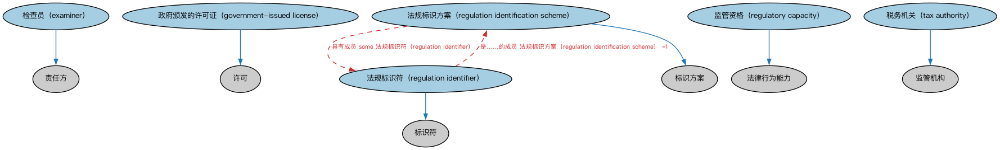

# 监管机构本体（Regulatory Agencies Ontology）结构与公理说明

本文档对应 `RegulatoryAgencies.rdf` / `RegulatoryAgencies.ttl`，说明该本体的类、继承关系、属性和公理约定。结构图见 `RegulatoryAgencies-structure.png`（`RegulatoryAgencies-structure.svg` 为可缩放版本）。

## 1. 本体概述

定义金融监管机构（regulatory agency）及其监管职能、管辖范围的通用概念。

**在体系中的位置**：FBC 功能实体模块的核心之一，美国、加拿大、欧盟监管机构个体本体都以它为基础。

**上下游关系**：上游依赖 BE 功能实体、政府实体与 FND 法律本体；下游被各区域监管机构本体及合规相关建模引用。

**与相近概念的差别**：监管机构≠登记机构——监管负责持续监督合规，登记负责主体注册；监管机构≠政府本身——它是政府设立的专门职能机构。

## 2. 类（Class）

| 类（Class） | 定义（Definition） |
|---|---|
| 检查员（examiner） | 由监管机构授权作为官方代表、对指定文件的准确性和真实性进行调查和审查的一方。 |
| 政府颁发的许可证（government-issued license） | 合法执行某项任务、提供某项服务、行使某项特权或从事某行业所需的许可授予。 |
| 法规标识方案（regulation identification scheme） | 用于组织法规信息并为法规分配标识符的方案。 |
| 法规标识符（regulation identifier） | 与某一项法规相关联的标识符。 |
| 监管资格（regulatory capacity） | 自然人凭借某监管机构的某项认证计划、代表其对某行业、组织或产品进行监管的资格。 |
| 税务机关（tax authority） | 对任何税种的核定、确定、征收、课征及其他相关事项具有管辖权的监管机构。 |

### 2.1 继承关系（Inheritance）

- 检查员（examiner） ⊑ 责任方
- 政府颁发的许可证（government-issued license） ⊑ 许可
- 法规标识方案（regulation identification scheme） ⊑ 标识方案
- 法规标识符（regulation identifier） ⊑ 标识符
- 监管资格（regulatory capacity） ⊑ 法律行为能力
- 税务机关（tax authority） ⊑ 监管机构

## 5. 公理约定（Axioms）

- 检查员（examiner）：由…扮演（is played by） 具有法律行为能力的自然人 =1
- 检查员（examiner）：由……授权 监管机构 =1
- 检查员（examiner）：由…扮演（is played by） some（具有能力方 some 监管资格（regulatory capacity））
- 政府颁发的许可证（government-issued license）：由……发行 some 监管机构
- 法规标识方案（regulation identification scheme）：具有成员 some 法规标识符（regulation identifier）
- 法规标识符（regulation identifier）：是……的成员 法规标识方案（regulation identification scheme） =1
- 法规标识符（regulation identifier）：标识 规章 =1
- 税务机关（tax authority）：发行 税务标识符 ≥0
- 税务机关（tax authority）：管理 some 税务识别方案
- 税务机关（tax authority）：具有管辖权 some 管辖权

## 6. 依赖（owl:imports，17 个）

本本体通过 `owl:imports` 引入以下本体，各项的中文名称与简介如下：

| 导入本体 | 中文名称 | 简介 |
|---|---|---|
| `BE/GovernmentEntities/GovernmentEntities.rdf` | 政府实体本体（Government Entities Ontology） | 定义政府、政体（polity）、法域（jurisdiction）及政府实体的核心概念，是各区域政府实体本体的共同基础。 |
| `BE/LegalEntities/LegalPersons.rdf` | 法律主体本体（Legal Persons Ontology） | 定义法律主体（legal person）与法定实体（legal entity）的核心概念：能持有权利义务、可起诉与被诉的主体。 |
| `FND/Agreements/Contracts.rdf` | 合同本体（Contracts Ontology） | 在协议之上定义具有法律约束力的合同（contract）：合同当事方、合同条款、义务与权利，是金融工具与交易合同建模的基石。 |
| `FND/Arrangements/Reporting.rdf` | 报告本体（Reporting Ontology） | 定义报告、报告方与报告内容的关系，支撑监管报告、财务报告等报送场景。 |
| `FND/Law/LegalCapacity.rdf` | 法律能力本体（Legal Capacity Ontology） | 定义法律能力、缔约能力、签章权等概念，刻画主体从事法律行为的资格。 |
| `FND/Law/LegalCore.rdf` | 法律核心本体（Legal Core Ontology） | 定义法域（jurisdiction）、法律、法规等核心法律概念，为监管主体与适用法律建模。 |
| `FND/Parties/Parties.rdf` | 参与方本体（Parties Ontology） | 定义参与方（party）、独立主体（autonomous agent）与「角色扮演」（party in role），是 FIBO 全库使用最广的基础本体之一。 |
| `FND/Relations/Relations.rdf` | 关系本体（Relations Ontology） | FIBO 最底层的基础本体，定义参考（reference）、分类（classify）等通用关系与抽象概念，全库普遍依赖。 |
| `FND/Utilities/AnnotationVocabulary.rdf` | FIBO 标注词汇表（FIBO Annotation Vocabulary） | 定义 FIBO 专用的标注属性（如释义来源、成熟度等级），用于本体自身的元数据标注。 |
| `https://www.omg.org/spec/Commons/AnnotationVocabulary/` | OMG 通用标注词汇表（OMG Commons Annotation Vocabulary） | OMG 通用本体库（Commons）中的标注词汇表，提供概念映射等标注属性，FIBO 用它标注术语与外部标准的对应关系。 |
| `https://www.omg.org/spec/Commons/BusinessAuthorizations/` | OMG 通用商业授权本体（OMG Commons Business Authorizations） | OMG 通用本体库（Commons）中的商业授权本体，定义授权、签章与代理权限的通用概念。 |
| `https://www.omg.org/spec/Commons/Collections/` | OMG 通用集合本体（OMG Commons Collections） | Commons 库中的集合本体，定义集合、成员等通用概念。 |
| `https://www.omg.org/spec/Commons/Designators/` | OMG 通用指称符本体（OMG Commons Designators） | Commons 库中的指称符本体，定义名称、标识符等「指代某物的符号」的通用概念。 |
| `https://www.omg.org/spec/Commons/Identifiers/` | OMG 通用标识符本体（OMG Commons Identifiers） | Commons 库中的标识符本体，定义标识符及其编码方案的通用概念。 |
| `https://www.omg.org/spec/Commons/Organizations/` | OMG 通用组织本体（OMG Commons Organizations） | Commons 库中的组织本体，定义组织、组织成员与组织结构的通用概念。 |
| `https://www.omg.org/spec/Commons/RegulatoryAgencies/` | OMG 通用监管机构本体（OMG Commons Regulatory Agencies） | Commons 库中的监管机构本体，定义监管机构及其监管职权的通用概念。 |
| `https://www.omg.org/spec/Commons/RolesAndCompositions/` | OMG 通用角色与构成本体（OMG Commons Roles and Compositions） | Commons 库中的角色本体，定义角色及整体—部分构成关系的通用概念。 |

## 7. 文件

- 官方 RDF/XML：`RegulatoryAgencies.rdf`
- 中文 Turtle：`RegulatoryAgencies.ttl`
- 结构图：`RegulatoryAgencies-structure.png` / `RegulatoryAgencies-structure.svg`