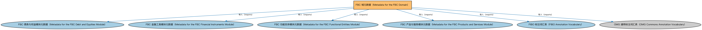

# FBC 域元数据（Metadata for the FBC Domain）说明

本文档对应 `MetadataFBC.rdf` / `MetadataFBC.ttl`。

## 1. 本文件是什么

声明金融商业与贸易（FBC）域由四个模块构成：债务与权益、金融工具、功能实体、产品与服务。

从机制上说，这是一个元数据清单（metadata manifest）文件：它本身不定义任何类或属性，而是通过 `dct:hasPart` 声明一个域或模块由哪些本体构成，并携带版本 IRI、版权、许可与成熟度等发布管理信息。它回答的问题是「这个域/模块包含什么、当前是什么版本」，供发布工具和文档系统按模块组织内容；它的 `owl:imports` 只引入标注词汇表，不是用来加载业务本体的入口（加载入口是 `All*` 与 `About*` 聚合文件）。

## 2. 声明的构成（dct:hasPart，4 个）

| 构成项 | 中文名称 | 简介 |
|---|---|---|
| `FBC/DebtAndEquities/MetadataFBCDebtAndEquities.rdf` | FBC 债务与权益模块元数据（Metadata for the FBC Debt and Equities Module） | 声明债务与权益（Debt and Equities）模块由债务、担保、信用评级、信用事件四个本体构成，及版本信息。 |
| `FBC/FinancialInstruments/MetadataFBCFinancialInstruments.rdf` | FBC 金融工具模块元数据（Metadata for the FBC Financial Instruments Module） | 声明金融工具（Financial Instruments）模块由金融工具、工具定价、结算三个本体构成，及版本信息。 |
| `FBC/FunctionalEntities/MetadataFBCFunctionalEntities.rdf` | FBC 功能实体模块元数据（Metadata for the FBC Functional Entities Module） | 声明功能实体（Functional Entities）模块的构成：金融服务实体、市场、监管机构、商业登记、商业中心及欧美区域扩展、各国参考个体等本体。 |
| `FBC/ProductsAndServices/MetadataFBCProductsAndServices.rdf` | FBC 产品与服务模块元数据（Metadata for the FBC Products and Services Module） | 声明产品与服务（Products and Services）模块由金融产品与服务、客户与账户两个本体构成，及版本信息。 |

## 3. 标注依赖（owl:imports，6 个）

以下导入仅用于支撑元数据标注本身（如成熟度等级、概念映射），不属于业务内容：

| 导入本体 | 中文名称 | 简介 |
|---|---|---|
| `FBC/DebtAndEquities/MetadataFBCDebtAndEquities.rdf` | FBC 债务与权益模块元数据（Metadata for the FBC Debt and Equities Module） | 声明债务与权益（Debt and Equities）模块由债务、担保、信用评级、信用事件四个本体构成，及版本信息。 |
| `FBC/FinancialInstruments/MetadataFBCFinancialInstruments.rdf` | FBC 金融工具模块元数据（Metadata for the FBC Financial Instruments Module） | 声明金融工具（Financial Instruments）模块由金融工具、工具定价、结算三个本体构成，及版本信息。 |
| `FBC/FunctionalEntities/MetadataFBCFunctionalEntities.rdf` | FBC 功能实体模块元数据（Metadata for the FBC Functional Entities Module） | 声明功能实体（Functional Entities）模块的构成：金融服务实体、市场、监管机构、商业登记、商业中心及欧美区域扩展、各国参考个体等本体。 |
| `FBC/ProductsAndServices/MetadataFBCProductsAndServices.rdf` | FBC 产品与服务模块元数据（Metadata for the FBC Products and Services Module） | 声明产品与服务（Products and Services）模块由金融产品与服务、客户与账户两个本体构成，及版本信息。 |
| `FND/Utilities/AnnotationVocabulary.rdf` | FIBO 标注词汇表（FIBO Annotation Vocabulary） | 定义 FIBO 专用的标注属性（如释义来源、成熟度等级），用于本体自身的元数据标注。 |
| `https://www.omg.org/spec/Commons/AnnotationVocabulary/` | OMG 通用标注词汇表（OMG Commons Annotation Vocabulary） | OMG 通用本体库（Commons）中的标注词汇表，提供概念映射等标注属性，FIBO 用它标注术语与外部标准的对应关系。 |

## 4. 文件

- 官方 RDF/XML：`MetadataFBC.rdf`
- 中文 Turtle：`MetadataFBC.ttl`
- 结构图：`MetadataFBC-structure.png` / `MetadataFBC-structure.svg`