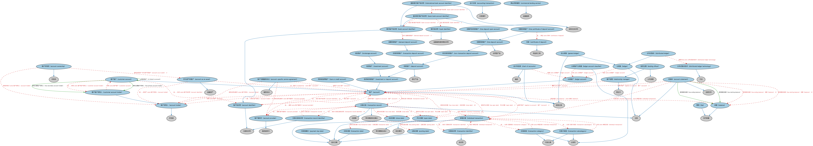

# 客户与账户本体（Clients and Accounts Ontology）结构与公理说明

本文档对应 `ClientsAndAccounts.rdf` / `ClientsAndAccounts.ttl`，说明该本体的类、继承关系、属性和公理约定。结构图见 `ClientsAndAccounts-structure.png`（`ClientsAndAccounts-structure.svg` 为可缩放版本）。

## 1. 本体概述

定义金融机构的客户（client）、账户（account）及账户持有关系：开户、账户类型、账户服务方。

**在体系中的位置**：FBC 产品与服务模块的两个核心本体之一。

**上下游关系**：上游依赖金融服务实体、FND 参与方与协议本体；下游被 LOAN（贷款账户）、卡账户等具体业务本体引用。

**与相近概念的差别**：客户≠账户持有人——客户是与机构有业务关系的主体，账户是服务的载体，一个客户可以有多个账户，联名账户有多个持有人。

本本体中类与类的核心关系如下（完整细节见各类小节）：

- **账户（account）** 继承 **财务记录（FinancialRecord）**
- **作为资产的账户（account as an asset）** 继承 **金融资产（FinancialAsset）**
- **账户持有人（account holder）** 继承 **所有者（Owner）**
- **账户标识符（account identifier）** 继承 **注册标识符（RegisteredIdentifier）**
- **账户所有权（account ownership）** 继承 **所有权（Ownership）**
- **账户提供方（account provider）** 继承 **服务提供方（ServiceProvider）**
- **对账单（account statement）** 继承 **法律文件（LegalDocument）**
- **对账单（account statement）** 继承 **记录（Record）**
- **账户专属服务协议（account-specific service agreement）** 继承 **服务协议（ServiceAgreement）**
- **会计交易（accounting transaction）** 继承 **交易事件（TransactionEvent）**
- **余额（balance）** 继承 **货币数量（MonetaryAmount）**
- **银行账户标识符（bank account identifier）** 继承 **账户标识符（account identifier）**
- 其余 56 条关系从略。

## 2. 类（Class）

| 类（Class） | 定义（Definition） |
|---|---|
| 账户（account） | 与常规交易和服务之业务安排相关记录的容器。 |
| 作为资产的账户（account as an asset） | 以账户形式存在的金融资产。 |
| 账户持有人（account holder） | 拥有账户的一方。 |
| 账户标识符（account identifier） | 表示某一账户的标识符。 |
| 账户所有权（account ownership） | 对账户的持有。 |
| 账户提供方（account provider） | 提供并服务账户的一方。 |
| 对账单（account statement） | 某一给定期间账户活动的定期汇总。 |
| 账户专属服务协议（account-specific service agreement） | 针对特定账户的服务协议，适用于客户在同一机构持有多个条款各异的账户的情形。 |
| 会计交易（accounting transaction） | 通过账户记录中的分录予以确认的事件。 |
| 余额（balance） | 可用或欠付的货币金额。 |
| 银行账户标识符（bank account identifier） | 标识银行提供的活期存款账户的标识符。 |
| 银行标识符（bank identifier） | 唯一标识金融机构的标识符，在适当时还标识为该账户提供服务的该机构分支机构。 |
| 基本银行账户标识符（basic bank account identifier） | 在特定国家唯一标识某一金融机构中某一账户的标识符，包含银行标识符（BBAN）。 |
| 经纪账户（brokerage account） | 由经纪商提供、允许投资者存入资金并下达投资指令的账户。 |
| 存单（certificate of deposit） | 与定期存款账户相关联、在一定期限（存期）内不可提取的现金类工具。 |
| 会计科目表（chart of accounts） | 依照适用法律、监管和报告要求对实体财务交易进行分类、记录和组织的结构化财务账户代码体系。 |
| 关闭日期（close date） | 某事物被关闭的日期。 |
| 商业贷款服务（commercial lending service） | 涉及为支持商业活动而提供信贷的服务。 |
| 客户账户（customer account） | 代表一组已识别、具名的余额和累计总额集合的账户，用于汇总某段期间与客户交易相关的活动。 |
| 客户账户持有人（customer account holder） | 拥有客户账户的一方。 |
| 活期存款账户（demand deposit account） | 不计息存款账户，存款可按要求立即支付，或原始期限或所需通知期极短。 |
| 存款账户（deposit account） | 记录存放于存款性机构保管和管理的资金的账户。 |
| 分布式账本（distributed ledger） | 在一组节点间共享、并通过共识机制在节点间同步的账本。 |
| 分布式账本技术（distributed ledger technology） | 使分布式账本得以运营和使用的方法。 |
| 费用（fee） | 对所提供服务收取的报酬。 |
| 总分类账（general ledger） | 用于在会计期间内随交易过账而记录和汇总头寸变化的有组织的分类账户集合。 |
| 单笔交易（individual transaction） | 具有货币影响、并记录在与账户相关联的记录中的事件。 |
| 国际银行账户标识符（international bank account identifier） | 基本银行账户号（BBAN）的扩展版本银行账户标识符，供国际使用（IBAN）。 |
| 投资账户（investment account） | 记录存放于金融机构的资金和/或证券的账户。 |
| 投资或存款账户（investment or deposit account） | 与要求账户持有人提供资金交由账户提供方管理的产品或服务相关联的账户。 |
| 分类账（ledger） | 业务活动和交易的有组织记录。 |
| 分类账户（ledger account） | 分类账中某一要素或子要素的单独记录，记录并汇总该特定科目的增加、减少和余额。 |
| 分类账户分类器（ledger account classifier） | 依照适用法律、监管和报告要求组织实体财务账户的分类器。 |
| 信贷主管（lending officer） | 对与特定借款人或账户的关系负总责的公司管理人员。 |
| 贷款或信用账户（loan or credit account） | 与账户持有人按特定还款条款和条件从账户提供方获得资金的服务相关联的账户。 |
| 非交易存款账户（non-transaction deposit account） | 任何未被明确视为交易账户的存款账户。 |
| 开立日期（open date） | 某事物被创建的日期。 |
| 付款到期日（payment due date） | 当期未偿余额、其部分金额或最低应付款额须支付给债权人的截止日期。 |
| 过账日期（posting date） | 决定凭证或日记账分录记入账户记录所属过账期间的日期。 |
| 客户经理（relationship manager） | 管理客户账户并维护其与服务提供商关系的责任方。 |
| 定期存单账户（time certificate of deposit account） | 允许以可转让或不可转让凭证证明的存款、或以收据证明的记账形式存款的定期存款账户。 |
| 定期存款账户（time deposit account） | 存款人无权、也不被允许在存款后六日内提取的存款账户，除非满足特定条件。 |
| 定期开放存款账户（time deposit open account） | 允许（定期存单以外的）存款、并与存款人订有有效书面合同的定期存款账户。 |
| 交易类别（transaction category） | 单笔交易的高层分类器。 |
| 交易日期（transaction date） | 特定交易发起的日期。 |
| 交易存款账户（transaction deposit account） | 存款人/账户持有人可通过可转让票据、支付指令等方式转账或取款的存款账户。 |
| 交易标识符（transaction identifier） | 与账户相关联的单笔交易的标识符。 |
| 交易记录（transaction record） | 与账户相关联的交易的记录。 |
| 交易记录标识符（transaction record identifier） | 交易记录的唯一标识符。 |
| 交易子类别（transaction subcategory） | 交易的第二层分类器，例如直接存款、支票、预借现金、取款、付款、购买等。 |

以下按类逐个展开：每个类给出继承关系、相关属性与公理约定；子类在父类之下降一级编号。

### 2.1 账户（account）

定义：与常规交易和服务之业务安排相关记录的容器。

- 父类：**财务记录（FinancialRecord）**
- 直接子类：**客户账户（customer account）**、**投资或存款账户（investment or deposit account）**、**分类账户（ledger account）**、**贷款或信用账户（loan or credit account）**

属性：

| 属性 | 定义 | 说明 |
|---|---|---|
| **具有余额（has balance）** | 将账户与该账户中可用的货币净额关联起来。 | 值域：余额（balance）；子属性：具有货币数量 |
| **具有关闭日期（has close date）** | 将某事物与其被关闭的日期关联起来。 | 值域：关闭日期（close date）；子属性：具有结束日期 |
| **具有开立日期（has open date）** | 将某事物与其被创建的日期关联起来。 | 值域：开立日期（open date）；子属性：具有显式日期 |
| **具有记录（hasRecord）** | — | — |
| **由……持有（isHeldBy）** | — | — |
| **由……标识（isIdentifiedBy）** | — | — |
| **由……提供（isProvidedBy）** | — | — |

公理：

- **具有余额（has balance）**至少有一个取值，类型是**余额（balance）**。
- **具有关闭日期（has close date）**可以有 0 个或多个**关闭日期（close date）**。
- **具有开立日期（has open date）**恰好有 1 个**开立日期（open date）**。
- **具有记录（hasRecord）**可以有 0 个或多个**交易记录（transaction record）**。
- **由……持有（isHeldBy）**可以有 0 个或多个**账户持有人（account holder）**。
- **由……提供（isProvidedBy）**至少有一个取值，类型是**账户提供方（account provider）**。
- **由……标识（isIdentifiedBy）**可以有 0 个或多个**账户标识符（account identifier）**。

#### 2.1.1 客户账户（customer account）

定义：代表一组已识别、具名的余额和累计总额集合的账户，用于汇总某段期间与客户交易相关的活动。

- 父类：**账户（account）**

属性：

| 属性 | 定义 | 说明 |
|---|---|---|
| **具有主要账户持有人（has primary account holder）** | 将账户与被视为账户主要所有者的客户关联起来。 | 值域：客户账户持有人（customer account holder）；子属性：由……持有 |
| **具有次要账户持有人（has secondary account holder）** | 将账户与被视为账户次要有人的客户（共同所有人）关联起来。 | 值域：客户账户持有人（customer account holder）；子属性：由……持有 |
| **关联至账户（is linked to account）** | 将给定客户账户与另一客户账户连接起来。 | 值域：客户账户（customer account）；子属性：关联于 |
| **例证（exemplifies）** | — | — |
| **由……持有（isHeldBy）** | — | — |
| **定义于（isDefinedIn）** | — | — |
| **由……标识（isIdentifiedBy）** | — | — |
| **由……提供（isProvidedBy）** | — | — |

公理：

- **例证（exemplifies）**至少有一个取值，该取值满足：该属性存在取值约束。
- **定义于（isDefinedIn）**至少有一个取值，类型是**服务协议（ServiceAgreement）**。
- **由……持有（isHeldBy）**至少有一个取值，类型是**客户账户持有人（customer account holder）**。
- **由……提供（isProvidedBy）**至少有一个取值，该取值满足：该属性存在取值约束。
- **由……标识（isIdentifiedBy）**至少有一个取值，类型是**账户标识符（account identifier）**。

#### 2.1.2 投资或存款账户（investment or deposit account）

定义：与要求账户持有人提供资金交由账户提供方管理的产品或服务相关联的账户。

- 父类：**账户（account）**
- 直接子类：**存款账户（deposit account）**、**投资账户（investment account）**

##### 2.1.2.1 存款账户（deposit account）

定义：记录存放于存款性机构保管和管理的资金的账户。

- 父类：**银行产品（BankingProduct）**、**投资或存款账户（investment or deposit account）**
- 直接子类：**非交易存款账户（non-transaction deposit account）**、**交易存款账户（transaction deposit account）**

属性：

| 属性 | 定义 | 说明 |
|---|---|---|
| **由……提供（isProvidedBy）** | — | — |

公理：

- **由……提供（isProvidedBy）**至少有一个取值，类型是**存款性机构（DepositoryInstitution）**。

###### 2.1.2.1.1 非交易存款账户（non-transaction deposit account）

定义：任何未被明确视为交易账户的存款账户。

- 父类：**存款账户（deposit account）**
- 直接子类：**定期存款账户（time deposit account）**

公理：

- 与**交易存款账户（transaction deposit account）**互斥：同一个体不能同时属于两者。

###### 2.1.2.1.1.1 定期存款账户（time deposit account）

定义：存款人无权、也不被允许在存款后六日内提取的存款账户，除非满足特定条件。

- 父类：**非交易存款账户（non-transaction deposit account）**、**合同型产品（ContractualProduct）**
- 直接子类：**定期存单账户（time certificate of deposit account）**、**定期开放存款账户（time deposit open account）**

###### 2.1.2.1.1.1.1 定期存单账户（time certificate of deposit account）

定义：允许以可转让或不可转让凭证证明的存款、或以收据证明的记账形式存款的定期存款账户。

- 父类：**定期存款账户（time deposit account）**

属性：

| 属性 | 定义 | 说明 |
|---|---|---|
| **由……例证（isExemplifiedBy）** | — | — |

公理：

- **由……例证（isExemplifiedBy）**至少有一个取值，类型是**存单（certificate of deposit）**。

###### 2.1.2.1.1.1.2 定期开放存款账户（time deposit open account）

定义：允许（定期存单以外的）存款、并与存款人订有有效书面合同的定期存款账户。

- 父类：**定期存款账户（time deposit account）**

公理：

- 与**定期存单账户（time certificate of deposit account）**互斥：同一个体不能同时属于两者。

###### 2.1.2.1.2 交易存款账户（transaction deposit account）

定义：存款人/账户持有人可通过可转让票据、支付指令等方式转账或取款的存款账户。

- 父类：**存款账户（deposit account）**
- 直接子类：**活期存款账户（demand deposit account）**

###### 2.1.2.1.2.1 活期存款账户（demand deposit account）

定义：不计息存款账户，存款可按要求立即支付，或原始期限或所需通知期极短。

- 父类：**交易存款账户（transaction deposit account）**

##### 2.1.2.2 投资账户（investment account）

定义：记录存放于金融机构的资金和/或证券的账户。

- 父类：**投资或存款账户（investment or deposit account）**
- 直接子类：**经纪账户（brokerage account）**

属性：

| 属性 | 定义 | 说明 |
|---|---|---|
| **由……提供（isProvidedBy）** | — | — |

公理：

- **由……提供（isProvidedBy）**至少有一个取值，类型是**金融机构（FinancialInstitution）**。

###### 2.1.2.2.1 经纪账户（brokerage account）

定义：由经纪商提供、允许投资者存入资金并下达投资指令的账户。

- 父类：**投资账户（investment account）**

属性：

| 属性 | 定义 | 说明 |
|---|---|---|
| **由……提供（isProvidedBy）** | — | — |

公理：

- **由……提供（isProvidedBy）**至少有一个取值，该取值满足：该属性存在取值约束。

#### 2.1.3 分类账户（ledger account）

定义：分类账中某一要素或子要素的单独记录，记录并汇总该特定科目的增加、减少和余额。

- 父类：**账户（account）**

#### 2.1.4 贷款或信用账户（loan or credit account）

定义：与账户持有人按特定还款条款和条件从账户提供方获得资金的服务相关联的账户。

- 父类：**账户（account）**

公理：

- 与**投资或存款账户（investment or deposit account）**互斥：同一个体不能同时属于两者。

### 2.2 作为资产的账户（account as an asset）

定义：以账户形式存在的金融资产。

- 父类：**金融资产（FinancialAsset）**

属性：

| 属性 | 定义 | 说明 |
|---|---|---|
| **是……的资产（isAssetOf）** | — | — |
| **由…扮演（is played by）** | — | — |

公理：

- **是……的资产（isAssetOf）**至少有一个取值，类型是**账户持有人（account holder）**。
- **由…扮演（is played by）**至少有一个取值，类型是**账户（account）**。

### 2.3 账户持有人（account holder）

定义：拥有账户的一方。

- 父类：**所有者（Owner）**
- 直接子类：**客户账户持有人（customer account holder）**

属性：

| 属性 | 定义 | 说明 |
|---|---|---|
| **持有（holds）** | — | — |
| **由…扮演（is played by）** | — | — |

公理：

- **持有（holds）**至少有一个取值，类型是**账户（account）**。
- **由…扮演（is played by）**至少有一个取值，该取值满足：**拥有（owns）**至少有一个取值，类型是**账户（account）**。
- **由…扮演（is played by）**至少有一个取值，该取值满足：**是…的参与方（is a party to）**至少有一个取值，类型是**账户（account）**。

#### 2.3.1 客户账户持有人（customer account holder）

定义：拥有客户账户的一方。

- 父类：**账户持有人（account holder）**

属性：

| 属性 | 定义 | 说明 |
|---|---|---|
| **持有（holds）** | — | — |

公理：

- **持有（holds）**至少有一个取值，类型是**客户账户（customer account）**。
- 该属性存在取值约束。

### 2.4 账户标识符（account identifier）

定义：表示某一账户的标识符。

- 父类：**注册标识符（RegisteredIdentifier）**
- 直接子类：**银行账户标识符（bank account identifier）**

属性：

| 属性 | 定义 | 说明 |
|---|---|---|
| **标识（identifies）** | — | — |

公理：

- **标识（identifies）**恰好有 1 个**账户（account）**。

#### 2.4.1 银行账户标识符（bank account identifier）

定义：标识银行提供的活期存款账户的标识符。

- 父类：**账户标识符（account identifier）**
- 直接子类：**基本银行账户标识符（basic bank account identifier）**、**国际银行账户标识符（international bank account identifier）**

属性：

| 属性 | 定义 | 说明 |
|---|---|---|
| **标识（identifies）** | — | — |

公理：

- **标识（identifies）**恰好有 1 个**活期存款账户（demand deposit account）**。

##### 2.4.1.1 基本银行账户标识符（basic bank account identifier）

定义：在特定国家唯一标识某一金融机构中某一账户的标识符，包含银行标识符（BBAN）。

- 父类：**银行账户标识符（bank account identifier）**、**结构化标识符（StructuredIdentifier）**

属性：

| 属性 | 定义 | 说明 |
|---|---|---|
| **包含（comprises）** | — | — |

公理：

- **包含（comprises）**恰好有 1 个**银行标识符（bank identifier）**。
- **包含（comprises）**恰好有 1 个**银行账户标识符（bank account identifier）**。

##### 2.4.1.2 国际银行账户标识符（international bank account identifier）

定义：基本银行账户号（BBAN）的扩展版本银行账户标识符，供国际使用（IBAN）。

- 父类：**银行账户标识符（bank account identifier）**、**结构化标识符（StructuredIdentifier）**

属性：

| 属性 | 定义 | 说明 |
|---|---|---|
| **包含（comprises）** | — | — |

公理：

- **包含（comprises）**恰好有 1 个**地理区域标识符（GeographicRegionIdentifier）**。
- **包含（comprises）**恰好有 1 个**基本银行账户标识符（basic bank account identifier）**。

### 2.5 账户所有权（account ownership）

定义：对账户的持有。

- 父类：**所有权（Ownership）**

属性：

| 属性 | 定义 | 说明 |
|---|---|---|
| **具有自有资产（hasOwnedAsset）** | — | — |
| **具有所有方（hasOwningParty）** | — | — |

公理：

- **具有所有方（hasOwningParty）**至少有一个取值，类型是**账户持有人（account holder）**。
- **具有自有资产（hasOwnedAsset）**恰好有 1 个**作为资产的账户（account as an asset）**。

### 2.6 账户提供方（account provider）

定义：提供并服务账户的一方。

- 父类：**服务提供方（ServiceProvider）**

属性：

| 属性 | 定义 | 说明 |
|---|---|---|
| **由…扮演（is played by）** | — | — |

公理：

- **由…扮演（is played by）**至少有一个取值，该取值满足：**是…的参与方（is a party to）**至少有一个取值，类型是**账户（account）**。

### 2.7 对账单（account statement）

定义：某一给定期间账户活动的定期汇总。

- 父类：**法律文件（LegalDocument）**、**记录（Record）**

属性：

| 属性 | 定义 | 说明 |
|---|---|---|
| **适用于账户（applies to account）** | 指明交易记录或单笔交易所适用的账户。 | 值域：账户（account）；子属性：适用于 |
| **具有期末余额（has ending balance）** | 将对账单与账单期间结束时账户中的可用金额关联起来。 | 值域：余额（balance）；子属性：具有余额（has balance） |
| **具有期初余额（has starting balance）** | 将对账单与账单期间开始时账户中的可用金额关联起来。 | 值域：余额（balance）；子属性：具有余额（has balance） |
| **记录交易（records transaction）** | 将对账单与其所记载的单笔交易关联起来。 | — |
| **具有报告期（hasReportingPeriod）** | — | — |

公理：

- **具有报告期（hasReportingPeriod）**至多有 1 个**显式日期区间（ExplicitDatePeriod）**。
- **具有期初余额（has starting balance）**至多有 1 个**余额（balance）**。
- **具有期末余额（has ending balance）**至多有 1 个**余额（balance）**。
- **记录交易（records transaction）**至少有一个取值，类型是**单笔交易（individual transaction）**。
- **适用于账户（applies to account）**恰好有 1 个**账户（account）**。

### 2.8 账户专属服务协议（account-specific service agreement）

定义：针对特定账户的服务协议，适用于客户在同一机构持有多个条款各异的账户的情形。

- 父类：**服务协议（ServiceAgreement）**

属性：

| 属性 | 定义 | 说明 |
|---|---|---|
| **具有合同当事方（hasContractParty）** | — | — |
| **适用于（appliesTo）** | — | — |

公理：

- **具有合同当事方（hasContractParty）**至少有一个取值，类型是**账户持有人（account holder）**。
- **具有合同当事方（hasContractParty）**至少有一个取值，类型是**账户提供方（account provider）**。
- **适用于（appliesTo）**至少有一个取值，类型是**账户（account）**。

### 2.9 会计交易（accounting transaction）

定义：通过账户记录中的分录予以确认的事件。

- 父类：**交易事件（TransactionEvent）**

### 2.10 余额（balance）

定义：可用或欠付的货币金额。

- 父类：**货币数量（MonetaryAmount）**

### 2.11 银行标识符（bank identifier）

定义：唯一标识金融机构的标识符，在适当时还标识为该账户提供服务的该机构分支机构。

- 父类：**金融服务提供商标识符（FinancialServiceProviderIdentifier）**

属性：

| 属性 | 定义 | 说明 |
|---|---|---|
| **标识（identifies）** | — | — |

公理：

- **标识（identifies）**恰好有 1 个**金融机构（FinancialInstitution）**。

### 2.12 存单（certificate of deposit）

定义：与定期存款账户相关联、在一定期限（存期）内不可提取的现金类工具。

- 父类：**现金类工具（CashInstrument）**

属性：

| 属性 | 定义 | 说明 |
|---|---|---|
| **具有利率（hasInterestRate）** | — | — |
| **具有名义价值（hasNominalValue）** | — | — |
| **具有合同期限（hasContractDuration）** | — | — |

公理：

- **具有利率（hasInterestRate）**恰好有 1 个**利率（InterestRate）**。
- **具有合同期限（hasContractDuration）**恰好有 1 个**时长（Duration）**。
- **具有名义价值（hasNominalValue）**恰好有 1 个**货币数量（MonetaryAmount）**。

### 2.13 会计科目表（chart of accounts）

定义：依照适用法律、监管和报告要求对实体财务交易进行分类、记录和组织的结构化财务账户代码体系。

- 父类：**财务记录（FinancialRecord）**、**编排（Arrangement）**

属性：

| 属性 | 定义 | 说明 |
|---|---|---|
| **刻画（characterizes）** | — | — |

公理：

- **刻画（characterizes）**至少有一个取值，类型是**分类账户（ledger account）**。

### 2.14 关闭日期（close date）

定义：某事物被关闭的日期。

- 父类：**显式日期（ExplicitDate）**

### 2.15 商业贷款服务（commercial lending service）

定义：涉及为支持商业活动而提供信贷的服务。

- 父类：**金融服务（FinancialService）**

### 2.16 分布式账本技术（distributed ledger technology）

定义：使分布式账本得以运营和使用的方法。

- 父类：**方法（Method）**

### 2.17 费用（fee）

定义：对所提供服务收取的报酬。

- 父类：**货币数量（MonetaryAmount）**

### 2.18 单笔交易（individual transaction）

定义：具有货币影响、并记录在与账户相关联的记录中的事件。

- 父类：**带日期集合成分（DatedCollectionConstituent）**、**发生事项（Occurrence）**

属性：

| 属性 | 定义 | 说明 |
|---|---|---|
| **适用于账户（applies to account）** | 指明交易记录或单笔交易所适用的账户。 | 值域：账户（account）；子属性：适用于 |
| **具有过账日期（has posting date）** | 指明交易过账至账户的日期。 | 值域：过账日期（posting date）；子属性：具有显式日期 |
| **具有交易日期（has transaction date）** | 指明交易实际发生的日期。 | 值域：交易日期（transaction date）；子属性：具有显式日期 |
| **具有交易描述（has transaction description）** | 提供交易的文字描述。 | 值域：xsd:string |
| **涉及商户（involves merchant）** | 指明交易中涉及的商户（卖方）。 | 值域：商户；子属性：涉及 |
| **具有货币数量（hasMonetaryAmount）** | — | — |
| **例证（exemplifies）** | — | — |
| **由……分类（isClassifiedBy）** | — | — |
| **由……标识（isIdentifiedBy）** | — | — |
| **注册于（isRegisteredIn）** | — | — |

公理：

- **例证（exemplifies）**可以有 0 个或多个**交易事件（TransactionEvent）**。
- **具有交易描述（has transaction description）**存在取值约束。
- **具有交易日期（has transaction date）**恰好有 1 个**交易日期（transaction date）**。
- **具有货币数量（hasMonetaryAmount）**恰好有 1 个**货币数量（MonetaryAmount）**。
- **具有过账日期（has posting date）**恰好有 1 个**过账日期（posting date）**。
- **注册于（isRegisteredIn）**的所有取值只能是**交易记录（transaction record）**。
- **涉及商户（involves merchant）**可以有 0 个或多个**商户（Merchant）**。
- **由……分类（isClassifiedBy）**可以有 0 个或多个**交易子类别（transaction subcategory）**。
- **由……分类（isClassifiedBy）**可以有 0 个或多个**交易类别（transaction category）**。
- **由……标识（isIdentifiedBy）**至多有 1 个**交易标识符（transaction identifier）**。
- **适用于账户（applies to account）**恰好有 1 个**账户（account）**。

### 2.19 分类账（ledger）

定义：业务活动和交易的有组织记录。

- 父类：**记录（Record）**
- 直接子类：**分布式账本（distributed ledger）**、**总分类账（general ledger）**

属性：

| 属性 | 定义 | 说明 |
|---|---|---|
| **包含（comprises）** | — | — |

公理：

- **包含（comprises）**至少有一个取值，类型是**分类账户（ledger account）**。

#### 2.19.1 分布式账本（distributed ledger）

定义：在一组节点间共享、并通过共识机制在节点间同步的账本。

- 父类：**分类账（ledger）**

属性：

| 属性 | 定义 | 说明 |
|---|---|---|
| **使用方法（usesMethod）** | — | — |

公理：

- **使用方法（usesMethod）**至少有一个取值，类型是**分布式账本技术（distributed ledger technology）**。

#### 2.19.2 总分类账（general ledger）

定义：用于在会计期间内随交易过账而记录和汇总头寸变化的有组织的分类账户集合。

- 父类：**分类账（ledger）**、**财务记录（FinancialRecord）**

### 2.20 分类账户分类器（ledger account classifier）

定义：依照适用法律、监管和报告要求组织实体财务账户的分类器。

- 父类：**分类符（Classifier）**

属性：

| 属性 | 定义 | 说明 |
|---|---|---|
| **分类（classifies）** | — | — |
| **定义于（isDefinedIn）** | — | — |

公理：

- **分类（classifies）**至少有一个取值，类型是**分类账户（ledger account）**。
- **定义于（isDefinedIn）**的取值固定为 LedgerAccountClassificationScheme。

### 2.21 开立日期（open date）

定义：某事物被创建的日期。

- 父类：**显式日期（ExplicitDate）**

### 2.22 付款到期日（payment due date）

定义：当期未偿余额、其部分金额或最低应付款额须支付给债权人的截止日期。

- 父类：**显式日期（ExplicitDate）**

### 2.23 过账日期（posting date）

定义：决定凭证或日记账分录记入账户记录所属过账期间的日期。

- 父类：**显式日期（ExplicitDate）**

### 2.24 客户经理（relationship manager）

定义：管理客户账户并维护其与服务提供商关系的责任方。

- 父类：**责任方（ResponsibleParty）**
- 直接子类：**信贷主管（lending officer）**

属性：

| 属性 | 定义 | 说明 |
|---|---|---|
| **管理（manages）** | — | — |

公理：

- **管理（manages）**至少有一个取值，类型是**账户（account）**。

#### 2.24.1 信贷主管（lending officer）

定义：对与特定借款人或账户的关系负总责的公司管理人员。

- 父类：**公司高管（CorporateOfficer）**、**客户经理（relationship manager）**

### 2.25 交易类别（transaction category）

定义：单笔交易的高层分类器。

- 父类：**分类符（Classifier）**、**代码元素（CodeElement）**

属性：

| 属性 | 定义 | 说明 |
|---|---|---|
| **分类（classifies）** | — | — |
| **具有标签（hasTag）** | — | — |

公理：

- **具有标签（hasTag）**存在取值约束。
- **分类（classifies）**至少有一个取值，类型是**单笔交易（individual transaction）**。

### 2.26 交易日期（transaction date）

定义：特定交易发起的日期。

- 父类：**显式日期（ExplicitDate）**

### 2.27 交易标识符（transaction identifier）

定义：与账户相关联的单笔交易的标识符。

- 父类：**标识符（Identifier）**

属性：

| 属性 | 定义 | 说明 |
|---|---|---|
| **标识（identifies）** | — | — |

公理：

- **标识（identifies）**恰好有 1 个**单笔交易（individual transaction）**。

### 2.28 交易记录（transaction record）

定义：与账户相关联的交易的记录。

- 父类：**带日期结构化集合（DatedStructuredCollection）**、**记录（Record）**、**注册簿（Registry）**

属性：

| 属性 | 定义 | 说明 |
|---|---|---|
| **适用于账户（applies to account）** | 指明交易记录或单笔交易所适用的账户。 | 值域：账户（account）；子属性：适用于 |
| **具有关闭日期（has close date）** | 将某事物与其被关闭的日期关联起来。 | 值域：关闭日期（close date）；子属性：具有结束日期 |
| **具有开立日期（has open date）** | 将某事物与其被创建的日期关联起来。 | 值域：开立日期（open date）；子属性：具有显式日期 |
| **具有交易记录状态（has transaction record status）** | 指明交易记录的状态。 | 值域：xsd:string |
| **包含（comprises）** | — | — |
| **由……标识（isIdentifiedBy）** | — | — |
| **由……管理（isManagedBy）** | — | — |

公理：

- **具有交易记录状态（has transaction record status）**存在取值约束。
- **具有关闭日期（has close date）**可以有 0 个或多个**关闭日期（close date）**。
- **具有开立日期（has open date）**可以有 0 个或多个**开立日期（open date）**。
- **包含（comprises）**可以有 0 个或多个**单笔交易（individual transaction）**。
- **由……标识（isIdentifiedBy）**至多有 1 个**交易记录标识符（transaction record identifier）**。
- **由……管理（isManagedBy）**恰好有 1 个**账户提供方（account provider）**。
- **适用于账户（applies to account）**恰好有 1 个**账户（account）**。

### 2.29 交易记录标识符（transaction record identifier）

定义：交易记录的唯一标识符。

- 父类：**注册标识符（RegisteredIdentifier）**

属性：

| 属性 | 定义 | 说明 |
|---|---|---|
| **具有标签（hasTag）** | — | — |
| **标识（identifies）** | — | — |

公理：

- **具有标签（hasTag）**存在取值约束。
- **标识（identifies）**恰好有 1 个**交易记录（transaction record）**。

### 2.30 交易子类别（transaction subcategory）

定义：交易的第二层分类器，例如直接存款、支票、预借现金、取款、付款、购买等。

- 父类：**分类符（Classifier）**、**代码元素（CodeElement）**

属性：

| 属性 | 定义 | 说明 |
|---|---|---|
| **分类（classifies）** | — | — |
| **具有标签（hasTag）** | — | — |

公理：

- **具有标签（hasTag）**存在取值约束。
- **分类（classifies）**至少有一个取值，类型是**单笔交易（individual transaction）**。

## 3. 其他属性

以下属性未绑定到本体的具体类（定义域在外部本体或未声明）：

对象属性（Object Property）：

| 属性 | 定义 | 说明 |
|---|---|---|
| **具有对应账户（has corresponding account）** | 将信贷协议与用作交易管理基础的账户关联起来。 | 值域：贷款或信用账户（loan or credit account）；子属性：关联于 |
| **具有付款到期日（has payment due date）** | 指明某笔款项须支付给债权人的截止日期。 | 值域：付款到期日（payment due date）；子属性：具有显式日期 |

## 4. 依赖（owl:imports，34 个）

本本体通过 `owl:imports` 引入以下本体，各项的中文名称与简介如下：

| 导入本体 | 中文名称 | 简介 |
|---|---|---|
| `BE/FunctionalEntities/FunctionalEntities.rdf` | 功能实体本体（Functional Entities Ontology） | 定义「功能实体」：按其在商业中承担的功能（而非法律形式）刻画的实体，是出版方、登记机构等功能性主体的基础。 |
| `BE/OwnershipAndControl/Executives.rdf` | 高管本体（Executives Ontology） | 定义公司高管（executive）、董事会成员及其职务角色，刻画「谁在管理公司」。 |
| `FBC/DebtAndEquities/Debt.rdf` | 债务本体（Debt Ontology） | 定义债务（debt）与债权债务关系的核心概念：借款人、贷款人、本金与利息义务。 |
| `FBC/FinancialInstruments/FinancialInstruments.rdf` | 金融工具本体（Financial Instruments Ontology） | FIBO 核心本体之一，定义金融工具（financial instrument）的通用概念：可交易、代表某种权利义务的合同工具，是证券、衍生品等具体工具的共同基础。 |
| `FBC/FunctionalEntities/BusinessRegistries.rdf` | 商业登记机构本体（Business Registries Ontology） | 定义商业登记机构（如公司注册处）及其登记职能。 |
| `FBC/FunctionalEntities/FinancialServicesEntities.rdf` | 金融服务实体本体（Financial Services Entities Ontology） | FBC 域核心本体，定义金融服务机构（银行、券商、保险公司、资管机构等）的功能分类体系。 |
| `FBC/ProductsAndServices/FinancialProductsAndServices.rdf` | 金融产品与服务本体（Financial Products and Services Ontology） | 定义金融产品（financial product）与金融服务（financial service）及其提供、购买关系。 |
| `FND/Accounting/CurrencyAmount.rdf` | 货币金额本体（Currency Amount Ontology） | 定义「金额＋币种」的货币金额（currency amount）表示，是 FIBO 中表达价格、债务金额、付款额等一切带币种数值的基础构件。 |
| `FND/Agreements/Contracts.rdf` | 合同本体（Contracts Ontology） | 在协议之上定义具有法律约束力的合同（contract）：合同当事方、合同条款、义务与权利，是金融工具与交易合同建模的基石。 |
| `FND/Arrangements/Documents.rdf` | 文档本体（Documents Ontology） | 定义文档、文档类型及文档与其所记载内容的关系，为合同文本、募集说明书等法律文书建模。 |
| `FND/DatesAndTimes/FinancialDates.rdf` | 金融日期本体（Financial Dates Ontology） | 定义金融语境下的日期与期间概念：结算日、付息日、到期日、日计数基准等。 |
| `FND/DatesAndTimes/Occurrences.rdf` | 事件与发生本体（Occurrences Ontology） | 定义「发生」（occurrence）、事件与触发条件，用于表达企业行动、信用事件等「发生了什么」。 |
| `FND/GoalsAndObjectives/Objectives.rdf` | 目标本体（Objectives Ontology） | 定义目标（objective）及其与组织、计划的关系，用于表达机构的经营目标与投资目标。 |
| `FND/OwnershipAndControl/Ownership.rdf` | 所有权本体（Ownership Ontology） | 定义「拥有」关系：所有者、被拥有资产及所有权份额。 |
| `FND/ProductsAndServices/ProductsAndServices.rdf` | 产品与服务本体（Products and Services Ontology） | 定义产品、服务及其提供者与客户的通用关系。 |
| `FND/Relations/Relations.rdf` | 关系本体（Relations Ontology） | FIBO 最底层的基础本体，定义参考（reference）、分类（classify）等通用关系与抽象概念，全库普遍依赖。 |
| `FND/Utilities/AnnotationVocabulary.rdf` | FIBO 标注词汇表（FIBO Annotation Vocabulary） | 定义 FIBO 专用的标注属性（如释义来源、成熟度等级），用于本体自身的元数据标注。 |
| `https://www.omg.org/spec/Commons/AnnotationVocabulary/` | OMG 通用标注词汇表（OMG Commons Annotation Vocabulary） | OMG 通用本体库（Commons）中的标注词汇表，提供概念映射等标注属性，FIBO 用它标注术语与外部标准的对应关系。 |
| `https://www.omg.org/spec/Commons/BusinessAuthorizations/` | OMG 通用商业授权本体（OMG Commons Business Authorizations） | OMG 通用本体库（Commons）中的商业授权本体，定义授权、签章与代理权限的通用概念。 |
| `https://www.omg.org/spec/Commons/Classifiers/` | OMG 通用分类器本体（OMG Commons Classifiers） | OMG 通用本体库（Commons）中的分类器本体，定义分类方案、类别与归类关系的通用概念，FIBO 的分类建模建立在其上。 |
| `https://www.omg.org/spec/Commons/CodesAndCodeSets/` | OMG 通用代码与代码集本体（OMG Commons Codes and Code Sets） | Commons 库中的代码本体，定义代码、代码集及其维护方的通用概念，是 ISO 4217、ISO 3166 等编码体系建模的基础。 |
| `https://www.omg.org/spec/Commons/Collections/` | OMG 通用集合本体（OMG Commons Collections） | Commons 库中的集合本体，定义集合、成员等通用概念。 |
| `https://www.omg.org/spec/Commons/ContextualDesignators/` | OMG 通用语境指称本体（OMG Commons Contextual Designators） | Commons 库中的语境指称本体，定义「在某个语境下指代某物的名称/符号」，是地址、账户号码等语境相关标识的基础。 |
| `https://www.omg.org/spec/Commons/ContextualIdentifiers/` | OMG 通用语境标识符本体（OMG Commons Contextual Identifiers） | Commons 库中的语境标识符本体，定义在特定语境下唯一标识事物的标识符结构，是地址、账户类标识的基础。 |
| `https://www.omg.org/spec/Commons/DatesAndTimes/` | OMG 通用日期与时间本体（OMG Commons Dates and Times） | Commons 库中的日期时间本体，定义日期、期间、时间点等通用时间概念。 |
| `https://www.omg.org/spec/Commons/Designators/` | OMG 通用指称符本体（OMG Commons Designators） | Commons 库中的指称符本体，定义名称、标识符等「指代某物的符号」的通用概念。 |
| `https://www.omg.org/spec/Commons/Documents/` | OMG 通用文档本体（OMG Commons Documents） | Commons 库中的文档本体，定义文档及其组成部分的通用概念。 |
| `https://www.omg.org/spec/Commons/Identifiers/` | OMG 通用标识符本体（OMG Commons Identifiers） | Commons 库中的标识符本体，定义标识符及其编码方案的通用概念。 |
| `https://www.omg.org/spec/Commons/Locations/` | OMG 通用位置本体（OMG Commons Locations） | Commons 库中的位置本体，定义地理位置、地点的通用概念。 |
| `https://www.omg.org/spec/Commons/Organizations/` | OMG 通用组织本体（OMG Commons Organizations） | Commons 库中的组织本体，定义组织、组织成员与组织结构的通用概念。 |
| `https://www.omg.org/spec/Commons/PartiesAndSituations/` | OMG 通用参与方与情境本体（OMG Commons Parties and Situations） | Commons 库中的参与方本体，定义独立主体、参与方及其角色扮演的通用概念，是 FIBO 参与方模型的上游。 |
| `https://www.omg.org/spec/Commons/RegistrationAuthorities/` | OMG 通用登记主管机构本体（OMG Commons Registration Authorities） | Commons 库中的登记主管机构本体，定义负责登记注册的主管机构及其登记行为的通用概念。 |
| `https://www.omg.org/spec/Commons/RolesAndCompositions/` | OMG 通用角色与构成本体（OMG Commons Roles and Compositions） | Commons 库中的角色本体，定义角色及整体—部分构成关系的通用概念。 |
| `https://www.omg.org/spec/Commons/TextDatatype/` | OMG 通用文本数据类型（OMG Commons Text Datatype） | Commons 库中的文本数据类型定义，提供带语言标记的文本等基础数据类型。 |

## 5. 文件

- 官方 RDF/XML：`ClientsAndAccounts.rdf`
- 中文 Turtle：`ClientsAndAccounts.ttl`
- 结构图：`ClientsAndAccounts-structure.png` / `ClientsAndAccounts-structure.svg`